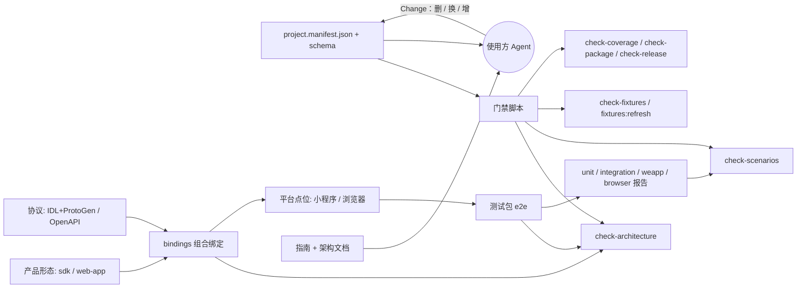

# 模板技术架构

本文件回答"解决什么问题、为什么这样设计"；[模板使用指南](template-guide.md)回答"怎么用、怎么换"。两者分工固定：指南的操作步骤发生变化时改指南，能力本身新增、替换或删除时同时改本文件（根 AGENTS 执行规则 13）。

## 粗略层

### 模板要解决的问题

每个新项目反复遇到的不是业务逻辑，而是两类工程问题：

- 架构问题：包边界与产物形态、协议来源与生成物、平台适配、外部服务的测试替身、构建与发布，每次都要从头决定一遍；交给 Agent 决定，每个项目结果都不一样，也难以评审。
- 质量问题：需求、测试与代码之间没有可机械核对的联系。测试全绿不代表每条需求都有证据；需求或代码改了，旧证据仍会被当作有效；"门禁全绿"是否真的检查到了该检查的东西，也无从得知。

模板把这两类问题的解固化成可运行的清单、门禁与文档。技术架构由清单登记、门禁核对；质量体系以 Spec Scenario 为唯一 ID，贯通用例、Fixture、Shadow 与报告，由场景门禁对账，来源一变旧证据立即失效。产品形态、协议来源与运行平台是替换点，当前并列提供"SDK + IDL + 小程序"与"Web 应用 + OpenAPI + 浏览器"两套实现，后续可按同一方式扩展其他端。使用方（主要是 Agent）照着改，而不是从头决定一套工程方案。

### 整体架构

多包职责：`sdk` 产品包导出 Headless SDK 公共入口与领域分层，Web 产品包承载 Vue 应用装配、组件树与状态分层；IDL 与 OpenAPI 协议包分别承载契约、生成入口、通信执行器和路由构造器；`bindings` 把产品、协议与平台点位组合起来。测试包承载来源化 Fixture、驱动、宿主、报告器、协议无关 Shadow 与本地预览。门禁只从清单读取包、命令、测试项目、绑定与发布设置；使用方按指南改清单与对应文件，不改门禁代码。

### 质量体系主线

Spec 定义需求与 Scenario，Scenario 自带 `json verification` 元数据（checkpoint 与 case）→ 用例按 case 绑定 Spec、Fixture 与运行环境 → Fixture 与 Shadow 提供受控输入与替身 → 各测试项目产出带来源摘要的报告 → 场景门禁用报告对账 Spec、绑定与证据，问题数为 0 才算通过 → 归档前确认清单、绑定、报告与来源摘要一致。

防"门禁全绿但没检查到"的三条主线：覆盖率按手写源码清单派生（`check:coverage`）、报告按来源摘要绑定（`check:fixtures` 与场景门禁的过期判定）、checkpoint 双向对账（声明与执行都必须一致）。

### 关键原则

1. **外部交互替身闭环**：服务端接口由 Shadow 网关承载，平台能力由产品包端口加测试替身承载；不提供"真实服务端 + 替身平台"这类混合模式，真实外部验收由消费方项目承担。
2. **清单驱动**：包、目录、必需命令、测试项目、摘要目录与发布设置只来自 `project.manifest.json`，写死拓扑由门禁检查拒绝。
3. **证据分类**：behavior 覆盖公共入口可见行为，module 验证内部正确性，engineering 验证包、门禁与工程证据；内部与工程证据不能抵扣行为证据。
4. **问题必须归属**：门禁问题要么归属到尚未交付的任务，要么是回归；不能归属就停下来。
5. **长期约定落在项目级载体**：AGENTS.md、schema、清单、脚本、指南与架构文档；Change 文档不能是唯一出处。
6. **优先采用现成方案**：先查官方文档与社区方案，查不到再做实验，最后才考虑自研；自研通用能力必须在 Design 写明已查方案与不采用的理由。

### 测试分层对照表

| 项目类别          | 在哪运行                       | 证明什么                           | 计入哪类证据           | 覆盖率                     |
| ----------------- | ------------------------------ | ---------------------------------- | ---------------------- | -------------------------- |
| unit              | 本机 Node，按包与测试工程拆分  | 公共入口行为与模块内部正确性       | behavior / module      | 计入，手写代码要求 100%    |
| integration       | 本机 Node，Shadow 与驱动替身   | 协议义务、Fixture 契约与跨模块流程 | behavior / engineering | 计入                       |
| platform（weapp） | 本机微信开发者工具，逐文件运行 | 真实平台网络适配与宿主运行         | behavior               | 宿主专用文件按清单登记排除 |

## 细节层

以下每节对应指南「能力地图」表格的一行，固定写四部分：解决的问题、实现机制与关键文件、关键设计决策与被否决的方案、演进记录。演进记录只写 Change 名称纯文本或指向已归档 Change 的相对链接；正在交付的 Change 不链接，避免归档搬迁后断链。

### pnpm workspace、Vite 双格式与声明、TS 分层配置、ESLint

#### 解决的问题

单仓库多包协作、库产物以 ESM 与 CJS 两种格式加类型声明交付、编译按层拆分、静态检查有统一基线。

#### 实现机制与关键文件

[pnpm-workspace.yaml](../pnpm-workspace.yaml) 登记包目录，根 [package.json](../package.json) 汇总命令，各包 `vite.config.ts` 用库模式产出双格式与声明，[tsconfig.base.json](../tsconfig.base.json) 与 [tsconfig.test.json](../tsconfig.test.json) 分层编译，[eslint.config.js](../eslint.config.js) 装配规则块；必需命令由清单 `manifest.requiredCommands` 决定，架构检查逐一核对。

#### 关键设计决策与被否决的方案

用 Vite 库模式一次构建 ESM/CJS 与 `.d.ts`，否决了 tsc 直出双格式（声明与产物的路径映射要另写一套）；ESLint 用扁平配置按目录 globals 分区，`wx` 只在宿主目录可见；规则块的路径按清单角色生成，不在配置里写死包名。

#### 演进记录

`2026-09-22-headless-payment-sdk`（首次搭建工作区与产物形态）、`2026-10-02-generalize-template`（清单驱动）、`template-core-hardening`（格式与规模基线）。

### 三包边界与产品交付

#### 解决的问题

谁可以依赖谁、什么能发布、测试工程如何不进入使用方产物。

#### 实现机制与关键文件

[project.manifest.json](../project.manifest.json) 登记三个包的目录、包名、角色、private 与允许的一级子目录；[scripts/check-package.ts](../scripts/check-package.ts) 校验打包产物与依赖边界；协议包不得依赖产品包与测试包；产品包与协议包各自 exports 与 publishConfig 决定发布面。

#### 关键设计决策与被否决的方案

测试包固定 private，只做行为与工程证据；复用现有根 entry 与 dist 清单，不新增平台子路径或测试出口（`HttpPort` 由协议包根入口具名导出，SDK 工厂与测试消费同一生产实现）；否决了为测试方便额外开放内部入口。

#### 演进记录

`2026-09-22-headless-payment-sdk`、`2026-10-02-remove-payment-business`（能力保全清单）、`template-core-hardening`（边界改由清单核对）。

### 分层、端口、依赖方向、wx lint、业务目录隔离

#### 解决的问题

领域代码不能依赖平台与生成代码，业务模块之间不能互相导入，平台全局只能在宿主目录出现。

#### 实现机制与关键文件

[.dependency-cruiser.cjs](../.dependency-cruiser.cjs) 的三条规则（`domain-core-no-generated`、`core-no-platform-or-node`、`domain-isolation`）按清单角色生成巡航范围（[scripts/lib/dependency-rules.cjs](../scripts/lib/dependency-rules.cjs)）；[eslint.config.js](../eslint.config.js) 的 `no-restricted-globals: wx`；规则与写法写在 [packages/sdk/AGENTS.md](../packages/sdk/AGENTS.md)。

#### 关键设计决策与被否决的方案

守卫按目录名（`core/`、`ports/`）自动覆盖 `src/` 下的业务模块，否决了逐模块白名单（每新增模块都要改配置）；规则是否真的会拦截由合成模块反例逐条证明（`SCN-TEMPLATE-ENGINEERING-007`），不靠"配置看起来对"。

#### 演进记录

`2026-09-30-template-example`（分层与 lint 规则）、[2026-10-02-generalize-template](../openspec/changes/archive/2026-10-02-generalize-template/)（守卫覆盖全部业务模块）、`template-core-hardening`（反例迁出示例）。

### 架构与质量门禁、使用指南守护、门禁自测隔离

#### 解决的问题

门禁脚本不能写死拓扑；指南与架构文档必须与仓库事实一致；门禁自测不能依赖仓库实时状态或被别处用例污染。

#### 实现机制与关键文件

[scripts/check-architecture.ts](../scripts/check-architecture.ts) 校验目录、清单、规则链接、指南、示例标记、项目地图与技术架构文档；[scripts/lib/markdown-docs.ts](../scripts/lib/markdown-docs.ts) 提供共用的 Markdown 事实提取；用例侧用 [controlled-root.ts](../packages/e2e/tests/tooling/controlled-root.ts) 建受控临时根。

#### 关键设计决策与被否决的方案

门禁自测在受控临时根中构造合成输入并做恢复断言，否决了"改仓库实时状态再还原"（互相干扰、失败后残留）；指南只做机械可核对事实（Scenario ID、pnpm 命令、清单字段、链接、章节、白名单），描述是否准确交给评审与复刻验收。

#### 演进记录

`2026-09-30-template-example`（指南检查）、`2026-10-02-generalize-template`（清单驱动）、`template-core-hardening`（自测隔离、架构文档检查）。

### 公共类型中文注释进入双格式声明

#### 解决的问题

手写公共类型与状态值必须有中文解释，并且这份解释要随双格式声明交付；检查对象不能写死成文件清单。

#### 实现机制与关键文件

[public-doc.ts](../packages/e2e/tests/tooling/public-doc.ts) 从产品包根入口的 exports 出发，用 TypeScript 编译器 API 发现需要中文注释的手写类型（跳过 `generated/`），再在源码与构建后的声明文件两侧核对；证据由 `SCN-TEMPLATE-ENGINEERING-003` 承担。

#### 关键设计决策与被否决的方案

按入口发现检查对象，否决了在清单里手工列类型名（新增类型就会漏）；只检查入口可达与手写声明，生成代码与外部包类型不参与。

#### 演进记录

`2026-09-22-headless-payment-sdk`、`template-core-hardening`（改为按入口发现）。

### 编译期公共类型契约测试（@ts-expect-error 反例、联合类型 never 穷尽、只读字段）

#### 解决的问题

公共类型契约要在编译期被证明：非法用法应报错，联合类型新增分支应让穷尽分支失败，只读字段不能被写。

#### 实现机制与关键文件

`tsconfig.test.json` 把 `*.test.ts` 纳入 typecheck，`pnpm typecheck` 因此会真实编译反面断言；写法模板给在就近单测（与实现同目录的 `*.test.ts`）里，规则写在 [packages/sdk/AGENTS.md](../packages/sdk/AGENTS.md)。

#### 关键设计决策与被否决的方案

用 `@ts-expect-error` 与 `never` 穷尽作反面断言，否决了只在运行时断言字段存在（写错类型也能通过）；typecheck 覆盖测试文件是关键前提，不另外维护一套类型测试配置。

#### 演进记录

`2026-09-30-template-example`、`template-core-hardening`（示例删除后写法仍保留在包级 AGENTS）。

### ProtoGen 生成与来源状态

#### 解决的问题

协议源码由 IDL 生成，生成结果、来源版本与生成工具版本必须可追溯、可复现。

#### 实现机制与关键文件

[proto-gen.yaml](../proto-gen.yaml) 与 [proto-gen.lock](../proto-gen.lock) 固定来源与版本，`pnpm proto:validate` 与 `pnpm proto:status` 校验生成物与来源状态，生成代码落在协议包 `src/generated/`（受依赖规则隔离）。

#### 关键设计决策与被否决的方案

ProtoGen Consumer 按产品实际依赖在 IDL 仓库登记，项目内使用根 devDependency 由 `pnpm proto:*` 调用；否决了把生成物手工拷进仓库（来源不可追溯，diff 无法评审）。

#### 演进记录

`2026-09-22-headless-payment-sdk`、`2026-10-02-generalize-template`（输出路径与包名中立化）。

### IDL 协议义务派生与消费接口双向对账

#### 解决的问题

"IDL 里定义了接口"不等于"SDK 真的按协议调用并处理了响应"；义务清单必须有确定的来源，并且要与调用点对账。

#### 实现机制与关键文件

产品包 [consumed-operations.ts](../packages/sdk/src/consumed-operations.ts) 声明消费了哪些接口与请求字段，[scripts/lib/contract-inventory.ts](../scripts/lib/contract-inventory.ts) 据此从 IDL 派生义务，场景门禁以 `method#request#field` 形式要求运行证据；`SCN-PROTOCOL-CONTRACT-001/002/005` 覆盖派生、证据与双向对账。

#### 关键设计决策与被否决的方案

义务来源改为产品包代码声明，否决了在清单里直接列接口名（脱离代码就没有编译期约束，也无法与调用点对账）；也否决了"IDL 全量出义务"（会把消费方不使用的接口变成硬性义务）。

#### 演进记录

`2026-09-22-headless-payment-sdk`（IDL 义务派生）、`2026-10-02-remove-payment-business`、`template-core-hardening`（改为消费接口派生）。

### 手写错误码事实与 Go 来源校验

#### 解决的问题

业务错误码既要对调用方稳定，又要与协议来源一致，不能只靠手工维护的清单。

#### 实现机制与关键文件

手写错误码目录在 [packages/protocol/src/errors](../packages/protocol/src/errors)，来源一致性由 `SCN-PROTOCOL-CONTRACT-003` 用例核验（错误码副本与 IDL 来源比对）；错误码义务由协议包 `businessErrors` 声明，不由示例接口代表。

#### 关键设计决策与被否决的方案

错误码事实以手写目录为唯一出口、来源校验单独成用例；否决了散落于各分支的数字字面量，也否决了为错误码建通用生成器（本期收益不足）。

#### 演进记录

`2026-09-22-headless-payment-sdk`（PC-02）、`template-core-hardening`（错误码义务不再以示例接口代表）。

### 协议执行器（公共上下文、Token、预算、取消）

#### 解决的问题

所有协议调用共享同一套上下文（身份、Token、预算、取消与超时语义），平台实现只负责发请求。

#### 实现机制与关键文件

[packages/protocol/src/client.ts](../packages/protocol/src/client.ts) 与 [packages/protocol/src/transport](../packages/protocol/src/transport) 定义执行器与上下文，网络工厂实现 `HttpPort` 端口（小程序实现在 [packages/protocol/src/adapters/network/wechat-miniapp.ts](../packages/protocol/src/adapters/network/wechat-miniapp.ts)）。

#### 关键设计决策与被否决的方案

平台网络能力以端口注入，产品包不直接依赖 `wx`；否决了在每个业务模块各自发请求（取消与预算语义会分叉）。

#### 演进记录

`2026-09-22-headless-payment-sdk`、`template-core-hardening`（请求 ID 与响应校验接入执行器）。

### 四条 OpenSpec 硬规则与三份格式 schema

#### 解决的问题

规划与证据的格式约定必须有唯一权威，并且能被机械校验。

#### 实现机制与关键文件

[AGENTS.md](../AGENTS.md) 的 OpenSpec 硬规则；Scenario/FLOW/case 的格式权威是 [scenario-gate.config.schema.json](../scenario-gate.config.schema.json)、[scripts/verification.schema.json](../scripts/verification.schema.json) 与 [scripts/flow.schema.json](../scripts/flow.schema.json)；用例见 `SCN-SCENARIO-GATE-001` 至 `-011`。

#### 关键设计决策与被否决的方案

schema 是权威、AGENTS 指路、Spec 定义门禁行为，三者分工固定；否决了把格式约定只写在文档里（改一处不会失败）。

#### 演进记录

`2026-09-30-template-example`、`template-core-hardening`（作用域与来源摘要）。

### 覆盖对账与证据有效性（三类验证、FLOW 连续性、skip、过期、checkpoint 对账）

#### 解决的问题

有报告不等于证据有效：用例要绑定到 Scenario 与 case，checkpoint 要双向对账，跳过的用例不算覆盖，来源变化后旧报告必须失效。

#### 实现机制与关键文件

[scripts/check-scenarios.ts](../scripts/check-scenarios.ts) 与 [scripts/lib/scenario-coverage.ts](../scripts/lib/scenario-coverage.ts) 做覆盖对账，[scripts/lib/scenario-staleness.ts](../scripts/lib/scenario-staleness.ts) 判过期；证据注解由用例侧 `context.annotate(..., 'scenario-evidence')` 产生；用例见 `SCN-SCENARIO-GATE-009/010/016`。

#### 关键设计决策与被否决的方案

checkpoint 双向对账（声明了但没执行、执行了但没声明都是问题），否决了只统计"用例通过数"；否决了逐用例记录运行时覆盖再反查源码（成本高、平台用例还要 sourcemap 回溯）。

#### 演进记录

`2026-09-22-headless-payment-sdk`、`2026-09-30-template-example`、`template-core-hardening`（checkpoint 对账）。

### 可配置 ID 格式

#### 解决的问题

Scenario 与 FLOW 的 ID 格式由使用方决定，不能写死在门禁里。

#### 实现机制与关键文件

[scenario-gate.config.json](../scenario-gate.config.json) 提供 `scenarioIdPatterns`、`flowIdPatterns` 与 `ownerIdPattern`，[scripts/lib/scenario-config.ts](../scripts/lib/scenario-config.ts) 统一加载并做正则匹配；用例见 `SCN-SCENARIO-GATE-011`。

#### 关键设计决策与被否决的方案

格式来自项目配置而非硬编码常量，否决了"多格式并存"之外的兼容分支——移除一种格式时旧 ID 直接报错，不做静默容忍。

#### 演进记录

`2026-09-30-template-example`、`2026-10-02-generalize-template`。

### Scenario/case/FLOW 绑定、Fixture 来源绑定与报告器

#### 解决的问题

用例与 Spec 的绑定要可机械核对；Fixture 必须能证明它服务于哪条 Requirement，来源变了要能发现；报告要有统一格式供门禁读取。

#### 实现机制与关键文件

[define-case.ts](../packages/e2e/src/cases/define-case.ts)、[fixture-loader.ts](../packages/e2e/src/cases/fixture-loader.ts)、[scenario-reporter.ts](../packages/e2e/src/reporters/scenario-reporter.ts)、[scripts/check-fixtures.ts](../scripts/check-fixtures.ts) 与 [fixtures-refresh.ts](../scripts/fixtures-refresh.ts)；Fixture 按 owner ID 与 Requirement 块摘要绑定来源。

#### 关键设计决策与被否决的方案

来源绑定改为 ID 加 Requirement 块摘要，否决了归档时自动重写路径（粒度问题不变），也否决了删掉来源绑定；Fixture 响应与协议同形校验放在协议包的 Shadow 侧，否决了"只在 `check:fixtures` 校验 JSON"，那会漏掉内联在测试代码中的响应（不声明即不校验）。

#### 演进记录

`2026-09-30-template-example`、`template-core-hardening`（来源模型改为 ID + 摘要、响应同形）。

### 手写代码 100% 覆盖与覆盖率完整性

#### 解决的问题

"100% 覆盖率"可能因为 include 漏配或新增 exclude 而让整个文件静默缺席；排除项也必须有理由、可复核。

#### 实现机制与关键文件

[vitest.config.ts](../vitest.config.ts) 的 `coverage.include` 由 [source-inventory.ts](../scripts/lib/source-inventory.ts) 派生的手写源码清单生成，[check-coverage.ts](../scripts/check-coverage.ts) 比对报告与清单，排除项只来自 `manifest.quality.coverageExclusions`；`pnpm check:coverage` 在 `test:unit` 之后运行；用例见 `SCN-TEMPLATE-ENGINEERING-009`。

#### 关键设计决策与被否决的方案

统计范围由清单派生（git 已跟踪 + 未忽略的新文件，排除 `generated/`、AGENTS/CLAUDE 与测试文件），否决了继续用 glob 维护 `include`——那正是文件静默缺席的原因；排除项只登记"只能在平台宿主进程执行"的文件并各带理由，不允许其他豁免。

#### 演进记录

`2026-09-22-headless-payment-sdk`、`template-core-hardening`（清单派生与 `check:coverage`）。

### Shadow 网关与外部交互替身标准（请求记录、路径转换、有界轮询、响应同形）

#### 解决的问题

测试需要可控的服务端与平台能力，但不能引入真实外部依赖，也不能让"替身 + 真实"混着跑。

#### 实现机制与关键文件

[packages/e2e/src/shadow](../packages/e2e/src/shadow) 提供协议无关的路由、故障注入、请求记录与响应同形校验（`server.ts`、`routes.ts`、`faults.ts`、`requests.ts`、`response-shape.ts`）；[packages/protocol/testing/shadow](../packages/protocol/testing/shadow) 与 [packages/openapi/testing](../packages/openapi/testing) 中的路由构造器从各自协议来源产出中立描述，不依赖示例；平台能力由产品包定义端口、[packages/e2e/src/drivers](../packages/e2e/src/drivers) 中的替身经用例注入。

#### 关键设计决策与被否决的方案

只提供"替身服务端 + 替身平台能力"一种闭环，否决了"真实服务端 + 替身"或"替身 + 真实平台"的混合模式；轮询必须有界且只在平台环境可用（`SCN-PROTOCOL-CONTRACT-013`）；响应不同形要在构造时被拒绝并要求显式认领（`SCN-PROTOCOL-CONTRACT-006/007`）。

#### 演进记录

`2026-09-22-headless-payment-sdk`、`2026-10-02-generalize-template`（Shadow 路由中立化）、`template-core-hardening`（请求记录、路径转换、轮询与同形校验）。

### 组合绑定

#### 解决的问题

模板同时包含两个产品包与两个协议包后，不能再用“每种角色恰好一个包”推断义务和平台证据；否则 IDL 义务会被错误要求提供浏览器证据，OpenAPI 义务也会被错误要求提供小程序证据。

#### 实现机制与关键文件

[project.manifest.json](../project.manifest.json) 与 [project.manifest.schema.json](../project.manifest.schema.json) 用 `packages[].form`、`packages[].protocolKind`、`packages[].globalStore`、`packages[].consumedOperations` 与 `bindings[]` 描述可用组合；[scripts/lib/project-manifest.ts](../scripts/lib/project-manifest.ts) 负责校验，[scripts/check-scenarios.ts](../scripts/check-scenarios.ts) 与 [scripts/check-package.ts](../scripts/check-package.ts) 按绑定派生义务、测试环境和发布范围。当前绑定为 `sdk-idl-weapp` 与 `web-openapi-browser`。

#### 关键设计决策与被否决的方案

绑定是产品、协议与平台测试项目之间的唯一组合事实；协议可复用于多条绑定，但产品必须恰好属于一条绑定，平台只能引用 platform 类测试项目。用例可显式声明 `binding` 或放在 `tests/<绑定名>/`，导入绑定独占包时架构检查会强制声明归属。否决了在门禁中按协议种类写分支，也否决了让某个产品只通过目录名推断协议与平台。

#### 演进记录

`template-web-absorption`。

### 协议适配器

#### 解决的问题

IDL 与 OpenAPI 的路由、义务、Fixture 校验和响应规则不同；如果门禁直接导入某一个协议包，新增协议就必须修改通用门禁，删除原协议也会带走共享能力。

#### 实现机制与关键文件

每个协议包在 `testing/adapter.ts` 导出同一组适配器能力，门禁按清单的 `protocolKind` 经 [scripts/lib/protocol-adapters.ts](../scripts/lib/protocol-adapters.ts) 加载；IDL 实现见 [packages/protocol/testing/adapter.ts](../packages/protocol/testing/adapter.ts)，OpenAPI 实现见 [packages/openapi/testing/adapter.ts](../packages/openapi/testing/adapter.ts)。协议侧路由构造器只产出中立描述，协议无关 Shadow 在 [packages/e2e/src/shadow](../packages/e2e/src/shadow) 执行，验证由 `SCN-PROTOCOL-CONTRACT-015` 与 `SCN-OPENAPI-CONTRACT-006` 承担。

#### 关键设计决策与被否决的方案

适配器放在协议包 `testing/`，既能被门禁导入，又不会进入生产入口；`responseValidator` 接受响应体与状态码，IDL 忽略状态码，OpenAPI 按状态码选择 schema。否决了在门禁中枚举接口名或协议种类，也否决了让协议包反向依赖测试包。

#### 演进记录

`template-web-absorption`。

### Web 应用包（含前端架构规范）

#### 解决的问题

Web 应用的装配、组件归属、状态归属和业务依赖如果只靠约定，会随着页面增长出现跨模块写入全局状态、UI 直连适配器、父组件反向引用等问题。

#### 实现机制与关键文件

[packages/web](../packages/web) 以 `main.ts` 为唯一装配入口，按 `app/`、`runtime/`、`shared/`、`store/` 与业务模块分层；[packages/web/AGENTS.md](../packages/web/AGENTS.md) 规定树形组件与状态分层，[scripts/check-component-tree.ts](../scripts/check-component-tree.ts) 检查入口唯一、父组件反向引用、CSS 就近、子树私有和孤儿组件，[.dependency-cruiser.cjs](../.dependency-cruiser.cjs) 检查 UI/核心/模块边界，[scripts/lib/web-app-checks.ts](../scripts/lib/web-app-checks.ts) 检查 `vue-tsc` 与核心层 DOM 禁令。

#### 关键设计决策与被否决的方案

状态按“谁读、谁写”分层；跨模块响应快照整份进入清单指向的唯一 setup store，对外只暴露 `readonly()` 状态与 action。组件状态、模块状态和全局状态分别落在组件、模块根与包根，业务模块之间不得互相导入。否决了多个 store、组件直接写全局状态、共享区反向依赖 store/适配器以及用覆盖率忽略掩盖不可达分支。

#### 演进记录

`template-web-absorption`。

### 产物边界

#### 解决的问题

Web 应用构建产物容易混入测试夹具、完整契约、源码样式或旧的模块清单；仅检查“构建成功”无法证明浏览器执行的是本次源码。

#### 实现机制与关键文件

[scripts/check-bundle.ts](../scripts/check-bundle.ts) 与 [scripts/lib/bundle.ts](../scripts/lib/bundle.ts) 校验 [packages/web/vite.config.ts](../packages/web/vite.config.ts) 产出的模块清单、产品摘要和导入边界；浏览器应用宿主启动前由 [packages/e2e/src/hosts/freshness.ts](../packages/e2e/src/hosts/freshness.ts) 与 [packages/e2e/src/hosts/app-host.ts](../packages/e2e/src/hosts/app-host.ts) 比较摘要，陈旧产物拒绝启动。证据见 `SCN-WEB-APP-012`、`SCN-WEB-APP-013` 与 `SCN-WEB-APP-014`。

#### 关键设计决策与被否决的方案

产物边界只从 Web 包源码、绑定协议源码和构建输入派生，不把测试或门禁脚本的变化误判为产品变化；完整契约、Fixture、浏览器宿主与测试辅助只能留在测试设施中。否决了把完整契约打进生产包，也否决了允许宿主直接运行未校验的新旧混杂产物。

#### 演进记录

`template-web-absorption`。

### OpenAPI 协议包

#### 解决的问题

Web 应用需要从 OpenAPI 契约生成类型和精简运行描述，同时把身份头、信封、业务码、路径参数、取消和浏览器真实 `fetch` 统一到与 IDL 对等的协议边界。

#### 实现机制与关键文件

[packages/openapi/contracts](../packages/openapi/contracts) 保存清单登记的产品契约、lock 与产品侧约定，[packages/openapi/src/generated](../packages/openapi/src/generated) 保存产品生成物；[packages/openapi/testing/engine](../packages/openapi/testing/engine) 保存与产品来源分离的引擎测试契约、约定、bundle 与生成物。该分离让替换产品契约只需改 `contracts/` 并从清单重跑同步，不需要改写引擎用例；[packages/openapi/src/rest/client.ts](../packages/openapi/src/rest/client.ts) 实现 REST 执行器，[packages/openapi/src/adapters/network/fetch.ts](../packages/openapi/src/adapters/network/fetch.ts) 提供真实浏览器网络工厂，[packages/openapi/testing/contract.ts](../packages/openapi/testing/contract.ts)、[shadow-routes.ts](../packages/openapi/testing/shadow-routes.ts) 与 [browser-runner.ts](../packages/openapi/testing/browser-runner.ts) 按产品或引擎载体提供测试适配；命令与摘要由 [scripts/api-contract.ts](../scripts/api-contract.ts) 按清单驱动。

#### 关键设计决策与被否决的方案

生成物分别从产品契约与引擎测试契约派生，完整契约不进入生产产物。响应使用可配置信封，默认 HTTP 200 且业务码 0 为成功；码表与接口码先经同目录约定模块规范化，Fixture、数据集与浏览器执行器再用 `contractCarrier` 显式选择 `product` 或 `engine`，缺省为产品载体。未知字段可由执行器忽略，但 Fixture 与 Shadow 必须严格同形并显式认领。身份头从 `securitySchemes` 推导，`x-implemented: false` 只提示不阻断；与 IDL 一样使用不可覆盖的 `X-Request-Id`。否决了在产品替换时同步改写引擎证据，也否决了在 xueshan 项目里写死信封约定或“只放过多出字段”的宽松认领。

#### 演进记录

`template-web-absorption`。

### 浏览器平台点位

#### 解决的问题

Web 与协议证据必须来自真实 Chromium 网络栈，同时不能被测试框架自身的请求重放或代理透明转发掩盖传输行为。

#### 实现机制与关键文件

[packages/e2e/src/drivers/browser.ts](../packages/e2e/src/drivers/browser.ts) 提供 Playwright 驱动，[packages/e2e/host/browser](../packages/e2e/host/browser) 与 [packages/e2e/host/app](../packages/e2e/host/app) 分别托管协议宿主与应用宿主，[packages/e2e/src/hosts/proxy.ts](../packages/e2e/src/hosts/proxy.ts) 提供共用代理；[packages/e2e/vitest.config.browser.ts](../packages/e2e/vitest.config.browser.ts) 与清单的 `browser` 测试项目登记执行范围。平台证据见 `SCN-BROWSER-PLATFORM-001`、`SCN-BROWSER-PLATFORM-003` 与 `SCN-BROWSER-PLATFORM-012`。

#### 关键设计决策与被否决的方案

浏览器自动化复用 Playwright 与本机 Chromium，不引入第二套测试框架；每个测试文件启动浏览器、每个 case 使用独立 context，驱动只做桥接，不注入请求逻辑。宿主只加载协议包产物和清单登记的绑定，不写死接口。否决了让页面直接调用测试模块、用 Node 请求代替浏览器证据，也否决了把浏览器重发当成 SDK 自动重放。

#### 演进记录

`template-web-absorption`。

### 本地预览

#### 解决的问题

开发和验收需要在不改产品代码、不发真实请求的情况下查看指定 Fixture 状态；同时开发代理要能连接真实服务端，却不能形成“部分 Shadow、部分真实服务端”的隐式混合。

#### 实现机制与关键文件

[scripts/preview-local.ts](../scripts/preview-local.ts) 与 [packages/e2e/src/preview/preview-launcher.ts](../packages/e2e/src/preview/preview-launcher.ts) 校验数据集、启动预览 Shadow 并托管 Web 产物；[scripts/dev-remote.ts](../scripts/dev-remote.ts) 与 [packages/e2e/src/preview/dev-remote.ts](../packages/e2e/src/preview/dev-remote.ts) 通过 [packages/e2e/host/web.config.json](../packages/e2e/host/web.config.json) 的代理前缀连接真实服务端；[packages/e2e/src/shadow/preview-server.ts](../packages/e2e/src/shadow/preview-server.ts) 只按序列状态返回响应。证据见 `SCN-BROWSER-PLATFORM-011` 至 `015`。

#### 关键设计决策与被否决的方案

测试、本地预览与开发代理是三种完整模式，仅在宿主或代理层切换；产品代码只请求同源 `/api` 或配置的 `VITE_API_BASE`，不包含模式分支。预览构造器只能由 `packages/e2e/src/preview/` 导入，`x-implemented: false` 的接口在开发代理下会返回未实现错误，应改用本地预览查看。否决了在每个接口上混合 Shadow 与真实服务端，也否决了把预览 Mock 逻辑放进产品包。

#### 演进记录

`template-web-absorption`。

<!-- web-example:begin -->

### Web 示例

#### 解决的问题

模板需要一套能实际运行、删除和复刻的 Web 应用证据，覆盖创建、轮询、列表、业务失败、传输失败、布局状态与本地预览，同时不能把示例业务写死成模板不可移除的一部分。

#### 实现机制与关键文件

[packages/web/src/trade-create](../packages/web/src/trade-create)、[packages/web/src/trade-list](../packages/web/src/trade-list) 与 [packages/web/src/trade-status](../packages/web/src/trade-status) 是示例模块，示例用例在 [packages/e2e/tests/web-openapi-browser/SCN-WEB-EXAMPLE.browser.spec.ts](../packages/e2e/tests/web-openapi-browser/SCN-WEB-EXAMPLE.browser.spec.ts) 与 [packages/e2e/tests/tooling/SCN-WEB-EXAMPLE-facts.spec.ts](../packages/e2e/tests/tooling/SCN-WEB-EXAMPLE-facts.spec.ts)，数据集在 [packages/e2e/tests/fixtures/_datasets](../packages/e2e/tests/fixtures/_datasets)。

#### 关键设计决策与被否决的方案

示例用标记和白名单与通用工程分离，删除后保留 Web 与 OpenAPI 包骨架、门禁规则和空的消费接口声明；OpenAPI 示例契约属于协议来源，不在 Web 示例白名单内。页面必须演示模块/组件/全局状态分层、轮询、失败态和业务码穷尽，但不重复协议矩阵的证据。否决了让示例目录成为门禁必需依赖，也否决了在示例里内置真实服务端或环境模式分支。

#### 演进记录

`template-web-absorption`。

<!-- web-example:end -->

### 微信开发者工具自动化与执行约定

#### 解决的问题

platform 类证据必须来自真实小程序运行时，而开发者工具不稳定，重复 `launch` 可能挂起。

#### 实现机制与关键文件

[packages/e2e/host/weapp](../packages/e2e/host/weapp) 承载宿主与运行器，[packages/e2e/vitest.config.weapp.ts](../packages/e2e/vitest.config.weapp.ts) 与 `test:e2e:weapp`、`weapp:prepare` 负责启动；约定写在 [packages/e2e/AGENTS.md](../packages/e2e/AGENTS.md)（逐文件运行、每个文件前退出主进程并预热、失败整文件重跑、不用 `-t`）。

#### 关键设计决策与被否决的方案

复用本机开发者工具与 miniprogram-automator，不自研 UI 自动化框架或工具控制器；平台用例经真实 `wx.request` 访问 Shadow，证明平台网络适配的真实性；开发者工具的不稳定本期不修，只用执行约定规避。

#### 演进记录

`2026-09-22-headless-payment-sdk`、`2026-10-02-generalize-template`。

### 统一发布入口与版本策略

#### 解决的问题

发布要走同一个入口，registry 与 tag 前缀不能写死，占位值不能被误发。

#### 实现机制与关键文件

[scripts/sdk-release.ts](../scripts/sdk-release.ts) 与 [scripts/check-release.ts](../scripts/check-release.ts) 按 `manifest.release` 读取 registry 与 tag 前缀，预检拒绝占位值；发布顺序与 tag 规则见 `template-engineering` ENG-04，用例见 `SCN-TEMPLATE-ENGINEERING-004`。

#### 关键设计决策与被否决的方案

发布目标来自清单、由用户显式触发统一入口，不依赖 Pipeline/Runner；否决了在脚本里写死 registry 或项目 ID（复制模板后会误发）。

#### 演进记录

`2026-09-22-headless-payment-sdk`、`2026-10-02-generalize-template`（发布目标来自清单）。

### OpenSpec 工作流与长期约定载体

#### 解决的问题

规划、评审与归档要有统一工作流；长期约定必须落在项目级载体上，不能只存在于某次 Change 的文档里。

#### 实现机制与关键文件

[AGENTS.md](../AGENTS.md) 的 OpenSpec 硬规则与执行规则、三级 AGENTS.md 与 CLAUDE.md、[本指南](template-guide.md) 与[架构文档](architecture.md)；工作流 schema 不随模板提交，由使用方安装（例如 Change Skill 的 `openspec-workflow`），[docs/engineering/bootstrap.md](engineering/bootstrap.md) 记录工具准备。

#### 关键设计决策与被否决的方案

模板只要求 OpenSpec 根与四条硬规则，把格式权威交给 schema 文件与项目配置；否决了把工作流 schema 提交进模板（会把使用方锁在某个版本的 CLI 上）。

#### 演进记录

`2026-09-30-template-example`、`2026-10-02-generalize-template`（工作流 schema 不再提交）、`template-core-hardening`（AGENTS 约定与架构文档）。

### 项目清单驱动工程门禁

#### 解决的问题

包目录、包名、允许目录、必需命令、测试项目与摘要目录一旦写死在门禁脚本里，使用方每改一次拓扑就要改门禁代码。

#### 实现机制与关键文件

[project.manifest.json](../project.manifest.json) 与 [project.manifest.schema.json](../project.manifest.schema.json) 是唯一权威，[scripts/lib/project-manifest.ts](../scripts/lib/project-manifest.ts) 统一加载并用 Ajv 校验，[scripts/run-by-manifest.ts](../scripts/run-by-manifest.ts) 按清单跑测试项目；用例见 `SCN-TEMPLATE-ENGINEERING-005`。

#### 关键设计决策与被否决的方案

清单缺失或校验失败即报错退出，不回退默认值；例外集中在清单登记（覆盖率排除、行数豁免），否决了在 ESLint 与 Vitest 配置里各自维护例外（分散且无法统一校验"每条例外都有理由"）。

#### 演进记录

[2026-10-02-generalize-template](../openspec/changes/archive/2026-10-02-generalize-template/)（引入清单）、`template-core-hardening`（扩展字段、去除写死拓扑）。

### 格式与规模基线（Prettier、行数上限）

#### 解决的问题

格式统一不能靠人工；源文件与测试文件需要不同的行数上限，超限要拆而不是加豁免。

#### 实现机制与关键文件

[.prettierrc.json](../.prettierrc.json) 与 [.prettierignore](../.prettierignore) 提供 `pnpm format` 与 `pnpm format:check`；行数上限由 [eslint.config.js](../eslint.config.js) 的 `max-lines` 执行（源文件 300、测试文件 600，空行与注释不计），豁免只来自 `manifest.quality.maxLinesExemptions`；用例见 `SCN-TEMPLATE-ENGINEERING-010`。

#### 关键设计决策与被否决的方案

引入 Prettier 而不是继续手工对齐；上限与豁免都由清单与规则块统一执行，否决了"超限就在配置文件里登记豁免"（豁免会失控）。

#### 演进记录

`template-core-hardening`。

### 渐进式项目地图与 CLAUDE.md 配对

#### 解决的问题

规则文件太大时 Agent 读不完也读不准；包级规则不该重复写在根文件里，模块级上下文需要就近加载。

#### 实现机制与关键文件

根 [AGENTS.md](../AGENTS.md)「项目地图」、包级 `packages/*/AGENTS.md`「子模块」与模块级 AGENTS.md 组成三级结构，每个 AGENTS.md 旁有首个非空行为 `@AGENTS.md` 的 CLAUDE.md；[scripts/check-project-map.ts](../scripts/check-project-map.ts) 机械核对结构与列表一致（对照清单 `manifest.packages[].moduleRoots`），用例见 `SCN-TEMPLATE-ENGINEERING-011`。

#### 关键设计决策与被否决的方案

CLAUDE.md 用 `@AGENTS.md` 导入行而非软链接（Windows 检出会退化、编辑工具拒绝写入）；模块集合由清单与真实目录派生，`generated/` 与 `tests/fixtures/` 不算模块；各节内容是否准确交给评审，机器只检查结构。

#### 演进记录

`template-core-hardening`。

### 技术架构文档

#### 解决的问题

指南回答"怎么用、怎么换"，但"为什么这样设计、被否决了哪些方案"没有载体，接手维护或写技术方案时只能翻归档 Change。

#### 实现机制与关键文件

[docs/architecture.md](architecture.md) 分粗略层（要解决的问题、整体架构、质量体系主线、关键原则、测试分层对照表）与细节层（能力地图每项一节，固定四部分）；[scripts/lib/architecture-doc.ts](../scripts/lib/architecture-doc.ts) 检查文档存在、被根 AGENTS.md 与 README.md 链接、能力地图每项有同名标题、相对链接可解析；用例见 `SCN-TEMPLATE-ENGINEERING-012`。

#### 关键设计决策与被否决的方案

演进记录只写 Change 名称纯文本或链接已归档目录，正在交付的 Change 不链接（归档搬迁或演练删除目录后链接会断）；文档内容准确性交给评审与复刻验收（无上下文 Agent 只读本文档回答质量体系问题），不做内容机械检查。

#### 演进记录

`template-core-hardening`。

### 场景门禁的 Change 作用域

#### 解决的问题

多个 active Change 同时改同一 Requirement 会让合并产生歧义；交付期间门禁需要只按当前 Change 的作用域运行。

#### 实现机制与关键文件

`pnpm check:scenarios --change <name>` 与 `SCENARIO_GATE_CHANGES=<name>` 限定合并范围（[scripts/lib/verify-arguments.ts](../scripts/lib/verify-arguments.ts)、[scripts/lib/spec-sources.ts](../scripts/lib/spec-sources.ts)）；用例见 `SCN-SCENARIO-GATE-017/018/019`。

#### 关键设计决策与被否决的方案

作用域只影响 Spec 合并与归档搬运，格式前置检查与清单模式不受影响（`SCN-SCENARIO-GATE-019`）；副本用例按作用域归档对应 Change 并清除变量，否决了让门禁"猜"该合并哪些 Change。

#### 演进记录

`template-core-hardening`。

### 按需测试与统一验收入口

#### 解决的问题

每个任务都跑全量太重，但按需运行不能替代全量证据；验收步骤多且要按同一 run id 串起来，失败后还要能续跑。

#### 实现机制与关键文件

[scripts/test-affected.ts](../scripts/test-affected.ts) 按改动的 Spec、Fixture、代码与门禁模块选择受影响场景，命中清单或构建输入时退化为全量；[scripts/verify.ts](../scripts/verify.ts) 依序执行验收步骤并写同一 run id 的报告；用例见 `SCN-SCENARIO-GATE-020/021/023/024/025`。

#### 关键设计决策与被否决的方案

按需报告带 `partial` 标记、场景门禁直接拒收（`SCN-SCENARIO-GATE-022`），否决了让按需结果充当验收证据；全量触发条件覆盖清单、构建输入与工具配置，宁可退化为全量也不漏跑。

#### 演进记录

`template-core-hardening`。

### X-Request-Id 按公司规范

#### 解决的问题

每个请求要带公司规范的链路追踪 ID，且宿主不能覆盖它；生成逻辑必须在三端一致。

#### 实现机制与关键文件

[packages/protocol/src/transport/request-id.ts](../packages/protocol/src/transport/request-id.ts) 生成 26 位 ID（按北京时间、末尾 6 位小写字母），头名为 `X-Request-Id` 且与 `BaseReq.requestId` 同值；时钟与随机源可注入但不作为公开参数；用例见 `SCN-PROTOCOL-CONTRACT-008/009/010`。

#### 关键设计决策与被否决的方案

小程序、浏览器与 Node 共用同一份同步实现，末尾 6 位用 `Math.random`（公司规范只规定格式，请求 ID 只用于链路追踪，不要求密码学安全），不设平台点位、不按平台分支、不改 async、不用 `wx.getRandomValues`，也不引入 `nanoid` 等运行时依赖；否决了"缺少 `crypto` 就抛错"的分支。

#### 演进记录

`template-core-hardening`（公共 API 破坏性变更：请求 ID 由执行器内化，宿主不再提供）。

### 模板示例解耦与删除白名单

#### 解决的问题

示例业务要能被使用方整块删除，而示例当前还承载着通用证据；不先迁出就删除，门禁会一起垮掉。

#### 实现机制与关键文件

通用证据已迁出到产品包 `consumedOperations` 声明、协议包 `businessErrors`、按入口发现的注释门禁、测试输入自带 FLOW 与新增的工程 Scenario；示例片段用 [scripts/lib/example-markers.ts](../scripts/lib/example-markers.ts) 的成对标记包裹，删除白名单与时机写在[指南](template-guide.md)「移除模板示例」。

<!-- template-example:begin -->

删除后的全绿证据由 `SCN-TEMPLATE-ENGINEERING-008` 在隔离副本中承担。

<!-- template-example:end -->

#### 关键设计决策与被否决的方案

先迁出再删除；删除直接提交，不写 REMOVED delta、不走归档，只在初始化阶段适用于白名单内容（项目后期退役自己的能力仍走正常 Change）；副本用 `git ls-files -co --exclude-standard` 复制并在副本内安装依赖，否决了链接原仓库 `node_modules`（workspace 链接会解析回原仓库，测到的不是删除后的代码）。

#### 演进记录

`2026-10-02-remove-payment-business`、`template-core-hardening`。

### 复刻验收方法

#### 解决的问题

模板改动的效果不能用"门禁全绿"自证：指南是否够用、替换点是否完整，要由没有上下文的执行者按指南真的做一遍才能发现。

#### 实现机制与关键文件

方法沉淀在[指南](template-guide.md)「复刻验收」：在待验收提交上导出隔离副本（改动未提交时用 `git ls-files -co --exclude-standard` 复制）、`git init` 后只做一次初始提交、按锁文件安装；模拟交付状态后交给全新无上下文的 Agent，提示词只含副本路径、先读根 AGENTS.md 与指南、操作目标与规则，禁止读取 `openspec/changes/` 与 `artifacts/`；输入选代表性子集，通过标准是确定性门禁全通过加历史问题不复现；猜测记录按"指南已覆盖但未读到 / 指南缺失需修订 / 合理的自主判断"三类判定，证据写入 Change 的 verify 记录。

#### 关键设计决策与被否决的方案

每个演练派发全新无上下文 Agent，否决了由带上下文的主 Agent 执行（会不自觉绕过指南缺口）；验收命令遵循作用域约定，副本中仍有 active Change 时用 `pnpm verify --change <该 Change>`。

#### 演进记录

`2026-10-02-generalize-template`（首次演练与重新演练）、`template-core-hardening`（沉淀为指南章节并在本 Change 验收）。
