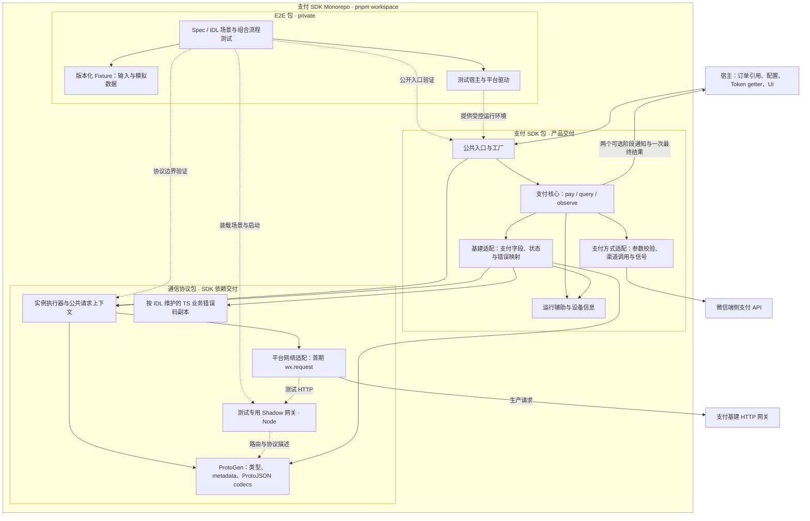
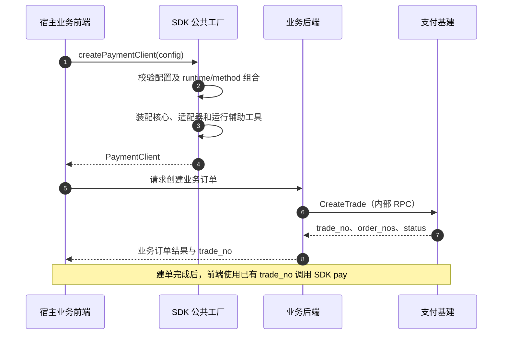
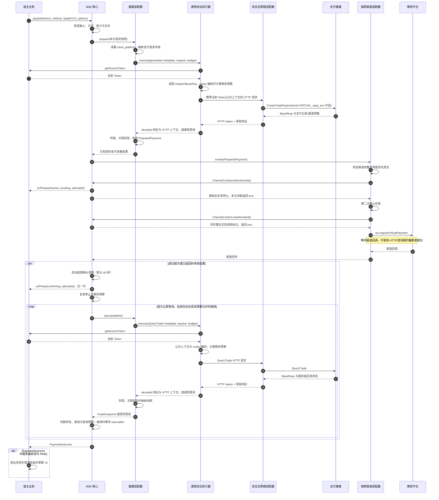
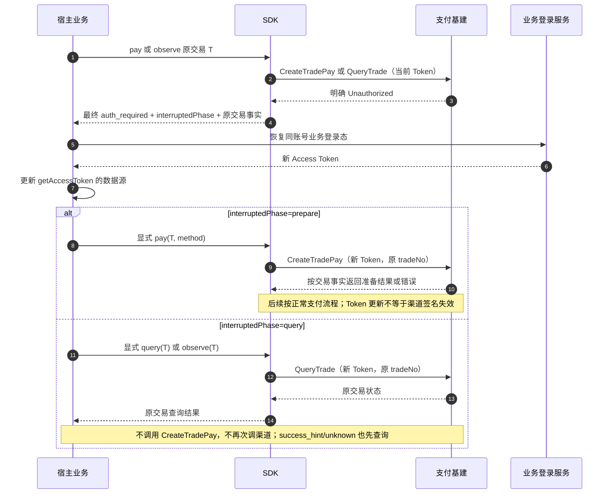
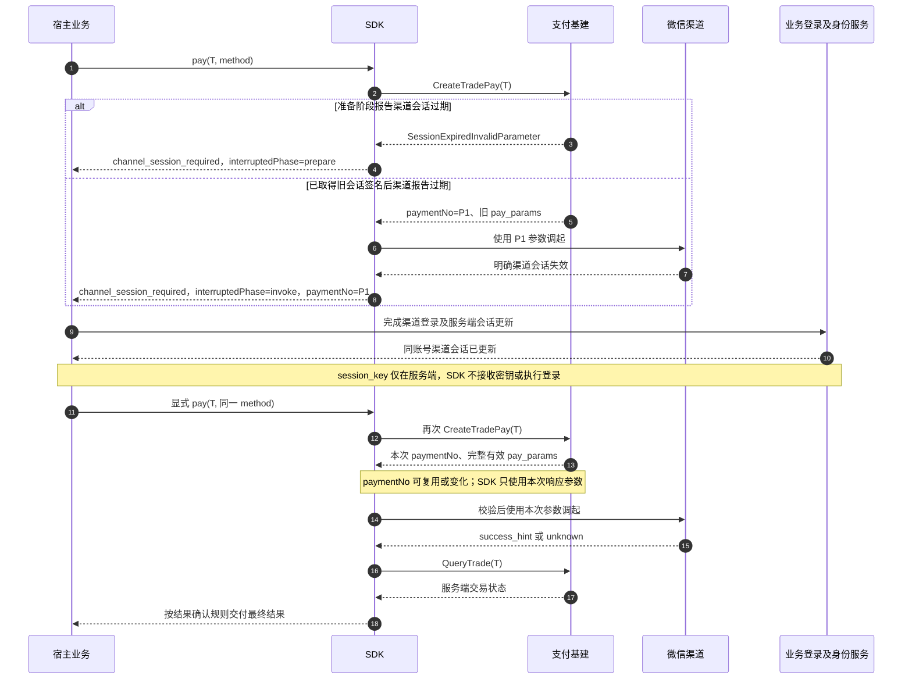
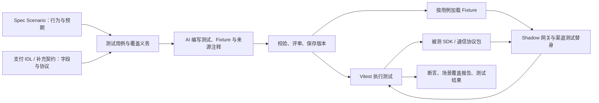
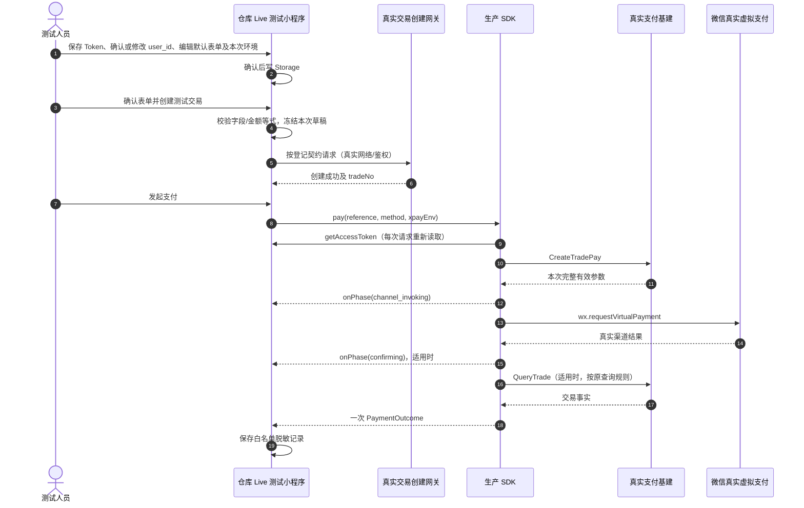
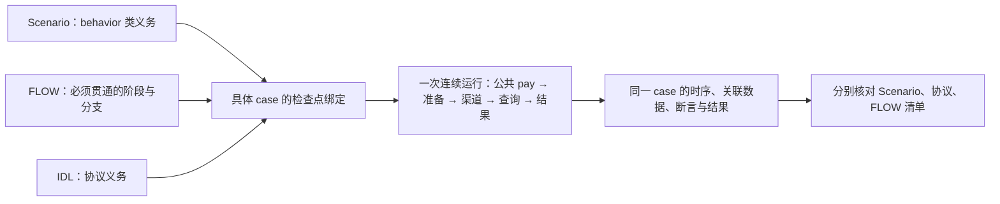

## Context

状态：用户已于 2026-09-10 确认 Task 8-B 的创建接口、可由 `.env.live` 预填且页面可改的 user_id 和可编辑默认表单；本次 uid 默认值语义、渠道失败码归类增量（CORE-024）与 `.env.live` 登记/Storage-only 语义正在进行独立 `plan-review`，通过并验证 freshness 后才向 Apply 同步和委派。既有 Task 1–7 已在隔离 Apply 工作区完成，Task 8 的 Shadow 运行已取证；本轮不撤销历史实施事实，8-A 宿主已在隔离 Apply 提交 2a0494e4f92ff4706eebfc489f491e27852135e3 交付，8-B 创建适配和 8-C 真实验收尚未完成。本文定义 Headless 支付 SDK 的模块职责、接口映射、执行流程及接入方式。公共类型、规范性要求、TC 和 SDK-P 待决项以 [公共契约](specs/payment-sdk-contract/spec.md) 及 [能力 Spec](specs/payment-sdk/spec.md) 为准。

SDK 采用纯 TypeScript 核心，通过自带网络和支付方式适配器连接支付基建及宿主平台。宿主负责业务订单、身份数据和 UI，通过配置/provider 与公共 API 接入。首期交付目标为微信小程序虚拟商品支付。

既有 API、文件布局与状态转换继续有效；本轮仅调整测试宿主和验收方案。实施应遵循本文定义的参数来源、接口映射、状态语义、重放行为和模块责任；新增契约缺口应先回到 Spec 明确再评审，不能由实施者临时决定。

接口基线为 IDL 分支 `feat/esm-v1.4`，commit `4e5cb22659fd4f4c36d06ae81256dc1c43e691d9`。源文件、核验日期及证据范围在公共契约的“已核对的服务端边界”登记；部署和真实支付另行验证。

## Goals / Non-Goals

**Goals:**

- 让实施者依据公共契约与本文，确定每一步调用哪个模块、传什么数据、消费哪个结果；未闭合之处有明确编号和实施禁区。
- SDK 拥有支付 HTTP 流程、协议映射、端侧渠道适配和有界查询；业务只接入配置/数据 provider 和公共支付 API。
- Shadow 自动化与 Live 真实支付均由本仓库测试宿主闭环，分别取证；业务应用验收不作为 SDK Change 完成条件。

**Non-Goals:**

- SDK 不管理业务登录、刷新 Token、业务订单、SKU、价格、席位、业务 UI 或路由；不在客户端保存 AppKey/session_key 或生成支付签名。Live 测试宿主仅有凭据输入、真实测试交易准备和验收控制台，不将这些职责移入产品包。
- 浏览器/公众号/扫码的真实适配、其他支付后台和公共插件机制属于首期范围之外。
- ESM 业务向 Proto 的迁移由业务 change 负责；工程采用 pnpm workspace、Vite 与 Vitest，三包职责见下文；目标仓库与生成登记按工程交付输入落实。

## Decisions

### Decision: SDK ownership and module graph

SDK 按职责分层，通过内部端口隔离平台依赖。四个主要职责是支付流程编排、基建协议适配、平台网络适配和端侧支付方式适配；公共工厂负责装配，运行辅助工具提供时钟、标识和等待能力；设备信息模块只采集 client_platform。交易引用与支付结果是业务模型；适配器、生成代码和时钟是技术组件。这里采用职责分层与端口隔离，不要求引入完整 DDD 框架或额外领域包。

| 概念 | 含义与职责 | 使用位置 |
| --- | --- | --- |
| runtime | 宿主环境标识，例如微信小程序；决定可用的平台实现 | PaymentClientOptions.runtime，首期为 wechat-miniapp |
| 公共工厂 | 校验初始化配置，装配 SDK 模块并返回客户端 | createPaymentClient / src/factory.ts |
| 支付核心 | 执行 pay、query、observe，编排准备、调起、查询和本地结束 | src/core/client.ts、observation.ts |
| RuntimePort | 运行辅助工具接口，提供时钟、ID 和可取消等待 | SDK 内部使用，由 src/runtime/default.ts 实现 |
| DeviceInfoPort | 读取下单端平台，归一为 client_platform | SDK 平台模块实现，业务无需传入 |

runtime 配置只选择宿主环境，RuntimePort 只提供工具能力；初始化由公共工厂执行，支付过程由核心编排。核心调用 SDK 内的基建适配器，将支付模型映射为 generated 请求；通信协议包的实例执行器消费 generated metadata/codecs、组装公共请求上下文，再交平台网络适配器发送。generated 代码描述协议及编解码，不自行决定业务登录或支付策略。



实线描述生产调用及包内依赖，虚线描述开发测试关系。生产依赖只有 SDK → 通信协议包；SDK 包与协议依赖包均不依赖 E2E。Shadow 与测试驱动不参与生产装配。

| 模块 | 输入与输出 | 依赖及禁止事项 |
| --- | --- | --- |
| 公共工厂 | PaymentClientOptions → PaymentClient | 按宿主配置装配 SDK 自带的 backend、网络、渠道和时钟 |
| 支付核心 | 支付/查询命令 → 两个约定阶段通知与一次规范结果 | 统一隔离 onPhase 回调、管理通知/结束闩锁；只依赖内部端口，不知道 Header、IDL channel 数值、wx 或 ESM |
| 支付基建适配器（SDK 包） | SDK 请求 → generated 请求；协议结果 → SDK 模型 | 唯一维护 method/channel、支付字段、BaseResp/身份错误的支付语义及交易关联校验；不拼 HTTP 公共字段 |
| 业务错误码副本（通信协议包） | 锁定 IDL Go 常量/描述 → bigint 常量目录及描述查询 | 仅保存服务端事实；集中手写维护和独立核验，不决定 SDK 恢复或支付结果 |
| 请求执行器（通信协议包） | generated metadata/请求、配置/provider、预算 → decoded 响应及 HTTP 上下文或通信错误 | 维护 Header/BaseReq、Token 读取、编解码、请求标识与剩余预算；保留 BaseResp，不决定支付结果、不刷新或重放 |
| 平台网络适配器（通信协议包） | URL/method/headers/body/预算 → HTTP status/headers/body 或网络错误 | 微信使用 wx.request，未来浏览器使用 fetch；不理解 tradeNo、PAID、业务 Token 存储和登录 |
| 端侧支付方式适配器 | PreparedPayment → 渠道信号或宿主动作 | 校验本渠道 pay_params，调用平台能力；不自行下单、查询交易或处理业务 UI |
| 设备信息适配器 | 平台设备信息 → client_platform | 只返回已归一平台值；异常回落 unknown，不影响 method/channel |
| 运行辅助工具（RuntimePort） | 时间、运行/请求标识、可取消等待 | SDK 提供默认实现；内部端口支持测试替换 |

平台网络和端侧渠道是两个独立维度：同一浏览器网络实现可以服务多个网页支付方式；同一小程序网络实现也可服务不同渠道。注册新渠道需补充其参数契约与映射，不得在核心添加 ESM 场景判断。

### Decision: SDK-owned networking and host data providers

SDK 维护网络实现，宿主提供契约要求的配置与数据获取方法。SDK 统一控制请求发送、超时、取消、协议解析和重放规则，使支付行为在不同业务接入中保持一致。

每个公开平台入口使用 SDK 自带实现。首期工厂只接受 `runtime=wechat-miniapp`；核心及模块导入不访问 wx，操作前检查实际平台能力，缺失时返回 unsupported。浏览器 `fetch` 是未来平台方案，不能在首期导出一个实际不可用的浏览器客户端。纯 TS 核心可在无平台全局的测试环境中通过内部 `createCoreClient` 与假端口运行；该测试工厂不属于 package 公共 exports。

| 数据 | 来源和读取时机 | 谁决定位置与格式 |
| --- | --- | --- |
| gatewayBaseUrl、appId | 宿主初始化配置；实例生命周期内固定 | SDK 校验配置并按 generated metadata 构造请求 |
| 当前业务 Token | 每次准备/查询前调用 getAccessToken；不读取业务 storage/store | SDK 按网关契约组装 Authorization: Bearer；不记录或持久化 Token |
| productId、lane、appVersion | requestContext 显式配置；不读取 ESM 环境变量 | SDK 按公共契约字段表写入 BaseReq/Header |
| client_platform | SDK 操作前读取设备平台，异常回落 unknown | 写入 CreateTradePay，不作为渠道选择条件 |
| xpayEnv | 宿主每次 pay 的可选参数；接纳时复制 | SDK 基建适配器映射 generated 枚举，协议 codec 写入 CreateTradePay.xpay_env；默认和实际环境由服务端决定 |
| Request ID | SDK 每次实际 HTTP 请求生成，运行通过 attemptId 关联 | SDK 按公共 BaseReq/Header 约定写入；不把 Request ID 当支付幂等键 |

宿主配置和 provider 提供字段值；SDK 根据网关及支付契约确定 Authorization 格式、Header、channel、trade_no、签名字段和 endpoint。Product ID 写入 baseReq.productId 与 X-Product-ID；Request ID 同时写 request_id Header 与 baseReq.requestId；lane/app_version 使用同名标准 Header。完整字段表见公共契约。未配置的可选字段省略；Product ID/JWT 实际配置、部署和异步消费由业务接入方与服务端联调确认。

Request ID 默认生成器位于 `packages/payment-sdk/src/runtime/default.ts`，沿用当前小程序 [protoHttp.ts:35](https://gitlab.daqian369.com/esm/esm_fe_app/-/blob/6fcf226488343efa9efe5a82165757fd2ac289cc/packages/app/src/shared/transport/protoHttp.ts#L35) 的组合规则：模块初始化时保存 `processNonce = Math.random().toString(36).slice(2, 10)`，共享序号从 0 开始；每次 nextRequestId 先递增序号，返回 `pay-${Date.now().toString(36)}-${processNonce}-${sequence.toString(36)}`。同一模块运行环境的多个客户端共享该生成器状态，序号不因客户端重建或时间回拨而重置；时间相同的请求仍由序号区分。固定 pay 前缀符合网关首字符规则，整体满足公共契约的正则和长度。此生成器只产生诊断关联标识，不承担支付幂等或安全凭据职责，不引入新的 ID 工具依赖。

工厂把默认生成器的 nextRequestId 装配到协议客户端 runtime；通信执行器每次发送前调用一次，并将同一个值写入 Header/BaseReq。每次查询也生成新值，attemptId 继续关联整个 SDK 调用。测试通过内部 runtime 替换时钟/ID，不改变公共初始化接口，也不导入 ESM 网络、登录或全局请求配置。IDL 规定传输位置，配套 common-sdk 规定允许字符；飞书中的时间格式不是当前 IDL 的强制生成算法。

Token provider 返回空值时识别为 auth_required，不发送本次 HTTP；provider 抛错归为 HOST_CONTEXT_ERROR，不伪装成服务端 401。provider 的等待也受本次预算约束。SDK 不主动刷新 Token 或重放 prepare；明确身份错误结束本次调用，宿主恢复凭据后按中断阶段显式 pay 或 query/observe，具体矩阵见公共契约。

网络端口保留 HTTP 非 2xx 和响应 body；通信协议包进行 ProtoJSON 解析与 codec 解码，SDK 基建适配器解释 BaseResp、身份与支付语义。平台网络失败单独归为 NETWORK_ERROR。网络适配器不得剥离 BaseResp、弹 Toast、自动重试或自动改路由。日志禁止打印完整请求/响应及签名。

凭据获取与网络发送的职责分离可参考 [Graph 鉴权接口](https://github.com/microsoftgraph/msgraph-sdk-javascript/blob/dev/docs/CustomAuthenticationProvider.md) 和 [Apollo 网络配置](https://www.apollographql.com/docs/react/networking/basic-http-networking)。本 SDK 由 getAccessToken 提供当前凭据，内部网络适配器负责发送请求。

### Decision: Protocol network factory export and assembly

协议包在现有根入口具名导出 createWechatMiniappHttp(): HttpPort。src/index.ts 显式重导出 src/adapters/network/wechat-miniapp.ts 的生产实现，零参数工厂仅创建端口。选择现有根入口是因为通信客户端/类型已经通过同一入口被 SDK 消费，首期只有微信网络实现且导入、创建均无平台访问，不需要新增平台子路径或构建管线。

SDK factory.ts 从 @daqian/payment-protocol 导入该工厂和 createProtocolClient，将工厂结果传入协议客户端 http。协议包负责 wx.request，SDK 工厂负责装配，核心仍只消费内部端口。SDK 的 package exports、PaymentClientOptions 和业务配置/provider 保持原契约；不转导出网络工厂，不要求业务安装协议包或提供 Request。

构建复用协议包已有 Vite 根 entry、exports["."] 的 import/require/types 条件和 files 中的 dist。由根重导出将生产实现纳入两个构建及声明；适配器的中文 JSDoc 保留。已有配置符合时不改 package.json/vite.config.ts 或增加导出 key；产物验收必须确认两种格式均可通过包名取得函数并创建 HttpPort。无 wx 环境加载和创建时无平台读取，真正 send 才访问平台。Node 安全加载不代表新增 Node/浏览器支付支持。generated 子入口不变，Shadow 和测试平台替身不能因重导出进入生产依赖图/发布包。

Task 2 增量维护协议根出口、就近 index.test.ts、协议 AGENTS 与双格式构建验证；不重写现有网络模块，不重做 Task 1/3–5。Task 6 的 weapp 最小协议 case 从已构建的协议包根取得 createProtocolClient/createWechatMiniappHttp，以真实 wx.request 请求 Shadow；最小宿主只运行测试函数，不能通过手写 HttpPort 绕过生产适配器。Task 7 的 SDK 公共工厂装配同一导出，并完成实际 tarball 的双格式及声明消费；Task 8 接续完整平台流程验收。

本补充是协议依赖包可消费的具名 API 增量，承接既定网络职责；不是面向业务的新 SDK API。没有选择深层源码导入、测试别名或宿主自写请求，因为这些方式不能兑现已定生产边界；本期也不增加通用网络工厂/注册器。合入同版规划和报告并校验 freshness 后，先回到 Task 2 完成受影响增量、共同门禁与独立评审，再恢复 Task 6 的真实 weapp 分支。Task 6 无依赖部分可继续，整项完成仍需前置满足。合入保留工程、已有任务状态和当前 WIP；仅按工作流重开受影响 Task 2，不用主区未勾选列表覆盖 Apply 状态。

### Decision: Public initialization and method selection

对外签名唯一来源是公共契约。初始化必填 runtime、gatewayBaseUrl、appId、enabledMethods、getAccessToken；policy、请求上下文和诊断回调按需配置。policy 内置请求超时 60000 ms、查询间隔 3000 ms、结果确认总时长 60000 ms；初始化与单次 pay/observe 可逐字段覆盖，配置类型与示例见公共契约。非法配置在工厂阶段抛出 PaymentConfigurationError；预期运行失败通过结果返回。

1. 宿主为当前应用创建一个客户端，选择已发布 runtime 和 enabledMethods。
2. 工厂按 SDK 注册表装配支持的网络/端侧适配器，拒绝空集合、重复或与 runtime 不匹配的配置。
3. 每次 pay 显式指定 method。核心检查已启用、可用及互斥后再访问服务端；不会把不支持的 H5 method 转成虚拟支付。
4. 支付基建适配器在唯一映射表中将 SDK method 编码成 generated channel；响应 channel 必须匹配请求，否则 PROTOCOL_ERROR 且不调用渠道。

runtime 选择宿主环境，enabledMethods 定义可用支付方式，每笔 pay 的 method 选择本次方式；服务端 channel 是该方式的协议编码。首期公开 method 只有 `wechat-miniapp-virtual-goods`。同一小程序环境可以承载不同支付方式，因此环境选择与支付方式选择分别建模。

requestContext 用于 Product ID、lane、appVersion 等公共数据。client_platform 描述下单端操作系统，用于统计/排障，由 SDK 内部 DeviceInfoPort 读取 wx.getDeviceInfo().platform：ios→ios、android→android、ohos/ohos_pc→harmony，其余/缺失/异常→unknown。采集不要求业务传值，失败不阻断支付；仅提取 platform，不持有其他设备信息。该值与 runtime/method/channel 分工不同，不参与选渠道、验签或风控。服务端从渠道回填的资金平台信息由服务端独立维护。

| 方式 | 服务端 channel | 端侧行为 | 首期状态 |
| --- | --- | --- | --- |
| 小程序虚拟商品 | CHANNEL_WECHAT_VIRTUAL=4 | wx.requestVirtualPayment | 唯一真实交付目标，受参数/联调前置约束 |
| 小程序普通 JSAPI | CHANNEL_WECHAT_JSAPI_MINI=1 | 需独立渠道实现 | 未实现 |
| 公众号 JSAPI | CHANNEL_WECHAT_JSAPI_OA=2 | 公众号平台调用 | 未实现 |
| Native 扫码 | CHANNEL_WECHAT_NATIVE=3 | 提供二维码数据，由宿主展示 | 未实现 |
| 普通浏览器 MWEB | 当前 IDL 无对应枚举 | 不能映射为 OA 或 Native 冒充 | 未支持 |

### Decision: Per-payment Xpay environment

公共 API 使用 `PaymentRequest.xpayEnv?: XpayEnv | undefined`，其中公开类型 `XpayEnv = 'sandbox' | 'prod'`，完整中文 JSDoc 和三态/部署表以 CONTRACT-14 为准。字段表达本次米大师支付的环境选择，因此与 reference/method 放在同一请求对象；客户端配置表达实例固定连接信息，RunOptions 表达等待/停止/通知控制，两者不承载这一支付参数。public 类型不直接暴露 generated 枚举，避免业务依赖协议包的版本和零值规则。

职责沿既有路径传递，不增加新层或环境适配器：

1. 核心在 pay 接纳时复制 request 及 reference，校验 xpayEnv 仅为 undefined/sandbox/prod；其他值返回 error/INVALID_INPUT（source=sdk、not_invoked），不调用 provider、HTTP、渠道或 onPhase。对象后续修改、前一笔的选择不影响本次或下一次请求。
2. PaymentBackend.prepare 接收完整 PaymentRequest。backend.ts 将 sandbox/prod 映射到 generated `XPAY_ENV_SANDBOX` / `XPAY_ENV_PROD` 常量（实际 TS 导出访问形式以生成产物为准）；undefined 不设置 generated optional 字段。禁止使用裸数字或先填 UNSPECIFIED 再依赖序列化省略。
3. 通信协议执行器用已有 metadata/codec 发送：HTTP JSON 分别为无 xpayEnv 键、具名 SANDBOX、具名 PROD。不扩展 Header/BaseReq，不将网络适配器变为环境决策层。Task 1 先验证支付 Profile 保留 optional presence 与具名枚举；缺能力交 ProtoGen 维护方处理，不能手改 generated 或另写 codec。
4. trade 按 IDL 将该字段原样传入 pay；服务端选择有效环境及签名所用的密钥。准备响应仍按已有 oneof/关联规则消费。PreparedPayment 与渠道参数不增加 xpayEnv，SDK 不解析、强转或重签 signData.env；IDL 的 PROD=2 与渠道 env=0 不是同一编码。
5. query/observe 只使用 TradeReference，不接受或发送该字段。准备/渠道身份恢复后需要新 pay 时，业务保留原选择（包括省略）并显式再调用；进入查询阶段后恢复仅查原交易。同交易并发仍按原 busy 规则，SDK 不保存支付环境历史、不增加幂等键，也不保证更换选择就会换支付单。

`gatewayBaseUrl` 选择服务入口，lane 选择服务泳道，runtime/client_platform 描述前端环境；它们都不决定 xpayEnv。省略由服务端用部署默认；本 IDL 只允许 test 部署逐请求覆盖，prod 部署对合法 sandbox 选择仍强制现网。SDK 不做全局默认、域名推断或跨环境回退，也不把请求值作为有效渠道环境的证明。新增字段不改变原有请求/查询预算和收银台等待方式。

**生成与网关前提。** 本版锁定 IDL `4e5cb22659fd4f4c36d06ae81256dc1c43e691d9` 的原始定义：CreateTradePayRequest.xpay_env=7、内部 PrepayRequest.xpay_env=15，共用 infra.pay.v1.XpayEnv；optional absence 与显式 UNSPECIFIED=0 分开，后者被校验拒绝。旧网关 a761953 仅作为已有 Header/响应规则的历史参照，不证明本字段兼容；DiscardUnknown=true 可静默吞掉 xpayEnv。SDK 不新增版本探测 API。Task 8 须取得兼容的网关/交易/支付构建版本、网关实际 codec 配置以及字段贯通证据；HTTP 200 或 Shadow 成功不足以通过该项。

**环境验收矩阵。** 原文及三态表见公共契约“xpayEnv 的三态、部署语义与职责”。测试期望固定来源，不从 SDK 输出倒推：

| 验证边界 | 必需输入/预期 | 取证方式 |
| --- | --- | --- |
| SDK 生成与出站 | 省略/undefined 无键；sandbox/prod 为具名枚举；非法值无外部动作；query/observe 无字段 | Task 1/3 的生成/类型与独立 wire 期望，Task 6/7/8 的 CONTRACT-022/023、CORE-020、FLOW-008 |
| test 配置的网关 → trade → pay | 省略采用沙箱默认、sandbox 为沙箱、prod 为现网；字段值及 presence 到达 pay | 服务端提供与验收构建/配置匹配的脱敏集成证据；不能只证明 SDK 发出正确 body |
| prod 配置的网关 → trade → pay | 省略、sandbox、prod 三种输入均采用现网；无静默丢字段掩盖覆盖策略 | 同版本、同配置的完整贯通证据，可在不调真实收银台时核验；不要求为了验证覆盖策略在生产重复扣款 |
| 真实微信渠道 | Android 有效沙箱；Android/iOS 有效现网；真实签名、收银台回调和服务端最终查单一致 | 事先明确实际部署、有效环境、测试账号和金额授权。每类用独立交易；仅有请求 sandbox 或模拟签名不能证明沙箱验证成功 |

按本 IDL，iOS 不支持沙箱，不能把 iOS 沙箱列为应成功场景。SDK 不仅凭请求 sandbox 提前否定 iOS 能力，因为最终环境可能被服务端覆盖为现网。服务端默认/覆盖与渠道签名的有效环境由服务端提供非敏感证据；SDK 仍不解析 signData 取证。没有真实扣款授权时保留该项未验收，不生成虚假通过，也不阻塞 Node/Shadow 工程验证。ESM 业务 Change 负责每次提供/省略选择和恢复时保留它，本仓库不新增业务 IDL 或业务页面规则。

### Decision: Prepare-to-channel contract mapping

服务端使用统一 `CreateTradePay` 入口加 channel；trade 校验归属，内部 pay 处理通道能力、收款 appid 白名单和渠道规则。SDK 基建适配器负责前端 wire 映射，端侧适配器负责如何消费对应渠道参数，两者不能各自选择渠道。

初始化只校验配置并装配模块，不发送 HTTP。业务后端先通过内部 CreateTrade 建立交易及子单，将 trade_no 返回业务前端；调用方随后执行 pay。校验通过后，SDK 的第一笔支付准备请求是 CreateTradePay。该接口对已有交易发起收银，取得本次渠道预支付参数。直接调用 query/observe 时，SDK 从 QueryTrade 开始。

| 环节 | 执行方与接口 | 引用及结果 |
| --- | --- | --- |
| 业务建单 | 业务后端 → CreateTrade（内部 RPC） | 创建 trade_no、order_nos 及交易状态，业务前端取得 trade_no |
| 支付准备 | SDK → CreateTradePay（公开 HTTP） | 输入已有 trade_no；返回同一 trade_no、payment_no、channel、pay_params、expire_time、base_resp |
| 交易查询 | SDK → QueryTrade（公开 HTTP） | 输入 trade_no；读取服务端交易状态 |

trade_no 标识交易父单，order_nos 标识建单时产生的子单，payment_no 标识支付记录。CreateTradePay 不返回新业务订单或 order_nos；pay_params 为 generated PayParams oneof；参数形状与 channel 分别校验。

| SDK 输入/内部上下文 | IDL 字段/入口 | 处理规则 |
| --- | --- | --- |
| reference.tradeNo | CreateTradePay.trade_no | 必填，长度 1–25；业务已创建，SDK 不补建订单 |
| method | channel | 通过单一显式表映射到 generated 枚举；首期仅 VIRTUAL |
| 本次 xpayEnv | CreateTradePay.xpay_env | 可选；省略保持 absence，sandbox/prod 使用 generated 具名常量；不写 QueryTrade |
| 初始化 appId | app_id | 必填，长度 1–32；服务端执行 channel/appid 白名单校验 |
| getAccessToken() | Authorization → 网关 metadata user_id | 由网关注入用户身份；body 仅包含 IDL 定义的请求字段 |
| 查询 reference.tradeNo | QueryTrade.trade_no | SDK 首期只按 tradeNo 查询；不设置无效的 sync_channel 强制对账 |
| SDK 设备信息 | CreateTradePay.client_platform | 由 DeviceInfoPort 映射为 ios/android/harmony/unknown，与 channel 独立 |

SDK 的支付准备请求由 trade_no、channel、app_id、client_platform、按本次输入可选设置的 xpay_env 和公共 BaseReq 构成。微信身份由服务端根据鉴权用户与 app_id 查询；SDK 不接收、获取或透传 OpenID，也不提供兼容入口。open_id 不赋值，出站 ProtoJSON 省略该字段；client_platform 由 SDK 内部上报。两种行为均通过真实 codec/报文 fixture 验证。

准备响应先完成 BaseResp 判错，然后依次校验 trade_no 与请求相同、payment_no 非空、channel 与请求一致、pay_params 为非空结构化 oneof 且分支正确。SDK 保留交易与本次支付记录引用，不将它们与本地 attemptId 混用。expire_time 按毫秒安全转换，不推导 CLOSED。

**pay_params → 渠道参数的契约边界。** IDL PayParams oneof 定义 wechat_jsapi、wechat_native、wechat_virtual 三种形状。首期必须命中 wechat_virtual 且 channel=VIRTUAL；JSAPI 两个 channel 共用形状，因此不能从 oneof 推导支付方式。支付基建适配器从 generated 解码值唯一映射为 SDK 内部 ChannelPaymentParams，核心原样传递，渠道适配器检查 method/kind 后只向 wx.requestVirtualPayment 传 mode、signData、paySig、signature。字段来源、必填和错误规则以公共契约“结构化支付参数与渠道映射”为准；不手写 wire DTO，TypeScript oneof 访问方式以实际生成产物为准。

signData 为非空原始字符串；mode 同时存在于签名内容和调用顶层。SDK 使用顶层 mode，不解析、重序列化、trim 或搬移签名内容；不比较恢复前后单号或全部签名字段。AppKey/session_key 留在服务端，SDK 不调用内部 SignWithSessionKey。外层 string、缺/多/错分支或缺字段均为协议错误，失败响应先按 BaseResp 判错。

**响应判定。** 通信执行器保留 decoded data、已解析 wire 与 HTTP 上下文；wire 用于检查 codec 默认值可能抹去的字段存在性和 oneof 分支，绝不输出诊断。SDK 基建适配器按公共契约“HTTP、信封与业务结果的判定顺序”处理：网络错误 → 非 2xx → 有效信封 → status_code → 支付字段/关联。status_code 是业务权威，success/error 矛盾只记录脱敏诊断，缺有效 statusCode 不能靠默认 0 成功。数值码/描述使用协议包按锁定 IDL 维护的 TS 副本，retryable 不触发准备重放，Conflict 不映射 PAID。

网关鉴权拒绝和正常业务错误均可 HTTP 200，但网关自造 baseResp 与支付 handler 的零值省略规则不同；协议测试分别取证。IDL oneof、两种 JSON 出口、int64/枚举形态及错误全集作为 Task 3/6 的明确输入；源码、样例与真实渠道证据不相互替代。

### Decision: Full payment execution and recovery

以下两张时序图分别展示接入准备和一笔支付，每张图从 1 开始编号。循环中的序号标识重复执行的步骤。

初始化与业务建单：



支付主流程（输入、能力与准备参数校验通过；中断后的恢复路径见下方身份恢复时序）：



pay 的初始快照为 `UNKNOWN/source=unavailable`。准备成功本身不合成 CREATED/PAYING；只有 QueryTrade 返回才能更新为服务端事实。内部运行阶段是 validating → preparing → invoking → observing → ended，由核心维护。

公共 pay/observe 接受每次调用可选的 RunOptions.onPhase，仅通知 channel_invoking 与 confirming，Promise 各返回一次最终 PaymentOutcome。宿主在调用前处理准备态，在约定阶段映射 UI，最终根据交易事实和结束原因处理；身份中断以最终结果及 interruptedPhase 交付，恢复后按矩阵显式再次调用。成功提示后仍可能查到 PAYING，等待超时保留最后可信快照，不归为支付失败。onDiagnostic 仅供技术诊断；业务阶段和结果使用公共契约，不订阅诊断日志。状态中文释义及触发场景以公共契约的“状态字段的中文语义与触发场景”为权威，编码注释按下节交付。

| 当前阶段与事件 | 下一动作 | 对外结果/约束 |
| --- | --- | --- |
| 校验失败、method 未启用、能力缺失或已有活动 pay | 不调用 prepare，不调用渠道 | INVALID_INPUT / unsupported / busy；not_invoked |
| prepare 返回鉴权、身份、会话错误 | 结束本次 pay，不调用渠道；业务恢复对应凭据后显式 pay | interruptedPhase=prepare，保留精确错误和交易引用；不能推断服务端无副作用，渠道会话恢复后须重新请求本次有效参数 |
| prepare 网络/协议错误 | 结束本次运行，不调用渠道 | 保留引用和精确错误；超时不表示服务端回滚 |
| prepare 响应关联或参数结构错误 | 结束，不调用渠道 | PROTOCOL_ERROR；不在客户端补参数或签名 |
| invoke 返回 success_hint | 启动结果确认预算，通知 confirming，复查停止/预算后立即 query | 成功提示不能设置 PAID，通知不代表 HTTP 已发出 |
| invoke 返回 unknown | 同样通知 confirming 后进入查询 | 保留 unknown 信号；无回调不是此分支，不能据未知自动重付 |
| invoke 返回 cancelled / launch_failed | 本次直接结束，不自动查询或重放 | channel_cancelled / launch_failed；业务可另行 query/observe |
| invoke 返回明确渠道会话失效（如 -15007） | 结束本次 pay；业务恢复渠道会话后显式 pay，同一 tradeNo 重新 CreateTradePay | channel_session_required、interruptedPhase=invoke；SDK 使用本次响应完整有效参数，不比较 payment_no，不重放旧 PreparedPayment |
| invoke 尚未回调 | 继续等待渠道回调 | 不启动查询预算、不设置渠道回调时限；宿主显式 cancellation 时只结束本地等待，进程退出不保证 Promise 交付 |
| query 返回 PAID/CLOSED | 结束 | confirmed，保留服务端事实；PAID 仍不代表业务权益就绪 |
| query 返回 CREATED/PAYING/UNKNOWN | 若预算允许，等待 intervalMs 后发下一次查询 | 同时最多一个查询，不伪造终态 |
| query 网络错误或明确可恢复 Unavailable | 不立即重试；预算内按 intervalMs 再查询 | 保留最后可信快照；是否为可恢复码必须来自已确认错误映射 |
| query 返回鉴权/身份/会话错误 | 结束本次查询/观察；业务恢复后仅 query/observe 原 tradeNo，不重新 prepare/invoke | 精确 reason/error、interruptedPhase=query 与最后可信快照；保留已有 paymentNo/渠道信号 |
| query 返回协议或其他确定错误 | 结束本次观察 | 返回精确错误与最后可信快照 |
| 查询预算达到 maxWaitMs | 结束本次观察 | timed_out；不把 PAYING 改为 CLOSED |
| 服务端 expire_time 已到但查询仍 PAYING | 在剩余查询预算内继续 | 不截断收银台或假设渠道已过期；后续 PAID 正常确认 |
| prepare/invoke/observe 阶段调用方显式停止 | 结束 SDK 本地等待，清理活动记录、订阅和调度，尽力取消网络 | stopped；不关单、不退款、不关闭原生收银台；旧回调不得推进新运行 |
| 未来适配器返回 redirect/qr_code 动作 | 返回宿主，停止本次主动观察 | action_required + nextAction；此分支首期只用假适配器验证 |

query 只进行一次查询，使用实例 policy.requestTimeoutMs；observe 从新的未知快照开始只查询原交易，不 prepare、不 invoke，channelSignal=not_invoked 只表示本次运行未调渠道。查询终态优先于同一处理回合的查询预算判断；运行已经结束后到达的任何结果都不能覆盖已交付结果。

对预期失败返回结果对象；端口抛错转换成规范错误。诊断回调抛错不得改变支付主流程或造成第二次结算。具体返回字段及不变量见公共契约，不在这里定义第二套类型。身份/会话错误结束原调用；恢复由宿主发起新的 pay 或 query/observe，不提供 resume 或后台自动恢复。宿主保留原 tradeNo/method、中断阶段和结果，SDK 不持久化恢复上下文。

### Decision: Backend cancellation and terminal ownership

通信 CANCELLED 是请求层的取消信号。SDK 内部 BackendResult<T> 保留公开成功/错误字段，并增加 { ok: false, cancelled: true } 分支；只改 ports/backend.ts 及其内部消费者，公共 PortResult/PaymentError/query 和协议包 CommunicationResult 不变。backend 不持有运行结束状态、不推断取消原因，直接返回内部变体；TIMEOUT 保持时间错误映射。这样模块可独立测试，避免用假的 TIMEOUT 兜底或把取消分支隐藏在核心竞争之外。

core/client.ts 和 observation.ts 先判断运行 ended 及所属请求是否已完成，再识别 cancelled，按公共契约“通信取消与运行结束的归属”表处理。原始宿主停止结束运行为 stopped；prepare 请求到期或观察总截止结束为 timed_out。观察中单笔查询到期且总窗口未耗尽时，仅将该请求结束为 TIMEOUT，按 intervalMs 重查，不设置运行 ended。独立 query 到期只返回现有 PortResult 的 TIMEOUT。没有停止或到期依据的异常取消转为 NETWORK_ERROR/source=network/originalCode=CANCELLED，沿用网络错误处理，不泄漏内部变体。

核心锁定对应层级的运行结束原因或请求完成结果后，再触发底层尽力取消。单笔查单到期只清理该请求并保留观察，重查用新的请求上下文；旧请求的同步 abort fail、取消或迟到响应不得干扰新请求。运行已结束时，后续停止不能把 timed_out 改成 stopped，反向顺序也不得把 stopped 改成 timed_out。消费响应的既有先处理者与终态规则不变。Task 3 验证 adapter 的中性取消映射；Task 4 完成核心所有分支和竞态；Task 7 的 CONTRACT-025 通过公开入口和受控网络/时钟验证六个 case，包括短请求预算耗尽后重查并确认 PAID，平台网络取消机制继续由 Task 2 验收。接口/场景及门禁变化由这三个任务和 Task 6/8 汇总，已完成 Task 1/2 不重做。

### Decision: Backend query recovery semantics

BackendResult 的普通失败分支在 error 旁保留可选 cause='query_unavailable'，只表达本次查询精确命中已确认可恢复错误。SDK payment-infra/backend 在已有响应判定之后同时检查 query 操作、ErrInfraTradeQueryTradeUnavailable 完整码和锁定描述 retryable=true，唯一赋值；其他分支保持无标签。完整输入表与判别规则见公共契约“已确认的查询恢复语义与公开结果投影”。不修改协议包 API 或公共 PaymentError，核心无需知道 IDL 错误数字。

observation.ts 只对符合公共契约的带标签 SERVER_ERROR 进入有界业务重查；未知码即使保留 retryable=true 也结束。网络错误/TIMEOUT 保留既有预算规则，prepare 不重放，独立 query 不轮询。core/client.ts 对 query 的 PortResult 和 pay/observe 的 Outcome.error 按公共字段构造，不返回/展开内部失败对象；运行时字段与双格式声明均验收不泄漏 cause。测试需要分别构造带标签已确认错误和无标签未知错误，不能从原码在核心补推断。

Task 3 增补内部端口/adapter 的正反映射单测，已完成时仅回到受影响范围补交付和回归评审；Task 4 落地核心分支与公共投影；Task 7 通过真实 backend 的公开入口集成验证 CONTRACT-026，Task 6/8 接入完整门禁。只补本次已批准重查规则所需的信息传递，不开放通用恢复策略或业务配置。

### Decision: Phase notifications and documented state semantics

采用每次调用可选的 onPhase，由核心在两个稳定边界调用业务回调；接口、顺序、异常和恢复约束的唯一定义见公共契约 CONTRACT-12/13 及“阶段通知与一次最终交付”。内部 validating/preparing/invoking/observing/ended 不全部公开，阶段通知不是最终结果对象。

| 字段层次 | 中文含义及定位 | 编码与使用要求 |
| --- | --- | --- |
| PaymentPhaseEvent.phase | channel_invoking=即将调用端侧渠道；confirming=开始向支付基建确认 | 每调用至多各一次；不保证原生界面可见/关闭或业务已绘制 |
| PaymentOutcome.channelSignal | 本次未调用、渠道成功提示、渠道取消、明确调起失败或结果未知 | 与服务端事实分开；无回调停止时 unknown 不触发补发 confirming |
| PaymentOutcome.reason | 本次调用结束原因：确认终态、取消、失败、凭据中断、不支持、忙碌、超时、停止、其他错误或动作交接 | 具体 12 个值及触发阶段见公共契约中文表；PaymentOutcome 不是 ended 回调 |
| PaymentOutcome.snapshot.state | CREATED/PAYING/PAID/CLOSED/UNKNOWN 的最后可信交易事实 | confirmed 还需区分 PAID/CLOSED，PAID 不表示权益到账 |
| interruptedPhase、error、source 等 | 错误发生位置、分类及事实来源 | 不是额外过程状态；按中文表及精确协议映射保留语义 |

例：渠道给 success_hint，查询一直 PAYING，最终 reason=timed_out，快照仍 PAYING；渠道取消的 reason=channel_cancelled 不表示 CLOSED；宿主停止是 stopped，不伪造成渠道 cancelled。这些区别必须同时出现在源码公共 JSDoc 和相关状态迁移/映射分支注释中。

**实施位置与控制顺序：** contracts.ts 维护 PaymentPhase/PaymentPhaseEvent/RunOptions 和结果类型；ports/channel.ts 的 ChannelContext 增加必需同步 beforeInvoke: () => boolean。core/client.ts 管理回调隔离、每阶段通知闩锁、活动记录与最终结束；core/observation.ts 管理确认入口和预算。adapters/channels/wechat-miniapp-virtual.ts 校验参数/能力后调用 beforeInvoke，再复查停止；false 直接返回 kind=stopped，不调平台。ChannelContext 另有必需同步 markInvoked: () => boolean；适配器第二次停止检查通过后，调用 markInvoked 并仅在 true 时紧接着调用平台。核心在该方法中一次置位，beforeInvoke 不改调用信号；未标记停止为 not_invoked，已标记且无有效回调停止为 unknown。完整准入、重复/迟到、同步顺序与测试规则见公共契约“渠道实际调用标记”。异步 stopped 返回不能代替标记，避免核心先处理宿主停止后已无法修正信号。假适配器遵守同一端口，action_required 的假动作没有真实平台调用，不触发 channel_invoking。

成功提示/已返回 unknown 的活动流程与独立 observe 均先固定查询截止，再通知 confirming，再复查停止/预算，开始首笔 query/provider。取消、明确失败、会话失效直接交付最终结果；prepare/调用前校验失败无阶段通知。confirming 内停止不得发送首笔查询；首次 PAID/CLOSED 仍先通知再交付结果，不增加 UI 展示延迟。通知回调无返回值控制协议，不 await Promise/thenable，异常和异步拒绝被隔离；同步耗时仍占用 JS 线程，预算不因此重置。观察者异常不进入 PaymentError、不改变最终结果、不记录异常原文。

核心在通知前建立同单活动记录，回调内重入仍 busy。结束先设置 ended、清理并交付唯一结果，迟到事件不得推进旧/新运行；业务自身已经启动的异步任务由业务检查运行标识及页面有效性。事件只给 attemptId/phase，无渠道参数或业务上下文，不进入通信协议包、IDL 或 Shadow。宿主在调用前建立本地运行标识，不能等 Promise 结果才判断本次调用。

**业务消费边界：** 容器将阶段映射为自身展示 Props，纯 UI 不直接依赖 SDK 枚举；临时视觉隐藏保留组件与订单/来源，不触发实际关闭/afterClose。SDK 不控制 UI、关系续接或权益查询。没有回调和进程退出仍按既有显式停止及原交易查询恢复，不新增渠道计时器、onShow 推断或自动重付。

**中文注释交付：** 手写公共类型、字段及状态联合值使用中文 JSDoc，说明所属层次、触发场景、来源和判断边界；映射及状态迁移实现用中文注释解释关键决定，引用相应 Spec 节/TC，避免另立语义。声明构建保留 JSDoc，Task 1 核对构建声明，Task 7/8 核对真实 tarball 的 ESM/CJS 类型入口。评审逐项对照权威中文表并保存源码/声明位置；类型/覆盖工具只验证其负责的性质，不用自研自然语言检查器冒充语义验收。新增/变更状态同改 Spec、注释及受影响测试，ProtoGen 生成注释不手改，也不新增中文文案映射 API。

### Decision: Budgets, cleanup and exclusive channel lifetime

时间策略按阶段生效，默认值与覆盖规则唯一来源为公共契约的“时间配置与阶段边界”。

1. prepare 或独立 query：从开始获取 Token 起计单次 requestTimeoutMs，默认 60000 ms；provider 消耗时间后，HTTP 只使用剩余时间。
2. invoke：等待渠道回调，不设置 SDK 渠道回调时限，不启动 observation.maxWaitMs，不用服务端 expire_time 中止收银台。SDK 不提供渠道有效期覆盖或虚构取消 API。
3. pay 在 success_hint/unknown 回调后，或调用方直接 observe 时，创建新的结果确认截止，默认 60000 ms；通知 confirming 并复查停止/预算后首次立即查询，后续在上一请求结束后默认等待 3000 ms。同一运行只允许一笔在途查询；通知不重复、不重置预算。
4. 观察中的每次请求截止取 min(当前时间 + requestTimeoutMs, 结果确认截止)，包含 provider 等待。网络超时只是本次请求/观察的结束条件，不能证明服务端未执行。

计时、并发控制和本地结束均为进程内行为。结果交付先设置 ended 闩锁，再清理调度/订阅、尽力 abort 网络，之后忽略迟到结果；应用后台挂起不保证计时器执行，恢复执行时按当前时间判断查询预算，不补发累计轮询。正常渠道等待不因 onHide/onShow、查询预算或交易到期自动结束。

同客户端同交易的活动 pay 返回 busy，仅防止当前执行重入；SDK 不保存 tradeNo→支付状态的历史表。前次调用结束后，再传同一 tradeNo 按普通请求访问服务端，复用、Conflict、过期或已支付结果由服务端契约解释，不能用本地缓存代替。SDK 不自动重放预下单或已签名参数。查询阶段的鉴权恢复只查原交易；渠道会话失效后的显式 pay 按恢复矩阵重新取得有效参数，服务端决定支付单复用、续用或新建。

服务端 expire_time 仅是交易期限信息；基建默认 30 分钟及预下单余量约束由服务端管理，不是 SDK 收银台计时器。此期限不能推导渠道必在同一时刻关闭或回调。未支付交易的过期处置、关单和渠道期限协调由服务端负责；当前 IDL 的 TradeStatus.CLOSED 标注“二期，一期不写入”，SDK 据实际查询结果处理，不把服务端关单能力的建设列为 SDK 待决项或实施前提。基建一期可能仍对到期 PAYING 交易确认渠道支付成功，SDK 接受查询到的 PAID；后续查询返回 CLOSED 时按终态处理。可能产生的冗余无效支付单一期保留，二期由服务端自动关单；SDK 不依赖每次恢复是否产生冗余单；不能将已支付或结果未知的单因 Token 失效而归为无效。

渠道没有回调时，SDK 持续等待；HTTP 的 60 秒和结果查询的 60 秒均不覆盖该阶段，不因等待较久自动查询、结束或再次发起支付。用户正常关闭收银台且收到取消回调时，按 cancelled 分支结束。进程退出后，旧调用随进程消失，SDK 不保证交付其 Promise 结果。

若交互已结束、进程仍存活且没有渠道回调，界面关闭本身不会使 SDK 的 Promise 结束。宿主通过 RunOptions.cancellation 显式结束本地调用，SDK 交付 stopped、释放活动记录并隔离旧回调；不增加渠道计时器。ChannelContext 透传该停止信号，适配器返回本地 kind=stopped，不伪造渠道取消。停止与回调只处理先到事件，结束后不再查询或二次交付。原调用仍活动时同客户端/同交易 pay 返回 busy；结束后显式 pay 是新流程。本地结束不关闭收银台、不决定交易状态；进程退出后由业务恢复 tradeNo，先 query/observe 查询事实。

### Decision: Authentication, identity and channel session

SDK 区分业务鉴权、微信身份绑定与渠道 Session Key，但不接管登录流程。

| 事实 | SDK 分类 | 已明确边界 |
| --- | --- | --- |
| Token 缺失、网关或 trade Unauthorized | AUTH_REQUIRED | 每次 HTTP 读取当前 Token，不缓存、不自行 refresh；网关 HTTP 200 中的鉴权错误也需识别 |
| WxIdentityNotFound | IDENTITY_REQUIRED | 已登录但缺微信身份绑定，不能等同 Token 过期 |
| SessionExpiredInvalidParameter / 渠道 -15007 | CHANNEL_SESSION_REQUIRED | 服务端或渠道报告会话失效，不能重放旧签名参数 |
| Unavailable | SERVER_ERROR，保留 retryable | 服务暂不可用不等于用户缺身份或会话已失效 |

IDL 定义的身份建立路径为：宿主取得业务 Token，再使用新的 wx.login code 调带鉴权的 BindWxUserIdentity；服务端兑换、绑定 uid/OpenID 并保存 session_key，响应不向前端返回 OpenID/session_key。业务 Token 与 Session Key 生命周期不同；后者用于微信虚拟支付用户签名，不能泛化为所有支付渠道或内部 RPC 均依赖微信登录态。网关将业务身份传入内部调用，具体中途失败仍须按服务端公开错误契约处理。

身份恢复按公共契约的“凭据恢复与再次调用”矩阵执行。SDK 的终止结果包含 interruptedPhase，让调用方区分 prepare/invoke/query；这是最终结果的一部分，不是中间状态通知。明确身份错误只结束当前 SDK 调用，不代表交易失败。宿主负责恢复相应凭据并显式发起下一次调用，原 Promise 不再等待或复活。

业务 Token 恢复：准备阶段重新 pay；查询阶段仅继续查询原交易。Token 在两次成功请求之间正常更新时，下次 getter 自动取得新值，流程无需中断。



渠道会话恢复：发生明确会话失效并且尚需支付时，宿主完成渠道登录及服务端 session 更新，再以同一 tradeNo/method 调用 pay。CreateTradePay 由服务端决定支付单复用、续用或新建并提供本次有效参数；SDK 保留签名原文，不自行重签，不重放旧 PreparedPayment。重试保持同一 tradeNo/channel/appId，不要求支付单号或全部签名字段变化；渠道单号及签名由服务端承担。



查询阶段即使遇到身份/会话错误，恢复后也只 query/observe；已完成支付或仅缺最终确认的交易不能进入上述再次支付分支。服务端内部 RPC 错误按公开错误语义和 SDK 当前阶段处理，不凭 Unauthorized 推断无副作用，不将网络失败、一般签名错误或无回调推断为 Session Key 失效。账号改变时业务先核对交易归属。

实施按 IDL 4e5cb22 消费；trade 36b636c、pay f5b03ba 及网关 a761953 是既有恢复/响应规则的历史实现参照，不代表新增 xpay_env 已部署。实际字段兼容按上方环境决策验收。有效 PREPAID 可复用 paymentNo/outTradeNo/signData/paySig，并以当次 session_key 重签 signature；SDK 不实现服务端状态机，只校验本次响应。Task 3 建立版本化 wire/错误样例，Task 7/8 验证公共调用和恢复；自动关单属于二期服务端职责，不构成 SDK 一期实施前提。

### Decision: 渠道失败码归类与保留原码

宿主联调（2026-09-17，ESM 小程序容器 fe_app）暴露两点：iOS 非中国大陆 Apple ID 返回 errCode 16 时被折叠为 unknown，宿主按“结果未知”持续查单，业务单始终 PAYMENT_IN_PROGRESS，「支付中」没有出口；同时 -15001/-15010/-15011 等明确失败只交付信号，PaymentOutcome.error 为空，宿主只能临时 patch wx.requestVirtualPayment 才能看到渠道原码。两条问题都以 errCode 为唯一可靠信息。

归类规则以公共契约“渠道失败码映射”表为准：-2 取消、-5 开通签约结果未知、-15007 会话失效保持专属语义；其余官方已列出失败码与官方表未列出的非零安全整数码（如 16、-15015）在 fail 回调中一律按渠道明确调起失败处理。未列出的码不回退为 unknown：收到 fail 回调本身已是渠道拒绝本次调起的结论，errCode 只用于细分原因与宿主文案；只有缺失、null、0、非整数、非安全整数、NaN、Infinity、非数字才按“无可用错误码”保持 unknown 并进入既有查询路径，0 不视为渠道明确拒绝。

明确失败必须携带 error：code=CHANNEL_ERROR、source=channel、originalCode='<十进制 errCode>'，不能只交付 channelSignal/reason 而让宿主拿不到渠道事实。渠道适配器与 -15007 同路径返回 PortResult 失败，核心仅在 phase=channel_invoking 的调用结果分支把该 CHANNEL_ERROR 结算为 reason=launch_failed；validating 阶段（如 channel.available() 抛错）与 prepare/query 阶段的 CHANNEL_ERROR 保持既有 reason=error 与 not_invoked 语义，不因本决策扩大解释，既有 capability-port 抛错断言不变。不新增或调整 EndReason 枚举值：宿主已有的 reason=launch_failed 分支即可承接，地区限制等永久条件由宿主按 originalCode 区分文案与重试策略。

PaymentError 稳定提供 SDK 定义的中文 message。fail 回调中的 errMsg 不参与分类、状态机、查单、恢复、重试或重放；SDK 仅在确认其为字符串时将其作为可选 channelMessage 透传，缺失、null、非字符串时省略。channelMessage 不进入诊断或日志，也不被当作 SDK 契约或本地化文案来源。

默认文案由 `packages/payment-sdk/src/errors/payment-error.ts` 内部集中维护，按 `PaymentError.code` 唯一取值；该模块不从 SDK 根入口导出，不读取 source、originalCode 或渠道 errMsg，也不参与错误分类或流程判断。所有 SDK 内部 PaymentError 构造点（渠道适配器、支付基建适配器、核心超时/输入/网络失败）都通过同一构造函数补齐必填 message；公开 query/pay/observe 投影显式复制 message，并仅在存在时复制 originalCode、retryable、channelMessage。固定文案如下，后续修改属于公共契约文案变更，须同步 Spec、声明和测试：

| PaymentError.code | 默认中文 message |
| --- | --- |
| AUTH_REQUIRED | 登录状态已失效，请重新登录 |
| IDENTITY_REQUIRED | 缺少微信支付身份，请先完成绑定 |
| CHANNEL_SESSION_REQUIRED | 支付会话已失效，请重新发起支付 |
| UNSUPPORTED | 当前环境或支付方式不受支持 |
| BUSY | 当前交易正在支付中，请勿重复操作 |
| INVALID_INPUT | 支付参数无效 |
| HOST_CONTEXT_ERROR | 获取支付上下文失败 |
| NETWORK_ERROR | 网络请求失败，请稍后重试 |
| PROTOCOL_ERROR | 支付响应格式异常 |
| CHANNEL_ERROR | 支付渠道调用失败 |
| SERVER_ERROR | 支付服务处理失败 |
| CONFLICT | 当前支付操作存在冲突 |
| TIMEOUT | 支付请求超时，请稍后确认支付结果 |

`channelMessage` 只由微信渠道 fail 回调边界写入；其它错误构造点不得用服务端 message/details、异常原文或诊断文本填充它。诊断与 Live/Shadow 证据继续只投影受控 code/source/originalCode 等白名单字段，不新增 message/channelMessage。

该默认口径按“fail 回调即渠道拒绝本次调起”的前提设计：若渠道将来新增表示“处理中/结果未知”的码，SDK 会按原码暴露为 launch_failed 而不擅自查单；原码与 reason 只描述本次调用为什么结束，交易事实仍以服务端 query/observe 为准，宿主不得仅凭 launch_failed 认定未扣款。

公共类型 JSDoc 与实现注释必须同步：本轮契约文本变化同时落在 packages/payment-sdk/src/contracts.ts 的 PaymentError.message/channelMessage 及相关状态注释、内部统一错误构造与双格式声明上，并重录 TC-PAYSDK-CONTRACT-021 的语义评审 Fixture（sourceDigest 与行锚点），不能只改 Spec 文本或只改注释。

本轮为 Task 5/6/7/8 的增量范围，新增 Scenario TC-PAYSDK-CORE-024：Task 5 负责适配器映射、统一错误构造及就近单测，Task 6 负责 Fixture/manifest 摘要刷新与 root reporter 绑定，Task 7 负责公共 query/pay/observe 投影与 FLOW-PAYSDK-002 的 integration 行为证据，Task 8 负责既有 weapp FLOW-PAYSDK-002 分支的全量回归与门禁汇总。该 weapp 义务指既有 FLOW-PAYSDK-002 回放在 -1 原码与既有断言下继续通过；CORE-024 本身不含 weapp case，不为它新增 weapp case 或新的 weapp 断言。

### Decision: Lane routing and environment boundaries

SDK 按已确认网关契约携带显式 lane 配置，不读取业务全局 TARO_APP_LANE，不在核心选择 baseline，也不将 gatewayBaseUrl 从测试自动切为生产。baseline 是某环境内的基线泳道，环境与泳道分别配置。

已核对的本地 deploy/common-sdk 机制支持“按目标服务匹配 lane，没有对应规则时走 stable 默认路由”。目标服务落到 baseline 实例并不会改写原请求 lane；后续同步调用仍可携带原业务 lane。已有开发规则但实例不可用不等于自动故障回落。缺省 header 和显式 baseline 也不能一概等价，HTTP 入站可能使用进程 RuntimeLane。

本地机制证据：deploy `ad304eb20a9286182eac8094b326590725d7a73a` 的 `k8s/scripts/deploy_lane.sh:1086`（service 路由、lane 匹配、默认 stable），common-sdk `c5df216aba58d6cdd08421eace3e833fa6e30c33` 的 `grpcutil/grpcutil.go:80,208` 与 `httputil/httputil.go:142,177`（上下文传播及入站缺省）。两个仓库未实时核对远端，也未核验集群部署。

正式传播头为 lane；已核对网关源码开启 AcceptLegacyEdgeHeaders，兼容旧入口。SDK 直接发送标准 lane，不依赖 ESM 的 X-Lane 拦截器；实际部署和同步/异步联调由业务接入方与服务端负责。

**异步边界：** 最新 `infra/trade/v1/trade_event.proto:45,68` 定义事件 lane 来源为生产者进程 RUNTIME_LANE，一期回调基线处理，事件 lane=baseline，消费者按 lane 过滤。携带开发 lane 的 prepare/query 不保证 PAID 事件进入开发业务消费者。业务权益联调需明确消费安排；SDK 不通过改 Header 猜测解决。该配置及联调由业务接入方和服务端负责，业务 B-P01 定义权益成功条件；SDK 不增加席位规则。

### Decision: Packaging, ESM integration and source ownership

Monorepo 采用 pnpm workspace，包含支付 SDK、通信协议、E2E 三个 workspace Package；SDK 是面向业务方的产品，通信协议是其内部依赖；这两个 Package 参与 SDK 交付，E2E 为 private。SDK 包与协议依赖包使用 Vite 库模式输出 ESM + CommonJS 双格式，通过声明生成插件产出类型声明；Vitest 统一执行测试。SDK 保持纯 TypeScript Headless；Vite 是工程工具，不引入 Vue 或浏览器运行依赖。

仓库为 `git@gitlab.daqian369.com:esm/infra/infra-payment-sdk.git`，本地根目录为 `/Users/liyongning/Projects/workspace/infra-payment-sdk`，CI 平台为 GitLab。三包名称固定如下；目录名与 npm 包名分别承担文件定位和依赖标识职责。

| 目录 | package.json name | 交付方式 |
| --- | --- | --- |
| packages/payment-sdk | @daqian/payment-sdk | 业务方安装的唯一直接依赖，SDK 发布流程的入口 |
| packages/payment-protocol | @daqian/payment-protocol | SDK 内部精确版本依赖，必要发布步骤由 SDK 流程执行 |
| packages/e2e | @daqian/payment-e2e | private: true，不发布 |

**工程基线与实施对照**

| 已确定的约束 | 方案落点 | 交付责任 |
| --- | --- | --- |
| 三包 Monorepo，SDK 包与协议依赖包和一个 private E2E 包 | 本节包职责、文件树与 SDK ownership and module graph | Task 1/7 |
| 支付模型/编排/渠道在 SDK，生成契约/请求上下文/平台 HTTP 在协议包；单向依赖 | 模块图、内部端口及SDK 包与协议依赖包 AGENTS | Task 1–5/7 |
| pnpm workspace + Vite 库模式/声明插件 + Vitest；类型检查独立执行 | 工具表、配置责任、统一命令 | Task 1 |
| 复用小程序 ProtoGen，实例消费 metadata/codecs，生成子树独占 | 本节 ProtoGen 复用方式；公共契约内部通信类型 | Task 1/3 |
| 手写实现四项单测覆盖率 100%，生成代码排除；单测就近 | 覆盖范围表及根/包 AGENTS | 各任务 |
| Spec 行为与 IDL 协议是两类测试输入，单项场景与组合流程分别完整覆盖 | Scenario-driven tests、Composed payment flows、两份 Spec | Task 6–8 |
| 测试代码、Fixture 数据、Shadow 工具分别归位；AI 生成后版本化重放 | 测试文件归属、Fixture/报告契约 | Task 6 |
| Node + 开发者工具自动化不依赖真实支付后端；渠道替身与真实收银台验收分开 | 测试运行链路和验收边界 | Task 6–8 |
| ID/检查点/case/环境/新鲜报告机械核对，语义与断言由评审核对 | Executable scenario coverage gate | Task 6/8 |
| 方案给出四份 AGENTS 正文、完整包内目录、官方初始化路径与统一检查责任 | 文件树、Official scaffolding、Agent instructions | Task 1/6/8 |

上述约束是本期工程基线；配套工具和详细目录作为本版可评审实现方案，不能在 Apply 中重新试选一套架构。双格式、独立版本及 SDK 统一发布规则已确定；初始化输入与验收证据按下表管理。

**工程交付输入与证据**

| 类别 | 所需内容与处理规则 | 责任/落点 |
| --- | --- | --- |
| 产品交付规则 | ESM + CommonJS 及类型声明；SDK/协议独立版本，workspace:* 开发依赖在打包时固定精确版本；统一 SDK 发布入口 | 已确定；Task 1/7/8 落实版本、消费与发布规则 |
| 仓库与包标识 | 上述仓库地址、本地位置、三包 name 与 @daqian scope 已确认；托管平台为 GitLab | 本节为权威登记；Task 1 初始化，不再重新命名 |
| 私有 npm 发布 | GitLab 项目 ID 为 245；两个产品包发布至 https://gitlab.daqian369.com/api/v4/projects/245/packages/npm/；Package registry 已开启，核对时为 0 Packages | 地址已确定；Task 1 配置各产品包 publishConfig 与安全鉴权，Task 7/8 验证精确依赖安装和发布流程；实际发布另按授权执行 |
| 发布执行环境 | 发布由用户显式触发，可在本地或其他受控环境执行正常 publish；本地打 tarball/消费测试是独立显式能力，不与正式发布文件或摘要绑定；外部 CI 或 Runner 仅可作为调用方，不是能力前置 | Task 1 建立可复用命令，Task 6 验证微信工具驱动，Task 8 分别证明本地包消费和正式发布顺序；执行资源是否在线、工具是否就绪由调用方自行负责。远端合并检查、审批和分支保护属于仓库治理，不纳入本 Change 验收 |
| 生成登记 | Consumer 指本仓库的通信协议包消费支付 IDL 的生成登记；只登记 SDK 所需的服务端契约及依赖，业务 Consumer 与业务 IDL 由业务仓库维护；输出固定为 packages/payment-protocol/src/generated | Task 1 按 ProtoGen 配置规范在 IDL 仓库登记本 SDK Consumer，再配置本仓库 Consumer/Profile/lock；无需业务接入方提供范围。Task 3 验证消费，缺 metadata 能力交维护方补齐 |
| Live 输入 | 仓库 Live 记录模式需要真实交易创建网关契约、测试账号/Token、真实 appId/合法域名/虚拟支付权限、test/prod 服务地址与部署证据；外部验收确认模式只需要最小非敏感结论记录 | Task 8 按 Live decision 分步核对；不依赖 ESM UI/构建/权益。创建接口已核 IDL 6726634，8-B 按本版评审推进；真实地址/部署/账号取证留在仓库 Live 记录模式，外部确认模式不向 SDK 维护侧索取 |
| 本地微信执行环境 | 使用现有本地微信开发者工具，通过 miniprogram-automator 连接；本机已有开发者工具及 CLI，作为本期平台自动化的执行环境 | Task 6 接入本仓库最小测试宿主并留下运行证据；不以等待新的执行资源或另建自动化工具为前置，外部 CI 是否调用由使用方自行决定 |
| ProtoGen 项目依赖 | 根 devDependency 使用私有 registry 最新正式版，安装后保存精确版本与 pnpm lock；当前为 @daqian/proto-gen 0.1.2，pnpm 10.20.0 | 工具已安装，版本命令与现有 IDL Producer 配置校验通过；通过项目 pnpm 命令使用，后续升级同样查源、锁版与验证，不读取全局版本作为项目基线 |
| 工具版本 | 所选工具的精确版本、engines/peerDependencies 交集、目标微信基础库与 JS 能力 | 初始化前记录 bootstrap 版本清单与官方依据，再运行锁版命令；版本兼容核对不重新选择框架，若需要改变既定工具或支持能力则先修订方案 |
| Spec 迁移 | 本仓库 openspec/changes/headless-payment-sdk 是唯一 SDK 规划来源；Proposal/Design/Specs/Tasks、Change 元数据、临时备忘和发送记录一并保留 | 2026-09-07 迁入；ESM 仓库 openspec/migrations/headless-payment-sdk.md 保留指针，业务引用指向本仓库；不保留两个活动 SDK Change |
| 实施与验收证据 | 锁文件/生成状态、构建消费、覆盖报告、开发者工具与真实渠道验证、用户触发发布流程 | 对应 Task 取证；文件存在、版本清单和静态验证不等于实现通过；远端仓库治理不在本 Change 验收范围 |

仓库名、账号、域名、精确补丁版本等登记值不构成重新选择工程架构的 TODO。缺输入时明确阻塞对应初始化/验收步骤，不能用猜测值安装、生成、发布或宣称联调成功。

项目与执行资源已做只读核对（原核对记录已从仓库移除）。两个产品包的发布地址使用 GitLab 官方项目级 npm endpoint；ProtoGen 工具仍从自身来源获取，现有锁文件中的工具产物位于项目 216，不将所有 @daqian 开发依赖统一改指项目 245。发布凭据由执行环境提供，文档和仓库只保存配置引用。[GitLab npm registry 官方说明](https://docs.gitlab.com/user/packages/npm_registry/)

| 工程能力 | 技术与状态 | 实施约束 |
| --- | --- | --- |
| 仓库与依赖 | pnpm workspace，已确认 | 根目录统一锁文件和命令；产品依赖 SDK → 协议；E2E 开发依赖SDK 包与协议依赖包 |
| 库构建 | Vite 库模式，已确认 | 使用当前 Vite/Rolldown 构建能力；显式指定库入口、外部依赖、目标语法、包导出和文件清单 |
| 声明生成 | unplugin-dts/vite，配套选型草案 | 复用维护方 Vite 接入方式，SDK 包与协议依赖包生成声明；tsc 独立检查全部手写源码、测试和工具 |
| 测试 | Vitest，已确认 | 单测 projects 为 sdk-unit / protocol-unit / test-tools-unit；跨包项目为 integration / weapp；根配置统一 coverage 与报告 |
| 静态检查 | ESLint + typescript-eslint、tsc --noEmit，配套选型草案 | 使用官方 flat config 推荐规则，按纯核心、平台和 Node 工具区分类型/全局变量；禁止照搬浏览器应用的全局配置 |
| 单测统计 | @vitest/coverage-v8，与 Vitest 同版本 | 根配置统一 include、exclude 和四项 100% thresholds，不自行实现代码覆盖统计 |
| 平台执行接入 | 本地微信开发者工具 + miniprogram-automator | 工具提供小程序 JS 与真实 wx.request 环境，Vitest 执行测试；driver 仅薄封装已有连接、函数执行、结果获取与清理能力，测试替身控制支付回调；不开发 UI 交互自动化框架 |
| Shadow HTTP | Express，配套选型草案 | 使用官方最小服务示例；仅在协议包 testing 的开发依赖中使用，项目实现 metadata 路由注册及场景响应游标 |
| 依赖分析 | dependency-cruiser，配套选型草案 | 使用官方 --init 配置，再加入三包和生产/测试边界规则；不自研 TS 模块解析器和依赖图算法 |
| 场景文档解析 | unified + remark-parse；GFM 表格使用 remark-gfm | 解析 Markdown AST，再按本项目约定提取 Scenario/流程及元数据；OpenSpec 生命周期语义以所用 Schema 为准 |
| Fixture 格式校验 | JSON Schema + Ajv，配套选型草案 | 校验测试容器、版本、响应序列等；Proto wire 约束仍来自 IDL/生成契约，不能手写另一套协议 schema 冒充真源 |
| 工程命令 | pnpm scripts + tsx | 薄 CLI 连接上述工具、规则与报告；不增加自研任务调度器或第四个 workspace 包 |

能力依据：[Vite 库模式](https://vite.dev/guide/build#library-mode)、[unplugin-dts](https://github.com/qmhc/unplugin-dts)、[Vitest projects](https://vitest.dev/guide/projects)、[typescript-eslint](https://typescript-eslint.io/getting-started/)、[dependency-cruiser](https://github.com/sverweij/dependency-cruiser)、[remark-parse](https://github.com/remarkjs/remark/tree/main/packages/remark-parse)、[Ajv](https://ajv.js.org/guide/getting-started.html)。配套选型和以下路径作为本版待评审方案；精确版本与 Node 兼容范围按工程交付输入表锁定。现有 Proto 包的 Rslib 配置仅提供产物消费参考；新仓库由 Vite 统一构建，不增加 Rslib、tsdown 或独立 Rolldown 构建管线。声明插件产出类型声明，tsc --noEmit 承担类型检查，不再并行维护另一套 tsc 声明产出。

**包职责与入口**

| 包 | 生产职责与入口 | 开发测试部分 |
| --- | --- | --- |
| payment-sdk | 根入口提供公共类型和 createPaymentClient；core 管理支付流程；adapters/payment-infra 映射支付语义；adapters/channels 调用支付方式；runtime/platform 提供本地工具与设备信息 | 手写模块旁放 *.test.ts；内部端口和测试工厂不进入生产 exports |
| payment-protocol | 根入口提供实例化请求客户端、createWechatMiniappHttp 和通信类型；generated 子入口按需导出生成的类型/metadata/codecs；errors 维护 IDL Go 错误的 TS 副本；transport 维护公共请求协议；adapters/network 维护 wx.request | testing 是测试基础设施实现目录，其中 shadow 提供 Node 影子网关、路由发现、请求记录和故障注入；协议模块单测在各手写模块旁，generated 子树由 ProtoGen 独占 |
| e2e | private，无产品运行入口 | tests/sdk 验证 SDK 行为边界；tests/protocol 验证协议交互；tests/flows 验证多个 Scenario 组成的连续流程；fixtures 提供同名用例数据；src 管理宿主、驱动、包消费和报告 |

以下文件树定义本版实施布局；Task 按此布局创建，不把包内拆分留到开发时决定。所有生产跨包访问只使用 package exports；协议包不引用 SDK 的 PaymentOutcome、PaymentError、PortResult、ChannelAdapter 或运行状态。OperationContext、Cancellation、HttpPort 及 CommunicationResult 等通信所需类型由协议包拥有，SDK 以类型依赖消费，避免循环引用。

**ProtoGen 的复用方式**

- ProtoGen 安装在本仓库根 devDependencies，安装/升级前从其 GitLab 私有 registry 查询最新正式版本，再以 --save-exact 写入 package.json 和锁文件；已锁定环境以 pnpm install --frozen-lockfile 复现。使用 pnpm scripts/pnpm exec 调用项目内工具，不使用全局 proto-gen 或每次运行临时下载版本。当前安装与核验记录见 [bootstrap](../../../docs/engineering/bootstrap.md)；0.1.3 是外部小程序锁文件中的历史引用，不作为本仓库安装依据。
- 复用现有 ProtoGen 的 Consumer/Profile、版本锁定、validate/status/sync 流程。生成按工具支持的契约选择粒度执行，SDK 的实际 HTTP 消费范围固定为下表两个方法及其可达 Proto 消息/枚举；Go 定义的业务错误码按下方独立决策手写维护。通信执行器直接消费 generated metadata/codecs，不建立手写 endpoint/DTO 镜像。
- 新输出目录固定为 packages/payment-protocol/src/generated；任何手写 transport、Shadow 或测试均在生成目录外。支付 Consumer 单独登记，不复用 ESM 的 esm-miniapp-fe 身份或业务生成范围；可复用其 generated-idl2-compatible/v1 Profile，但须按支付方法 metadata/codecs 要求验证适用性，并锁定本项目 IDL 来源。正式登记按工程交付输入落实，不改变生成目录所有权。
- ProtoGen 的 Consumer 是 IDL 的消费登记，E2E 测试宿主和业务小程序是 SDK 的调用方，两者不是同一层。仓库内 E2E 消费 SDK 公共入口并在干净目录验证实际 tarball；该测试宿主、配置及 Fixture 由本仓库维护，不依赖 ESM 应用代码、业务构建或真实业务环境。
- 本 SDK 的 Consumer 由实施者按 ProtoGen 支持的选择粒度在 IDL 仓库 proto-gen.yaml 中按需登记，repository 指向 infra-payment-sdk。SDK 使用的服务入口为 InfraTradeService.CreateTradePay / QueryTrade；仅纳入其所在契约及必要消息、枚举和 BaseResp/ErrorInfo；具体 Go 错误常量由手写副本交付。业务应用的订单、权益 IDL 和业务 Consumer 不在本 Change 中配置；8-B 测试宿主复用已选 trade.proto 中的 CreateTrade，详见 Live decision；不复制整个 infra-gateway 或 ESM 的消费范围。登记范围、可达依赖和公开 HTTP 清单须经 ProtoGen 校验后写入初始化记录。
- 当前小程序 generated std.ts 使用 globalHandler，应用 protoHttp 还包含刷新登录态后重试。新协议客户端通过实例闭包绑定配置/transport，使用 generated method.meta 和 codecs 执行请求；不调用全局 config，也不复制应用刷新策略。两个客户端并发时 Token、lane、网关地址和预算互不覆盖。若支付 Profile 不提供所需 metadata，则交由 ProtoGen 维护方补齐，不手改生成文件。
- request 执行器只负责通信错误与原始协议上下文；SDK 基建适配器负责 PaymentError、交易状态及关联校验。错误响应无法解码时保留可用 HTTP 状态及原始错误上下文，不把解码成功或 HTTP 200 当作支付成功。

Task 1 的生成输入及验收要求如下。Consumer 已在 5539be8 登记，生成和运行证据按各执行工作区实际交付核验。项目内 ProtoGen 0.1.2 的官方 init 模板已在临时 Git 仓库核对，正式初始化复用该命令后替换项目值，不手写生成框架。

| 输入 | 固定值或操作 |
| --- | --- |
| Producer Consumer 登记 | IDL 仓库新增 id=infra-payment-sdk，repository=git@gitlab.daqian369.com:esm/infra/infra-payment-sdk.git；contract.include 选择 idl/infra/trade/v1/trade.proto，工具解析其 pay/order/base 等可达依赖，不复制业务 Consumer |
| 本仓库 Consumer | sources.id=payment-idl；git.url=git@gitlab.daqian369.com:esm/narnia/idl.git，defaultBranch=feat/esm-v1.4；consumerId=infra-payment-sdk |
| 输出 | outputs.id=payment-ts，generator=ts-client，profile=generated-idl2-compatible/v1，path=packages/payment-protocol/src/generated |
| 协议基线 | 4e5cb22659fd4f4c36d06ae81256dc1c43e691d9 的结构化参数、错误契约及 optional xpay_env；Consumer 登记后记录实际生成 commit；跟踪分支 current 按下文 Generated provenance and fixed error facts 验收。只有支付兼容闭包/生成树不变才能仅刷新来源；消费语义变化先更新 Spec/Design 并评审 |
| SDK 实际 HTTP 方法 | infra.trade.v1.InfraTradeService.CreateTradePay、infra.trade.v1.InfraTradeService.QueryTrade；路径由其 metadata 提供 |
| 可执行验证 | 项目内 proto-gen init consumer → config validate → consumer sync --branch feat/esm-v1.4 → consumer status；保存生成 lock、类型/metadata/codecs、Proto 已声明的错误枚举、oneof 表达和完整方法清单；完整业务错误码副本由 Task 3 维护并另行核验；确认 xpay_env optional presence、generated XpayEnv 常量及 ProtoJSON 三态编码；不手改 generated |
| 工具执行环境 | 当前 ProtoGen 0.1.2 仅支持 darwin/arm64 原生执行；生成/状态检查使用匹配的 Mac 或当前本地环境，不能把 Linux 可安装当作 CLI 可运行；CI 任务按实际能力选 Runner |

支付 Consumer 的可达依赖须包含 pay.proto 的 XpayEnv；消费义务新增 CreateTradePay.xpay_env 的 presence/枚举规则。Prepay.xpay_env 只用于核对同一枚举与服务端透传边界，不注册为第三个 SDK/Shadow HTTP 方法。IDL Consumer 已登记于 5539be8f09323709fa65f6568efe22896ec35d24；Task 1 保存实际登记/生成后的完整 commit，Task 3/6 的独立 Go Fixture 保留其固定取数来源，生成产物/当前报告记录各自实际来源；来源刷新按下文兼容规则，不改旧 Fixture 的事实版本。

protoFile 选择可能同时生成同文件其他方法；生成文件完整性由工具维护，不手动裁剪。SDK 注册及 Shadow 的本期路由只从上述两个完整方法名选择 generated metadata，IDL 场景门禁也只覆盖这两个实际消费方法和可达字段/错误。额外生成的管理端、内部 RPC 或其他渠道类型不能成为 SDK 可调用能力；8-B 的 Live 宿主唯一额外消费 CreateTrade，单独按 CORE-023 验证，不计入原两方法支付覆盖分母；检查器应验证它们未被 SDK/Shadow 注册。范围来自此 Spec/Design，不能由现有测试自行缩减。

参考实现来自外部 ESM 前端仓库 `git@gitlab.daqian369.com:esm/esm_fe_app.git`，本地为 `../esm/fe_app`（相对 SDK 仓库根）：[generated std.ts](../../../../esm/fe_app/packages/esm-proto-generated/src/std.ts) 的 method.meta、[protoHttp.ts](../../../../esm/fe_app/packages/app/src/shared/transport/protoHttp.ts) 的 metadata/codec 使用，以及 [proto-foundation-smoke.ts](../../../../esm/fe_app/packages/e2e/src/proto-foundation-smoke.ts) 的开发者工具与 Shadow HTTP 链路。本文其他“当前小程序”的路径也相对该 ESM 仓库，不能当作 SDK 内部文件。仅复用可分离机制，业务状态、Taro 请求封装和自动登录不进入 SDK。

**实施文件布局（待评审）**

```text
infra-payment-sdk/
  AGENTS.md                         全仓库迭代流程、事实入口与质量门禁
  package.json                      根命令与工程依赖
  pnpm-workspace.yaml
  pnpm-lock.yaml
  .gitignore / .npmrc               精确保存版本；缓存/报告排除规则
  tsconfig.base.json
  tsconfig.test.json                 测试环境与测试入口别名
  tsconfig.tools.json                Node 工具独立类型边界
  vitest.config.ts                  projects、覆盖范围、阈值、报告
  vitest.shared.ts                  测试专用 alias/公共设置；项目显式合并
  eslint.config.js                  官方推荐规则加本项目边界
  .dependency-cruiser.cjs           官方生成配置加三包依赖规则
  proto-gen.yaml / proto-gen.lock   支付 Consumer 与生成版本
  docs/engineering/bootstrap.md    实际工具版本、模板来源、初始化命令与差异
  openspec/                        当前仓库的唯一 SDK Spec 与项目级 workflow schema
  scripts/
    check-architecture.ts          消费依赖分析结果，检查 AGENTS/目录/入口
    check-scenarios.ts             Spec/IDL/流程清单、测试绑定、运行结果核对
    check-fixtures.ts / check-package.ts
    verification.schema.json      Spec 验证元数据容器校验，不复制支付 DTO
    lib/spec-inventory.ts          OpenSpec 有效集、Scenario/流程元数据提取
    lib/contract-inventory.ts      消费支付 Consumer 描述及获准契约
    *.test.ts                      递归就近单测
  artifacts/                       本次报告、派生清单和 tarball；不作事实源
  packages/
    payment-sdk/
      AGENTS.md                     支付领域、内部端口与依赖约束
      package.json / vite.config.ts / tsconfig.build.json
      vitest.config.ts             sdk-unit
      src/
        index.ts / contracts.ts / factory.ts
        core/client.ts / observation.ts
        ports/backend.ts / channel.ts / runtime.ts / device-info.ts
        adapters/payment-infra/backend.ts
        adapters/channels/wechat-miniapp-virtual.ts
        adapters/platform/wechat-device-info.ts
        runtime/default.ts         时钟、标识、等待；诊断按既定端口处理
        *.test.ts                  递归就近放置，和手写模块同目录
    payment-protocol/
      AGENTS.md                     生成所有权、通信职责与测试设施边界
      package.json / vite.config.ts / tsconfig.build.json
      vitest.config.ts             protocol-unit，包含 testing 的机制单测
      src/
        index.ts / client.ts       根导出通信客户端和 createWechatMiniappHttp
        index.test.ts              网络工厂根导出、类型与无平台加载/创建
        generated/                 ProtoGen 独占，禁止手改
        errors/business-codes.ts   IDL Go 错误码的手写 TS 副本及描述查询
        errors/business-codes.test.ts  就近单测，纳入手写覆盖
        transport/context.ts / errors.ts
        ports/http.ts / context.ts
        adapters/network/wechat-miniapp.ts
        *.test.ts                  手写通信代码的就近单测
      testing/                      测试基础设施代码，不是场景测试集合
        index.ts                   仓库专用测试入口
        shadow/server.ts / routes.ts / requests.ts / faults.ts
        *.test.ts                  Shadow 机制的就近单测
    e2e/
      AGENTS.md                     用例来源、绑定、Fixture 与证据规约
      package.json                 private: true
      vitest.config.unit.ts        test-tools-unit，包含 E2E src 与根 scripts
      vitest.config.integration.ts
      vitest.config.weapp.ts
      src/
        harness.ts / package-consumer.ts
        drivers/node.ts / weapp.ts / channel-double.ts
        cases/define-case.ts       包装 Vitest 注册及检查点绑定，不自研 runner
        cases/fixture-loader.ts
        reporters/scenario-reporter.ts
        *.test.ts                  递归就近单测
      host/weapp/                  官方最小小程序结构；Shadow 函数宿主与 Live 最小控制台
        app.js / app.json / project.config.json
        pages/index/index.js / index.json / index.wxml / index.wxss
        live/                      controller、Token Storage、交易准备、脱敏证据
        pages/live/                原生 Page 控制台；无 UI 框架
        vite.live.config.ts / app.live.js / app.live.json
        project.live.example.json  无真实 appId 的配置示例
        .generated-live/           可导入的 Live 项目，忽略提交，与 Shadow 输出分离
      tests/sdk/                   TC-*.spec.ts，SDK 行为边界
      tests/protocol/              按 IDL 方法/边界编写的通信黑盒用例
      tests/tooling/               场景/架构检查器的 CLI 集成用例
      tests/flows/                 FLOW-PAYSDK-*.spec.ts，连续跨包支付流程
      tests/fixtures/
        base.json                  默认失败骨架，非万能成功响应
        fixture.schema.json        Fixture 容器格式，不复制 wire DTO
        TC-PAYSDK-*/                对应 TC 测试文件的输入和协议差异
        FLOW-PAYSDK-*/              对应流程测试文件的完整响应/渠道序列
          manifest.json            来源摘要、IDL 锁定、各 case 数据路径
          <case-key>.json           每个具体 case 的确定性数据
```

client.ts 是协议执行器唯一入口，负责 metadata/codec 执行；transport/context.ts 负责公共 Header/BaseReq 与 provider 取值，transport/errors.ts 负责通信错误。SDK backend.ts 负责支付映射。禁止在多个目录重复建设一套请求执行器。文件树中的 <case-key> 表示运行用例的稳定标识，不是可省略的实现内容。新增同职责文件按就近单测规则放置；新增职责层、包或跨包入口须先更新本设计。

Shadow 实现由协议包维护，场景数据由 E2E 包持有。E2E 通过仅测试配置解析的 @payment-test/protocol 别名访问 testing/index.ts；这个别名只出现在测试 tsconfig/Vitest 配置，生产构建和 package exports 不包含它。协议包生产发布清单只包含生产入口、声明及所需 generated 依赖，排除 testing、Fixture、测试驱动；发布检查同时检查 tarball 文件清单与生产入口依赖图，避免 Node 服务代码进入小程序。

**测试相关文件归属**

| 内容 | 维护位置 | 说明 |
| --- | --- | --- |
| 必须验证的行为、步骤和结果 | OpenSpec Requirement/Scenario | 测试用例设计的事实来源，不在 E2E 复制另一份需求正文 |
| 协议字段与方法要求 | 支付 IDL、获准补充契约 | 协议规则的事实来源；派生验证清单不替代 IDL |
| 支付/通信模块单测 | 对应手写模块旁的 *.test.ts | 网络封装、公共上下文、错误映射等各有就近单测 |
| Shadow 基础设施 | payment-protocol/testing/shadow/*.ts | 实现启动服务、匹配路由、响应游标、请求记录与故障注入；不是业务场景用例 |
| Shadow 自身单测 | Shadow 实现旁的 *.test.ts | 验证影子网关机制正确，不证明 SDK 支付流程正确 |
| 场景的自动化测试代码 | e2e/tests/sdk/、tests/protocol/、tests/flows/；工程检查器在 tests/tooling/ | Vitest 用例执行步骤和断言；单场景引用 TC，组合流程引用 FLOW 并逐项绑定多个 TC |
| 场景请求/响应数据与行为 | e2e/tests/fixtures/base.json 及同名 TC/FLOW 目录 | manifest.json 记录来源，case-key JSON 保存输入、请求期望、响应序列和渠道替身行为；数据不是完整测试步骤定义 |

单元测试的小型局部输入可就近维护；需要复用的已确认协议 wire 样例可只读引用 E2E Fixture 数据，不因此建立生产包对 E2E 的运行依赖。完整跨包场景与 Fixture 不散落到通信包 testing；testing 的职责是为测试提供工具。

SDK 包与协议依赖包分别配置 Vite 库模式和声明入口；SDK 将通信协议包设为外部依赖，按依赖顺序先构建协议包再构建 SDK。E2E 通过构建后的公开入口测试，独立消费检查再安装打包产物，验证文件清单和声明引用。声明插件不等同于全项目类型检查；测试和工具源码也必须纳入 typecheck。

**双格式交付约束**

SDK 包与协议依赖包的 Vite build.lib 显式配置 formats 为 ['es', 'cjs']。同一个包版本同时包含两种格式，不按格式拆成两个 npm 包或两个版本。package exports 的 import/require 条件分别指向 ESM/CommonJS 产物，所有公开子入口遵守相同规则；声明入口必须匹配对应模块语义，不能只验证 JS 能加载。SDK 对协议包保持外部包依赖，ESM 和 CommonJS 消费分别解析对应协议产物。

| 消费方式 | Task 7 / check:package 必需验证 |
| --- | --- |
| ESM import | 从实际 tarball 安装并导入 SDK/协议公开入口，执行调用；TypeScript ESM 消费可解析声明 |
| CommonJS require | 从同一版本 tarball 安装并加载同一公共 API，执行调用；TypeScript CommonJS 消费可解析声明 |
| 产物一致性 | 两种格式的公共导出和协议依赖完整，不夹带 Shadow；小程序平台验证继续单独执行 |

构建与 exports 依据 [Vite 库模式文档](https://vite.dev/guide/build#library-mode)。产物文件、声明路径与工具精确版本在初始化记录中登记，由上述消费矩阵验证；双格式通过不等于真实微信渠道验收。

**独立版本与 SDK 统一发布**

SDK 包与协议依赖包分别维护 package.json 的 version，版本号不要求相同。SDK 是唯一业务交付与发布入口；通信协议包作为 SDK 的普通 dependencies 随该流程处理，不设置面向协议包的独立发版触发器、发布计划或业务接入流程。业务方只声明 SDK 依赖，由包管理器安装配套协议版本；协议包的 package exports 用于 SDK 消费与内部验证。

开发依赖固定写为 workspace:*。pnpm pack/publish 将它转为当前协议包的精确版本；发布清单不得残留 workspace:、latest、* 或浮动范围。该行为使用 [pnpm workspace 官方能力](https://pnpm.io/workspaces#publishing-workspace-packages)，不自研依赖版本转换。SDK 的运行包仍保留协议包外部依赖，因此协议版本需要在同一 registry 中可取得；协议包的必要上传是 SDK 发布流程中的依赖步骤。只有 E2E 标记 private: true。

| 本次 SDK 交付的变化 | 版本与发布处理 |
| --- | --- |
| 只变更 SDK，协议产物未变 | 升级 SDK 版本，继续依赖已验证的协议精确版本；协议包不升版、不重复发布 |
| 协议产物变更，需要随 SDK 交付 | 升级协议版本并升级 SDK 版本；先验证新组合，再由 SDK 发布流程处理依赖和 SDK；协议更新不自动影响旧 SDK |
| SDK 与协议同时变更 | 两包按各自变更确定版本，SDK 固定新协议版本，同一 SDK 发布流程交付 |
| 只变更 E2E/文档/纯工程配置，交付产物未变 | 验证受影响内容，不因此制造产品发版 |

版本增幅按各包公开契约的兼容性确定；协议依赖更新但 SDK 对外无新增或破坏性变化时，SDK 至少发布一个补丁版本以携带新的精确依赖。同一 SDK 发布记录关联 SDK/协议版本、IDL lock、源码修订、发布步骤及 registry 结果。本地包消费记录可另存测试 tarball 摘要，但该摘要不进入正式发布身份，也不与 registry 产物作文件一致性比较。

项目只提供一个用户显式触发的 sdk-release 流程，使用 pnpm 官方 publish 命令；GitLab 手动作业、本地终端或其他受控执行器可以承载同一流程，执行位置不改变发布契约。版本计划和发布记录属于该流程，不新增独立版本管理服务或包级发布入口：

1. 以 SDK 版本确定本次交付，记录 SDK/协议版本组合，并校验当前源码修订、tag、clean checkout 和精确协议依赖。
2. 若本次协议版本尚未发布，从协议 workspace 执行正常 publish 并确认该版本可读取；已存在且可读取时直接复用，不覆盖已有版本，也不与本地测试 tarball 比较字节或摘要。
3. 协议依赖就绪后，从 SDK workspace 执行正常 publish，记录 SDK 交付结果。依赖发布失败或不可取得时不得继续发布 SDK。
4. 协议已发布而 SDK 发布失败时，本次 SDK 交付仍记为失败；重试沿用同一版本组合，不删除或覆盖已发布依赖，也不把依赖发布成功视为 SDK 发布成功。
5. 所有发布动作、registry 确认和最终完整性检查均成功后，才原子提升正式成功结果；任何后续失败只能留下 failed checkpoint，不能留下可被误认成成功的正式 result。

SDK 发布流程由用户明确授权并主动触发。执行器可为 GitLab 手动作业、受控本地环境或其他能够提供项目 245 写入身份的环境，但必须复用相同正常 publish 命令、版本组合和依赖顺序，且不另建协议包发布入口。发布记录须包含源码修订、版本组合、步骤状态和发布结果；执行位置及触发所处分支阶段不是 SDK 能力契约，远端合入保护不作为发布前置。

`check:package` 通过本地 tarball 验证 SDK 精确依赖、文件清单及真实消费者安装，只有用户显式执行该测试时才打包。正式 sdk-release 不调用或消费该 tarball；其预检只验证发布版本组合、源码/tag、协议依赖和 registry 状态。Task 8 分别验证本地包消费与正式发布入口、顺序、结果时序和失败阻断规则。常规回归不实际发布包，发布验证与真实上传分开；本 Change 的设计确认不等于执行发布的授权。

根命令固定为 proto:version/validate/status/sync、lint、typecheck、build、test:unit、test:integration、test:e2e:weapp、check:architecture、check:scenarios、check:fixtures、check:package、check:fast 和 check。职责与实施顺序见下一节；Task 1 在方案评审及工程交付输入满足后初始化。

ESM 由 application/payments 组合根配置 SDK，传递网关/appId/上下文、当前 Token getter 和时间策略；SDK 自带网络与渠道能力，feature 消费公共 API。业务按公共契约的中断阶段恢复凭据并显式再次调用，查询阶段只查原交易；渠道会话恢复必须在服务端完成。权益和 UI 归业务。业务自身 Thrift/Proto 迁移由业务 change 管理。

SDK 规划在本仓库维护，ESM 业务 Change 继续在其业务仓库维护；跨仓库引用按 [仓库 README](../../../README.md) 的本地布局与远端登记定位。迁移仅改变规划位置和引用，不代表 Task 1 初始化、Plan Review、Apply 或发布已完成。

### Decision: Generated provenance and fixed error facts

生成状态与手写错误事实使用两条来源链。proto-gen.lock 跟踪已配置 feat/esm-v1.4 的当前生成来源；固定 Go 目录/Fixture 继续引用 5539，不要求其与 lock.resolvedCommit 相等。完整机器比较字段、manifest 迁移和正反例以公共契约“生成来源与错误事实来源分别校验”为准。共同 proto:status 门禁继续要求成功/current，不豁免退出码，也不通过改写旧事实版本来消除失败。

ProtoGen 0.1.2 的 branch 参数按分支解析，不能将 --branch <SHA> 当固定提交接口；应检查 resolvedBranch/fallbackUsed。当前已观察到 5539→fa352 只改 resolvedCommit/producerInputDigest，全部支付 projection/descriptor/output 不变；这只证明该次可按来源刷新处理，不为以后变更提供通行结论。兼容闭包变化先核对并评审，Go 相关含义变化另行升级固定事实。

Task 3 修改 CONTRACT-024 及受管理 Go manifest/refresh 工具：固定错误源与生成兼容基线分别验证；共同运行证据记录当前 lock 摘要和 sync/status 输出。已完成 Task 1–3 的产物与历史事实保留，Task 3 的来源门禁增量须完整回归和独立评审后再完成。Task 6 将七个 case 接入清单，Task 8 汇总当前运行来源与实际环境。无需新建通用同步工具或升级 ProtoGen。

### Decision: IDL-owned business error catalog

通信协议包在 src/errors/business-codes.ts 集中维护公共契约列明的 17 项错误。以 IDL 5539be8 的 error_code.go/error_contract.go 为唯一权威，复制完整 bigint 数值及错误描述；副本由本仓库维护，放在 generated 之外。已有 Proto 枚举继续生成，副本范围不扩大到 DTO、endpoint 或 codec。

协议包根入口导出只读 paymentBusinessErrors（键为原 Go 错误名称，值为 PaymentBusinessErrorDescriptor）、paymentBusinessErrorsIdlCommit 和 getPaymentBusinessError(statusCode: bigint)。描述类型如下；canonicalCode 引用 generated CanonicalErrorCode，找不到时返回 undefined，不能猜测类别：

```ts
/** 原始 IDL 错误描述，不包含 SDK 的结果分类或恢复动作。 */
export type PaymentBusinessErrorDescriptor = Readonly<{
  /** 完整服务端业务错误码，保留 int64 精度。 */
  statusCode: bigint;
  /** IDL 通用错误分类；不能代替完整错误码识别具体场景。 */
  canonicalCode: CanonicalErrorCode;
  /** IDL DescribeErrorCode 给出的业务错误名称。 */
  bizCodeName: string;
  /** 原始描述中的服务来源；不同于 SDK PaymentError.source。 */
  source: string;
  /** 服务端描述的重试属性；不授权 SDK 自动重放预下单。 */
  retryable: boolean;
}>;
// 每条记录的 key、bigint 字面量及描述按公共契约清单和锁定 Go 原文维护。
// SDK 使用 paymentBusinessErrors.ErrInfraTradeCreateTradePaySessionExpiredInvalidParameter.statusCode 比较。
export function getPaymentBusinessError(
  statusCode: bigint,
): PaymentBusinessErrorDescriptor | undefined;
```

这些导出供 SDK 及仓库测试消费，不从 @daqian/payment-sdk 公共入口再导出；协议包不反向依赖 SDK。SDK backend.ts 继续唯一映射 AUTH_REQUIRED、CHANNEL_SESSION_REQUIRED 等公共语义。transport/errors.ts 仍只放本地通信错误，不混入服务端错误目录。常量对象及嵌套记录使用 readonly 类型并冻结，避免一个消费者修改后影响其他客户端；就近单测覆盖查询命中、未知码及不可变性。

Task 3 在 E2E 的 TC-PAYSDK-CONTRACT-024 目录保存独立 Go 取数样例 idl-errors.json 和 manifest.json；每项包含 name、十进制 statusCode、canonicalCode、bizCodeName、source、retryable。manifest 在现有 sources 中记录精确 IDL 提交、两份 Go 来源文件 SHA-256、取数命令及输出摘要，随样例保存可复现取数所需的非敏感输入。取数直接引用锁定 Go 常量和 DescribeErrorCode，仅为测试事实取证；生产 TS 副本由手工维护，测试取数不改写生产源码。不得使用 TS 目录或本地临时审计文件反向制造权威样例。

协议集成测试 TC-PAYSDK-CONTRACT-024.spec.ts 从协议包正式 exports 读取副本并与独立样例逐项核对，检查名称集合恰为 17 项、值无损、描述完整，以及导出的错误来源提交与固定 Go Fixture 一致；另按公共契约校验 generated lock 的兼容闭包，本次远端 current 由共同 proto:status 门禁取证。比较时将 bigint 转为十进制字符串，generated canonicalErrorCodeToJSON 将分类转为名称；期望仍取自 Go 样例，不能反向生成。受控数值、描述、遗漏及版本变异必须被同一核对逻辑拒绝。Task 3 运行此测试，Task 6 将其七个必需 case 按公共契约元数据接入场景门禁；副本映射后的真实支付行为仍由既有协议及 FLOW 测试覆盖。该静态契约一致性场景只需 integration，不新增真机环境要求。

IDL 来源更新按上述双来源规则核对：支付生成闭包无变更时可只同步 lock，固定 Go 事实继续保留并另记相关差异核验。升级错误事实时先评审再取数，运行就近单测、CONTRACT-024 及受影响错误/恢复流程；不得仅改提交字符串使门禁通过。常规测试只重放仓库样例，无在线 IDL/Go 服务依赖；proto:status 不覆盖这份副本，其一致性另由本测试和来源核验负责。副本及查询逻辑按手写源码纳入 lint/typecheck/四项覆盖，副本变更按协议包自身版本并由 SDK 发布流程交付。

该方式利用已有 IDL 定义，代价是升级时需要同步维护。独立来源样例、完整错误清单和差异评审约束维护失配；本期不建设通用错误码生成器，也不采用散落于 SDK 各分支的数字字面量。

### Decision: Official scaffolding and reproducible bootstrap

初始化使用官方脚手架、官方最小配置与已选社区工具。本项目只补充支付适配、测试场景和工程规则，不自研构建器、声明生成器、测试 runner、HTTP 服务框架、Markdown 解析器或模块依赖分析器。官方模板不包含的库模式和多项目配置按对应版本官方文档补充，不能宣称存在一个生成全部支付工程的官方脚手架。

| 顺序 | 采用的入口 | 对生成结果的限定修改 | 完成证据 |
| --- | --- | --- | --- |
| 1. 冻结输入 | 核对所选工具的 engines、peerDependencies 与目标小程序能力 | 按工程交付输入表登记 Node、pnpm、create-vite、Vite、Vitest/coverage-v8、声明插件等精确版本与 Consumer/Profile；产物格式固定为 ESM + CommonJS 及类型声明。先记录再初始化，不执行浮动 latest 或试装后倒推设计 | 版本与模板清单、官方来源、预期命令明确；尚未运行不得标“兼容已验证” |
| 2. 根与产品包 | 根已通过 pnpm init 建立工具依赖，继续扩充；SDK 包与协议依赖包使用锁版 create-vite 的 vanilla-ts 模板 | 根 private、workspace 仅 packages/*、统一锁文件；SDK 使用 workspace:* 依赖通信包；移除模板 DOM 示例，库入口换成 src/index.ts | 保存模板版本、命令、交互答案与修改清单；最终无示例 DOM/样式依赖 |
| 3. 库构建与声明 | Vite 官方 build.lib 示例 + unplugin-dts/vite 维护方配置 | 两包各自入口/声明/exports/files；SDK external 协议包；设置 ES2020 及平台能力约束，禁止用语法降级假装 polyfill bigint | 先协议后 SDK 的 build 通过；类型检查通过；确认产物格式不使用 Vite 单入口默认 UMD 代替已审议格式 |
| 4. 测试与静态分析 | Vitest 官方 Getting Started、projects、coverage；ESLint 官方配置初始化；dependency-cruiser --init | 五个具名测试项目、显式共享配置、根 coverage/reporters；ESLint 推荐 TS 规则与分区 globals；依赖分析补三包规则 | 实际测试发现清单、导入/依赖反例检查；不采用“空测试通过”证明测试基建完整 |
| 5. Proto 与测试服务 | 获准 ProtoGen Consumer 命令；Express 官方最小 HTTP 示例 | 生成目录之外接实例执行器；Shadow 只补 metadata 路由、严格请求匹配和用例响应序列；不安装 Express 整站模板 | 生成状态 current；一个真实协议往返可验证；按已锁定 oneof/响应矩阵验证，不以自编字段替代生成契约 |
| 6. 平台测试宿主 | 本地现有微信开发者工具、官方最小小程序模板及 miniprogram-automator 的现成能力 | E2E 内最小宿主装载已构建 SDK；直接执行测试函数，无点击/导航流程；支付 API 用替身，wx.request 用真实实现 | 工具连接、函数执行与平台请求结果；官方模板/版本/导入配置记录；不自研自动化工具，不宣称真实收银台验收 |
| 7. 完整检查 | pnpm 脚本调用已安装 CLI，报告由本次运行产生 | 加入规则核对、产物消费与两环境结果聚合；根与三包 AGENTS 同步落地 | Task 1/6/8 分阶段取证；未交付检查明确失败/缺失，禁止用返回 0 的占位命令过关 |

命令形态如下，其中版本变量来自初始化前登记的版本清单，执行前必须为非空精确版本；本段说明入口，不在规划阶段运行：

```sh
# 根工具 package.json 已存在，扩充现有配置，不再次执行 pnpm init。
pnpm create vite@${CREATE_VITE_VERSION} packages/payment-protocol --template vanilla-ts
pnpm create vite@${CREATE_VITE_VERSION} packages/payment-sdk --template vanilla-ts
pnpm create @eslint/config@${ESLINT_CONFIG_VERSION}
pnpm exec depcruise --init
```

E2E 目录使用 pnpm init 创建 private package，再安装 Vitest；它是测试工程，无需生成浏览器应用。Vitest 采用官方安装与项目配置，不假设 create-vite 自动附带测试套件。两次 create-vite 只生成未存在的产品目录；后续迭代复用已保存配置，不重新覆盖源码。根与各包只保留一个 workspace 锁文件，CI 使用 pnpm install --frozen-lockfile。模板保留版本和来源记录，不在产品目录保存第二份模板工程。

脚手架来源：[pnpm workspace](https://pnpm.io/workspaces)、[create-vite 模板与命令](https://vite.dev/guide/)、[Vite 库模式](https://vite.dev/guide/build#library-mode)、[Vitest 安装](https://vitest.dev/guide/)、[Vitest projects](https://vitest.dev/guide/projects)、[ESLint 初始化](https://eslint.org/docs/latest/use/getting-started)、[Express 最小服务](https://expressjs.com/en/starter/hello-world/)。官方文档核对日期为 2026-09-06；实际版本须与对应文档匹配，不混用旧 workspace 配置与新 projects API。

**配置与命令责任**

| 位置/命令 | 本项目必须填入的内容 |
| --- | --- |
| 根 package.json、pnpm-workspace.yaml | private、packageManager 精确 pnpm 版本、engines、packages/*；统一开发工具版本，禁止包内另装不同 Vitest/TypeScript |
| tsconfig.base.json | strict、ES2020、无默认 Node/DOM 全局；构建配置覆盖已选择的模块解析；平台类型仅在平台模块使用，测试/工具类型不进入核心 |
| 根 vitest.config.ts | projects；coverage-v8；SDK src、协议 src/testing、E2E src/host 手写逻辑、scripts 全部适用实现纳入 include，精确排除 generated、测试断言/数据/声明/纯配置；四项 thresholds=100；全局 reporters |
| vitest.shared.ts 与各项目配置 | defineProject + mergeConfig 显式共享测试设置；文件型项目不假设继承根 alias；只有测试配置解析 @payment-test/protocol，不带入库构建 |
| lint / typecheck | ESLint 检查手写实现/测试/工具；tsc 分别检查两个产品、E2E 与工具配置，测试不靠声明插件间接检查 |
| test:unit | vitest run --project sdk-unit --project protocol-unit --project test-tools-unit --coverage；任何一项阈值不足失败 |
| live:build / live:check / check:live | 构建或校验 Live 宿主/证据，具体职责见下方 Live decision；不加入 pnpm check 的真实扣款步骤 |
| test:integration / test:e2e:weapp | 均属于 Shadow 模式，分别执行 integration / weapp；包含被分配到该环境的 TC 与 FLOW，报告写 artifacts/<run-id>/<project>/；同一 case 的报告不可跨环境互抵 |
| check:scenarios --inventory | 只检查 Spec/IDL/流程元数据、绑定、Fixture 来源，输出结构缺口；不声称已执行覆盖 |
| check:fast | 生成状态 → Lint/类型/架构 → 单测 → build → Fixture/清单静态检查 → Node 集成 → 实际包消费/产物检查 |
| check | check:fast → weapp → check:scenarios；按同一输入版本聚合两环境结果；缺环境/旧报告失败 |

bootstrap.md 在 Task 1 记录实际命令、模板版本、移除/修改文件和已执行验证，Task 6/8 补后续工具与平台证据；它记录工程来源，不成为另一份技术方案。工具报错先核对锁定版本、官方配置和最小复现，不以更换框架、放宽类型、开启 passWithNoTests 或下调门禁解决。

### Decision: Scenario-driven tests and shadow gateway

E2E 包统一维护跨模块测试，按测试边界区分 SDK 行为与协议交互。用例输入有两类：Spec Scenario 提供行为、调用过程及结果；支付 Consumer 的 IDL 与获准补充契约提供公开方法、字段、编码及错误要求。两类输入在用例设计阶段汇合：同一个支付成功用例可以同时覆盖行为和协议义务，协议独有的边界另行补充。方法范围不扩展到 SDK 不调用的内部 RPC 或整个公司 IDL。



AI 生成发生在开发/更新用例时，产物与源码一起保存并绑定 Spec/IDL 版本；CI 不调用模型临时生成新的期望或随机响应。动态响应通过已保存的状态序列、固定 seed 和受控时钟重放。AI 编写的实现仍按手写实现计入覆盖率，只有 ProtoGen 管理的生成目录可按该例外排除。Vitest 负责运行用例、断言和报告，不承担代码生成。

**Fixture 与 Shadow 的契约**

- base fixture 提供 IDL 一致的基础骨架与默认错误语义，同名 TC fixture 只表达差异。每个场景包含请求匹配/期望、响应序列、故障行为以及渠道替身的返回信号；期望依据 Spec/IDL，不从被测实现自动推导。
- Shadow 从支付 Consumer 的 generated metadata 中选择本期两个实际消费方法，发现其公开 HTTP 路由；路由清单与上方方法范围核对，禁止复制 endpoint 表或暴露额外生成的管理端方法。IDL 字段可生成骨架，价格、订单状态序列及支付语义须来自已明确场景；pay_params 的外层与分支来自 IDL；signData 是签名原文，不由 AI 推导或重建其内容。
- 每个用例独立实例或场景命名空间，维护独立的请求记录与响应游标。支持响应序列（如 PAYING → PAID）、HTTP 错误、延迟及断连；未匹配请求和多余请求必须被测试发现，不能用兜底成功响应掩盖缺场景。
- 渠道替身由测试宿主/driver 控制；Shadow 只模拟服务端 HTTP，不伪称能控制真实微信收银台。签名样例只验证原文透传与结构，不能证明真实签名可支付。
- xpayEnv 请求匹配须读取 codec 归一前的原始 JSON，区分键缺失与 null/0/UNSPECIFIED。三态、query 无字段、连续隔离与 FLOW-006 恢复数据放同名 Fixture；Shadow 引擎不内置部署环境决策。SDK 发出错误枚举或遗漏必需场景时门禁必须失败；同一 codec 双端一致不能掩盖错误。
- 至少保留按 IDL/服务端去敏样例独立整理的 wire 期望，直接核对实际 Header/body；不能只让客户端与 Shadow 使用同一 codec 往返成功，就认定协议正确。
- 公共契约“协议与恢复的必需测试输入”规定正常/失败/非法 oneof、两类响应出口、错误全集、恢复复用与不同单号等必需数据。完整样例由锁定 Go 消息和对应 marshaler 生成，manifest 保留来源与摘要；模拟签名和带省略号的形态示例均不作为真实可支付证明。Task 3 先交付 wire 数据，Task 6 建立结构校验与绑定，Task 7/8 完成连续流程及平台证据。

**执行环境与证据边界**

验收运行模式仅有 Shadow 与 Live；unit 是模块验证，integration/weapp 是现有 Vitest project 名，不是额外联调模式。不增加“真实服务端 + 渠道替身”模式。

| 模式/验证层次 | 调用链路 | 可证明的内容 |
| --- | --- | --- |
| 单元验证 | 单个手写模块 + 假端口/时钟 | 局部正确性；不冒充 Shadow 跨包或 Live 真实结果 |
| Shadow / integration | Node → 已构建公开入口 → 真实协议执行器 → 测试网络桥接 → Shadow；渠道替身 | 确定性跨包行为与协议请求/响应 |
| Shadow / weapp | Vitest + automator → 本仓库测试小程序 → SDK/协议 → 真实 wx.request → Shadow；虚拟支付 API 替身 | 开发者工具中的平台网络与流程，不证明真实收银台 |
| Live | 同仓测试小程序 → 真实交易创建网关取得 tradeNo → 生产 SDK → 真实基建及 wx.requestVirtualPayment → SDK 查单 | 本仓库 Live 记录模式下独立完成真实渠道与服务端联调；也可由外部验收确认模式提供同一支持声明范围的真实事实 |

Shadow 的目录与工具继续按已评审所有权：payment-protocol/testing 提供网关，E2E 通过测试 alias 装载；Fixture/driver/host 在 E2E。两个产品包 exports、tarball 及生产依赖图不包含测试设施。不得因为模式命名迁移目录或新增生产测试开关。

Shadow 的 host/weapp 装载已构建产品、暴露测试函数；driver 薄封装 miniprogram-automator 的连接/执行/取结果/清理，wx.request 真实执行，不自研控制器、重连框架或 UI 自动化。既有 integration/weapp TC、IDL 与八条 FLOW 的场景义务、分母和完整链路断言保留。

Live 在同一 host/weapp 源目录新增最小原生 Page 控制台；使用独立入口与输出目录，不导入 Shadow setup、channel-double 或 Fixture。人工输入凭据并操作真实收银台，工程自动化只验证控制台逻辑与构建边界。Live 不承诺把真实支付和任意故障注入做成无人值守回归。若采用外部验收确认模式，仍保留并验证该控制台的构建边界，但不要求为补齐仓库附件而重复操作真实收银台。业务应用的订单/UI/权益/上线验收独立，不是 SDK Task 8 的完成前置。

**三类质量门禁**

1. 静态检查：Lint、TypeScript 类型检查、跨包依赖/生产入口隔离及 ProtoGen 状态。SDK/协议生产代码、测试、工具分别使用匹配环境的类型配置，避免把 Node/DOM 全局误带进纯核心。
2. 单测代码覆盖：语句/分支/函数/行全部 100%。分母覆盖 SDK 手写源码、协议手写源码、Shadow、E2E harness/driver 与可执行工程工具；测试断言、Fixture 数据、声明和纯配置不是被测实现。显式 include 未导入的源文件，精确排除 generated 目录，不使用宽泛的“自动生成”标签跳过 AI 编写的实现。
3. 验证覆盖与通过：全部 Spec 验证覆盖率 = 全部必需 case（含各 kind）及环境均已执行的 Scenario 数 ÷ 本期全部适用 Scenario 数；支付 E2E 行为覆盖率 = 全部 behavior 子项及所需环境已执行的 Scenario 数 ÷ 含 behavior case 的适用 Scenario 数；协议覆盖率 = 已执行的契约义务数 ÷ 支付 Consumer 全部适用契约义务数。分别要求 100%，并分别检查通过率 100%；模块、工程证据不能填入支付 E2E 的分子。只统计接口被调用过不算协议场景覆盖；协议义务包括各公开方法的正常/错误响应、字段与公共上下文、编码边界及 Spec 要求的超时行为。

覆盖分母从 Spec Scenario 和支付 Consumer 的方法/契约要求取得，不能反过来用现有测试数量当分母。测试文件头引用 TC、FLOW、IDL 方法和来源版本，同名 Fixture 目录建立关联，自动生成覆盖报告而不另建手工同步映射表。未定义的协议语义、draft、skip、缺 Fixture 或缺环境证据显示为未覆盖/待决；场景有断言但失败仍须阻断。场景覆盖和连续流程覆盖同时检查，不要求穷举所有状态组合。

### Decision: Repository-owned Shadow and Live acceptance

本仓库同时拥有可重复的 Shadow 回归与真实的 Live 验收入口。产品 API、两方法支付 Consumer 和四个核心职责不变。已有 Shadow 实现继续复用；把真实后端与渠道替身混合会模糊证据边界，因此不提供第三种模式；依赖业务应用完成 SDK 验收不符合仓库自闭环目标。

**文件与构建**

| 路径（相对仓库根） | 职责 |
| --- | --- |
| .env.live.example、.env.live | 前者提交无真实值示例；后者是唯一 Live 服务配置文件，加入 gitignore，不使用 .env.live.local |
| packages/e2e/host/weapp/live/config.ts | 白名单配置类型/校验，不能读取 SDK 内部或给 SDK 增加配置字段 |
| packages/e2e/host/weapp/live/token-store.ts | wx Storage 读写/删除及状态投影 |
| packages/e2e/host/weapp/live/create-trade.ts、create-trade-errors.ts | generated CreateTrade metadata/codecs + 既有协议客户端执行真实创建；本地错误表和结果只属于测试宿主 |
| packages/e2e/host/weapp/live/trade-form.ts、runtime.ts | 默认表单、十进制/金额校验、唯一业务单号及草稿快照；协议客户端所需薄时钟/Request ID 装配，不引用 SDK 内部 |
| packages/e2e/host/weapp/live/controller.ts | 最小控制台的运行状态、生产客户端装配、交易准备/显式 pay 或查询恢复 |
| packages/e2e/host/weapp/live/evidence.ts | 阶段/最终结果的白名单投影、脱敏导出；无原始响应日志 |
| packages/e2e/host/weapp/pages/live/index.{js,json,wxml,wxss} | 原生 Page 绑定；逻辑放上述 TS 模块，保留必需中文说明 |
| packages/e2e/host/weapp/app.live.{js,json}、vite.live.config.ts | Live 独立入口，不 require Shadow runner；只包含 Live 页面和 bundle |
| packages/e2e/host/weapp/project.live.example.json、project.live.config.json | 前者提供非敏感配置形状，后者本机微信项目配置并忽略提交；含真实 appid、libVersion、合法域名检查开启；禁止 touristappid |
| packages/e2e/host/weapp/.generated-live/ | 可直接导入开发者工具/预览真机的完整 Live 项目，忽略提交；与既有 Shadow .generated 输出分离 |
| packages/e2e/src/live/build.ts、check.ts | 使用既有 Vite build API、Node 文件 API、dotenv.parse、Ajv；构建/配置/产物边界检查，不控制开发者工具 |
| packages/e2e/src/live/evidence.schema.json、check-evidence.ts | 校验人工 Live 记录结构、矩阵、版本和附件摘要，不声称自动证明服务端事实 |
| docs/engineering/live-create-trade-contract.md | 已核创建接口来源/契约/地址登记；仅由实际服务端契约填写，不复制业务 SKU/权益规范 |
| docs/engineering/live-acceptance.md | 本机配置、操作、设备/服务矩阵和取证说明，引用本节，不另定接口或通过规则 |

所有新增手写 TS/JS 模块及根命令胶水均就近 *.test.ts 并纳入 test-tools-unit 四项 100%；Page 绑定也需执行验证，不能因“模板”排除手写行为。配置/声明/纯 JSON/WXML 数据按既有覆盖边界处理。复用已经初始化的原生小程序模板和工具版本，不再次脚手架覆盖工程，不新增框架或 workspace。

Live 构建入口只用 dotenv.parse 读取根 .env.live 的确切内容（不使用 dotenv.config，不合并 process.env/.env/.local，不做变量插值）；经校验后通过 Vite define 注入单个 __PAYMENT_LIVE_CONFIG__ 常量，envDir=false（Vite build 配置关闭自动 env 文件加载），禁止自动暴露 VITE_* 或整个 process.env。小程序运行时消费编译后的对象，不访问 Node 环境变量。SDK/协议依赖从已构建包 exports 解析，版本/产物 hash 写构建清单。Live build 输出独立 .generated-live，不清理 Shadow 输出；反之既有 Shadow 构建不得清理 Live 项目。

Vite 的默认 env 机制会合并多类文件并受进程环境影响，本入口为了配置来源唯一采用其支持的显式 define 与 dotenv.parse；复用社区解析器，不自研 env 解析。依据：[Vite env 与 mode](https://vite.dev/guide/env-and-mode)、[dotenv parse](https://github.com/motdotla/dotenv#parsing)（2026-09-10 核对）。此处 live 是验收模式名，不是服务器 test/prod，也不等于 xpayEnv。

**宿主消费的 .env.live 配置清单**

下表是宿主唯一读取的配置面，也是新增 key 的登记处：需要新 key 时先在本表登记用途与校验规则，再同步 .env.live.example 与校验器，不允许只改代码或只在示例文件里加。本表约束的是宿主消费集合，不是本机 .env.live 文件的全部内容：Design 不规定该文件还可包含哪些其它本地 key，也不要求文件与清单逐字相等；未登记的 key 不进入宿主配置，也不影响已登记配置的解析。AppKey、session_key、支付签名与真实 Token 原文不得提交，不得写入规划、示例文件、构建清单或日志，也不得成为宿主配置来源：`.env.live` 出现凭据类 key（名称含 TOKEN、SECRET、SESSION_KEY、SIGNATURE、PASSWORD 等或 VITE_ 前缀）即校验失败（判定口径见 CORE-021 `config-allowlist`），Token 控制台输入框没有环境初值，只由用户粘贴后确认写入 Storage；错误只报告 key/规则，不输出其值。

| .env.live key | 要求及用途 |
| --- | --- |
| PAYMENT_LIVE_GATEWAY_BASE_URL | 必填 HTTPS URL，映射 SDK gatewayBaseUrl |
| PAYMENT_LIVE_CREATE_TRADE_URL | 必填 HTTPS URL，pathname 固定 /api/base/trade/create，无 query/fragment；origin 作为创建协议客户端的 gatewayBaseUrl；仅测试宿主消费 |
| PAYMENT_LIVE_PRODUCT_ID | 必填，保持 SDK 原有 productId 类型/校验，不猜业务标识 |
| PAYMENT_LIVE_LANE、PAYMENT_LIVE_APP_VERSION | 可选，省略/空值保持 absence；分别映射 SDK requestContext 对应字段，不自动 baseline |
| PAYMENT_LIVE_SERVER_ENV | 必填 test/prod，仅用于操作提示和关联服务证据，不控制 SDK 或服务端环境 |
| PAYMENT_LIVE_USER_ID | 可选的正整数十进制字符串，作为创建表单的 user_id 初始值；页面可修改，仅进入 CreateTrade body，不进入 Storage、SDK 初始化或支付请求；空值等同未配置 |
| PAYMENT_LIVE_TRADE_DEFAULTS_JSON | 可选、严格具名的非敏感默认表单覆盖；仅允许 bizType、goodsType、items、originalAmount、discountAmount、payAmount，字段类型/等式同下文。不是任意请求体，不允许 Token、业务单号或 BaseReq；user_id 使用独立 PAYMENT_LIVE_USER_ID；省略使用内置受控样例 |

URL 禁止用户信息、query、fragment 和携带凭据；env 不承载任意 Header、请求体 JSON 或 SDK 初始化配置。VITE_* 前缀与其它凭据类 key、以及已登记值中的环境插值一律失败；其它未登记 key 不注入宿主配置、不进入构建清单或日志；错误只报告 key/规则，不输出其值。真实 appId/基础库在 project.live.config.json 及微信平台配置中维护，合法域名和虚拟支付权限在微信平台核实；构建时将 appid 传为宿主提供的 SDK appId，SDK 不采集或让用户输入 OpenID。xpayEnv 是每次支付的页面选择，不写入 .env.live 默认值。构建配置摘要仅覆盖已登记清单和非敏感微信项目配置。

**Token 和控制台**

Storage key 固定为 payment-sdk:live:access-token，仅本测试小程序使用。用户在掩码输入框粘贴非空 Token，点击“保存”才调用 wx.setStorageSync；允许替换、清除。保存/清除后立即清空页面输入，只显示“已配置/未配置/存储失败”，不显示 Token 片段、长度或原文。读写异常禁止以旧输入继续发起新请求；Storage 读取异常或无 Token 时 provider 返回不可用，按原 SDK 鉴权语义结束；控制台事前也禁用创建/支付。getAccessToken 每次请求时从 Storage 读取，不在初始化时永久缓存。Storage 不是服务端密钥存储，不保存 AppKey/session_key/payParams。

页面提供：Token 保存/替换/清除，使用可选环境初值且可编辑的 user_id 输入，默认数据可编辑的创建表单，“新建测试草稿”，xpayEnv“省略/sandbox/prod”选择，创建测试交易，发起支付，查询/继续确认当前交易，脱敏结果导出。完整 tradeNo 仅留测试宿主内存，由真实创建响应获得；页面无手工 tradeNo 输入，也不把 tradeNo 放 env。创建和支付分开按钮，创建未成功不能 pay；一次创建/支付进行中禁用重复按钮，选择值在点击 pay 时复制并冻结为该次输入。页面明确展示服务 test/prod 与本次选择，并提醒 prod 服务会按现网处理；创建表单的商品/金额使用下文受控默认值并允许修改；宿主只检查数值和等式，不提供商品核价或修改服务端定价能力。

Token 更新不自动恢复、重放或创建新支付。已有调用结束后，由用户按 interruptedPhase 显式操作：prepare 鉴权失败可对当前 tradeNo 再 pay；query 鉴权失败只 query/observe 原交易；channel session/绑定问题由外部已有身份机制处理，控制台不登录或续期 session_key，凭据及渠道会话恢复后才显式 pay，保留原选择。控件不得在 SDK 正在等收银台时自动超时或开启并行新支付；页面卸载可通过既有 cancellation 显式停止本地等待，清理事件监听，旧回调不能写回已卸载页面。停止不表示渠道关闭或订单未支付。

**Live 时序**



图展示成功确认主链；明确取消/失败/身份问题遵循原 SDK 分支，不因 Live 强制查询或制造 confirming。真实创建失败不调用 SDK；创建结果不明确时也不自动重发创建，不用猜测 tradeNo 继续。

**真实创建契约与已有生成能力**

权威来源为 IDL [6726634 的 trade.proto](https://gitlab.daqian369.com/esm/narnia/idl/-/blob/6726634/infra/trade/v1/trade.proto)、同版 base.proto、pay.proto、error_code.go/error_contract.go 及服务端变更说明。CreateTrade 现为 POST /api/base/trade/create，body='*'；gateway 从 Authorization 注入 metadata user_id，body.user_id 必填且必须等于该 uid。无登录身份返回 CreateTradeUnauthorized，不一致返回 CreateTradeInvalidParameter。前端不解码 Token 推算 uid、不发送自填 user_id Header、不替代服务端身份校验。QueryOrder 虽同次开放，仍不属于本次闭环。

现有 IDL Consumer infra-payment-sdk 已按文件选中 trade.proto，协议包也已生成 CreateTrade DTO 和具名方法定义。8-B 复用这个文件级登记及 generated exports；通过项目 ProtoGen 更新到包含本次 binding 的受审来源，不新增重复 Consumer/输出目录，不手写 HTTP metadata/DTO/codec。此处是 E2E 宿主新增一个实际消费方法，不把 SDK/Shadow 的两方法支持清单扩大为三方法，也不增加 SDK 根出口。原先“未来如需新增生成范围再设 E2E 专用 Consumer”在本次不触发，因为无新增 protoFile/依赖范围。

CreateTrade/QueryOrder 的 HTTP metadata 和注释变化会改变生成闭包，不能当作仅 resolvedCommit 刷新。8-B 保存同步前后完整 lock、IDL 差异和 ProtoGen 原始输出；本轮评审准入后，按 CONTRACT-024 的“兼容闭包发生变化”分支更新 generatedCompatibility 期望并回归。允许变化仅为本版经核对的文件/生成变化，SDK 支付方法/参数/语义不扩展；若远端又增加未核语义，停受影响步骤回规划。固定 5539 的 17 项支付错误副本、Go 样例和历史 wire 来源不变；新创建错误由 E2E 单独维护。生成文件内附带 QueryOrder 路由不等于它成为 SDK、Shadow 或 Live 控制台支持能力。

**表单、默认数据与请求映射**

user_id 为单独的十进制输入框；`PAYMENT_LIVE_USER_ID` 可提供初始值，空值时页面初始为空，用户可在提交前修改。该值只在页面内存保留，不写 Storage/日志、SDK 初始化、PaymentRequest 或支付请求；显式“新建测试草稿”重新采用环境初值。Token 仍只由用户确认后存 Storage，创建和支付各次 HTTP 从同一 TokenStore 读取当前值，绝不从 user_id 构造鉴权。Token 换号时不会自动改 user_id 或转移当前交易；归属不一致由服务端拒绝。界面说明二者必须属于同一测试账号。

默认表单位于 trade-form.ts：bizType='payment_sdk_live'，goodsType=generated GoodsType.GOODS_TYPE_VIRTUAL；单个 item 的 skuId='sdk-live-test-sku'、skuName='支付 SDK 联调商品'、skuSnapshot={wechatVirtualProductId:'sdk-live-test-sku', bizSnapshot:'{}'}、quantity='1'、unitPrice='100'、discountAmount='0'、payAmount='100'；整单 originalAmount='100'、discountAmount='0'、payAmount='100'（金额单位均为分，且满足服务端渠道策略的最低交易金额）。100 分默认值属于已评审的 8-B Live 增量（登记见 docs/engineering/live-create-trade-contract.md，实施证据见 artifacts/20260911-task8b-sku-snapshot/），本次修订只把设计与已实现代码对齐，不属于渠道失败码增量。这些是便于输入的样例，不声称 SKU 已配置、价格真实或获准扣款；实际执行前使用环境维护方确认的 SKU/金额。可选 env 覆盖经同一严格表单校验；items 覆盖按整个数组替换，不做按索引隐式合并。允许所有业务数据字段在页面修改，enum 使用 generated 名称下拉，不提供任意 JSON 请求编辑器。

| 表单 / ProtoJSON 字段 | 校验及 wire 编码 |
| --- | --- |
| bizType / biz_type | string 1–32；发送 lowerCamelCase bizType |
| bizTradeNo / biz_trade_no | string 1–64；草稿生成，可手改；幂等锚点，与 userId/金额等提交快照一起保留 |
| userId / user_id | 正整数十进制字符串，1..9223372036854775807；以 bigint 建 DTO、codec 输出字符串，禁止 Number 中转 |
| goodsType / goods_type | generated 已定义且非 UNSPECIFIED，VIRTUAL/PHYSICAL 可编辑；codec 输出枚举名。仅 VIRTUAL/单 item 属本 SDK 正常 Live 支持矩阵，其他组合仍由服务端合规判断，不自动换支付方式 |
| items | 1–50 项，可增删；每行 bizOrderNo 1–64 且本次唯一；skuId 1–64、skuName 1–128、skuSnapshot.wechatVirtualProductId 最长 64、skuSnapshot.bizSnapshot 最长 2048（JSON 字符串，不携带凭据）；quantity 为 1..2147483647 整数字符串转 number |
| items.unitPrice/discountAmount/payAmount | 非负 int64 十进制字符串；bigint 参与计算；逐行 payAmount = unitPrice × quantity − discountAmount，结果非负且不溢出 |
| originalAmount/discountAmount/payAmount | 非负 int64；总 payAmount > 0；originalAmount = Σ(unitPrice × quantity)、discountAmount = Σ(item.discountAmount)、payAmount = Σ(item.payAmount)，均用 bigint 校验，无浮点元转分或静默修正 |
| baseReq | 不在可编辑表单中；由既有协议客户端创建 requestId/productId，与 Header 同步；不含 userId |

表单整数字符串只接受十进制规范形式，拒绝空值、科学计数法、小数、正负号、溢出；quantity 单独受 int32 上限。字符串长度遵循 Proto 的 Unicode 字符数量，不用 JS UTF-16 长度误拒非 BMP 字符。skuSnapshot.bizSnapshot 编辑控件只接受可解析 JSON 字符串且满足长度；wechatVirtualProductId 使用独立文本控件；两者按结构化 SkuSnapshot 交 generated codec，不把对象字段拼回旧 JSON 字符串。金额校验是输入一致性，不意味着 SKU 价格可信；所有实际服务端拒绝仍正常展示受控分类。

初次打开/显式“新建测试草稿”生成 bizTradeNo 和每行 bizOrderNo：本页面随机 nonce（16 位十六进制）+ Date.now().toString(36) + 页面递增序号组成，统一 live 前缀，行号追加 -i，保证长度 ≤64；不使用固定示例单号，不把 Request ID 当业务幂等号。新增行分配新序号，删除不复用。允许手改，并校验行内唯一；服务端负责跨请求冲突。此随机值只用于低碰撞测试标识，不作为安全凭据或全局唯一保证。

表单的实现边界如下；这是测试宿主内部类型，不是产品 SDK 契约。交易默认 JSON 校验不包含 userId/bizTradeNo/bizOrderNo；独立的 `PAYMENT_LIVE_USER_ID` 在配置解析时允许空值或合法正整数十进制字符串。实例化草稿后以该值预填 userId 并生成业务号；提交校验要求全部有效。env 的交易默认覆盖只接纳下列 defaults 字段，item 不接纳 bizOrderNo。

```ts
type LiveItemDraft = Readonly<{
  bizOrderNo: string; skuId: string; skuName: string; skuSnapshot: { wechatVirtualProductId: string; bizSnapshot: string };
  quantity: string; unitPrice: string; discountAmount: string; payAmount: string;
}>;
type LiveTradeDraft = Readonly<{
  userId: string; bizType: string; bizTradeNo: string;
  goodsType: 'GOODS_TYPE_VIRTUAL' | 'GOODS_TYPE_PHYSICAL';
  items: readonly LiveItemDraft[];
  originalAmount: string; discountAmount: string; payAmount: string;
}>;
type LiveTradeDefaults = Omit<LiveTradeDraft, 'userId' | 'bizTradeNo' | 'items'> & {
  items: readonly Omit<LiveItemDraft, 'bizOrderNo'>[];
};
type DraftValidation =
  | Readonly<{ ok: true; value: LiveTradeDraft }>
  | Readonly<{ ok: false; fields: readonly string[] }>;
// createTradeDraft(defaults: LiveTradeDefaults): LiveTradeDraft
// validateTradeDraft(draft: LiveTradeDraft): DraftValidation
// toCreateTradeRequest(validDraft: LiveTradeDraft): CreateTradeRequest
```

validation.value 是复制后的有效快照；fields 仅包含受控字段路径，不包含输入值或原始异常。运行入口必须检查 ok 后才调用 DTO 映射；不得把 TS 类型等同于运行期校验。skuSnapshot 按结构化 SkuSnapshot 映射，bizSnapshot 仍按 JSON 字符串校验；enum 映射用 generated goodsTypeFromJSON/具名值，int64 经 BigInt 后交 generated codec；禁止手写 DTO 默认值模仿 codec。

点击“创建”先校验，再复制完整草稿；请求进行中禁用编辑/新建/重复提交。成功后保存真实 tradeNo 和提交快照，表单冻结；“新建草稿”明确清除当前交易关联、解锁输入并生成新业务单号，保持历史证据的独立 correlation。失败后保留本次业务单号和输入；用户显式重试未改的草稿复用幂等锚点。超时/网络失败不自动重发、不自动换新单号；提示结果不明确，新草稿可能产生另一笔交易。手改已提交同号关键数据可能被服务端拒绝，不自动规避冲突。pay 只使用成功响应的 tradeNo，创建不自动 pay，支付/查询恢复规则沿用前文。

**通信、返回与错误**

create-trade.ts 使用 @daqian/payment-protocol 根入口的 createProtocolClient/createWechatMiniappHttp，以及 generated 子路径 idl/infra/trade/v1/trade 的 CreateTrade.meta、CreateTradeRequest/Response；不直接调用 generated 全局 handler。创建客户端的 gatewayBaseUrl 取已校验 createTradeUrl.origin，metadata.path 必须是 /api/base/trade/create，组合后的 URL 与配置相同；与支付网关可不同 origin，但实际账号/路由/同一交易存储须在 8-C 验证。创建 requestContext 复用非敏感 productId/lane/appVersion。runtime.ts 仅装配 Date.now、符合既有正则的 live 前缀时间/随机串/计数 Request ID、可取消 setTimeout 等待；不导入 SDK 私有 runtime，不增加公共 SDK 方法。每次创建新 Request ID，Header request_id 与 baseReq.requestId 同值；Header Authorization='Bearer '+当前 Token、Content-Type=application/json、X-Product-ID、可选 lane/app_version 由现有协议层生成。

创建预算固定 60000ms（宿主接口预算，不是支付/收银台期限），使用 OperationContext.deadlineAtMs 和页面取消；超时/取消不改变服务器交易事实。页面 generation 丢弃卸载后的创建结果，不能回写引用或触发 pay。此处复用现有 transport 的 wx.request/abort 和单次结算，不开发通用重试、登录或工具控制器。

内部接口在 8-B 细化为 CreateTradePort.create(request: CreateTradeRequest, context: OperationContext): Promise<CreateTradeResult>；request 在表单边界校验并复制，context 由 controller 本次生成。结果为 {kind:'created', reference:TradeReference} 或 {kind:'failed', reason:'auth'|'invalid_input'|'conflict'|'invalid_response'|'unavailable'|'cancelled'}。这些是 E2E 本地结果，不进入 PaymentError/PaymentOutcome 或协议包公共错误类型；界面使用固定中文说明，不原样输出 server message/details。无配置/无有效登记时仍保留 unavailable 失败关闭分支，但就绪后不再把所有网络故障误报为“契约未就绪”。

| 来源 / 场景 | 本地处理 |
| --- | --- |
| 本地字段/等式错误 | invalid_input；零 HTTP、零 SDK 动作 |
| 无 Token/HTTP401/创建 Unauthorized(10100801001020) 或网关 Unauthorized(20200002001020) | auth；要求用户检查 Token，保存后仍需显式重试 |
| CreateTradeInvalidParameter 10100801001010；GatewayInvalidParameter 20200002001010 | invalid_input；user_id 不匹配也在此，不伪称 Token 已失效 |
| CreateTradeConflict 10100801001040 | conflict；不自动换单号、查询或发起支付 |
| CreateTradeUnavailable 10100801001070、其他有效非零码、网络/超时或无有效信封的非2xx | unavailable；结果可能不明确，不重放。GatewayNotFound 20200002001030 同此，提示检查部署而非杜撰交易不存在 |
| 显式本地取消 | cancelled；不宣称关单或未创建 |
| 2xx 非 JSON/根非对象、缺 baseResp/statusCode、非法 int64、成功载荷不合法或 codec 失败 | invalid_response；不能由 generated 默认值补成创建成功 |
| 有效 2xx、实际存在 statusCode 且无损值为0、tradeNo 为非空 string 且1–25字符、status 为已定义非 UNSPECIFIED、orderNos 数组与提交 items 数量相同且每项非空1–25字符且唯一 | created；只返回 reference.tradeNo。不把 CreateTrade 的 status 当作 SDK 已支付，幂等响应也不承诺一定 CREATED |

按公共契约“HTTP、信封与业务结果”相同顺序判断：HTTP401 优先，其余非2xx 不允许成功；有效非零 statusCode 优先于冲突 success/error 字段；2xx 的存在性/原始类型通过 wire 校验后才用 codec 数据。标准 ProtoJSON 为 lowerCamelCase、int64 字符串、枚举名，兼容 codec 支持的安全整数与已定义枚举数值；不安全 number、布尔/对象不可隐式转为0。success/error/statusMsg 条件冲突不覆盖 statusCode，只记固定枚举诊断；不记录原始报文。新4项创建错误在 live/create-trade-errors.ts 按 6726634 Go 原名和 bigint 手写维护，通过独立 Go 输出验证；网关3项复用现有协议目录，不复制/扩大17项产品表，不从普通 canonical/retryable 推断重发。

**契约、生成与实测证据的边界**

8-B 在 docs/engineering/live-create-trade-contract.md 记录上述版本、HTTP/字段/错误/幂等及用户确认、generated lock/来源/调用范围和验证结果；契约登记可在本地完成，不必等真实域名可达才能写适配或跑单测。Go 来源样例、ProtoJSON 数据及复现命令归 E2E tests/fixtures/TC-PAYSDK-CORE-023（provenance/main.go、go.mod、source-manifest.json 和具名 wire 文件），固定从 6726634 对应 Go 定义生成，不用待测 TS codec 生成期望。实际 test/prod URL、网关/trade 部署版本、user_id 校验生效与脱敏 HTTP 样例可由测试/服务维护方另存受限运行记录；它们不是 SDK 维护侧必须取得的输入。不能把 Go 样例当作已部署服务响应。8-B 的 generated 增量用受审源码来源同步，若生成器不能表达绑定则报告能力缺口，不手改 generated。

真实渠道事实有两种等价但不可混用的证据模式：

1. **仓库 Live 记录模式**：由本仓库 Live 宿主产生 `manifest.json`、矩阵记录及受控附件摘要，按能力 Spec 的 LIVE-PAYSDK 固定分母运行 `live:check`/`check:live`；校验器只检查结构和来源，真实事实仍由评审人核对。
2. **外部验收确认模式**：由用户或测试负责人提供一条最小、非敏感的结论记录，必须精确绑定 SDK 版本 `payment-sdk-v0.1.0-alpha.2`，并明确实际平台为 Android、iOS，实际测试环境为测试环境，且正常支付通过、异常场景可被 SDK 拦截并向接入方提示。允许用测试方已有的整体测试结论表达覆盖范围，不要求逐项转录 LIVE-PAYSDK case、故障类型、设备、服务版本或原始运行记录；未声明的平台或环境不得据此扩写为已单独验证。

外部验收确认模式不要求 SDK 维护侧取得或保存账号、Token、appId、域名、交易号、签名、设备明细或原始日志，也不要求重复执行已完成的真机支付；它只替代真实事实的附件收集，不替代 `pnpm check`、Shadow 或宿主构建边界。固定 LIVE-PAYSDK 矩阵是仓库 Live 记录模式的取证分母；外部模式只对确认记录明确声明的平台、环境和总体结果负责。宿主构建边界由已完成的 8-A/B 工程证据满足（包括 Live 独立入口、生产依赖隔离、配置白名单和 CORE-021/022/023 门禁）；外部模式不重新执行 `live:build`/`live:check`，但这些既有证据缺失时不能通过。

本版 CreateTrade 仍由调用方自报金额，服务端没有商品目录核价。测试默认值和前端等式校验不解决这个问题；本 Change 仅用于受控 Live 验收，不据此宣称正式 C 端定价安全，不扩充商品中心或业务后端职责。

**命令与验收**

| 命令/操作 | 唯一职责和通过标准 |
| --- | --- |
| pnpm live:build | 运行 tsx packages/e2e/src/live/build.ts；校验 env/微信项目配置，使用现有 Vite 构建 Live 独立项目和来源清单；不联网、不自动打开工具、不触发支付 |
| pnpm live:check | 运行 tsx packages/e2e/src/live/check.ts；检查构建清单、非 tourist appId、域名校验开启、生产 SDK/协议入口、无 Shadow/替身/Fixture 依赖以及无敏感值输出；缺创建契约登记时明确非零，不能称 Live ready |
| 开发者工具导入 .generated-live 并真机预览 | 按批准账号/环境/金额执行控制台与真实收银台；使用现成工具，手工 Token 不通过 CLI 参数传递 |
| pnpm check:live -- --run-dir artifacts/<run-id>/live | 仅用于仓库 Live 记录模式：运行 tsx packages/e2e/src/live/check-evidence.ts，检查该输入 manifest/矩阵项/评审记录与附件摘要完整、新鲜；缺项/失败/伪用 Shadow 报告非零；不联网或重放支付 |
| pnpm check | 保持静态、unit、integration/weapp Shadow 与场景聚合入口；不得隐式执行 Live/扣款。新增宿主模块单测及工程反例纳入其中 |

live:build 的合法非敏感示例可在隔离临时目录演练，但必须标为工具测试，不能作为真实 live:check 或渠道通过证据。手写构建/取证脚本用社区库及现有文件/哈希机制薄封装，不实现新调度器、自动登录或收银台 UI 框架。

若执行本仓库 Live 取证，可记录 artifacts/<run-id>/live/manifest.json、events.json、matrix.json 和实际附件/评审记录；matrix 的要求来自能力 Spec 的 LIVE-PAYSDK 清单，不能从记录反推分母。若采用外部验收确认模式，本 Change 只记录上述最小结论及其明确声明的平台、环境与总体测试范围，不要求逐项保存 case key、详细 manifest、设备/服务版本或原始附件；任何配置与报告均不得存凭据。

仓库 Live 记录模式的 events 只保存序号、时间、runId/attemptId、阶段枚举、公共 snapshot.state/channelSignal/reason、受控 error.code/error.source 与 Outcome 顶层 interruptedPhase 和可用 requestId；不展开 error/details/message、diagnostic 原文、请求 Header/body、payParams 或平台完整回调。tradeNo/paymentNo 仅投影为脱敏关联标识，服务端附件采用同一关联标识或 requestId 关联；原始交易号仅在受限服务查询中核验，不写公共报告。成功证据必须关联同一次真实创建、SDK 预下单、渠道和查单，不拼接不同交易；纯工具校验只证明结构/摘要，服务端有效环境和真实渠道事实由评审人核对来源附件。外部验收确认模式不生成伪造的 events 或附件。

Token/签名从来不经 console/日志/剪贴板导出；导出按钮只将白名单记录写用户本地文件或复制脱敏 JSON，并允许显式清除本机记录。记录采用 fail-closed 字段投影，不以黑名单替换整个原始响应。Shadow Fixture 中的受控假凭据不据此获得 Live 日志豁免。

Task 8 完成要求：当前 pnpm check（含 CORE-021/022/023/024 新增义务）、原有包/发布演练门禁、仓库 Live 记录模式的完整矩阵证据或外部验收确认模式的最小结论记录，以及独立评审全部满足。外部结论须绑定本次 SDK 版本并明确实际平台、环境、正常支付和异常场景结果；不要求逐项复述测试 case，也不把未声明环境扩写为已验证。live:check、check:live、详细 Live 清单和原始附件只在采用仓库 Live 记录模式或需要复核具体运行记录时使用；外部验收确认模式不以这些附件作为额外前置。真实账号、Token、appId、交易号、设备明细、服务部署细节和原始日志不作为 SDK 维护侧必交输入；ESM 构建、页面、权益、业务上线及实际 npm 发布不在 SDK Change 完成条件中。业务联调可引用 SDK 结果。

### Decision: Verification boundaries and evidence classification

E2E 验证调用方或外部依赖能观察到的行为、过程影响和结果，包括请求内容/次数、渠道是否调起、阶段通知、支付结论，以及明确不应发生的动作。单元测试验证各模块内部规则和分支的正确性。一个完整流程可以覆盖多个 Scenario；场景测试不等于按 ID 各写一个孤立测试。

Spec 同时包含模块约束和工程验收，不能因为它们使用 Scenario 标题，就要求经 SDK 公共支付入口验证。全部 Scenario 保持登记，具体 case 按验证对象分类；混合场景可以同时包含多类 case。

| case.kind | 验证对象与入口 | 必需证据与统计 |
| --- | --- | --- |
| behavior | SDK/协议公共入口可观察的行为、过程影响和结果；仅替换外部服务/平台 | integration 或明确要求的 weapp。计入支付 E2E 行为覆盖；内部模块单测不能抵扣 |
| module | 核心、端口、适配器等内部模块的正确性；允许假端口隔离 | 所属 sdk-unit / protocol-unit / test-tools-unit 的就近单测。计入该类 Spec 义务与手写代码覆盖，不计入支付 E2E/FLOW |
| engineering | 包产物、类型/注释、架构/CLI 门禁、来源一致性及工程证据 | 本期使用 integration 的真实 CLI/产物检查，人工语义评审和远端配置按任务验收取证。不计入支付 E2E；不能把自动检查记录结构说成已自动证明语义或远端生效 |

三类均为必需验收，不是可选等级。既有八条 FLOW 及其 case/环境清单保持不变；IDL HTTP 交互义务仍须真实协议客户端的集成证据。CORE-001/002/010 和 CONTRACT-001 明确的五项内部假端口 case 由 sdk-unit 承接，原公共工厂、网络链路和产物边界分别验收。CONTRACT-024 的七项独立 Go/来源核验继续经既定 integration 执行，作为工程契约一致性检查；它们不替代错误码在支付流程中的实际行为测试。

分类由 Spec 的 verification 决定，不从文件目录、测试项目或已有报告推断。涉及可见支付行为的检查点不能为方便实现改成 module；变更验证边界须有获准的 Requirement/Scenario 依据并重新评审。结构化元数据只约束清单和运行证据，断言是否准确表达原文仍由评审负责。

### Decision: Composed payment flows and test granularity

Scenario 是必须验证的要求，测试 case 是一次具体执行，两者为多对多关系；其中 behavior 类验证可观察的行为、过程影响和结果。一个 case 可以贯通多个 Scenario；一个 Scenario 也可以需要多个边界 case。不能强制“一个 Scenario 对应一个独立测试函数”，更不能把多个隔离测试的结果拼成一条贯通流程。

连续流程的权威清单放在能力 Spec 的“必需集成流程”中，用 FLOW-PAYSDK-* 标识。清单引用已有 Scenario，声明公共入口、连续阶段、必需 case 和运行环境，不复制协议正文。E2E tests/flows/FLOW-PAYSDK-*.spec.ts 执行流程；同名 fixtures/FLOW-PAYSDK-*/manifest.json 和 case-key JSON 保存完整场景数据。既有 TC-* 约定继续用于单项测试；场景 ID 不等于文件所有者 ID，组合文件的所有者是 FLOW，具体断言再关联各 TC。



以 FLOW-PAYSDK-001 为例，测试通过生产 createPaymentClient 调用一次 pay；Shadow 返回经确认的准备参数；渠道替身记录收到的原始 signData，等待后发出 success_hint；Shadow 按序返回 PAYING、PAID。该次测试必须断言：初始化无 HTTP、prepare/invoke 各一次、渠道回调前没有查询、交易引用贯穿请求与响应、PAYING 时 Promise 尚未交付、最后仅一次交付 PAID。覆盖义务分别关联 CONTRACT-002、CORE-003、CORE-005、CONTRACT-003/008；准备参数来自公共契约和 Task 3 完整样例，不使用省略号报文。

**连续流程的强制执行边界**

1. 从已构建公共入口开始，在同一 client/run/case 中完成清单规定的连续步骤；多次外部调用仅限清单明确的同单重入/恢复等场景，不能中途重建 SDK 或重置 Shadow 来跳过阶段。
2. 真正执行 SDK 工厂、核心、基建映射、generated codec 和通信执行器；不得 mock 这些内部模块。可控替身限于服务端 HTTP、端侧平台 API、Node 网络桥接及测试时钟，weapp 的 wx.request 使用开发者工具真实实现。
3. harness 收集同一次执行的 HTTP 请求序列、渠道 API 调用、公共结果与时间记录；断言阶段先后、次数、交易关联和“禁止发生”的调用。业务 E2E 不依赖 SDK 私有状态或诊断日志作为唯一依据。
4. 流程清单的每个必需 case 都要在所需环境中单独贯通。仅有各 TC 通过、仅在文件头列出多个 TC，或几段测试共享一个 FLOW 标签，均不能填满流程覆盖。
5. 测试 helper 只包装 Vitest 注册、元数据和检查点断言；绑定采用 caseId、ownerId（TC/FLOW）、covers（TC/协议检查点）、flowId/flowCase、environment、fixtureCase。元数据是测试代码的一部分，静态提取和 reporter 核对，不另造执行步骤 DSL。复用的数据只说明输入，不决定预期。

完整门禁在原有 Scenario/协议 100% 及全部通过之外，要求固定必需 FLOW-001–008 的 case 覆盖及通过均为 100%。FLOW 覆盖率的分母来自能力 Spec 的固定清单；关联多个 TC 不自动证明完整覆盖这些 TC 的所有预期。检查器验证绑定和运行证据，评审仍须核对断言与连续步骤的实际含义。恢复路径及请求计数按公共契约固定；Fixture 未完整生成或缺少运行证据时，不得宣称协议兼容或真实可支付。

### Decision: Executable scenario coverage gate

单元测试的四项代码覆盖率由 Vitest coverage provider 和 thresholds 检查。Scenario 覆盖使用 Vitest 的运行结果和项目清单检查器配合完成：reporter 提供执行事实，scripts/check-scenarios.ts 核对本项目 Spec/IDL 的验证义务。这是工程规则的连接层，不新增一套测试执行框架。工具依据：[Vitest coverage](https://vitest.dev/config/coverage)、[Vitest reporters](https://vitest.dev/guide/reporters)。

**验证义务元数据格式**

项目采用 Scenario 标题中的 TC ID；这是本项目的稳定标识约定，不是 OpenSpec 自动分配的 ID。每个 Scenario 在测试设计时附一个 `json verification` fenced block：remark 只负责定位块，JSON.parse 与 Ajv 按 scripts/verification.schema.json 验证格式，CI 不用模型解读正文。字段契约如下；能力 Spec 的 CORE-003 给出与现有场景关联的首个登记实例。

| 字段 | 内容与约束 |
| --- | --- |
| formatVersion | 固定为 2；该版本在全部 Scenario 的 case 上显式登记 kind；旧 v1 不默认解释为 behavior，须完成评审迁移 |
| checkpoints | 非空对象，键为场景内稳定的检查点名，值说明它对应的 WHEN/THEN 义务；不放测试文件路径或被测实现细节 |
| cases | 非空数组，每项为 key、kind、requiredIn、checks；key 在该 Scenario 内唯一，checks 引用已有检查点；kind 仅为 behavior/module/engineering，requiredIn 与上方分类表允许的项目一致，不能从现有报告倒推 |
| blockedBy | SDK-P 引用数组，可为空；存在未关闭依赖时保持缺口，不生成成功证据 |

verification v2 只改变 Spec 验证义务格式，不升级或改写 Fixture manifest 的 formatVersion。Ajv 必须拒绝缺 kind、未知 kind、module 绑定 integration/weapp 或 behavior/engineering 绑定 unit 项目；运行项目还须与该 case.requiredIn 精确匹配，测试绑定不能自行改类。

Scenario 状态与来源沿用所属 Spec，不在块内再复制一套状态。每个显式分支都要有对应必需 case；同一 case 可以验证多个检查点，不要求每个检查点单独运行。共享检查点的说明按当前 case 分支解释；例如缺 signData 不能证明缺 signature 的必需 case。参数化展开须保留稳定 case key，不把父测试名通过当成所有分支通过。检查点说明是原场景的验证拆解，若改变预期行为，须先修改原 Requirement/Scenario。用例设计与元数据一起评审后再生成 Fixture 和测试；这是开发时的测试设计输入，不能由测试绑定或 CI 改写。

FLOW 使用能力 Spec 已登记的表格作为权威元数据：完整 FLOW ID、关联 TC、连续阶段/检查点、必需 case key、环境、未决依赖均不可缺；GFM 表格由 remark-gfm 解析。流程阶段检查不能只引用 TC 的运行结果，必须记录同一 flow case 的执行证据。

IDL 自动义务以 `完整方法名#规则类别#字段路径` 标识；无字段的整包规则使用 `$`，枚举等分支写入稳定 case key。规则类别限于本项目实际消费的请求/响应映射、Header/BaseReq、编码边界、响应与错误处理；按 Consumer 方法与可达类型派生，不扫描无关内部 RPC。错误码义务纳入公共契约的 17 项 Go 来源清单，不能只扫描 Proto descriptor；IDL 未表达的支付语义只从获准补充契约登记，不能推导出任意业务状态。ProtoGen 自身 codec 算法覆盖不计入本项目义务；本项目检查的是手写调用正确使用生成契约。

测试绑定的每个 covers 项显式写 `id、caseKey、checks`；kind 由所引用 Spec case 解析，不在测试中自定；ownerId 决定测试文件与 Fixture 目录，caseId 是本次具体测试标识，FLOW 另带 flowId/flowCase。绑定引用 Scenario 的 case key，不要求与 FLOW 的 case key 同名；例如一个 `FLOW-PAYSDK-001/normal` 可以同时覆盖签名原文和查询支付事实的不同 case。检查器由这些声明派生测试映射，Spec 不维护反向测试路径清单。

integration/weapp 的 Fixture manifest 固定包含 formatVersion、ownerId、sources（Spec 路径/摘要、IDL lock 摘要、补充契约版本；错误码样例另含 Go 原文件摘要和取数证据）和 cases（case key 到数据文件的映射）。case 数据只含输入、请求期望、HTTP 响应/故障序列和渠道替身行为；运行环境及必需断言取自 Spec/测试绑定。报告固定记录 runId、project、源码/Spec/IDL/Fixture 摘要及每个文件/完整测试名/case 的检查点执行结果；报告与派生清单只写 artifacts，不回写成测试事实。

module 单测继续放在被测模块旁，不迁到 E2E，不要求新建空 Fixture。通过 Vitest 已有 test meta 的 paymentCase 记录同形 ownerId/caseId/covers/environment；fixtureCase 显式为 null，未用外部数据时报告的 Fixture 来源显式为 null，由测试源码摘要覆盖内联数据。若读取外部样例则记录实际路径/摘要，不能用 null 豁免。测试全名携带 ownerId/caseId，reporter 同样核对项目、文件、完整名称和实际执行检查点；可直接使用现有 Vitest meta/annotate 及断言能力，不要求产品包测试反向依赖 E2E helper，不新增测试公共 API。integration/weapp 仍按既有 define-case、同名 Fixture 与来源规则执行。

module 的每个检查点也必须记录真实断言执行与结果；可按同一 payment-evidence 注记格式输出 assertions/checkpoints，不因项目是 unit 就免验绑定。报告缺失、无断言或检查点未执行均保留缺口。Task 6 配置根 reporter 收集三个 unit project 中已绑定的 Spec case；未绑定普通单测仍正常计入代码覆盖，不要求所有单测人为创建 TC。

metadata 缺失、JSON 无法解析、空 case/checkpoint、未知分类/环境/引用或重复标识均报清单缺口。测试设计未完成仍显示在分母中，不能用“还没写 metadata”把场景排除。既有 46 个 Scenario 的分类/绑定由 Task 6 交付；本轮新增 CORE-021/022/023/024 后共 50 个，新增义务由 Task 8 接入并回归；元数据齐全不表示用例已运行。缺分类既不能静默排除出 E2E 分母，也不能使完整门禁通过。

**清单、绑定与执行三方核对**

1. 从本期适用的有效 Spec 全集构建场景和 FLOW 清单，按生命周期合并已沉淀 Spec 与 active change 的增改删；不能只扫描本次修改的测试或只取 ready。以稳定 TC/FLOW ID 识别，记录来源、内容摘要、必需检查点/case、适用运行环境和状态。必要检查点及环境属于 Spec，不能由测试作者自行减少。使用 OpenSpec 已有结构能力；缺少所需机器数据时由 remark AST 适配本项目约定，不自研 OpenSpec 引擎。
2. 从支付 Consumer 的 IDL/描述产物和补充契约构建协议验证清单，以完整方法名、规则类别与字段路径形成稳定标识。类型、字段、方法/注解能确定的规则自动派生；支付参数内部结构、身份错误优先级等缺失语义标为待决，不猜测。生成规则覆盖请求/响应、公共上下文、编码和契约错误边界；不把 ProtoGen 内部算法测试重复纳入本项目。规则适用性与范围在 Spec 管理，变更需评审。
3. integration/weapp 的 TC/FLOW 文件名和头注释定位测试所有者及同名 Fixture 目录；module 则从就近单测的具体 meta 定位，不强制改名/搬迁；进一步在具体 test/case 上绑定验证项与检查点，不能只给文件贴一个 ID 就把文件中的所有义务算完成。使用稳定 case key，并让测试完整名称携带 ownerId/case key；以项目、文件、完整测试名唯一关联 Vitest 结果。绑定清单自动派生，不维护第二份手工映射表。参数化测试展开后的每个必需 case 分别记录，一个测试可以显式覆盖多个验证项；流程的连续阶段证据必须来自同一 case，不能跨测试拼接。
4. 单测和两类跨包运行输出独立结果，聚合时匹配本次 CI run、源码/Spec 摘要、当前 proto-gen.lock 摘要、Fixture 固定事实版本及生成兼容基线/运行环境；lock 摘要用于本次报告 freshness，不与固定 Go Fixture 永久绑定；报告缺失、摘要不一致或使用旧报告即显示未验证。要求 Node 与 weapp 的项目不能用另一种环境的通过记录替代。
5. scripts/check-scenarios.ts 输出每个必需验证项的来源、检查点、测试文件/case、Fixture、环境、执行状态和缺口，分别汇总全部 Spec、behavior/module/engineering 分类、支付 E2E 行为、协议、FLOW case；生成机器可读 JSON 与供人查看的摘要。完整门禁要求清单无待决、无缺项、所有必需 case 已执行且全部通过；任一条件不满足返回非零退出码。

派生清单可用以下逻辑键组织：Spec 项为 TC ID + kind + 检查点 + 必需 case + 环境；协议项为方法全名 + 规则 + 字段路径 + 必需 case + 环境。逻辑键按集合去重，一个场景绑定多个测试不会抬高分子，某个必需子项缺失也不能被其他通过测试抵消。全部 Spec 汇总只在该场景全部 kind 的必需子项有执行证据时计为已执行覆盖；支付 E2E 汇总只检查 behavior 子项，分母来自 Spec 中含 behavior 的场景；协议汇总采用同样的全部必需子项规则。纯 module/engineering 不计支付 E2E，但仍在全 Spec 分母中。失败测试可以有执行覆盖，但必须另报失败，执行覆盖 100% 不代表验证通过。

**必须被门禁发现的情况**

| 输入问题 | 检查结果 |
| --- | --- |
| Spec/IDL 新增验证义务但没有测试绑定 | 缺映射，完整门禁失败 |
| 绑定不存在的 ID、重复唯一测试键、缺同名 Fixture、未展开必需参数 case | 清单或绑定不合法，失败 |
| 仅标注 ID、空测试、没有实际执行断言、only/skip/todo 或未执行 | 不计验证完成；CI 禁止 only，必需 skip/todo 阻断 |
| Node 通过但缺必需 weapp 报告，或报告不是当前输入版本 | 环境证据缺失/过期，失败 |
| 用 unit 报告抵扣 behavior/IDL/FLOW，或以工程检查填支付 E2E 分子 | 分类/证据不匹配，失败 |
| 混合 Scenario 的 behavior 通过但缺 module/engineering，或缺 verification/kind | 全部 Spec 验证仍有缺口，不能宣称全量完成 |
| 所有 case 已执行，但某个断言失败 | 执行覆盖可达 100%，通过门禁仍失败 |
| 所有单项 Scenario 通过，但必需 FLOW 缺失、只执行了一部分阶段，或由多个隔离测试拼接 | 流程覆盖未完成，不能以 Scenario 100% 抵扣 |
| 删除测试/场景、放宽忽略范围或移除检查来制造绿色结果 | 变更与基线对比列出减项，需有已确认 Spec 变更依据；不能自动视为无影响 |

测试辅助入口要求已绑定 case 有实际运行的断言，并保留期望检查点与验证代码的关联；工具只机械检查关联、断言执行和结果。它不能证明自然语言中的每一项含义被断言正确表达，expect(true) 等无关断言也不能靠计数识别完整语义。评审必须逐项核对 Given/When/Then 与断言的关联；AI 生成测试同样受此约束。100% 表示已定义验证范围的可追溯执行覆盖，不表示穷尽所有现实情况或自动证明没有缺陷。

当前可复用基础为 ESM 前端仓库的 TC 标题约定、@TC/Fixture 映射与 Vitest defineTc。该仓库现有 check-spec-mappings.mjs 读取业务登记表，只做静态映射检查；它不是本 SDK 的覆盖门禁。本版 Scenario 均有唯一 TC ID，完整数量以有效 Spec 扫描为准，阶段通知与中文注释场景同样计入分母。全部逐场景元数据已按 v2 写入原 Spec；Task 6 依此实现/迁移 schema、分类统计、IDL 义务派生、绑定、Fixture 和报告 freshness，Task 7/8 交付余下公共行为与 FLOW 证据；声明注释的结构存在可机械核对，中文语义及场景对应仍须评审。不得让 AI 在 CI 临时拆分自然语言或按现有测试反推分母。

工程 case 涉及中文语义或支持声明时，自动化只核对既有任务验收记录的结构、来源版本与证据链接。Task 评审须实际阅读注释/声明；缺实质证据不能仅靠一份自填 passed 记录过关。不建设自然语言正确性检查器或通用审批平台。CORE-017 只验证仓库内可执行门禁及规则减项评审记录，不验证代码托管平台的合并审批或分支保护。

### Decision: Agent instructions and architecture enforcement

本期初始化时同步交付根 AGENTS.md、三个包各自的 AGENTS.md 和可执行质量门禁；下面在方案阶段给出各文件的条款正文，Task 1 根据已评审内容落盘，Task 6 完成测试清单/证据核对，Task 8 验证完整门禁。当前独立仓库已有规划入口 README/AGENTS 和项目级 workflow schema，尚无三个 package 或机器门禁；Task 1 扩充根 AGENTS 并创建包级规则，不能把本节草案当作已经运行的配置。ESM 前端仓库的通用 AGENTS.md 保持其原有适用范围。

| 目标文件 | 必须写入的约束 |
| --- | --- |
| 根 AGENTS.md | 必读 Spec/Design 与就近 AGENTS 路径；已确认工具链和包依赖；Spec → 测试设计/IDL → 实现与单测/场景测试 → 完整检查的迭代顺序；目录索引、质量阈值、统一命令、缺口与结果汇报格式；未决契约不得自行补义 |
| packages/payment-sdk/AGENTS.md | 公共入口、核心/基建/渠道/设备职责；通过协议包 exports 依赖；支付状态、时间及续接约束引用权威 Spec；单测就近，跨包测试在 E2E；禁止业务 UI/登录和生产测试入口 |
| packages/payment-protocol/AGENTS.md | generated 子树仅由 ProtoGen 管理；元数据/codecs 来源与同步命令；手写错误码副本的来源/同步/验收；实例隔离、通信职责、禁止反向依赖与业务刷新；testing 是测试设施，Shadow 不进入产品产物；单测及 Fixture 归属 |
| packages/e2e/AGENTS.md | Spec/IDL 是期望来源；测试 ID/case/检查点绑定；Fixture 来源、版本及存储路径；Shadow/driver 装载方式；运行环境与报告格式；禁止按实现反推期望或用替身证据替代平台证据 |

**根 AGENTS.md 条款正文**

1. 本仓库只包含 packages/payment-sdk、packages/payment-protocol、packages/e2e。开始工作先读当前有效 OpenSpec、相应 change 的 proposal/design/tasks，以及所改包的 AGENTS.md；事实来源与 SDK-P 待决登记随 Spec 迁移保持唯一，不从 ESM 应用代码推导 SDK 要求。
2. 采用本文工具表、目录和初始化步骤。创建工程使用锁版官方脚手架或已登记官方/社区配置；执行记录写 docs/engineering/bootstrap.md。不得新建自研通用构建、生成、测试、依赖解析框架，不能擅自增加第四包或引入 UI 框架。
3. 开工列出影响的 TC、FLOW、IDL 方法和模块；行为/接口改变先更新 Spec/IDL 及必需测试义务，再维护实现、就近单测、集成测试与 Fixture。未决契约不写猜测实现或成功假数据。Apply 反馈须核对原始 authority 与证据；重大冲突涉及已确认职责、公共接口、支付流程或技术路线时先请用户确认，交接措辞和独立评审不替代范围授权。
4. 生产依赖只能 payment-sdk → payment-protocol；SDK 包与协议依赖包的生产源码不得引用 e2e、testing 或测试别名。业务跨包调用仅经 exports；生成目录只允许 ProtoGen 写入。两包独立版本，SDK 使用 workspace:* 并在打包时固定协议精确版本；发布统一走 sdk-release，协议依赖的必要上传在同一流程处理，E2E 不发布。
5. 必跑命令为 proto:validate/status、lint、typecheck、check:architecture、test:unit、build、check:fixtures、test:integration、test:e2e:weapp、check:package、check:scenarios，完整入口 pnpm check。check:fast 只表示普通 Node 阶段完成，不代表全量通过。
6. 手写实现四项单测覆盖率均为 100%；全部 Spec 验证、支付 E2E behavior、IDL 契约和必需 FLOW case 分别需完整执行且通过，按 verification.kind 区分 module/behavior/engineering，不用内部正确性或工程检查抵扣外部行为。缺用例/环境、draft/skip、失败或过期报告必须列出，不改分母和阈值制造绿色结果。
7. 架构/目录/导出/阈值变化先更新获准方案，再同步就近 AGENTS、工具规则与 CI；生成、门禁、覆盖排除及 AGENTS 变更进入维护者评审。禁止用删除规则或扩大排除掩盖失败。
8. 汇报提供“方案条款 → 实际文件/命令 → 一致或偏差及原因”，包含生成状态、四项覆盖、TC/FLOW 及协议缺口、平台边界和关联 SDK-P；按 Tasks 共同完成条件与专属验收判定任务状态，在 artifacts/<run-id>/tasks/task-<n>.md 索引原始证据，格式见 Acceptance gates and evidence ownership。不把脚手架完成、文件存在或静态校验通过称为支付实现完成。
9. 渠道 beforeInvoke 通知与 markInvoked 实际调用准入遵循公共契约；阶段不能代替实际调用标记。公共状态语义以 SDK 公共契约中文表为权威；手写公共类型/字段/状态值保留中文 JSDoc，关键映射与生命周期分支保留场景说明。修改状态同时维护 Spec、注释、测试及声明产物；评审逐项核对，不能以英文标识或覆盖率代替语义说明。

10. 逐次 xpayEnv 按 CONTRACT-14 和 Per-payment Xpay environment 执行；变更 IDL 基线、presence 或测试义务须同步 Spec/Design/Tasks 并重新评审。网关与实际渠道环境证据独立登记，生成成功不证明部署兼容。
11. 错误码副本按 IDL-owned business error catalog 维护，以锁定 Go 定义为准；手写副本、独立 Fixture、来源记录和测试同步更新，属于协议包质量门禁。

12. 验收运行模式仅 Shadow/Live。Live 由仓库测试宿主闭环，不依赖业务应用验收；严格按 Live decision 保持环境、凭据与证据隔离。实际支付不由 pnpm check/CI 自动触发，Task 8 缺真实证据保持未完成。

**packages/payment-sdk/AGENTS.md 条款正文**

1. 先读根 AGENTS、能力 Spec、公共契约及 Design 的模块图/流程。src/index.ts 是公共导出；factory.ts 校验配置并装配客户端；禁止内部测试工厂进入公共 exports。
2. core/ 只编排内部端口；ports/ 定义 backend/channel/runtime/device-info；adapters/payment-infra/backend.ts 是 method/channel、支付结果、错误和交易关联映射的唯一位置；adapters/channels/ 只消费准备参数并调用渠道；adapters/platform/ 只采集设备信息；runtime/ 提供运行工具。
3. HTTP 执行、Header/BaseReq 和 ProtoJSON 由协议包负责；SDK 工厂通过协议包根导出的 createWechatMiniappHttp 装配网络，不在 SDK 根转导出；SDK 不另写 HTTP 层。核心无 wx/DOM/Node/ESM 依赖，平台全局只在对应适配边界按调用读取。
4. 宿主只提供已定义配置/provider。禁止业务登录、Token 刷新、OpenID 输入、签名生成、SKU/权益/UI/导航逻辑。渠道信号不是服务端账务事实；时间与重复调用严格引用公共契约，不在本文件复制默认值或另定续接规则。
5. 每个手写模块的 *.test.ts 就近维护；模块单测可注入内部假端口。Spec 标为 module 的 case 使用现有 Vitest meta/注记绑定检查点，收集实际单测证据，不增 SDK 公共测试导出或反向依赖 E2E helper。公共支付流程在 E2E tests/flows，不能用内部假 backend 的单测代替跨包流程证据。
6. 修改本包执行 sdk-unit、类型、构建及相关 TC/FLOW；交付前根 pnpm check。恢复入口、结构化参数及响应判错按公共契约；SDK 不比较恢复前后 paymentNo，不重放旧参数。新契约缺口先更新 Spec，再评审，不在实现中猜测。
7. onPhase 仅按公共契约的两个边界发出，由核心隔离异常并去重，渠道适配器通过 beforeInvoke 通知核心、通过 markInvoked 同步登记调用；通知后的第二次停止检查命中时保持 not_invoked，重复/迟到标记无效；禁止业务 UI 进入回调实现、误用 onDiagnostic 或新增渠道超时。contracts.ts 和映射/生命周期的中文注释逐项对齐中文语义表，双格式声明保留公共 JSDoc，验收记录源码与声明位置。

8. xpayEnv 仅由本次 PaymentRequest 输入；核心复制并校验，backend 映射 generated 具名常量；省略保持 absence。不得放入初始化默认或从 runtime/lane 推断，不得改写 signData.env；查询不携带选择，恢复按公共契约由业务显式再次 pay。
9. BackendResult.cancelled 仅供内部控制；backend 保留通信取消，核心区分单请求完成与整次运行 ended；观察中单笔查单超时按剩余预算重查。公共 query 不泄漏变体，不以 TIMEOUT 或渠道取消代替停止。
10. 内部 cause=query_unavailable 仅由 backend 按 query 操作、精确已知码与 IDL 可恢复描述赋值；核心不查错误数字，不以未知 retryable 提示重查。query/Outcome 的公开结果显式投影公共字段，不泄漏标签；更新映射同时维护 CONTRACT-026、注释与单测/集成验收。

**packages/payment-protocol/AGENTS.md 条款正文**

1. 先读根 AGENTS、proto-gen.yaml/lock、公共请求契约与 Design。src/generated/ 仅由获准 ProtoGen 管理；不在其中增加手写 index、测试或 AGENTS，不编辑 generated DTO、codec 或 metadata。
2. ProtoGen 是项目根 devDependency，通过项目 pnpm scripts/pnpm exec 执行；安装/升级查私有 registry 最新正式版并保存精确版本与锁文件，不使用全局工具。生成顺序为 proto:version → proto:validate → proto:status；需要更新时 proto:sync → proto:status。使用支付 Consumer/Profile 和精确来源，不能复制 ESM Consumer/分支。缺生成能力提交给 ProtoGen 维护方处理。
3. generated lock 来源与固定 Go 错误源分别验收；遵循公共契约的完整兼容闭包比较与 current 门禁。无关上游更新不改写固定目录；相关错误语义变化先评审。
4. client.ts 按实例绑定配置/provider/transport，消费 generated method.meta/codecs；transport/context.ts 维护公共 Header/BaseReq；transport/errors.ts 维护通信错误；adapters/network/ 只封装平台 HTTP。不得配置全局 handler、刷新登录态或自动重放请求。
5. 协议包不引用 SDK/E2E 类型，不解释 PAID、渠道结果或权益。返回 decoded 协议、只供校验的 wire 及 HTTP 上下文供 SDK 映射；禁止将这些原文输出诊断，生产入口只导出已审议的客户端、createWechatMiniappHttp、通信类型、业务错误目录/查询及 generated 子入口；该网络工厂从现有根入口供 SDK 装配，加载/创建不读取平台，测试不得另写 HttpPort 代替其 weapp 证据。交付产物变化需要升级自身版本，由 SDK 发布流程统一处理依赖发布；不提供单独的协议包发布入口，不要求业务方直接安装或选配协议版本。
6. testing/index.ts 和 testing/shadow/ 为 Node 测试工具；通过 @payment-test/protocol 供仓库测试使用。Express/Ajv 等测试依赖不得进入生产导入图和 tarball；Shadow 路由由 Consumer metadata 发现，不手写 endpoint 表。
7. src/ 与 testing/ 内手写逻辑的单测就近，协议/流程集成和 Fixture 在 E2E；不把某个支付用例写入 Shadow 引擎。修改执行 protocol-unit、生成状态、类型/构建及受影响协议/流程测试；交付执行根完整门禁。

8. 生成契约须保留 xpay_env 的 optional presence，codec 区分省略与显式枚举；不手写 XpayEnv 数字常量/DTO/codec 或在网络层选择环境；业务错误码副本按单独决策维护。Shadow 路由仍只限 CreateTradePay/QueryTrade；测试匹配保留原始字段存在性，场景环境期望由 E2E 提供。
9. src/errors/business-codes.ts 按锁定 IDL Go 原文手写维护 17 项错误码与描述，保留 bigint、中文语义及来源提交；不依赖 ProtoGen 生成，不伪装 generated 排除覆盖。通过根 exports 供 SDK 消费，SDK 公共入口不再导出。IDL 更新同时核对来源、独立 Go Fixture、CONTRACT-024 和受影响映射测试；不得只改版本或以 TS 副本生成测试期望。


**packages/e2e/AGENTS.md 条款正文**

1. 先读根 AGENTS、有效 Scenario/必需 FLOW 清单、支付 IDL/补充契约及 Design。测试期望由这些事实决定，不能从 SDK 实现、现有返回值或 Fixture 自动反推预期。
2. tests/sdk 与 tests/protocol 放单项行为/协议测试，tests/flows 放组合流程，tests/tooling 放 CLI 门禁验证。src/ 只放 harness、driver、用例绑定、Fixture 装载和报告工具；host/weapp 提供 Shadow 函数宿主和独立构建的 Live 控制台，按 Live decision 管理配置、Storage、真实交易与脱敏证据。
3. 测试文件所有者为 TC/FLOW；同名 fixtures/<owner-id>/manifest.json 记录来源与版本，case-key JSON 保存该次输入/响应/渠道序列。步骤和断言在 *.spec.ts；不得把 fixtures 宣称为完整测试用例 DSL，或在协议 testing 里维护场景集合。
4. 使用稳定 caseId 和具体检查点绑定，一个 case 可以覆盖多个 TC/协议义务；FLOW 必需阶段须在同一次运行贯通，禁止把多个隔离测试拼接为流程通过。新增场景或流程必须同步绑定和数据，失效/归档按 Spec 生命周期处理，不回收 ID 表示另一种行为。
5. 集成测试消费 SDK 包与协议依赖包构建后的公开入口；仅替换外部 HTTP 服务和端侧平台 API。不得 mock SDK 核心/基建映射/协议客户端/codec；平台适配细节的单测留在产品包。weapp 必须实际经过开发者工具 wx.request。
6. 每例独立场景状态，响应序列固定，额外/缺失请求必须断言。成功流程检查交易引用、调用顺序/次数和最终结果；错误分支同时检查后续动作没有发生。禁止兜底成功、随机 AI 响应、只断言没有抛错或只贴场景 ID。
7. weapp 协议用例从已构建协议包根使用 createProtocolClient/createWechatMiniappHttp，SDK 用例调用 SDK 公共工厂，不自写 HttpPort 绕过生产网络适配。Vitest 使用现成断言、fake timers、生命周期和 reporter API；weapp 使用本地已有开发者工具及 miniprogram-automator，helper 只负责连接、执行 SDK 测试函数、取回结果与必要清理，不自研连接协议、工具控制器、UI 交互框架或执行引擎。harness/driver/reporter 的手写逻辑就近单测并纳入四项 100%。
8. 根 reporter 分别收集 unit 与 integration/weapp 报告，携带同次 run、源码/Spec/IDL/实际 Fixture 摘要及项目；module 无外部 Fixture 时明确 null，不能豁免测试源码 freshness。按 verification v2 分类汇总全部 Spec、支付 E2E behavior、IDL 和 FLOW 覆盖/通过，unit 不抵扣公共 E2E；tests/tooling 通过真实 CLI 验证门禁正向与反例，受控工具输入不得冒充被测 SDK 运行证据，验收按 Acceptance gates and evidence ownership。Node 替身、开发者工具、真实渠道/业务验收分别报告；缺环境不准跳过后宣称完整交付。
9. 阶段通知测试在同次 FLOW 中记录 beforeInvoke、第二次停止检查、实际平台调用、回调、confirming、首笔查询及最终结果的顺序/次数，并检查停止后没有动作；Fixture 只控制外部输入，不能伪造 SDK 阶段通知或内部 markInvoked；FLOW-007 分别验证通知内、通知后未调用、已调用后的停止，平台计数为 0/0/1。中文注释语义由评审核对，产物消费检查保留对应声明证据；业务 UI/afterClose 与权益验收由业务 change 负责。

10. CONTRACT-022/023、CORE-020 与 FLOW-008 的三态、非法输入、逐次隔离和原文保持必须绑定并运行；新增 IDL 字段不能仅刷新来源摘要后跳过覆盖。Android 沙箱与 Android/iOS 现网分别取证；网关字段贯通、真实扣款授权及部署环境不能由 Shadow 结果推定。

11. 固定 Go Fixture 的事实来源与当前 generated lock 来源分开核验；CONTRACT-024 保留固定目录/Go一致性并覆盖来源刷新正例及完整支付闭包反例。当前lock摘要只绑定本次运行报告，不要求永久等于Fixture记录；不得改写旧Go取数证据或自动覆盖兼容基线。

12. Live 入口不导入 Shadow setup/Fixture/渠道替身，沿用生产 SDK 和微信原生能力；交易创建只在测试宿主，契约不齐不得猜测。根 .env.live 只注入明确登记的非敏感配置（未登记 key 不进入宿主配置，凭据类 key 校验失败），Token 仅由用户确认写 Storage，getter 每次读取；不得记录原始凭据、签名或完整响应。
13. Live 的控制台、构建和证据校验逻辑纳入手写四项覆盖；工程测试证明工具能力，不抵扣真实 Live 矩阵。产物隔离、命令及证据要求见 Live decision。保留现成 automator 薄封装，不增加真实收银台 UI 自动化框架。

上述四份正文由本设计评审后落盘。包内规则继承根规则，若与 Spec 或根规则冲突，先报告并修正文档，不由更深目录自行放宽阈值。迁移时把每份文件的“先读”条目换成可解析的相对链接，check:architecture 验证四份文件、链接及必需命令存在；规则语义正确性由评审负责。

AGENTS.md 保持精简的强制规则与权威文档指针，不复制另一套接口或需求正文；规则有变化时同一 change 同步更新 Design/Spec、AGENTS 与检查配置。文件创建后先检查链接与目录规则有效，再开始对应层实现。生成目录的所有权规则放在协议包 AGENTS，不在生成目录里手工添加文件。

**机器强制与评审分工**

- dependency-cruiser 解析源码导入、再导出及依赖图并执行 .dependency-cruiser.cjs 的规则；scripts/check-architecture.ts 只补包清单、AGENTS/链接/目录和工具结果核对，不重复实现依赖分析器。check:package 检查实际 tarball/入口是否包含测试设施。
- check:fixtures/check:scenarios 将缺场景、错误绑定、非法数据、过期或缺环境报告转换为非零退出；Vitest coverage 负责四项 100% 阈值，生成状态检查禁止过期生成产物。
- 完整聚合检查以统一根命令交付，可由用户在本地、CI 或其他受控环境显式触发；门禁脚本/配置、覆盖排除、场景分母规则与 AGENTS 的修改须由指定维护者评审。是否把命令接入合并检查、审批或分支保护由仓库使用方自行治理，不作为 SDK 发布能力或本 Change 的验收项。
- 评审负责确认场景及断言表达正确、架构变更获准；机器负责可机械验证的边界和执行证据。AGENTS.md 让 Agent 知道该做什么，统一命令约束一次发布所接受的结果；远端仓库治理不改变这些能力。

### Decision: Acceptance gates and evidence ownership

验收同时核对交付物、执行结果和来源证据。Tasks 的每个顶层任务只有在其前置满足、承诺产物齐全、共同门禁及专属验收通过、评审完成后才能勾选。TDD 的 RED/GREEN 是开发过程证据，不能替代覆盖率、集成或最终交付验收；依赖安装成功、生成了配置文件、构建通过也不能分别代替对应能力验收。

**工程能力验收矩阵**

| 验收对象与责任任务 | 实施产物 | 执行与通过标准 | 必须保留的证据 |
| --- | --- | --- | --- |
| 官方初始化与工程复现，Task 1，Task 6/8 补平台部分 | 三包及根配置、锁文件、bootstrap.md | 来源清单覆盖本阶段实际初始化工具；Task 1 验证 create-vite、Vite 库模式/声明、Vitest、Lint/依赖分析，Task 6/8 补小程序宿主；在没有 node_modules/dist/artifacts 的干净检出中按锁定依赖安装，类型/构建检查通过；模板 DOM 示例已移除 | 工具/模板精确版本、官方来源、实际初始化命令/交互答案、生成到最终配置的差异与原因、干净检出日志；不得只写“使用官方脚手架” |
| 仓库与 workspace 边界，Task 1/6/7 | 三包目录、四份 AGENTS、依赖规则与 exports | check:architecture 检查包清单、规则链接、SDK → 协议方向、核心平台隔离、生产/测试边界；正向工程通过，反向依赖/生产引入 Shadow/缺规则的反例失败；check:package 核对实际产物 | 实际依赖图、目录/入口检查、违规路径与退出码、四份 AGENTS 与 Design 的逐项对照 |
| 静态检测基建，Task 1 | ESLint/TypeScript/依赖配置、统一命令及失败传播 | lint、typecheck、check:architecture 正常输入均退出 0；临时副本分别注入已启用规则的 lint 违规、真实类型错误、反向依赖，对应命令必须非 0；非零退出可由任意调用方传播 | 配置与 include 范围、原始诊断、各反例命令/退出码；不能以忽略错误的脚本包装成成功 |
| 单测与覆盖门禁，Task 1 建立、各任务维护 | 就近单测、三个 unit project、coverage-v8 配置/报告 | pnpm test:unit 对当前全部已交付手写实现统计四项 100%；包括未被测试导入的文件。临时加入未测试函数/分支或遗漏测试的手写文件，真实覆盖命令必须失败；按生成排除规则隔离 ProtoGen 文件 | 测试发现清单、逐文件覆盖明细、四项总数/百分比、include/exclude 与负例证据；不能只提交 TDD 记录或百分比截图 |
| Spec/IDL 到 E2E 的测试基建，Task 6 | 验证义务、绑定工具、测试/Fixture、Shadow、驱动与 reporter | 按下述贯通演练分别验证 Spec 和 IDL 输入；正向执行可追溯，缺项/旧证据/跳过/断言失败均阻断；Shadow 路由与支付 Consumer 公开 HTTP 方法一致，错误编码与多余请求能被发现 | 来源清单、用例设计/评审、版本化测试与 Fixture、真实 CLI 结果、HTTP/渠道记录、分类覆盖、协议/FLOW 报告及负例报告 |
| 错误码副本，Task 3，Task 6/8 汇总 | 协议包手写错误目录、来源版本、CONTRACT-024 与独立 Go 样例 | 全部 17 项及描述精确一致；数值/描述/遗漏/来源变异失败；副本纳入手写质量门禁 | 原始 IDL 提交/文件摘要/取数命令、独立 JSON、逐项核对与变异结果；proto:status 不能代替副本验收 |
| SDK 逻辑与平台适配，Task 2–5/7 | 网络、通信、支付编排、渠道及公共工厂 | 各任务专属断言与公共契约一致；请求/渠道顺序、字段与签名原文、结果来源、预算、互斥及禁止重放均有证据；身份恢复按公共契约的阶段矩阵；参数按锁定 oneof 与响应矩阵；重复支付验证本次取参，不要求新 paymentNo | 模块单测、参数化分支报告、公开调用的连续记录；无契约分支列为 blocked，不使用猜测 Fixture 过关 |
| SDK 包交付，Task 7/8 | 实际 SDK/协议 tarball、README、SDK 发布清单 | 干净消费者只声明 SDK；ESM/CJS 执行和对应 TS 声明检查均通过，协议精确依赖可解析；无私有测试导出/Shadow；调用公共入口贯通规定 FLOW | 包内容/摘要、依赖版本、消费者源码/配置/命令、两种格式结果及 FLOW 证据；包括协议根网络工厂的运行/声明、无 wx 加载/创建及 SDK 无转导出的证据，不能用仓库源码 alias 代替 tarball 消费 |
| 阶段与中文状态说明，Task 1/4/5/7/8 | 公共 onPhase、内部 beforeInvoke/markInvoked、类型/实现注释与双格式声明 | CORE-018/019、CONTRACT-020/021 与 FLOW-007 及旧 FLOW 通知检查点通过；只在约定边界通知，停止/旧回调无后续副作用；源码和声明保留必需中文 JSDoc | 同次运行的通知/渠道/HTTP/结果记录，状态表到源码/声明/测试的索引；注释存在性反例与逐项语义评审，不能用覆盖率代替解释准确性 |
| 逐次 xpayEnv，Task 1/3/4/5/6/7/8 | 公共可选参数/JSDoc、generated 枚举/presence、唯一请求映射、TC/FLOW 与独立 wire 数据 | 三态编码、非法零副作用、逐次复制/隔离、恢复与 query 无字段、签名原文均通过；网关到 pay 的环境规则及真实渠道按上方矩阵另验 | 精确 IDL/Consumer/Fixture、原始请求与渠道入参断言、网关/服务构建和配置、有效环境的脱敏证据；无真实授权不得执行现网支付 |
| 平台与发布流程，Task 8 | Shadow 平台证据、Live 记录模式的真实矩阵证据或外部验收确认模式的真实结论、用户触发的 sdk-release | weapp 的真实 wx.request → Shadow 链路通过；Live 记录模式从本仓库创建真实测试交易并完成支持矩阵，或外部确认模式绑定 SDK 版本并明确实际平台、环境及正常/异常结果；受控发布反例证明先依赖后 SDK、失败阻断；同一流程可由本地或 CI 等受控执行器触发 | Live 记录模式保留环境/设备/基础库版本和脱敏结果；外部确认模式保留最小结论字段；发布步骤及失败阻断记录；实际发布与业务权益结果单列 |

门禁反例在临时副本或受控工具输入中执行，测试结束清理；不得为演练修改生产行为或降低正式阈值。静态与单测门禁复用所选官方工具，脚手架只负责初始化，验收以真实命令结果为准。覆盖范围与阈值使用 [Vitest coverage 配置](https://vitest.dev/config/coverage)；本项目补充范围核对和反例，不自研覆盖率统计。

**三个 workspace 的验收边界**

| Workspace | 必须通过的本包验收 | 不能拿来替代的证据 |
| --- | --- | --- |
| payment-sdk | sdk-unit、类型/双格式构建、支付职责与内部端口隔离；公共工厂完成后有 tarball/FLOW 证据 | 内部假 backend 的单测不能替代真实通信链路或渠道验收 |
| payment-protocol | protocol-unit 覆盖手写 src/testing；ProtoGen 状态 current；实例隔离/出站协议/平台网络与 Shadow 机制验证；产物不含测试设施 | generated codec 自我往返不能独自证明 wire 正确；协议包不单独对业务发布 |
| e2e | test-tools-unit 覆盖 harness/driver/reporter；integration/weapp 按规定环境执行 TC/FLOW/协议义务；Fixture/来源/报告检查通过 | 自身单测不能替代实际运行被测 SDK；只贴 ID、只生成数据或 Node 替身不能填补流程/平台证据 |

**Spec/IDL → 测试交付的贯通演练**

AI 是开发阶段的编写者。验收对象是事实驱动的测试设计、版本化产物和可执行校验链路，不增加在线模型服务或自研代码生成引擎；CI 禁止通过重新生成期望来适配被测实现。Task 6 对两类来源各完成一次以下演练，输入来源与文件位置遵循既定目录：

1. 固定有效 Spec、支付 Consumer 描述/IDL lock 和获准补充契约；记录独立于现有测试的必需义务清单与分母。对受控输入增加一个 Scenario 或一项适用 IDL 义务，清单必须出现新义务，原有测试即使全绿也应报告缺绑定。
2. 用例设计列出 Given/When/Then、必需 case/检查点、环境、TC/IDL 引用及所需组合 FLOW；步骤/预期必须逐项可追溯。原 Spec 的 verification 元数据承载义务，测试文件承载步骤/绑定，不另建人工反向映射表。自然语言/契约有歧义时先解决事实，不生成“成功”期望。
3. AI 依据获准设计编写 E2E 测试、同名 Fixture 与 manifest；先运行类型、check:fixtures 和 check:scenarios --inventory。请求期望与生成 codec 的实际输出独立比较；类型正确或 Fixture 存在不代表语义正确，断言仍需评审。
4. Vitest 在目标环境执行：调用已构建入口，harness 装载 Shadow/渠道替身，记录实际请求、阶段与公共结果。Task 6 至少贯通已明确协议调用的客户端 → codec → 网络 → Shadow → 解码/断言；完整支付 pay 流程由 Task 7 的 FLOW-001/008、Task 8 的其余 FLOW 贯通。
5. 汇总当前输入版本的 Scenario/IDL/FLOW 报告；同一输入与 Fixture 重放结果一致。正向受控样例应完整覆盖且通过；实际项目未完成的场景继续显示缺口，不能用演练报告宣布全项目 100%。
6. 分别移除一个必需绑定/Fixture，改变 IDL 或 Spec 摘要，跳过一个 case，制造错误 wire/失败断言，缺失一个必需 weapp 报告，或拆开一个 FLOW 的阶段；真实检查命令必须指出具体缺口并非 0。恢复合法输入并重新执行后才通过。

测试设计和验证义务登记须先于对应测试实现；如需修改规划语义，遵循 Change 的重新评审流程。Task 6 的受控 CLI 演练可使用工具 Fixture 中的小型事实/报告集合，但不能伪装为真实 SDK 的运行报告。CORE-015/016/017 覆盖这些基建反例；业务主流程的成功证据仍由真实被测 SDK 产生。

**证据保存与完成判定**

每个任务在 artifacts/<run-id>/tasks/task-<n>.md 留下验收记录，引用同次命令原始日志和工具报告。记录至少包含：任务与义务范围、实际交付文件、源码/Spec 摘要、IDL lock、Fixture 摘要、工具/环境版本、命令与工作目录/退出码、覆盖明细、专属断言结果、偏差/缺口和任务评审结论。命令失败是预期反例时必须单列，不能与正常通过混为一份绿色报告。记录是执行证据索引，不是第二份需求或手工覆盖映射表。

| 对外结论 | 判定条件 |
| --- | --- |
| 某任务完成 | Tasks 的共同退出条件及该任务专属验收均通过，证据有效且任务评审通过；部分分支受阻时不勾选整个任务 |
| SDK 工程验收通过 | 本期工程/功能产物齐全；pnpm check 完整通过；三包边界、手写单测四项 100%、全部适用 Scenario/IDL/FLOW 覆盖与通过、tarball 消费及用户触发发布流程均有新鲜证据 |
| 首期微信渠道验收通过 | 在工程验收基础上，由用户或测试负责人按外部确认最小记录明确确认支持声明范围内的真实环境/渠道场景已通过，或由仓库 Live 记录模式提供完整矩阵证据；详细脱敏运行证据可由外部测试方保留，不要求 SDK 维护侧收集敏感配置或原始日志；模拟器+替身通过不能代替 |
| SDK 已发布 | 获准执行 sdk-release，实际 registry 产物/精确依赖与本次验证清单一致，SDK 发布成功；发布工作流演练不等于已经上传 |
| 业务接入验收通过 | 由业务 Change 证明真实配置、订单/权益/UI 等业务链路，独立于 SDK Change；不作为 SDK 工程、Live 或 Task 8 完成条件 |

Task 8 可以分别报告工程已通过和真实渠道确认结论；若用户/测试负责人尚未确认真实支付及异常场景通过，Task 8 保持未完成。实际发布不是工程测试命令的隐式副作用。正式 Verification Artifact 仅在工作流准入条件满足后生成，引用工程证据和该确认结论；规划文件存在、设计 TODO 关闭和静态 validate 通过均不表示上述验收已完成。

### Decision: Verification and delivery evidence

验收分为公共消费、核心生命周期、网络适配、IDL 映射、端侧渠道与真实联调六类；具体 TC 与 Task 对应在另外两份 Spec 和 tasks 中维护。

质量门禁采用上述静态检查、手写单测覆盖率与场景/流程覆盖及通过三部分，规范要求以公共契约为准。生成工具自身质量由 ProtoGen 负责，SDK 的协议消费与跨模块交互按本项目场景验证；版本与 SDK 统一发布规则见 Packaging；精确版本、生成及发布登记按工程交付输入表落实，Tasks 负责配置、命令与运行证据。

- 公共消费检查验证宿主通过配置/provider 创建客户端，SDK 自行装配运行依赖；公开 runtime 字符串用于选择平台。核心导入无平台副作用，未知方式提前失败。
- 网络检查输入 Header/body 是否准确、状态码/响应是否保留、是否只有一次发送、是否按预算 abort，签名与凭据不进入诊断。
- 生命周期检查调用顺序、查询无重叠、只结束一次、迟到结果无效、身份结果不混淆；验证渠道等待没有本地时限。宿主显式 cancellation 返回 stopped 并清理本地记录，进程退出后按原 tradeNo 查单，不从界面关闭推断 Promise 已结束；Token 查询恢复不增加 prepare/invoke 次数，渠道会话恢复后的显式 pay 使用本次响应有效参数，同时覆盖服务端复用/返回不同单号的合法响应。
- IDL fixture 绑定精确 commit 与真实 schema；签名模拟数据仅证明结构与原文传递，完整 wire 及真实渠道分别取证。
- Live 使用本仓库测试小程序验证真实交易创建、预下单、渠道、查询及最终结果。权益/异步消费由业务联调独立证明，不作为本 Change 的完成条件；业务自行决定购买入口上线。

既有 TC/FLOW 的实现与历史运行见 Task 8 记录；本轮新增义务尚未实施，不能复用旧摘要伪装新输入已验收。静态方案校验只证明文档结构。

## Risks / Trade-offs

| 项目 | 已明确的处理 | 尚需关闭的条件 |
| --- | --- | --- |
| 多平台网络实现的维护成本 | 按平台复用 SDK 网络适配器，宿主提供配置/provider | Task 2/8；实际环境由业务接入配置 |
| IDL/网关产物漂移 | 锁定 commit，重生成并核对 oneof 与两种响应出口；按 Go 原文同步错误码 TS 副本并做独立一致性验证 | Task 1/3/6；参数映射、wire 与真实渠道分别取证 |
| 取消/请求或查询超时被误当未支付 | 结果分三类、期限不合成关单、禁止自动重放，恢复查询不重新支付 | Task 4/8 的结果与调用计数证据 |
| 交互已结束但存活进程内的原生调用没有回调 | 不设置渠道时限；宿主显式停止本地等待，清理与旧回调隔离按公共契约 | Task 4/5 的 stopped、busy 和迟到回调测试 |
| 身份绑定、Token、session 混淆 | 三类错误及中断阶段分别表达，查询只恢复查询，渠道会话失效后显式 pay 重新取参，支付单复用归服务端 | Task 3 协议映射与 Task 4/8 恢复矩阵测试 |
| 渠道明确失败被折叠为“结果未知” | 未文档化有限非零数字码按明确调起失败归类并保留十进制原码；只有无可用错误码才保持 unknown 并进入查询 | Task 5/7 的 CORE-024 映射与公共投影证据；真实渠道分类由 Task 8 矩阵取证 |
| 开发泳道支付事件落基线 | 分开验证同步路由与异步消费 | 业务接入联调、业务 B-P01 |
| 业务接入与 SDK 公共契约不一致 | 按公共契约的业务接入要求核对初始化、结果处理和联调条件 | 联合实施前完成一致性核对 |

当前无剩余 SDK 产品 API 设计 TODO；Live 创建契约已由 6726634 明确，8-B 手工uid与默认表单消费语义按本版重新评审，8-C保留实际部署与账号前置；后续契约变更产生的缺口统一登记在公共契约；pnpm/Vite/Vitest 和三包边界已确定，工程输入、交付及生成登记由工程交付输入表和 Tasks 管理。过期交易处置和关单由服务端负责，平台验收和部署接入在验证/接入章节管理；时间策略已写入公共契约。实施前完成独立 Plan Review；各任务按已确定契约、输入与验收标准推进。

本轮增加仓库内 Live 宿主与验收边界，旧 Plan Review 不覆盖这些新输入；重新评审通过且 Apply 工作区取得同一份新规划后才可恢复实施。网关部署/真实环境证据为相应任务验收前提，不能留给实现者猜默认值或签名处理。
