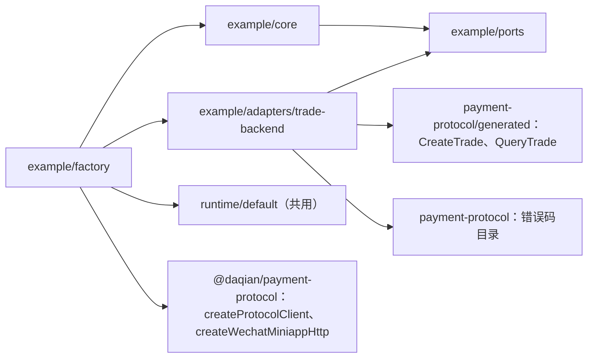

## Context

本仓库复制自 infra-payment-sdk `1e23ae4`，基线 `pnpm check:fast` 已通过（首个提交 `020e582`）。本 Change 先完成两件事，为后续删除支付业务做准备：

1. 把写死在支付上的场景门禁改为通用门禁，并加上四条前置检查；
2. 新增一个中立示例，覆盖模板要保留的 A–G 各项能力。

读代码核实的现状与缺口：

| 位置 | 现状 | 影响 |
| --- | --- | --- |
| `scripts/check-scenarios.ts:281-284`、`scripts/lib/fingerprints.ts:54-57` | Spec 来源和 `specDigest` 都写死为已归档支付 Change 的两个 delta spec | 新 Change 的场景进不了门禁，其 Spec 变化也不影响新鲜度判断 |
| `scripts/lib/spec-inventory.ts:49,84` | 只匹配 `TC-PAYSDK-*`、`FLOW-PAYSDK-*`，不匹配的 Scenario 标题被静默跳过 | 缺 ID 或 ID 格式不对的场景不会被发现 |
| `spec-inventory.ts` 读取 verification 块 | 缺块时报告问题；有多个块时取最后一个 | 多个块不会被发现 |
| `packages/e2e/src/cases/define-case.ts:17`、`tests/fixtures/fixture.schema.json:8` | 绑定和 Fixture 的 ownerId 只接受 `(TC\|FLOW)-PAYSDK-` | 示例无法登记用例和 Fixture |
| `scripts/check-scenarios.ts` 覆盖对账 | 未知的 Scenario 引用会报告；绑定里的 `flowId` 未登记时不报告 | FLOW 登记丢失不会被发现 |
| `openspec/specs/payment-sdk/spec.md` | FLOW 表原本写在 Requirement 之外的独立章节，归档以 Requirement 为单位合并，这一节被丢弃（已模拟归档复现：Requirement 内的表保留，外面的表丢失）；24 个场景及其 verification 块与归档一致 | 直接改读主 Spec 会丢掉 8 条 FLOW |
| `openspec/specs/payment-sdk-contract/spec.md` | 26 个场景与归档一致；"公共 API 提案"等 Requirement 之外的章节同样没有同步 | 不影响场景清单；这些章节不是门禁输入 |
| 已归档支付 Design 第 1198–1213 行 | verification 块与 FLOW 表的字段含义只写在这里；`blockedBy` 定义为支付专用的"SDK-P 引用"；FLOW 说明要求的"未决依赖"列在实际表格中并不存在 | 格式说明归属不对，且已与现状不一致 |
| `scripts/verification.schema.json` | 只有结构约束，没有字段说明；`engineering` 的 `requiredIn` 只允许 `integration`；`blockedBy` 限定 `^SDK-P-` | 需要补说明并放宽 `blockedBy` |
| FLOW 表格式 | 没有 schema，由 `spec-inventory.ts:80-93` 按列序号隐式解析；支付表的"关联 Scenario"列用的是 `CONTRACT-001/002` 这类简写 | 格式无明确定义 |
| 51 个支付 Fixture manifest | `sources.spec` 指向归档 spec 并记录其摘要 | 归档内容不可变，这些摘要继续有效 |

约束：每个任务完成后 `pnpm check:fast` 必须通过；手写代码四项覆盖率 100%；不修改 IDL、Consumer、包名或 registry；不删除支付相关内容。

## Goals / Non-Goals

**Goals:**
- 门禁从有效 Spec（主 Spec 加 active change）构建场景与 FLOW 清单；支付的清单、义务和 summaries 与改造前逐项一致。
- 四条前置检查（OpenSpec 存在、场景 ID 合规且唯一、verification 块合规、FLOW 表写在 Requirement 正文中）先于对账执行，并写进根 AGENTS.md 的硬规则。
- 示例按 Spec EX-01～07 实现，在 SDK、协议 testing、E2E、Live 中都与支付代码隔离。
- 示例的全部场景和 FLOW-TEMPLATE-EXAMPLE-001 在 Shadow 下取得运行证据（integration 与 weapp），并纳入场景门禁。示例既用来走通模板全流程，也作为给使用方的样板。

**Non-Goals:**
- 不改变支付的行为、Spec 中的 Requirement 或已登记的 TC/FLOW；不重写支付 Fixture 的来源路径。
- 示例用到的 `CreateTrade` 字段不纳入支付 IDL 契约清单（`contract-inventory`），示例行为通过其 Spec 场景验证。
- 不通用化 `requiredIn` 中的项目名（`sdk-unit` 等）、Vitest meta 键 `paymentCase`、注解名 `payment-evidence` 和包名，这些随后续的包名通用化一起处理。
- 本 Change 不做 Live 真实运行，也不验证真实服务端是否接受示例请求（例如未填的 `skuSnapshot`）。示例的行为证据全部来自 Shadow：在契约确定的前提下，由 Shadow 在前端内部闭环整套服务。

## Decisions

### Decision: 有效 Spec 的发现与合并

门禁不再写死路径，改由新模块 `scripts/lib/spec-sources.ts` 发现来源：

1. **基础层**：`openspec/specs/*/spec.md`，以目录名作为 capability。
2. **变更层**：`openspec/changes/*/specs/*/spec.md`，跳过 `archive`。多个 active change 按目录名字典序依次合并。
3. **合并规则**：以 Requirement 为单位。
   - ADDED：新增。若同名 Requirement 已存在，报错。
   - MODIFIED：整体替换同名 Requirement 及其下全部场景。若目标不存在，报错。
   - REMOVED：删除同名 Requirement 及其下场景。
   - RENAMED：只改名，场景不变。
   - 两个 active change 修改或删除同一个 Requirement 时，报告冲突。
4. **FLOW 表**：只有写在某个 Requirement 正文中、表头第一列为 `FLOW ID` 的表格才登记为 FLOW，FLOW 随所在的 Requirement 一起参与合并（被 MODIFIED 替换、被 REMOVED 删除）。写在 Requirement 之外的这种表格一律报错（GATE-03 / SCN-SCENARIO-GATE-007）。同一有效 Spec 内 FLOW ID 重复同样报错。

仍沿用现有的 remark AST 解析，不调用 `openspec show --json`。原因：CLI 输出不包含 `json verification` 代码块和 FLOW 表这两类门禁必需的数据，而且让清单依赖 CLI 输出格式会增加漂移风险。CLI 只用于前置检查。

`fingerprints.ts` 的 `specDigest` 改为对 `spec-sources` 发现的全部文件计算摘要，使 active change 的 Spec 变化也能让旧报告失效。支付 Fixture 的 `sources.spec` 继续指向归档文件：归档内容不可变，摘要仍然有效，本 Change 不做迁移。

**支付 FLOW 的迁移**：不直接编辑主 Spec，而是在本 Change 的 `specs/payment-sdk/spec.md` 中 MODIFIED SDK-14：原文、三个场景和 verification 块逐字保留，只在第一个场景之前插入归档 delta 中"必需集成流程"整节的正文（说明段落、8 行 FLOW 表以及 case 细表），去掉原来的 `##` 标题。SDK-14 原文本就写着"本文件登记的必需集成流程"，这张表放在这里语义吻合。已在仓库副本上模拟归档本 Change：主 Spec 中保留了 8 条 FLOW，24 个场景内容不变。Change 进行中，门禁通过合并 MODIFIED 读到这张表，支付的 FLOW 集合不受影响。

**兜底检查**：GATE-04 的未知 FLOW 引用检查仍然保留，用来发现任何其他原因造成的登记丢失。

备选方案：继续写死路径，只多加一个示例 Spec 路径。否决原因：每新增一个 Change 都要改门禁代码，与模板目标相悖。

### Decision: 前置检查与 ID 配置

新增根配置 `scenario-gate.config.json`，按 `scenario-gate.config.schema.json` 校验，配置不合规时门禁直接失败：

```json
{
  "scenarioIdPatterns": ["^TC-PAYSDK-[A-Z]+-\\d{3}$", "^SCN-[A-Z0-9]+(?:-[A-Z0-9]+)*-\\d{3}$"],
  "flowIdPatterns": ["^FLOW-PAYSDK-\\d{3}$", "^FLOW-[A-Z0-9]+(?:-[A-Z0-9]+)*-\\d{3}$"]
}
```

新模块 `scripts/lib/scenario-config.ts` 负责读取这份配置，`spec-inventory`、`check-fixtures` 和 `check-scenarios` 共用。场景报告器（`packages/e2e/src/reporters/scenario-reporter.ts`）只收集执行事实，不读取 ID 配置、不做格式判断；测试绑定中的 ID 由 `check-scenarios` 对账时与清单比对，引用未登记的 Scenario 或 FLOW 即报错。`fixture.schema.json` 中 ownerId 的 pattern 放宽为非空，格式改由 `check-fixtures` 按配置校验。`define-case.ts` 属于 E2E 运行时，不读取根配置，只校验 ownerId 非空且为大写 ID 形态；绑定是否合规交给门禁对账判断。这样 E2E 源码不会反向依赖 `scripts`。

`check-scenarios` 的执行顺序固定如下，任一步有问题就输出全部已发现的问题，并在读取报告之前非零退出：

1. **OpenSpec 前置（GATE-01）**：`openspec/specs` 必须是目录；执行 `openspec --version` 必须退出码为 0。CLI 通过可注入的执行函数调用。`check:fast` 不得依赖本机安装的 `openspec`：单测直接替换执行函数；integration 中所有经过真实门禁 CLI 的用例（包括恢复通过、支付基线、各类反例），都在临时目录放一个受控的 stub 可执行文件 `openspec`（只响应 `--version` 并返回 0），并把该目录放在 `PATH` 最前面；"CLI 不可调用"的反例则使用不含 `openspec` 的受控 `PATH`。只有面向真实仓库的 `pnpm check:scenarios`（属于 `pnpm check`）需要使用方自行安装的 CLI。

**`--input` 模式不执行前置检查**：`--input` 只对调用方给出的 `CoverageInput` 做纯计算，现在也不读取任何 Spec（`scripts/check-scenarios.ts:273-277`），因此不执行 OpenSpec、ID、FLOW 位置、verification 块这四类前置检查；对账中的未知引用检查（含新增的未登记 FLOW 引用）照常执行。这样现有的支付门禁用例（`packages/e2e/tests/tooling/helpers.ts:33-39` 以 `--input` 调用真实门禁 CLI，TC-PAYSDK-CORE-015/016/017）不需要修改，在没有 `openspec` 的环境中也能通过。单测覆盖"`--input` 模式下即使 CLI 不可用也完成对账"。
2. **场景 ID（GATE-02）**：每个 `#### Scenario:` 标题必须以符合某个 `scenarioIdPatterns` 的 ID 开头，FLOW ID 同理；在有效 Spec 内全局唯一，MODIFIED 替换的情况除外。不合规的 Scenario 以"标题原文"作为占位 ID 留在清单中，计入缺口。
3. **FLOW 表位置与行格式（GATE-03）**：表头第一列为 `FLOW ID` 的表格必须位于某个 Requirement 正文中，每一行按 `scripts/flow.schema.json` 校验。
4. **verification 元数据（GATE-05）**：每个 Scenario 下恰好一个 `json verification` 块，通过 `scripts/verification.schema.json` 校验，且 checks 只引用已声明的 checkpoint。kind 与运行环境的匹配已由 schema 的 `allOf` 约束。
5. **清单与对账**：沿用现有 `evaluateCoverage`，新增一条检查：绑定中的 `flowId` 不在清单中时，报告 `unknown flow`（GATE-04）。

`openspec` CLI 不作为项目依赖，由使用方自行提供。根 AGENTS.md 的写法见下一个决定。

### Decision: 格式约定的归属：schema 为权威，AGENTS 指路，Spec 定义门禁行为

第 2、3、4 条硬规则对应的格式，都是写任何 Spec 时要遵守的写作约定，不属于某一个能力的行为，所以不在能力 Spec 或 Design 里定义字段。分工如下，每处只写一份：

| 位置 | 内容 |
| --- | --- |
| 三份格式 schema | 唯一权威定义。每个属性（含嵌套）都有中文 `description`：`scenario-gate.config.schema.json`（新增，ID 格式配置）、`scripts/verification.schema.json`（补说明）、`scripts/flow.schema.json`（新增，FLOW 行） |
| 根 AGENTS.md"OpenSpec 硬规则" | 四条规则各一句说明 + 对应 schema 路径 + 一个最小示例（一个 verification 块、一张两行的 FLOW 表）；注明第 2 条的 ID 格式沿用 Change Skill，第 3、4 条是项目扩展，Skill 不会生成也不会提醒 |
| `scenario-gate` Spec | 只定义门禁按这三份 schema 校验、不合规就阻断的行为，引用 schema 路径，不复制字段表 |

**verification schema 的调整**：补全 description；`blockedBy` 的元素从 `^SDK-P-` 放宽为非空字符串，含义改为"尚未关闭的依赖的引用，存在时该场景保持缺口"。支付场景的 `blockedBy` 目前全为空数组，放宽不影响支付基线。`engineering` 只允许 `integration` 的约束保持不变，本 Change 所有 engineering case 已符合。

**FLOW schema**：门禁把 Requirement 正文中表头第一列为 `FLOW ID` 的表格逐行解析为对象 `{ id, relatedScenarios, stages, cases, requiredIn, notes }`，再按 `flow.schema.json` 校验：共 6 列；`id`、`stages`、`cases`、`requiredIn` 必填；`requiredIn` 取值限定为 `integration`、`weapp`；列表列用 `、` 分隔，阶段用 `→` 分隔。表头文字以第一列 `FLOW ID` 识别，其余列按位置取值，与现有解析保持一致，保证支付表不需要改写。`relatedScenarios` 暂为说明性字段，schema 只要求为字符串，门禁不校验其中的 ID 是否已登记；这是已知缺口，删除支付后收紧为必须引用已登记的完整 ID。

**文档完整性检查（GATE-06）**：新增 `scripts/lib/schema-docs.ts`，递归检查三份 schema 中每个属性的 `description`，并检查根 AGENTS.md 是否包含三份 schema 的路径；接入 `check-architecture`。

归档 Design 中的格式说明不再作为依据；使用方以 schema 和 AGENTS 为准。

### Decision: 长期约定的项目级载体与 AGENTS 结构

原则：本 Change 引入的每条长期约定，都必须落在项目级载体上；Change 文档只记录落地原因与验收，不能是唯一出处。下表是本 Change 的载体清单，Plan Review 与各任务验收据此核对"不存在只写在 Change 文档里的长期约定"：

| 长期约定 | 项目级载体 |
| --- | --- |
| 四条硬规则 | 根 AGENTS.md"模板通用规则 · OpenSpec 硬规则" |
| ID 配置、verification 块、FLOW 行的格式 | 三份 schema（字段带 description）；根 AGENTS.md 引用路径并给最小示例 |
| 门禁读取哪些 Spec、ID 格式在哪里配置 | 根 AGENTS.md"场景门禁与归档"；`scenario-gate.config.json` |
| 归档时的必做事项（FLOW 表在 Requirement 内；Fixture manifest 的 `sources.spec.path` 改指向归档目录） | 根 AGENTS.md"场景门禁与归档" |
| SDK 分层、示例与业务的隔离、依赖方向规则与 `wx` lint 规则的含义 | `packages/payment-sdk/AGENTS.md`"按示例扩展新业务"；机器约束在 `.dependency-cruiser.cjs`、`eslint.config.js`，规则注释引用该节 |
| Shadow 按业务登记路由的扩展方式 | `packages/payment-protocol/AGENTS.md`"按示例扩展新业务" |
| 用例、FLOW、Fixture、weapp runner、Live 页面的放置与绑定方式 | `packages/e2e/AGENTS.md`"按示例扩展新业务" |
| 示例本身的行为 | `template-example` Spec（示例自己的内容，不需要其他载体） |

**AGENTS 结构**：根目录和三个包的 AGENTS.md 都改为两部分。

1. **模板通用规则**：本 Change 新增或改写，长期有效。根"必读"改为通用入口：有效 Spec 在 `openspec/specs/`，进行中的 Change 用 `openspec list` 查看，以及本文件的硬规则；不再写死任何 Change 路径。
2. **当前业务：支付**：原有支付条款以及指向归档支付 Change 的必读链接，原样移入本节，并注明"删除支付业务时整节移除"。这样支付代码在删除前仍有依据，模板规则也不被支付内容混淆。

移入时只调整位置，不改写支付条款的语义。唯一例外是 `payment-protocol/AGENTS.md` 第 7 条"Shadow 路由仍只限 CreateTradePay/QueryTrade"：它与示例的 `CreateTrade` 路由直接冲突，改为"Shadow 路由按业务登记，支付登记 CreateTradePay/QueryTrade"，其余语义不变。

`check-architecture` 已检查 AGENTS 中的相对链接可解析；新结构下的链接同样受此约束。

### Decision: 支付基线等价验证

GATE-04 的"支付对账结果不变"只比较**支付子集**，即 ID 符合支付格式（`TC-PAYSDK-*`、`FLOW-PAYSDK-*`）的 Scenario 与 FLOW。现有 summaries 是对清单中全部场景的合计（`scripts/check-scenarios.ts:246-265`），加入示例和门禁场景后必然变化；运行报告的新鲜度又依赖 `sourceDigest`（覆盖 `scripts/`）和 `specDigest`，改造本身就会让旧报告过期。所以比较分成两部分，都不依赖实时报告：

1. **清单与义务等价**：改造前用现有门禁在 `--inventory` 模式下导出支付子集的 Scenario ID 集合、每个 case 的 `key/kind/requiredIn/checks`、FLOW 的 `id/cases/requiredIn/stages`，保存为 `packages/e2e/tests/fixtures/SCN-SCENARIO-GATE-005/payment-inventory.json`。改造后，新门禁从有效 Spec 构建清单、过滤出支付子集，要求与该文件逐项相等。
2. **对账逻辑等价**：改造前构造一份固定的 `CoverageInput`（`--input` 模式），其中 `current` 指纹固定写死，场景、FLOW、绑定和报告都取自支付子集的一次真实运行记录；保存该输入及现有 `evaluateCoverage` 对它的输出（summaries 与 issues）为 `payment-coverage-input.json`、`payment-coverage-output.json`。改造后，用新门禁对同一份输入运行 `--input` 模式，要求输出相等。因为 `current` 指纹是固定的，结果不受源码和 Spec 摘要变化影响。

两份基线文件由 manifest 记录摘要，受 `check:fixtures` 管理。各任务的共同完成条件只要求这两项等价成立，不比较实时报告中的执行数或通过数；实时 `pnpm check:scenarios` 中支付场景的执行状态，取决于该次是否同时运行了 integration 与 weapp，只在 Task 6 的全量 `pnpm check` 中作为完整门禁验收。

### Decision: 示例在 SDK 中的结构与公共契约

示例自成一个目录，内部仍按模板的分层组织：

```text
packages/payment-sdk/src/example/
  contracts.ts            公共类型（带中文 JSDoc）
  factory.ts              createExampleClient、ExampleConfigurationError
  core/client.ts          create 与 observe 的编排、观察循环、单次结果闩锁
  ports/backend.ts        ExampleBackend 内部端口
  adapters/trade-backend.ts  唯一接触 generated 的地方：中立模型与交易接口互相映射
```



SDK 根入口追加 `export type * from './example/contracts'` 和 `export { createExampleClient, ExampleConfigurationError } from './example/factory'`。

公共契约：

```ts
type ExampleClientOptions = Readonly<{
  runtime: 'wechat-miniapp';
  gatewayBaseUrl: string;
  getAccessToken: () => string | null | Promise<string | null>;
  catalog: ExampleCatalog;
  requestContext?: Readonly<{ productId?: string; lane?: string; appVersion?: string }>;
  policy?: ExamplePolicyOverrides;
}>;
type ExampleCatalog = Readonly<{ kind: string; itemId: string; itemName: string; unitValue: bigint }>;
type ExamplePolicyOverrides = Readonly<{ requestTimeoutMs?: number; intervalMs?: number; windowMs?: number }>;
type ExampleCreateInput = Readonly<{ ownerId: string; externalRef: string; units: number }>;
type ExampleResourceRef = Readonly<{ id: string; externalRef: string }>;
type ExampleState = 'pending' | 'completed' | 'closed' | 'unknown';
type ExampleError = Readonly<{
  category: 'invalid_input' | 'unauthorized' | 'host' | 'network' | 'timeout' | 'server' | 'protocol';
  message: string;
  serverCode?: string;        // 十进制字符串
  serverDescription?: string; // 错误码目录中已知时附带
}>;
type ExampleCreateResult = Readonly<{ ok: true; reference: ExampleResourceRef }> | Readonly<{ ok: false; error: ExampleError }>;
type ExampleRunOptions = Readonly<{ cancellation?: Cancellation; policy?: ExamplePolicyOverrides }>;
type ExampleOutcome = Readonly<{
  end: 'completed' | 'closed' | 'window_elapsed' | 'failed' | 'cancelled';
  lastState: ExampleState;
  error?: ExampleError;
}>;
interface ExampleClient {
  create(input: ExampleCreateInput): Promise<ExampleCreateResult>;
  observe(reference: ExampleResourceRef, options?: ExampleRunOptions): Promise<ExampleOutcome>;
}
```

`Cancellation` 使用协议包公开导出的类型，不引用支付的 `contracts`。可以共用的只有 `runtime/default`（`RuntimePort`）以及协议包的公开入口，这与 EX-05 的约定一致。

**配置校验**：`gatewayBaseUrl` 为非空字符串，`getAccessToken` 为函数，`catalog` 的各字符串字段非空且 `unitValue > 0n`，时间策略字段均为正数。任一不满足就抛出 `ExampleConfigurationError`；工厂本身不读平台、不取 Token、不发请求。

**输入校验**：`ownerId` 为十进制正整数字符串，且在 int64 范围内；`externalRef` 为 1～64 个字符；`units` 为 1～999 的整数。

### Decision: 中立模型到交易接口的映射

映射全部集中在 `adapters/trade-backend.ts`：

| 示例 | 交易接口 |
| --- | --- |
| `catalog.kind` | `bizType` |
| `externalRef` | `bizTradeNo`；`items[0].bizOrderNo = externalRef + '-1'` |
| `ownerId` | `userId`（`BigInt`） |
| `catalog.itemId` / `itemName` | `items[0].skuId` / `skuName` |
| `units` | `items[0].quantity` |
| `catalog.unitValue × units` | 条目级：`items[0].unitPrice = unitValue`，`items[0].discountAmount = 0`，`items[0].payAmount = unitValue × units`（IDL 要求 `= unit_price × quantity − discount_amount`，`trade.ts:270`）。整单级：`originalAmount = unitValue × units`，`discountAmount = 0`，`payAmount = unitValue × units`（IDL 要求分别等于各条目对应字段之和，`trade.ts:309-316`）。`create-mapping` module 用例逐一断言这六个金额字段 |
| 固定值 | `goodsType = GoodsType.GOODS_TYPE_VIRTUAL`（generated `pay/v1`）；`items[0].skuSnapshot` 不填（IDL 中为可选字段） |
| `CreateTradeResponse.tradeNo` | `reference.id` |
| 查询 | `QueryTradeRequest{ tradeNo: id, syncChannel: false }`。IDL 规定 `tradeNo` 与 `(bizType, bizTradeNo)` 二选一（`trade.ts:411`），示例只按 `tradeNo` 查询，与支付 backend 一致；`externalRef` 只用于本地关联，不进入查询请求 |
| `trade.status` | CREATED、PAYING → `pending`；PAID → `completed`；CLOSED → `closed`；其余 → `unknown` |
| `trade.tradeNo` 与请求不一致 | `protocol` 错误 |

**错误映射**：协议包的每种通信结果都有唯一对应，覆盖 `CommunicationError.code` 全部取值（`packages/payment-protocol/src/transport/errors.ts:3-4`）：

| 协议结果 | 示例类别 | 观察中可重查 |
| --- | --- | --- |
| `TIMEOUT` | `timeout` | 是 |
| `NETWORK_ERROR` | `network` | 是 |
| `EMPTY_ACCESS_TOKEN` | `unauthorized` | 否 |
| `HOST_CONTEXT_ERROR`（宿主 `getAccessToken` 抛错或返回非字符串） | `host` | 否 |
| `CODEC_ERROR` 且带 HTTP 401 | `unauthorized` | 否 |
| `CODEC_ERROR` 且带其他非 2xx HTTP 状态 | `server`（不带 `serverCode`，message 注明 HTTP 状态） | 否 |
| `CODEC_ERROR` 且 HTTP 为 2xx 或无 HTTP 上下文 | `protocol` | 否 |
| `CANCELLED` | 内部以 `cancelled: true` 传递，不对外暴露类别 | — |
| BaseResp 非零 | `server`，带十进制 `serverCode`；错误码目录中的 Unauthorized 码归入 `unauthorized` | 仅目录中 `QueryTrade` 的 Unavailable 码可重查 |

HTTP 非 2xx 的判定方式与支付 backend 相同（`backend.ts:73-78`）。错误码按原始 bigint 比较，不从文案推断。

**可重查**：观察期间，只有 `timeout`、`network`，以及目录中 `QueryTrade` 的 Unavailable 码可以重查，其余错误直接以 `failed` 结束。示例核心只根据端口返回的 `retryable` 标记做判断，不认识任何错误码数值。

### Decision: 观察循环、预算与取消

- **默认值**：`requestTimeoutMs = 10_000`，`intervalMs = 3_000`，`windowMs = 60_000`。取值优先级：单次调用 > 初始化配置 > 默认值。
- **创建**：发请求一次，截止时间为 `now + requestTimeoutMs`，不重试。`create` 不接受停止信号。
- **观察**：窗口截止时间为 `start + windowMs`。第一次查询立即发出；每次查询的截止时间取 `now + requestTimeoutMs` 与窗口截止时间中较早者。结果处理：
  - 终态：立即结束。
  - 非终态，或可重查的错误：在剩余窗口内休眠 `intervalMs` 后再查；窗口耗尽则以 `window_elapsed` 结束，`lastState` 为最后一次成功查询得到的状态，没有成功查询过则为 `unknown`。
  - 不可重查的错误：以 `failed` 结束。
- **取消**：订阅宿主的停止信号，把它转发给休眠和进行中的请求。宿主停止后以 `cancelled` 结束；因为预算耗尽导致的通信取消不算宿主取消，按窗口规则结算。
- **单次结果**：用一个 `ended` 闩锁保证只交付一次结果，并在结束时解除订阅、取消等待。迟到的响应会被丢弃。

以上沿用支付核心已经验证过的"停止/预算/闩锁"模式，但代码独立实现，不引用支付核心。

### Decision: 依赖方向与 lint 规则

在 `.dependency-cruiser.cjs` 中新增三条规则：

- `example-core-no-generated`：`^packages/payment-sdk/src/example/(core|ports)/` 不得依赖任何 `generated/` 路径，也不得依赖 Node 核心模块。
- `example-no-payment`：`^packages/payment-sdk/src/example/` 不得依赖 `^packages/payment-sdk/src/(core|adapters|ports|errors|contracts|factory)`（`runtime/` 除外）。
- `payment-no-example`：`^packages/payment-sdk/src/(?!example/)` 不得依赖 `^packages/payment-sdk/src/example/`；`index.ts` 除外，因为它需要导出示例。

`wx` 是全局对象，依赖分析发现不了，所以在 `eslint.config.js` 中为 `packages/payment-sdk/src/example/{core,ports}/**` 配置 `no-restricted-globals: ['wx']`。上述三条规则和这条 lint 规则，都在 integration 中各用一个违规反例证明会阻断，再证明恢复后通过（SCN-TEMPLATE-EXAMPLE-008）。

### Decision: 协议 testing 与 Shadow

新建 `packages/payment-protocol/testing/shadow/example/routes.ts`，导出 `discoverExampleRoutes()`：从 generated metadata 中取出 `CreateTrade` 和 `QueryTrade` 两条路由，校验方式与支付路由相同。`createShadowServer` 增加可选参数 `routes`，默认值仍是支付路由，因此支付调用方的行为不变。示例的 Shadow 场景复用已有的 step、fault 和 request record 机制。

### Decision: E2E 的布局与绑定

- **integration 用例**：`packages/e2e/tests/example/SCN-TEMPLATE-EXAMPLE-0xx.spec.ts`；FLOW 用例为 `packages/e2e/tests/example/FLOW-TEMPLATE-EXAMPLE-001.spec.ts`。
- **weapp 执行**：新增 `packages/e2e/host/weapp/example-runner.ts`。weapp driver 只能调用注册在 `getApp()` 上的函数（`src/drivers/weapp.ts:19-24`），所以要对共享的测试宿主文件做**只增不改**的扩展：`host/weapp/vite.config.ts` 在现有 `protocol-runner` 之外增加 `example-runner` 构建入口；`host/weapp/app.js` 增加注册 `runExampleCase`，现有三个支付函数保持不变。`example-runner.ts` 与 `app.js` 的新增分支由现有的 `packages/e2e/src/drivers/weapp-host.test.ts`（`test-tools-unit`）扩展覆盖；`app.js` 在 100% 覆盖范围内。
- **weapp 用例**：放在 `packages/e2e/tests/weapp/example/`。现有 weapp 项目的 include 是 `packages/e2e/tests/weapp/**`，已能收录；而 integration 项目的 include 只新增 `packages/e2e/tests/example/**`，两者不重叠，示例 weapp 用例不会被 integration 项目误跑。
- **Fixture**：`packages/e2e/tests/fixtures/<ownerId>/`，与支付共用同一个根目录，靠 ID 命名空间区分。原因是 `check-fixtures` 要求平铺的 ownerId 目录。
- **module 用例**：写在 `src/example/**` 旁边的 `*.test.ts` 中，绑定格式与支付的 module 用例相同，属于 `sdk-unit`；Shadow 路由的用例属于 `protocol-unit`；门禁工具的用例属于 `test-tools-unit`。
- 修改 `packages/e2e` 下各 vitest 配置的 include，纳入 `tests/example/**`。`check-architecture` 的目录白名单不需要改。

### Decision: Live 示例页面

- **页面注册**：`app.live.json` 增加页面 `pages/live/example/index`，控制逻辑放在 `host/weapp/live/example-controller.ts`，调用生产 SDK 的 `createExampleClient`。
- **配置**：`.env.live` 白名单增加非敏感键 `LIVE_EXAMPLE_KIND`、`LIVE_EXAMPLE_ITEM_ID`、`LIVE_EXAMPLE_ITEM_NAME`、`LIVE_EXAMPLE_UNIT_VALUE`；`ownerId` 复用已有的 uid 预填键，页面上可以修改。Token 沿用 Storage 与 getter 机制。
- **证据**：`evidence.schema.json` 增加记录 `LIVE-TEMPLATE-EXAMPLE-001`（kind 为 `live-example-record`），内容包括资源引用、一次最终结果和请求路径列表。`check-evidence` 校验记录结构，并拒绝请求路径中包含 `/api/base/trade/pay` 的记录。
- **构建检查**：`host/weapp/vite.live.config.ts` 当前只有一个固定入口（`pages/live/index.js`），`src/live/build.ts` 的 `liveOutputFiles`/`liveSourceFiles` 也是固定列表；两者都以只增不改的方式加入示例页面。`live:build` 和 `live:check` 的离线检查随之扩展到示例页面，覆盖白名单注入、无 Token、无支付调用；支付 Live 页面的构建结果不变。

页面作为样板交付，本 Change 不做真实运行。使用方有真实服务和测试 Token 时，可以按现有 Live 流程运行并取证。

### Decision: 包与发布

`scripts/check-package.ts` **保持不变**。它目前只打包并检查产物清单、测试路径与协议依赖版本（`scripts/check-package.ts:20-29`），没有导出列表，也不做 ESM/CJS/类型导入检查；支付门禁用例 `TC-PAYSDK-CORE-017` 以 `--input` 调用它并要求现有输入完全通过（`TC-PAYSDK-CORE-017.spec.ts:38-53,107,125`），因此不向其输入或检查逻辑加入示例相关内容。

示例的包消费只由新增的 integration 用例 `packages/e2e/tests/example/SCN-TEMPLATE-EXAMPLE-001.package.spec.ts`（case `package-consumer`）证明，写法参照支付的 `TC-PAYSDK-CORE-014.spec.ts`，但不复用它的 Fixture 或辅助代码：

1. 在临时目录用 `pnpm --filter <包> pack` 打出协议包与 SDK 包的 tarball；
2. 分别建立 ESM 消费工程（`type: module`，`import { createExampleClient, ExampleConfigurationError } from '@daqian/payment-sdk'`）和 CommonJS 消费工程（`require`），以 `file:` 依赖安装 tarball，运行后断言两个导出存在，且以非法配置调用 `createExampleClient` 会抛出 `ExampleConfigurationError`；
3. 各放一个 `.ts` / `.cts` 消费文件，用 `tsc --noEmit` 校验示例公共类型可从 `dist/index.d.ts`、`dist/index.d.cts` 解析。

这一用例单独进入 integration 报告，与 `check:package` 的现有职责互不影响。发布入口与版本不变，本 Change 不上传任何包。

### Decision: 任务顺序与"可运行"判定

1. 用现有门禁生成支付基线，然后完成门禁通用化（含 SDK-14 的 FLOW 表经 delta 合并）、四条前置检查、三份格式 schema 及其字段说明和文档完整性检查，更新根 AGENTS.md。
2. 实现示例的 SDK 部分：契约、工厂、核心、端口、适配器、module 用例和依赖规则。
3. 实现协议 Shadow 路由，以及 integration 用例和 FLOW 用例。
4. 实现 weapp 执行和用例。
5. 实现 Live 页面与证据门禁，并纳入包消费验证。

每个任务结束时 `pnpm check:fast` 必须通过。`check:scenarios` 从任务 1 起就能看到示例场景，在任务 5 完成之前，它会如实把示例场景报告为覆盖缺口，因此 `pnpm check` 在这期间预期不通过；支付部分必须始终与基线一致。任务 5 结束时运行完整的 `pnpm check`，需要本机微信开发者工具。

## Risks / Trade-offs

- **示例依赖支付 IDL**：示例借用交易接口，模板暂时仍绑定公司的 IDL 仓库。缓解：映射只存在于一个适配器文件中，以后更换 IDL 时只替换这一层，这件事作为单独的一步。
- **Shadow 与真实服务端之间可能有差异**：示例只以 Shadow 为证据，证明不了真实服务端是否接受请求，例如示例没有填 `skuSnapshot`，服务端还可能校验 `bizType`、SKU 和价格。这是有意接受的：示例的目标是走通模板流程并作为样板，契约正确性以 IDL 为准。
- **FLOW 表放进 Requirement 后依赖 OpenSpec 的归档行为**：目前 OpenSpec 1.6.0 归档时会原样保留 Requirement 的正文，已模拟验证。缓解：OpenSpec 升级后如果行为变化，GATE-04 的未知 FLOW 引用检查能发现。
- **自己实现 delta 合并**：合并规则由项目自己实现，可能与 OpenSpec 的语义有偏差。缓解：module 用例覆盖 ADDED、MODIFIED、REMOVED、RENAMED、冲突和 archive 忽略；另用本 Change 的真实目录做一次 integration 对照。
- **归档后示例 Fixture 的来源路径失效**：Fixture manifest 的 `sources.spec` 记录所依据 Spec 的路径和摘要。Change 进行中，示例 Fixture 指向 `openspec/changes/template-example/specs/...`；归档时这个目录会被移到 `archive/<日期>-template-example/`，`check:fixtures` 会因为路径不存在而失败。支付的 51 个 manifest 就是在归档提交中重新指向归档路径的。缓解：归档本 Change 时，在同一个提交里把示例 manifest 的 `sources.spec.path` 改为归档路径（摘要不变，因为内容没变），并运行 `pnpm check:fixtures` 确认。
- **AGENTS 两部分结构可能被后续修改混淆**：有人把通用规则写进支付小节，删除支付时会被一起删掉。缓解：两部分的标题固定，支付小节注明整节删除；Plan Review 与任务验收按上面的载体清单核对。
- **FLOW 的"关联 Scenario"列暂不校验**：在删除支付之前，这一列可能写错而不被发现。缓解：登记为已知缺口，删除支付后在 `flow.schema.json` 与门禁中收紧。
- **前置检查依赖本机 CLI**：没有安装 `openspec` 的环境中，`pnpm check` 中的场景门禁会失败。这是有意为之，符合规则 1。`check:fast` 中的 integration 门禁用例使用受控 stub，不依赖本机 CLI。
- **示例与支付代码有相似之处**：观察循环与支付核心的实现思路相似但各自独立，属于有意的重复，这样删除支付时不会牵连示例。
