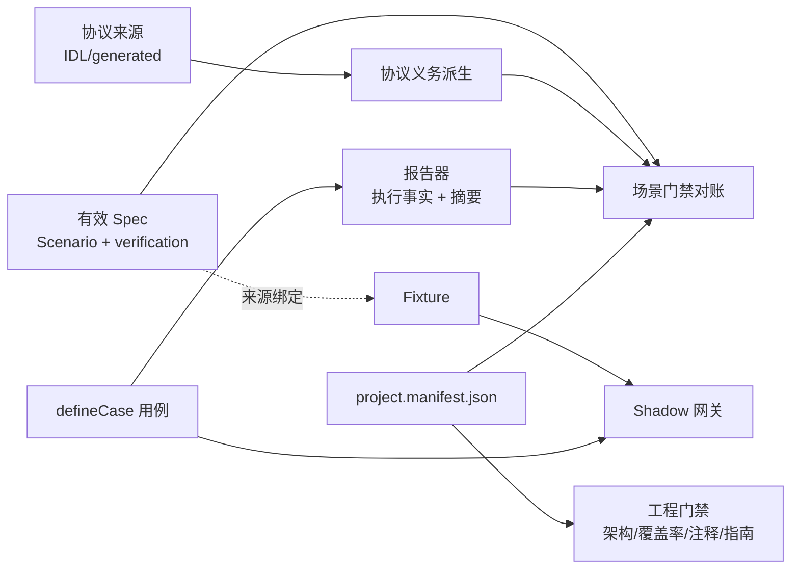

## Context

模板的质量体系是一条链：有效 Spec 中的 Scenario 声明行为，`json verification` 块声明证据义务（case × checkpoint × 运行环境），测试用 `defineCase` 履约并经 Shadow 网关与 Fixture 闭环外部交互，报告器记录执行事实与来源摘要，场景门禁按清单对账。工程门禁（架构、覆盖率、产物、注释、指南）按项目清单 `project.manifest.json` 工作。



第一个真实使用方 xueshan_fe 跑完了完整周期。按"只吸收实施方发现不了、或每个项目都要重复付出高摩擦成本的问题"筛选后，链上暴露的缺口集中在以下几处（括号内为使用方反馈编号或会话记录）：

- **摘要与范围**：源码指纹只收 `.ts/.js`，构建配置、锁文件、HTML 改动后旧证据仍判为最新（#22 #23）；覆盖率可以因 `include` 漏配或 `exclude` 新增让整个文件缺席，阈值仍显示 100%（#6、入口文件被排除）。
- **证据完整性**：Fixture 与契约不一致仍计为通过（443/1162）；执行了但未登记的 checkpoint 无人守护（#58）；协议义务的接口集合、错误码表和 ID 前缀取自示例，产品新增的调用不产生义务（FCR2-I1）；注释门禁只检查示例文件。
- **生命周期摩擦**：多个 active Change 时门禁互相污染（#1）；归档后 Fixture 的 Spec 路径全部失效，两次分别手改 141 份与 35 份（#18 #62）；每个 Task 整套全量运行；三条验收命令须手工共用 run id，过期提示不说明原因；门禁自测依赖仓库实时状态（#20 #25）。
- **Shadow**：未编排或未注册路由的请求不记录、不报告（#13）；`{x}` 路径在 Express 5 中被当作可选片段（#15）；严格步数与真实时间轮询冲突，项目临时放宽后削弱了次数证据（#42 #53）。
- **写死**：`defineCase` 环境联合类型、默认报告名、tooling 用例包名、ENG-001 临时构建复制清单、inventory 单测、`proto-gen.lock` 路径、依赖规则中的包路径（#3 #4 #14 #19、ENG-001 失败）。
- **规范缺口**：`X-Request-Id` 头名与格式不符合公司规范；没有行数上限、格式化基线与渐进式目录说明；"为什么这样设计"散落在各次归档 design 中，无法支撑技术方案与分享。

本 Change 只处理与产品形态、协议种类、运行平台无关的核心。Web 应用、OpenAPI 协议包、浏览器平台与本地预览由后续 Change `template-web-absorption` 承担，它以本 Change 为前提。

## Goals / Non-Goals

**Goals:**

- 门禁"通过"必须意味着该检查的都检查到了：指纹覆盖全部构建输入，覆盖率覆盖全部手写代码，Fixture 与协议同形，checkpoint 双向一致，协议义务以产品实际消费为准。
- 多 Change 并行、提前规划、归档不再引发门禁误报或批量手工改动。
- Apply 期间可以按需运行受影响的用例；最终验收仍是同一 run id 下的完整证据，一条命令完成。
- 门禁与测试代码中不再有清单之外的写死拓扑。
- 新增规范（行数、格式、渐进式地图、请求 ID、优先采用现成方案）以确定性检查或 AGENTS 约定落地。
- 技术架构文档成为能力与设计理由的长期载体。
- 删除模板示例后门禁仍全绿；以可复用的复刻验收方法验证本次改造。

**Non-Goals:**

- 不新增 Web 应用、OpenAPI 协议包、浏览器平台、本地预览（见 `template-web-absorption`）。
- 不做模块化框架（清单模块声明、能力矩阵）；待更多真实项目后再抽象。
- 不做 UI 还原与一次性验收能力；不做断言质量的机械检查（只以 AGENTS 约定与评审清单约束）。
- 不为存量使用方提供升级工具；不做 `traceparent`；不做服务端状态管理；不处理执行方修改验收标准（归工作流）。
- 不做门禁 run 的取消与加锁。
- TypeScript 不升级主版本。

## Decisions

本节按职责模块组织。每个模块说明要解决的问题、实现方式和关键决策。跨模块共享的契约集中在"共享契约：清单扩展"与"共享契约：手写源码文件清单"两节。

### Decision: 共享契约：清单扩展

`project.manifest.json` 是门禁读取工程事实的唯一入口，本次扩展字段如下。字段的唯一权威仍是 `project.manifest.schema.json`，每个新属性都带中文 `description`：

| 字段 | 含义 | 消费方 |
|---|---|---|
| `fingerprints.sourceRoots` | 语义改为：目录下全部 git 跟踪文件与未被忽略的新文件，不再按扩展名过滤 | 源码清单、指纹、覆盖率完整性 |
| `fingerprints.buildInputs` | 新增。影响构建或测试结果、但不在源码目录内的文件或目录，例如 `vite.config.ts`、`tsconfig*.json`、`pnpm-lock.yaml`、`vitest.config.ts`。支持末段通配 | 指纹 |
| `fingerprints.protocolInputs` | 新增，替代写死的 `proto-gen.lock`。协议来源锁文件 | 协议摘要 |
| `fingerprints.hostRoots` | 删除，内容并入 `sourceRoots`（扩展名过滤已取消，它不再有单独存在的理由） | — |
| `packages[].consumedOperations` | 新增，仅 product 角色可填。产品包内声明消费接口的模块路径 | 协议义务派生 |
| `packages[].moduleRoots` | 新增。包内承载模块的根目录（如 `src`、`testing`、`tests`），其一级子目录视为模块 | 渐进式地图检查 |
| `quality.coverageExclusions[]` | 新增。`{ path, reason }`，覆盖率排除登记 | 覆盖率配置与完整性检查 |
| `quality.maxLinesExemptions[]` | 新增。`{ path, reason }`，行数上限豁免登记 | ESLint 配置 |
| `testProjects[].config` | 新增。该测试项目的 Vitest 项目配置文件路径 | 根 `vitest.config.ts` 组装 projects |
| `testProjects[].perFile` | 新增，可选。为 true 时验收入口逐文件运行该项目，每个文件一份报告 | `verify` |
| `testProjects[].prepare` | 新增，可选。逐文件运行前执行的准备命令名（例如退出并预热微信开发者工具） | `verify` |

理由：所有"可以例外"的地方都只登记在清单一处，评审只需要看一个文件的 diff；ESLint 与 Vitest 配置是 JS/TS 文件，可以直接读取清单。替代方案是在 ESLint 配置和 Vitest 配置里各自维护例外，被否决，因为例外会分散，且无法统一校验"每条例外都有理由"。

`hostRoots` 删除是破坏性变更，存量使用方按能力地图自行吸收。

`requiredCommands` 新增：`format`、`format:check`、`check:coverage`、`check:project-map`、`fixtures:refresh`、`test:affected`、`verify`，以及各 perFile 项目的 `prepare` 命令（模板为 `weapp:prepare`）。架构检查校验每个 `testProjects[].prepare` 都登记在 `requiredCommands` 中，从而必然存在于根 `package.json`。

### Decision: 共享契约：手写源码文件清单

新增 `scripts/lib/source-inventory.ts`，产出一份清单，指纹、覆盖率完整性、覆盖率 `include` 三处共用：

- **范围**：对每个 `sourceRoots` 目录执行 `git ls-files -co --exclude-standard -- <root>`，覆盖已跟踪文件和尚未 `git add` 的新文件，被 `.gitignore` 忽略的临时产物自然排除。仓库不是 git 工作区时报错并退出，不退化为全目录扫描。
- **固定排除**：`generated/` 目录下的生成代码；各级 `AGENTS.md` 与 `CLAUDE.md`（只改文档不应让证据过期）。
- **分类**：每个文件标记为 `code`、`test` 或 `asset`：
  - `test`：`*.test.*`、`*.spec.*`，以及 test 角色包 `tests/` 目录下的全部文件（用例的 helper、harness、stub 属于测试支撑，与 ENG-08 的测试文件口径一致）；
  - `code`：其余 `.ts/.js/.mjs/.cjs` 文件（后续 Change 可扩展 `.vue`）；
  - `asset`：其他文件。
  - 指纹使用全部三类，再加上 `buildInputs`。
  - 覆盖率只取 `code` 类，并减去测试文件和 `quality.coverageExclusions`。

**指纹**：`sourceDigest` 由上述清单与 `buildInputs` 计算。`idlDigest` 更名为 `protocolDigest`，由 `protocolInputs` 计算。报告器除了记录各摘要，还记录 `files: { path: sha256 }` 明细，供过期说明使用（见"验收入口与过期说明"）。

**覆盖率**：

- `vitest.config.ts` 的 `coverage.include` 从清单的 `code` 类文件派生，`coverage.exclude` 只保留测试文件模式、`generated/` 和 `quality.coverageExclusions`。
- 新增 `check:coverage`，比对"清单 `code` 类文件减去登记排除"与"覆盖率报告中的文件"：任何文件缺席都报错，登记的排除项指向不存在的文件也报错。它加入 `check:fast`，位于 `test:unit` 之后。

**允许登记的覆盖率排除**：只在被测代码确实只能在平台宿主进程中执行、无法由 unit 项目加载时登记。模板本次登记的条目限于 `packages/e2e/host/weapp/` 下的 `setup.ts`、`vite.config.ts`、`protocol-runner.ts`、`example-runner.ts`，理由均为"只在微信开发者工具宿主中执行，行为证据由 weapp 用例承担"。`host` 下现有已被单测覆盖的 `.js` 文件继续计入覆盖率。除此之外不新增排除。

替代方案是继续用 glob 维护 `include`，被否决：这正是 `.vue` 与 `host/**/*.ts` 静默缺席的原因。

### Decision: 去除写死拓扑

| 位置 | 现状 | 改为 |
|---|---|---|
| `packages/e2e/src/cases/define-case.ts` | `environment: 'integration' \| 'weapp'` | `environment: string`，运行时校验它属于清单中 integration 或 platform 类项目 |
| `scripts/check-scenarios.ts` | 默认报告 `['unit.json','integration.json','weapp.json']` | 由清单 `testProjects` 派生：unit 类项目合并为 `unit.json`，其余每个项目一份 `<name>.json` |
| tooling 用例（GATE-008、ENG-005/006 等） | 写死 `['sdk','api','e2e']` 等包名 | 从清单读取 |
| `SCN-TEMPLATE-ENGINEERING-001` 的临时构建复制 | 写死文件清单 | 复制 `sourceRoots`、`buildInputs` 与包的 `package.json`、tsconfig |
| `scripts/lib/contract-inventory.test.ts` | `requiredIn` 写死 `['integration','weapp']` | 从清单派生 |
| `fingerprints.ts` | 读 `proto-gen.lock` | 读 `protocolInputs` |
| `.dependency-cruiser.cjs`、`eslint.config.js` | 正则中写死 `packages/sdk`、`(sdk\|protocol)` | 配置文件读取清单，按角色生成路径正则 |
| 根 `check:architecture` 脚本 | depcruise 参数写死包目录 | 由 `check-architecture.ts` 按清单组装参数后调用 depcruise |

ENG-05 的"门禁脚本不得写死"扩展到 `.dependency-cruiser.cjs`、`eslint.config.js`、`vitest.config.ts` 和根 `package.json` 的 scripts。测试包固定路径 `packages/e2e/` 的豁免保持不变。

根 scripts 与 Vitest 项目列表的派生方式：

- 新增 `scripts/run-by-manifest.ts`，按清单组装并执行命令：
  - `build`：按依赖顺序（protocol 角色先于 product 角色）对每个包执行 `pnpm --filter <name> build`；
  - `typecheck`：对每个产品包与协议包的 `tsconfig.build.json`，以及根 `tsconfig.test.json`、`tsconfig.tools.json` 执行 `tsc --noEmit`；
  - `test:unit`：清单中全部 unit 类项目一起运行并开启覆盖率；
  - `test:integration` 与 `test:e2e:<name>`：运行对应项目。
- 根 `package.json` 中这些脚本的值改为 `tsx scripts/run-by-manifest.ts <命令名>`。
- 根 `vitest.config.ts` 的 `projects` 由清单 `testProjects[].config` 组装。
- 扫描范围：脚本的**值**与上述配置文件的内容；脚本**键名**不扫描。`test:e2e:<平台项目名>` 这类键名由清单的 `requiredCommands` 登记，本身就是清单事实，与"不得写死"不冲突。

### Decision: Fixture 来源绑定改为 ID + Requirement 块摘要

**问题**：Fixture `manifest.json` 现在记录 `sources.spec: { path, sha256 }`，path 指向某个 Change 或 archive 下的 spec 文件，sha 是整个文件的哈希。带来三个后果：

- 归档后路径失效；
- 同一文件里任何改动都会让全部 Fixture 过期；
- Scenario 被删除后，只要 archive 文件还在，检查照样通过（#62）。

**新模型**：

```json
"sources": { "spec": { "requirementDigest": "<sha256>" }, ... }
```

- owner 由 Fixture 目录名（Scenario 或 FLOW ID）确定，不再记录路径。
- `check:fixtures` 用场景门禁的同一套来源合并逻辑（`spec-sources.ts`，遵守 `--change` 作用域），按 owner ID 找到当前生效的 Requirement 块：Scenario 取其所属 Requirement，FLOW 取其登记行所在的 Requirement。
- 摘要计算前先规范化文本：统一换行为 LF、去掉行尾空白、去掉空行。块的范围从 `### Requirement:` 标题起，到下一个 Requirement 标题、任一更高级标题（如 delta 中的 `## MODIFIED Requirements`）或文件结束为止。
- **找不到 owner**：报"在有效 Spec 中不存在"。
- **摘要不一致**：报过期，并提示 `pnpm fixtures:refresh <owner>`。
- **多个 active Change 同时修改同一 Requirement、且未指定 `--change`**：报歧义，要求指定作用域。

新增 `pnpm fixtures:refresh <owner...>`，重算 `requirementDigest` 与 case 文件的 `sha256`，替代目前的手工刷新。

**前提验证（规划阶段已完成）**：在模板的临时副本中做了两次真实的 `openspec archive`：一次用 MODIFIED delta 修改 EX-05，一次用 ADDED delta 新增一个 Requirement。两次归档后，归档目录中的 delta 块与主 Spec 中合并后的块都逐字相同，规范化摘要相同。因此归档不需要改动任何 Fixture。SCN-SCENARIO-GATE-015 把这一点固化为长期用例。

**取舍**：以 Requirement 为单位，同一 Requirement 下改一个 Scenario 会让该 Requirement 下的全部 Fixture 过期。这是为了不漏掉 Requirement 正文与 FLOW 表这些上下文的改动，有意接受这个粒度。

**迁移**：模板内全部 Fixture 一次性迁移；`fixture.schema.json` 删除 `path` 字段。`sources` 中的其他条目（例如 IDL 来源路径）不受影响。

替代方案一是归档时自动重写路径，被否决：仍绑定在文件上，粒度问题不变。替代方案二是删掉来源绑定，被用户否决。

### Decision: Fixture 响应与协议同形

**问题**：模板只校验 Fixture manifest 的格式和文件哈希，Shadow 原样返回 `steps[].body`（`shadow/server.ts:97`）。用例的响应既可能来自 Fixture JSON，也可能直接写在测试代码里，例如 `exampleServer(...)` 的内联配置。

**做法**：在 Shadow 构造场景时校验，而不是在 `check:fixtures` 里校验，因为只有这里能同时覆盖两种来源。

- Shadow 引擎本身与协议无关（保持 `shadow-engine-no-generated` 规则）。每条路由描述新增可选的 `validateResponse(body): string[]`，由协议侧的路由构造器注入：IDL 由 `idl-routes.ts` 注入，后续 OpenAPI 由它自己的路由构造器注入。
- IDL 的校验器复用 `contract-inventory.ts` 已有的 `deriveFields`（从 generated TS 类型解析可达字段、可选性、oneof 与编码），据此生成结构校验。规划阶段对示例三个响应类型做过探测，`deriveFields` 能给出每个可达字段的路径、可选性与编码类别（字符串、数字、int64 字符串、布尔、枚举名、数组、map、嵌套对象、oneof）。实现时需要补两点：
  - 字段路径目前是 proto 字段名（`trade_no`），校验器要同时接受 proto3 JSON 的 lowerCamel 名（`tradeNo`），两者等价，与适配器现有的读取方式一致；
  - 枚举字段目前只标为"枚举名"，需要从 generated 枚举中补充合法取值列表。

  校验规则：
  - 出现未知字段、编码或类型不符（例如 int64 必须是十进制字符串、枚举必须是合法名称）、同一 oneof 出现多个分支时，校验失败。
  - 缺少非 presence 字段不判错，符合 proto3 的默认值语义。
- 构造时任一 step 的 body 校验失败，`createShadowServer` 立即抛错，并指出路由、步骤序号和字段路径。
- 用例需要故意返回非法响应时（例如 codec-error 义务），step 显式声明 `malformed: { reason }` 才跳过校验，`reason` 必须是非空字符串。不声明就校验，这是"必须认领"的规则。

替代方案是只在 `check:fixtures` 中校验 Fixture JSON，被否决：会漏掉内联在测试代码中的响应。这是 xueshan 中出现过的绕过路径（不声明即不校验）。

### Decision: 协议义务以产品声明的消费接口派生

**问题**：`contract-inventory.ts:233` 从 `testing/shadow/example/routes.ts` 取接口集合，错误码义务取自示例 Fixture `idl-errors.json`，义务 ID 前缀写死为 `infra.trade.v1`。后果有三个：

- 派生出的是"示例的义务"，不是产品的义务；
- 删除示例后派生器直接崩溃；
- 产品新增的调用不产生义务，门禁照样全绿（xueshan FCR2-I1）。

**做法**：

1. **声明**：product 包在 `packages[].consumedOperations` 指向的模块中导出 `consumedOperations`，内容是一个数组，每个元素是 `{ method, requestFields }`：
   - `method`：generated 中 `createMethod` 产出的方法常量（例如 `CreateTrade`）。不是 `createMethod` 常量的元素（例如只有 `defineMethodSpec`、没有 HTTP 元数据），派生器报错。
   - `requestFields`：该接口请求字段的映射策略，键为字段路径，值为 `{ cases, authority }`，取值与现在 `contract-inventory.ts` 中的 `requestPolicies` 相同（`mapped-value`、`fixed-value`、`omitted`、`generated-value`、`configured-value`）。这张表从门禁脚本迁到产品包，因为"请求字段怎么映射"是产品的事实，门禁脚本不应按方法名写死它。

   模板示例把自己的两个方法及其策略登记在 `packages/sdk/src/consumed-operations.ts`，示例条目以及它们依赖的 import 语句都用 `template-example` 标记包裹；数组显式标注元素类型，示例删除后空数组仍能通过类型检查与 lint。
   - 清单未登记 `consumedOperations` 时，按空声明处理；登记了但模块不存在、或模块未导出数组时，派生器报错退出。
2. **派生**：派生器用 TS 编译器 API 解析声明模块：
   - 数组中每个元素解析到它在 generated 目录中的声明位置，该文件即请求/响应类型的源文件，替代 `deriveFields` 中写死的 `idl/infra/trade/v1/trade.ts`；
   - 源文件相对 `generated/idl/` 的目录路径即 IDL 包名（`idl/infra/trade/v1/trade.ts` → `infra.trade.v1`），作为义务 ID 前缀（`RpcMethodMeta` 本身不含包名，因此不从 `meta` 取）；
   - 接口名、HTTP 方法、路径与请求/响应类型名从元素的 `meta` 读取。
   声明为空时，按消费接口派生的义务（路由、字段映射与编码、公共请求上下文、响应、通信错误、超时）为空，派生器不报错；业务错误码义务来自 `businessErrors`，与声明无关，仍然存在，证据由 SCN-PROTOCOL-CONTRACT-003 承担。
3. **双向检查**：新增"实际调用集合"，用 TS AST 静态扫描产品包源码中 `<protocol>.request(<X>.meta, ...)` 形式的调用，以及从 generated 模块导入、并作为参数传给 `request` 的方法描述。
   - 声明了但没有调用，报"未使用的声明"；
   - 调用了但没有声明，报"未声明的调用"。
4. **错误码义务**：来源改为协议包手写的 `businessErrors` 目录（PC-02 的事实源），不再取示例 Fixture。
5. **路径映射**：产品包以 `@daqian/template-protocol/generated/...` 导入方法常量。派生器创建 TS program 时，用路径映射把协议包名解析到协议包 `src/`，避免解析到 `dist`。
6. **协议矩阵用例的通用化**：`tests/protocol/SCN-PROTOCOL-CONTRACT-002.spec.ts`、weapp 版及 `host/weapp/protocol-runner.ts` 不再写死 `CreateTrade`/`QueryTrade`：
   - 遍历声明中的接口，用方法常量的 `meta`（请求/响应类型、codec、路径）构造请求、解码响应；
   - 每个接口的请求与响应数据放在 Fixture `SCN-PROTOCOL-CONTRACT-002/protocol-matrix.json` 中，以接口名为键（取代现在的 `create`/`query` 键），示例的两个键随示例删除。
   新增消费接口时，产品只需在声明中登记方法与请求字段策略、在矩阵 Fixture 中补该接口的数据，不改门禁脚本和矩阵用例代码。指南"能力地图"写明这一操作。
7. **双向检查的反例**：在受控临时根中合成一个非 `trade.ts` 的 generated 文件（含 `createMethod` 常量），证明前缀与类型源文件按声明位置推导；另合成一个只有 `defineMethodSpec` 的元素，证明派生器报错。

替代方案是在清单里直接列出接口名，被否决：脱离代码就无法做编译期约束，也无法与调用点对账。

### Decision: 中文注释门禁按入口发现

ENG-03 目前只检查 `sdk/src/example/contracts.ts`。改为：以 product 包根入口 `src/index.ts` 为起点，用 TS 编译器 API 解析全部导出符号，追溯到它们在包内的手写声明（排除 generated），检查每个类型、字段、联合类型字面量分支、枚举成员都带中文 JSDoc。同名字段在每个声明位置都要检查（修正 #28 中"只检查首次出现"的问题）。双格式声明产物的保留检查不变。

### Decision: checkpoint 双向对账

`defineCase` 已在报告的 `scenario-evidence` 注解中写入实际执行的 checkpoint，它是整个绑定的扁平集合。一个绑定可以 cover 多个 Scenario、FLOW 与协议义务（例如协议矩阵用例同时 cover SCN-PROTOCOL-CONTRACT-002 与上百条义务）。

反向检查的对账单位是**绑定**：

- 登记集合 = 该绑定全部 cover 的 checks 并集。Scenario 与 FLOW 的 cover 以有效 Spec 中 verification 块声明的 checkpoint 为准；协议义务的 cover 以派生出的义务清单为准，义务 checkpoint 的形式为 `<义务 ID>/<case>`。
- 执行集合中出现、但不在登记集合中的 checkpoint，按"未登记的 checkpoint"报错。
- 绑定中某个 cover 自己声明的 checks 引用了不属于该 Scenario 的 checkpoint，沿用现有正向检查报错，不在本规则内重复。

module 类证据（手写 `annotate`）适用同一规则。

### Decision: 场景门禁的 Change 作用域

- `check:scenarios` 与 `check:fixtures` 支持 `--change <name>`，可重复出现，也可用逗号分隔。指定后，只合并主 Spec 与这些 Change 的 delta。
- 不带参数时，语义保持不变：主 Spec 加全部 active Change。CLI 帮助与指南写明这一点，这是 xueshan Plan Review 中出现过的误解。
- `--change` 后为空值，或指定的 Change 不存在于 active 目录，都直接报错退出。
- 格式前置检查（GATE-01/02/05/06）始终覆盖全部 active Change，不受作用域影响：格式问题与"属于哪次交付"无关。

### Decision: 按需测试入口

**问题**：Apply 期间每个 Task 都整套跑 `check:fast`。

**入口**：新增 `pnpm test:affected`。

参数：

- `--base <ref>`：默认 `HEAD`，比较工作区与该引用的差异；
- `--scenario <ID...>`：直接指定场景；
- `--dry-run`：只打印计划。

推导规则，按顺序生效：

1. **全量触发**：改动命中清单文件、`buildInputs`、`protocolInputs`、Vitest、ESLint、depcruise 配置、根 `package.json`、平台适配目录（`*/adapters/network/`）、`packages/e2e/host/`、`packages/e2e/src/drivers/` 时，直接退化为全量 `check:fast`，并打印原因。
2. **Spec 改动**：比较改动前后的有效清单，Requirement 块摘要变化的 Requirement，其下全部 Scenario 和 FLOW 计入。
3. **Fixture 改动**：目录名即 owner ID，直接计入。
4. **代码改动**：
   - integration 与平台用例经产品包、协议包的 package exports 导入构建产物（`dist`），按 Vite 模块图做 `vitest related` 会在 `dist` 处断开，因此不用它推导这些用例。改用 dependency-cruiser 的 `--reaches`（现成能力）：分析时用一份只供分析的 tsconfig 路径映射，把包名映射到各包 `src` 入口，求出"能到达改动文件"的测试文件，再静态提取文件中 `defineCase` 绑定的全部 Scenario/FLOW ID；
   - 改动落在产品包或协议包 `src` 时，运行前先执行 `pnpm build`，保证用例测的是新产物；
   - unit 类项目直接导入源码，执行 `vitest related <改动文件>`，关闭覆盖率阈值。
5. **扩展到所有环境**：对计入的 ID，选出所有绑定了这些 ID 的测试文件，覆盖全部环境，包括平台用例。只要求平台环境的 Scenario，其平台用例也由第 1、2、3 条覆盖。
6. **门禁自身代码**：改动 `scripts/` 时，运行 test-tools-unit 中的相关单测，以及 tooling 目录中引用这些模块的用例。

**输出与边界**：

- 每次运行打印"选了哪些 ID、因为什么选、跑了哪些文件"。
- run id 取 `affected-<YYYYMMDDTHHmmssZ>`，报告写入 `artifacts/<run-id>/reports/` 并带 `partial: true` 标记，场景门禁遇到 partial 报告直接拒收，因此按需结果不可能冒充验收证据。
- **频率约定**：Task 完成时运行 `test:affected`；Apply 交回前、Verify 前必须全量运行。Apply 中途每隔几个 Task 全量一次的具体节奏，在本 Change 的 Apply 中试行后写入指南（OI-CH-02）。

替代方案一是逐用例记录运行时覆盖再反查源码，被否决：成本高，平台用例还需要 sourcemap 回溯，现阶段收益不足。替代方案二是人工在清单中声明"场景 → 源码模块"，被否决：重构后必然过时。

### Decision: 验收入口与过期说明

**入口**：新增 `pnpm verify [--run-id <id>] [--from <step>] [--change <name>...]`。

- 不传 `--run-id` 时生成 `<分支名>-<YYYYMMDDTHHmmssZ>`：分支名中的 `/` 替换为 `-`，detached HEAD 时用 `detached`。
- `--from` 的取值是步骤对应的命令名：`check:fast`、`test:e2e:<平台项目名>`、`check:scenarios`。续跑时会覆盖该步骤及之后各步骤的报告；`test:affected` 产出的 partial 报告不会混入，因为 `verify` 会在同一个 run id 下重新生成全部报告。
- 依次执行三个步骤，全部共用同一个 `VERIFY_RUN_ID`：
  1. `check:fast`；
  2. 清单中每个 platform 类项目对应的 `test:e2e:<name>`。项目登记了 `perFile: true` 时（小程序即如此，见 `packages/e2e/AGENTS.md` 的逐文件约定），按文件逐个运行：每个文件前执行项目的 `prepare` 命令，每个文件写一份报告到 `reports/<项目名>/<文件名>.json`；某个文件失败时，先执行 `prepare` 再整文件重跑一次，仍失败才停止。
  3. `check:scenarios`。

  `--change` 通过环境变量 `SCENARIO_GATE_CHANGES` 传给全部步骤：`check:fixtures` 与 `check:scenarios` 在命令行没有 `--change` 时读取该变量，使 `check:fast` 内的 Fixture 检查与最终对账使用同一作用域。

  场景门禁的默认报告集合改为：`unit.json`、各非 perFile 项目的 `<name>.json`，以及 perFile 项目目录 `reports/<name>/` 下的全部文件。
- 任一步失败即停止，并打印"使用 `--from <step> --run-id <id>` 从该步续跑"。perFile 项目续跑时，已有通过报告的文件跳过，只运行失败文件及之后的文件。
- 运行结束打印各步耗时与结论。
- `check` 脚本改为调用 `verify`。

**过期说明**：报告记录各摘要的文件明细（见"手写源码文件清单"）。场景门禁判定过期时，输出以下三类信息：

- run id 不一致：期望值和实际值；
- 哪一类摘要不同：source、spec、protocol、fixture；
- 本次与报告之间变化了哪些文件：最多列 20 个，超出时给出总数。

### Decision: 门禁自测隔离

门禁相关测试分两类，规则不同：

| 类别 | 例子 | 规则 |
|---|---|---|
| 门禁逻辑自测：验证门禁本身对给定输入的判定是否正确 | GATE 系列反例、`check-scenarios.test.ts` 的 live-inventory 用例 | 必须在受控临时根上运行，断言具体结果，不使用 `expect.any(Array)` 一类恒真断言 |
| 模板自身事实核验：验证模板当前代码与 Spec 是否满足某项要求 | EX-012、PC-001 的 inventory-cli、ENG-005 的写死扫描、ENG-003 的注释检查 | 允许只读真实仓库；结论不得受与该事实无关的 active Change 影响，涉及 Spec 来源时用 `--change` 限定，或只读主 Spec 与本 Change |

**受控临时根的构造**（统一 helper，任务 3 起使用）：

- 在临时目录执行 `git init`，写入最小 OpenSpec 结构、清单与所需 Fixture，并做一次初始提交，因为源码清单要求 git 工作区；
- `openspec` CLI 默认用 `openspec-stub.ts` 替身；需要真实 CLI 的用例（GATE-015 的真实归档、示例删除副本）使用仓库 `node_modules` 中的 `@fission-ai/openspec`，本 Change 将其加为精确版本 1.6.0 的 devDependency（与本机工作流所用 CLI 及规划阶段实验一致），不使用全局安装。

`check-scenarios.ts` 中 FLOW 分支的覆盖，由测试输入提供 FLOW 来保证，不再依赖仓库里存在 FLOW。"删除示例后覆盖率不因缺少 FLOW 而失败"（#25）的端到端证据由 SCN-TEMPLATE-ENGINEERING-008 在示例删除副本中运行 `check:fast`（含覆盖率阈值）承担，SCN-SCENARIO-GATE-026 只证明自测输入自带 FLOW。

### Decision: Shadow 请求记录、路径转换与有界轮询

1. **记录全部请求**：
   - 已注册路由但当前场景未编排时，仍返回 404，但写入 `records()`，`verify()` 报"未编排的请求"。
   - 新增兜底处理器，接住所有未注册路径，返回 404，写入记录，`verify()` 报"未注册的请求"。
   - 这样无论 SDK 对 404 是否容错，多发的请求都会可见。
2. **路径转换**：注册路由前，把 `{name}` 规范化为 `:name`。转换后若仍含 `{` 或 `}`，构造时报错。
3. **有界轮询**：路由编排新增 `poll: { maxRequests: K }`。
   - `steps` 用完后，后续请求重复最后一个 step，直到总数达到 K。
   - 每次超出的请求仍按最后一个 `expectedRequests` 校验参数和请求头。
   - 超过 K 次，返回 409 并计入 `verify()` 的问题。
   - `steps` 为空时，构造即报错。
   - **使用范围约束**：`defineCase` 的上下文新增 `environmentClass`，用例构造 Shadow 时传入。任何路由使用了 `poll`，而 `environmentClass` 缺失或不是 `platform` 时，构造即抛错。这样集成用例的次数证据始终是精确的。

### Decision: X-Request-Id 按公司规范内化

规范来源：dq-tech-ai-plugin `dq-be-core/skills/dq-be-libs/references/common-sdk.md` 第 92–97 行，以及 `dq-be-idl-convention`、`dq-fe-troubleshooting` 中的相关条目。

- **头名**：`X-Request-Id`，替代当前的 `request_id`。同一个值写入 `BaseReq.requestId`（IDL 规范要求两者相同）。
- **格式**：`yyyyMMdd_HHmmss_SSS_abcdef`，共 26 个字符。时间按北京时间（UTC+8）计算，不依赖宿主时区；末尾是 6 位随机小写字母，用 `Math.random` 生成。公司规范只规定格式，未要求随机数的生成方式；请求 ID 只用于链路追踪，不是凭据，不需要密码学安全。小程序宿主没有 `crypto`（Apply 期间实测基础库 3.10.3），而 `Math.random` 在小程序、浏览器与 Node 中都可用，因此全平台使用同一实现，不设平台点位，生成器保持同步。不引入 `nanoid/non-secure` 等库：实现只有几行，而协议包要同时发布 ESM 与 CJS，不值得为此增加运行时依赖。（Apply 期间用户裁决修订，2026-10-10）
- **生成方**：由协议包 `transport/` 中的标准生成器生成，每次请求都生成新的值。模板没有自动重试，暂不涉及重试时是否复用。
- **公共 API 变更**：删除协议包公共选项 `ProtocolClientOptions` 中的 `runtime.nextRequestId`，同时删除 SDK `runtime` 端口中的同名能力，宿主无论经 SDK 还是直接使用协议客户端都不能覆盖。这是用户裁决"每次新生成、不可覆盖"的直接结果，属于协议包与产品包公共 API 的破坏性变更，在 Change 说明与能力地图中注明。
- **测试确定性**：用例不再依赖可预测的请求 ID：Shadow 用 `headerPatterns` 校验格式，并比对同一请求中头与 `BaseReq.requestId` 相等；生成器单测通过内部参数注入时钟与随机源，这两个参数不进入任何包的公共导出。
- **删除旧实现**：删除 `sdk/src/runtime/default.ts` 中带 `pay-` 前缀的旧生成器。
- **写死点**：门禁、测试、Shadow、Fixture 中写死 `request_id` 头的 7 处同步修改。
  - Shadow 的期望请求头新增 `headerPatterns`（正则匹配），用来校验这个每次都变的值；
  - `contract-inventory.ts` 中公共上下文的义务改为校验头名和格式。
- **测试**：生成器的单测必须在非 +8 时区下运行（显式设置 `TZ`），以证明不依赖宿主时区。
- **Spec**：头名、格式与生成规则写入有效 Spec（新 Requirement PC-05）。

### Decision: 工程基线

- **依赖版本**：全部升级到当前最新的补丁或小版本（vitest、@vitest/coverage-v8 5.0.3，vite 8.3.x，eslint 10.12.x，typescript-eslint 8.71.x，dependency-cruiser 18.5.x，tsx、yaml、globals、api-extractor、unplugin-dts 等），实施时以 `pnpm outdated` 的结果为准。
  - TypeScript 保持 5.9.x：typescript-eslint 的 peer 范围是 `<6.1.0`，后续 Change 要引入的 openapi-typescript 要求 `^5.x`，6.x 和 7.x 都会被阻断。
  - `@types/node` 跟随 `engines` 的最低主版本 22。
  - `@daqian/proto-gen` 升级到私有 registry 的最新正式版本（当前 0.1.3），保存精确版本与锁文件。
- **Prettier**：直接采用 xueshan 的配置（`printWidth 100`、`singleQuote`、`semi`、`trailingComma all`、`arrowParens always`、`endOfLine lf`）。`.prettierignore` 包含：
  - `openspec/`、`.local/`、`.claude/`、`artifacts/`、`dist/`、`coverage/`；
  - `**/generated/**`、`pnpm-lock.yaml`；
  - 带摘要的 `packages/e2e/tests/fixtures/**`、协议来源锁文件。

  新增 `format` 与 `format:check` 两个命令，`format:check` 加入 `check:fast`。全量格式化单独作为一个提交，提交在行数统计之前。
- **行数上限**：ESLint `max-lines`，`skipBlankLines` 与 `skipComments` 都开启。
  - 源文件 300 行；测试文件（`*.test.*`、`*.spec.*`、`packages/e2e/tests/**`）600 行；generated 豁免。
  - 豁免登记在 `quality.maxLinesExemptions`，配置文件从清单读取。
  - 模板现有超限文件本次全部拆分，不登记豁免：`check-scenarios.ts`、`sdk-release.ts`、`sdk-release.test.ts`，以及格式化后新出现的超限文件。
- **忽略项**：`eslint.config.js` 的 ignores 加入 `.local/**`。`.gitignore` 删除 `openspec/schemas/`，使用方提交的工作流 schema 不再被静默忽略。模板仓库自己维护时，如需不跟踪 schema，在 `.git/info/exclude` 中本地排除，这一点在 README 的维护者说明中写明。

### Decision: 渐进式项目地图与 CLAUDE.md 配对

**层级**：

| 层级 | 位置 | 内容 |
|---|---|---|
| 全局 | 根 `AGENTS.md` | 全局规则；"项目地图"一节：包 → 职责 → 包级 AGENTS 链接 |
| 包 | `packages/<dir>/AGENTS.md` | 包级规则；"子模块"一节 |
| 模块 | 每个 `moduleRoots` 下的一级子目录，例如 `packages/sdk/src/example/`、`packages/protocol/src/transport/`、`packages/e2e/tests/tooling/` | 模块级 AGENTS.md |

`generated/` 与 `tests/fixtures/` 不算模块。

**模块级骨架**：固定五节，依次为"职责、对外入口、允许依赖、本地约束、子模块"。没有内容的节写"无"，不允许删节。包级规则只写在包级文件中，下级文件只链接、不复制。

**CLAUDE.md 配对**：每个 AGENTS.md 旁边放一个 CLAUDE.md，首行固定为 `@AGENTS.md`，下面可以追加只给 Claude 看的内容。

理由来自规划阶段对 Claude Code 2.1.295 的实测，以及官方文档：

- Claude Code 从 v2.1.277 起原生读取 AGENTS.md；
- 但只要根目录出现任何 CLAUDE.md，全仓库的 AGENTS.md 都不再加载；
- 只有在每个目录都配对时，才能完整加载且不会重复。

无条件配对还能兼容不读 AGENTS.md 的旧版本和特殊会话，也让 Claude 用户可以写自己的专属指令，同时不影响 Codex（Codex 只读 AGENTS.md）。

使用 `@AGENTS.md` 导入而不是软链接：软链接在 Windows 检出时会退化成普通文件，Claude 的编辑工具也会拒绝写入软链接。

**门禁（新增 `check:project-map`，加入 `check:architecture`）**：

1. 根目录、每个包、每个模块目录都有 AGENTS.md。
2. 模块级 AGENTS.md 五节齐全。
3. 包级"子模块"一节列出的目录（行内代码形式）与实际模块目录集合完全一致；根"项目地图"一节列出的包与清单一致。
4. 每个 AGENTS.md 都有配对的 CLAUDE.md，首个非空行是 `@AGENTS.md`；每个 CLAUDE.md 都有同目录的 AGENTS.md。

内容是否准确由评审负责。指南补充两点：Claude Code 版本要求不低于 v2.1.277；本地的 `CLAUDE.local.md` 同样会屏蔽 AGENTS.md，必须以 `@AGENTS.md` 开头。

### Decision: AGENTS 约定

以下内容写入 AGENTS，不做机械检查（门禁无法判断其语义）：

- **根 AGENTS 执行规则新增"优先采用现成方案"**：遇到问题，先查官方文档与业界或社区的成熟方案，查不到再做实验，最后才考虑自研。引入框架生态时，优先使用官方脚手架。确需自研通用能力时，在 Design 中写明已查过哪些方案、为何不采用。xueshan 反馈 #9 记录过这一条，当时只写在模板自己的搭建记录里，没有成为使用方约定。
- **e2e AGENTS 新增"断言反模式"**：列出实际出现过的反模式，每条附正确写法：
  - `expect.any(...)` 一类恒真断言；
  - checkpoint 的名称与登记含义，和断言内容不一致；
  - 循环零次执行导致断言空转；
  - 单飞合并的请求下做计数断言，结果恒真；
  - 只断言"没有抛错"。
- **e2e AGENTS 新增"断言审查清单"**：供独立评审使用。对每个 checkpoint，先读 verification 块中登记的含义，再判断"如果实现以某种方式出错，这条断言是否会失败"。
- **e2e AGENTS 新增"轮询用例写法"**：
  - 请求次数由 Fixture 状态序列决定的轮询（例如查询到终态即停止），各环境都可以精确断言次数。
  - 请求次数由真实时间决定的轮询（固定间隔、无终态），集成用例用假时钟精确断言次数；平台用例使用 `poll`，只断言最终结果，次数证据由集成用例承担。

### Decision: 技术架构文档

新增 `docs/architecture.md`，面向需要整体理解模板的人或 AI，例如写技术方案、做分享、接手维护时。它和指南的分工是：指南回答"怎么用、怎么换"，架构文档回答"解决什么问题、为什么这样设计"。

**结构**：

1. **粗略层**：模板要解决的问题；整体架构图（产品、协议、测试三包，加清单与门禁）；质量体系主线（Spec → verification → 用例 → Fixture/Shadow → 报告 → 门禁）；关键原则（外部交互替身闭环、清单驱动、行为证据与内部证据分开计）；测试分层对照表（unit、integration、platform 三类项目分别在哪运行、证明什么、计入哪类证据、是否计入覆盖率）。
2. **细节层**：能力地图中的每一项各占一节，固定写四部分：解决的问题、实现机制与关键文件、关键设计决策与被否决的方案、演进记录。演进记录用 Change 名称纯文本标注；相对链接只允许指向已存在的归档 Change 目录（`openspec/changes/archive/<日期>-<名称>/`），正在交付的 Change MUST NOT 以相对链接指向 `openspec/changes/<名称>/`，否则归档搬迁或演练删除目录后链接失效。

**维护规则**：凡是新增或改变能力的 Change，在 Design 阶段同步更新这份文档，这一条写入根 AGENTS 执行规则。

**机械检查**（由架构检查执行，对应 ENG-10）：

- 文档存在，并被根 AGENTS.md 与 README 链接；
- 指南"能力地图"中的每一项，在文档中都有同名的二级或三级标题；
- 文档中的相对链接都能解析。

**内容来源**：存量部分从四个归档 Change 的 design 中整理，再加上本次新增的能力。

### Decision: 指南修订

`docs/template-guide.md` 的修改：

- **能力地图**：新增本次的各项能力，写明承载文件与验证方式，与架构文档章节一一对应。
- **从方案到验收**：
  - 改为 `test:affected`（Task 期间）加 `pnpm verify`（交回前与 Verify）。
  - 删除"每个 Task 的验收索引写入 `artifacts/<run-id>/tasks/`"：验收结论以 Change 内的 verify 记录为准，`artifacts/` 只作为本地运行产物目录。AGENTS.md 中"场景门禁与归档"一节同步修改。
- **初始化方式**：
  - 改为"先做适配评估（只读模板），再复制"。
  - 补充"仓库已有 OpenSpec 根与活跃 Change"的接入路径：不整体复制模板的 `openspec/`，按需把模板的主 Spec 以 ADDED delta 引入；存量 Scenario 补 verification 块时，用 `--change` 限定作用域分批补齐（xueshan 反馈 #2、#3）。
  - 新增"移除模板示例"一节：给出删除白名单；时机是"项目自己的第一个 Scenario 通过完整门禁之后"；方式是直接提交删除，不写 REMOVED delta，也不走归档；明确只适用于白名单内的内容，且只在初始化阶段使用。项目后期退役自己的能力，仍走正常的 Change。
- **归档已知限制**：
  - 整份能力退役时，OpenSpec 会生成空 Spec 并拒绝归档，给出手工步骤；
  - 保留 ID、只改 Scenario 标题时会被拒绝，先在主 Spec 中同步标题再归档。
- **版本对齐**：接入官方脚手架时，按 peer 依赖与 `engines` 统一版本；模板版本过旧时可以升级，并在反馈日志中记录。
- **使用方约定**：反馈日志只记录实际遇到、并已核实的问题；每条注明问题出在模板代码还是项目代码。
- **复刻验收**：见下一节。
- **替换点地图**：同步本次字段变化（`hostRoots` 删除，`protocolInputs`、`consumedOperations` 新增）。

### Decision: 模板示例解耦与删除白名单

示例目前还承载着一些通用证据，必须先迁出，再允许按白名单删除：

| 通用证据 | 迁出方式 |
|---|---|
| 协议义务的接口来源 | 产品包的 `consumedOperations` 声明 |
| 错误码义务的来源 | 协议包 `businessErrors` |
| 注释门禁的检查对象 | 按入口发现 |
| `check-scenarios` 的 FLOW 分支覆盖 | 测试输入自带 FLOW |
| 依赖与平台规则的反例 | 新增工程 Scenario，在临时根中构造一个合成模块，逐条证明规则会拦截。EX-008 只保留示例自身的分层检查 |

示例还被一些共享文件引用，补充迁出方式：

| 共享位置 | 当前对示例的依赖 | 处理 |
|---|---|---|
| `tests/protocol/SCN-PROTOCOL-CONTRACT-002.spec.ts` | 用 `discoverExampleRoutes()` 取协议矩阵的路由 | 改为由 `consumedOperations` 声明生成路由（新增通用的 `discoverDeclaredRoutes()`）。声明为空时，矩阵用例断言按消费接口派生的义务为空并结束（业务错误码义务不在矩阵范围内） |
| `packages/protocol/testing/shadow/idl-routes.test.ts` 导入 `./example/routes.ts` 的 `exampleRpcMethods`（SCN-PROTOCOL-CONTRACT-004 `idl-route-source` 的证据） | 删除后编译失败，Scenario 失去证据 | 改为直接用 generated 方法常量构造输入，不依赖示例目录 |
| 包级 AGENTS.md"子模块"一节列出的示例模块（`sdk/src/example`、`e2e/tests/example` 等） | 删除后 `check:project-map` 报列表不一致 | 示例条目用 `<!-- template-example:begin/end -->` 包裹 |
| `packages/protocol/testing/index.ts` 导出 `discoverExampleRoutes`；`shadow/bootstrap.test.ts`、`shadow/server.test.ts` 直接导入示例路由 | 删除后编译失败 | 导出行用标记包裹；新增的 `discoverDeclaredRoutes(declaration)` 放在 `packages/protocol/testing/shadow/`，以声明数组为参数（协议 testing 不依赖 SDK），由 protocol-unit 单测覆盖；Shadow 引擎单测改用中立的合成路由，不再依赖示例路由 |
| SCN-PROTOCOL-CONTRACT-008（请求 ID） | 原写"经公共 SDK 入口"，唯一 SDK 入口是示例 | 改为经协议包公共入口 `createProtocolClient` 发请求，不依赖示例 |
| `packages/e2e/host/weapp/app.js`、`setup.ts`、`vite.config.ts`、`src/drivers/weapp-host.test.ts` | 注册与配置示例运行器 | 示例相关片段用标记包裹（见下） |
| SCN-TEMPLATE-ENGINEERING-001 的 Fixture `sdkExports` | 写死示例导出名 | 改为从产品包根入口实际导出计算 |
| `consumed-operations.ts` 的单测 | 断言恰好是 CreateTrade、QueryTrade | 示例断言用标记包裹，且只针对标记内的示例条目（允许标记外有使用方条目，Apply 期间用户裁决修订 A5，2026-10-10：支付 SDK 复刻演练发现"整份声明恰好两个"使使用方无法先加后删）；标记外只断言"每个元素都是 generated 方法描述" |
| 指南与 AGENTS 中指向示例文件的链接、`SCN-TEMPLATE-EXAMPLE-*` 引用 | 删除后断链，ENG-06 的事实检查失败 | 示例段落用标记包裹 |

| `SCN-SCENARIO-GATE-026` 的事实核验条目中引用 SCN-TEMPLATE-EXAMPLE-012 的部分 | 示例删除后用例不存在 | 用 `template-example` 标记包裹 |

迁出表之外如再发现引用示例的共享文件，由任务 10 负责迁出。

**片段标记**：共享文件中只属于示例的片段，用成对注释包裹：代码文件写 `// template-example:begin` 与 `// template-example:end`，Markdown 写 `<!-- template-example:begin -->` 与 `<!-- template-example:end -->`。删除示例时，连同标记一起删除标记之间的内容。架构检查校验标记成对出现、不嵌套。这样"删什么"可以机械执行，不靠人工判断。

**删除白名单**：

- 整目录或整文件：
  - `packages/sdk/src/example/`；
  - `packages/protocol/testing/shadow/example/`；
  - `packages/e2e/tests/example/`、`packages/e2e/tests/weapp/example/`；
  - `packages/e2e/host/weapp/example-runner.ts`；
  - `packages/e2e/tests/fixtures/` 下的 `SCN-TEMPLATE-EXAMPLE-*` 与 `FLOW-TEMPLATE-EXAMPLE-*`；
  - `packages/e2e/tests/tooling/SCN-TEMPLATE-EXAMPLE-*`；
  - `openspec/specs/template-example/`；
  - 只对模板仓库有意义的维护证据：示例删除验收 `SCN-TEMPLATE-ENGINEERING-008` 的用例与 Fixture（A3），以及"新增消费接口"回归用例 `packages/e2e/tests/protocol/SCN-PROTOCOL-CONTRACT-002-extension.spec.ts`（Apply 期间用户裁决修订 A6，2026-10-10：支付 SDK 复刻演练第 2 轮发现它写死 `CreateTradePay` 并追加到真实声明，使用方声明同一接口或替换 IDL 后必然失败；改为随示例删除，且只基于标记内示例条目与示例键构造数据）。
- 片段：全仓库所有 `template-example:begin/end` 标记之间的内容，包括 `packages/sdk/src/index.ts` 的示例导出、`consumed-operations.ts` 的示例条目、宿主注册、指南与 AGENTS 的示例段落。
- JSON 中的示例键：`SCN-PROTOCOL-CONTRACT-002/protocol-matrix.json` 中示例接口的键（`CreateTrade`、`QueryTrade`），删除后执行 `pnpm fixtures:refresh SCN-PROTOCOL-CONTRACT-002`。JSON 不能写注释标记，因此这一项在白名单中逐个列出。共用接口例外：使用方仍在调用的示例接口（与示例共用同一 IDL 接口）不删除其矩阵键；它在声明中的条目 MUST 在同一次删除中移到标记外、成为使用方条目（标记内外不得同时声明同一接口，否则义务会重复登记）。没有被使用方使用的示例接口照常删除。（Apply 期间用户裁决修订 A7，2026-10-11：支付 SDK 复刻演练第 3 轮中支付查单与示例共用 `QueryTrade`，按原文一律删键会让使用方删完示例后立即失败。）
- 同步：`quality.coverageExclusions` 中指向已删除文件的条目。

项目地图只把 `moduleRoots` 的一级子目录视为模块。`protocol/testing/shadow/example`、`e2e/tests/weapp/example` 这类二级示例目录不是模块，不需要模块级 AGENTS.md，按整目录随白名单删除即可。

**验收**：分两层。

- 自动化（SCN-TEMPLATE-ENGINEERING-008，登记在 template-example 的 EX-10，用例、Fixture 与排除列表条目属于删除白名单，随示例一起删除；Apply 期间用户裁决修订 A3，2026-10-10：示例删除演练发现它在示例真正删除后必然失败，且对使用方是长期开销）：在临时副本中按白名单删除后，`check:fast` 通过，场景门禁清单模式（`--inventory`）除"被 `TEMPLATE_COPY=1` 排除的会创建副本的用例"与平台项目的缺失绑定外，问题数为 0。临时副本中无法运行小程序，所以这一层不要求平台报告。门禁的绑定来自运行报告：被排除的用例在副本里没有报告；平台项目（清单 `class` 为 `platform`，例如 weapp）在副本中也不运行。所以门禁必然报这两类缺失绑定。断言要求问题集合恰好等于由根 `vitest.config.ts` 排除列表与清单平台项目推导出的这些缺失项，不手写名单，多一条或少一条都算失败（Apply 期间用户裁决修订，2026-10-10）。副本的构造方式：
  - 用 `git ls-files -co --exclude-standard` 复制当前工作区，`git init` 并做一次提交，然后在副本中执行 `pnpm install --offline --frozen-lockfile`，从本机 pnpm store 安装依赖。各包 `node_modules` 中的 workspace 链接因此指向副本内的包目录，而不是原仓库；`copy-construction` 断言副本中 `@daqian/template-sdk` 的 realpath 位于副本内。不采用链接原仓库 `node_modules` 的方式：pnpm 的 workspace 链接会解析回原仓库，副本里测的就不是删除后的代码；
  - 模拟"当前 Change 已交付"的模板状态：对作用域内的 active Change（`SCENARIO_GATE_CHANGES` 所列，未设置时为空）执行 `openspec archive <name> -y`，其余 active Change 的目录直接从副本中移除（它们是尚未交付的后续工作，例如 `template-web-absorption`）。不这样做，本 Change 自带的 `template-example` delta 会在示例删除后变成悬空修改；
  - 归档完成后，副本内的运行环境清除 `SCENARIO_GATE_CHANGES`：被归档的 Change 已不在 active 目录，变量继续生效会触发"Change 不存在"错误；
  - 再按白名单删除示例；
  - 运行约定：有 active Change 时，任何可能触发副本用例的运行都带作用域，包括全量运行与 `pnpm test:affected`。本 Change 在 active 期间即 `pnpm verify --change template-core-hardening`，单独运行 `check:fast` 或 `test:affected` 时设置 `SCENARIO_GATE_CHANGES=template-core-hardening`，副本据此归档本 Change；本 Change 归档后不再有 active Change，副本无需归档。指南"从方案到验收"把这一条写成通用约定；
  - 防止递归：副本中设置环境变量 `TEMPLATE_COPY=1`，根 `vitest.config.ts` 在该变量存在时排除所有会创建副本的用例（SCN-TEMPLATE-ENGINEERING-008、SCN-TEMPLATE-ENGINEERING-001 的临时构建、SCN-SCENARIO-GATE-026 中运行副本的 case），并在 tooling 用例的 helper 中断言该变量未设置时才允许创建副本。
- 演练：由复刻验收的示例删除演练在真实副本中运行完整的 `pnpm verify`，包括平台用例。

### Decision: 复刻验收方法与本次验收

把 `2026-10-02-generalize-template` 中使用过的演练方法沉淀为指南"复刻验收"一节，供以后每次能力扩展复用：

- **隔离副本**：在待验收的提交上执行 `git archive` 导出到临时目录（改动尚未提交时，改用 `git ls-files -co --exclude-standard` 复制工作区），`git init` 后只做一次初始提交，再执行 `pnpm install --frozen-lockfile`。待验收的 Change 仍处于 active 时，先模拟交付状态：在副本中归档该 Change、移除其余 active Change（与示例删除副本的做法相同），再删除副本中该 Change 的归档目录与 `artifacts/`，避免演练 Agent 读到规划和已知答案；完成后再交给演练 Agent。这一做法沿用 `2026-10-02-generalize-template` 的重新演练。
- **执行者**：每个演练派发一个全新的、不带上下文的 Agent。提示词只包含副本路径、"先读根 AGENTS.md 与指南"、操作目标与规则；禁止读取 `openspec/changes/` 与 `artifacts/`。
- **演练副本中的验收命令**：遵循上文的运行约定。演练 Agent 按仓库规则在自己的 active Change 中维护 Spec 与 Fixture，因此其工作仍在 active Change 中时，验收命令为 `pnpm verify --change <该 Change>`；只有副本中没有 active Change 时才不带作用域。这一条写进演练提示词的"规则"部分。
- **输入范围**：为目标项目选一个代表性子集，在演练说明中写明包含哪些 Scenario 与接口。
- **通过标准**：确定性门禁全部通过。演练 Agent 的猜测记录分三类判定，沿用原方法："指南已覆盖但未读到"、"指南缺失需修订"、"合理的自主判断"。另外，每个已纳入范围的历史问题都必须不再复现。
- **证据**：写入 Change 的 verify 记录，内容包括提示词、执行者、步骤摘要、改动文件、门禁结果和猜测记录的处理。

**本 Change 的验收**：

1. **示例删除演练**：按白名单删除示例，`pnpm verify` 全绿。
2. **支付 SDK 复刻**：输入是归档的 `2026-09-22-headless-payment-sdk` 中以下 Requirement 与 Scenario 的子集，使用现有 IDL，组合为 SDK + IDL + 小程序：
   - SDK-01 / TC-PAYSDK-CORE-001：无平台环境导入。
   - SDK-03 / TC-PAYSDK-CORE-003、004：签名原文透传、无效准备参数。
   - SDK-04 / TC-PAYSDK-CORE-005、024：正常等待渠道回调、明确调起失败的原码保留。用来验证平台能力替身（小程序收银台）的写法。
   - SDK-05 / TC-PAYSDK-CORE-006：慢查询与超时的有界观察。用来验证集成用例的假时钟写法与平台用例的 `poll`。
   - SDK-06 / TC-PAYSDK-CORE-007：重复回调与连续点击。
   - 一条"创建支付 → 调起 → 观察"的 FLOW。

   子集刻意涉及新接口 `CreateTradePay`，用来验证 `consumedOperations` 的声明与双向检查。Live 宿主（SDK-17）、可观测性（SDK-07）、环境选择（SDK-16）不在子集内。

   复刻时 Scenario ID 按新规则重新分配，不沿用 `TC-PAYSDK-*`。通过标准：全部门禁通过，并核对 xueshan 反馈中已纳入本 Change 的问题（#1 #3 #4 #6 #13 #14 #15 #18 #19 #20 #22 #23 #25 #42 #53 #58 #62 及 FCR2-I1）没有再出现。

Web 相关的复刻（xueshan 子集、Web 应用 + IDL + 浏览器交叉）在 `template-web-absorption` 中进行。

### Decision: 实施顺序与迁移

依赖关系决定的顺序：

1. 工程基线（版本、Prettier、忽略项）；
2. 清单扩展与手写源码清单、指纹、覆盖率完整性；
3. 去写死；
4. 门禁自测隔离；
5. Fixture 来源模型与迁移；
6. checkpoint 双向、`--change`、验收入口与过期说明；
7. 按需测试；
8. 协议义务与消费接口、注释门禁；
9. Shadow 与 Fixture 同形；
10. X-Request-Id；
11. 行数上限与拆分；
12. 渐进式地图与 AGENTS 约定；
13. 文档；
14. 示例解耦与删除演练；
15. 支付 SDK 复刻与最终验收。

**回滚**：每一步都是独立提交。Fixture 迁移与清单 schema 变更会破坏旧格式，模板内一次性迁移完成，不保留双格式兼容。

## Risks / Trade-offs

- **Requirement 粒度的过期范围偏大** → 有意为之，换取不漏掉上下文；`fixtures:refresh` 把刷新成本降到一条命令。
- **按需测试漏选** → 最坏情况只是发现得晚，不会让缺陷漏到最后：Apply 交回与 Verify 前都强制全量，partial 报告被门禁拒收。
- **结构校验对 proto3 JSON 的覆盖有限**（例如 `Any`、`Struct` 等动态类型） → 遇到无法判定的字段类型时报"待定"，不放行；示例接口不含这类类型。
- **项目地图引入约 20 个模块级 AGENTS.md 及其 CLAUDE.md** → 骨架固定，内容很短；门禁只校验结构，避免为维护文档付出过高成本。
- **`hostRoots` 删除与 Fixture manifest 结构变更属于破坏性变更** → 存量使用方按能力地图自行吸收，模板不提供迁移工具（用户已确认）。
- **行数拆分可能引入回归** → 由 100% 覆盖率与全量门禁兜底；拆分与功能修改分开提交。

### 未决事项

| ID | 状态 | 责任方 | 待确认内容 | 关闭依据 | 影响范围 |
|---|---|---|---|---|---|
| OI-CH-01 | 已关闭 | 主 Agent | ADDED 类型的 Requirement 在归档前后的规范化摘要是否一致 | 规划阶段已在临时副本中真实归档验证，逐字相同 | Fixture 来源模型 |
| OI-CH-02 | 关闭（任务 18） | 实施方，结论由用户确认 | Apply 中途全量运行的节奏（每几个 Task 一次） | 有效样本中"按需通过、全量失败"0 次，样本少；结论：不能只跑按需，每个 Task 按需、至少每 3 个 Task 与交回前、验收前全量，带作用域交付的 Change 交付前在已归档无作用域状态完整运行一次；后续 Change 继续积累数据。用户 2026-10-10 确认；已写入指南"从方案到验收" | 按需测试、指南 |
| OI-CH-03 | 已关闭 | 主 Agent | 支付 SDK 复刻子集的具体 Scenario 清单 | 已在"复刻验收方法与本次验收"中固定 | 复刻验收 |
