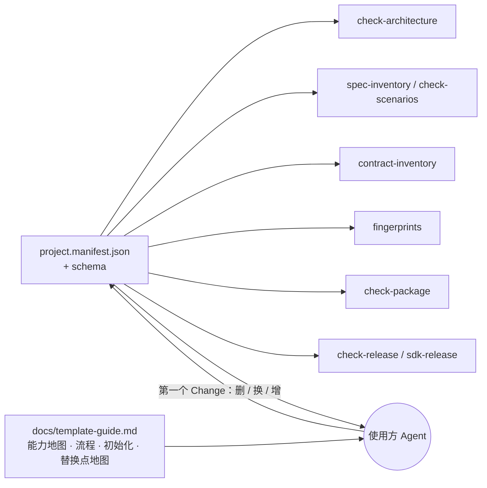

## Context

`main`（`c734554`）已删除全部支付业务，质量体系在示例与 4 份通用能力 Spec（`scenario-gate`、`template-engineering`、`protocol-contract`、`template-example`）上运行，`check:fast`、逐文件 weapp 与场景门禁全绿。本 Change 是模板演进的收尾，把仓库变成使用方可以直接拿去演进的 **SDK 领域模板**。

用户确认的定位与交付标准：
- AI 时代的前端项目模板；当前只交付 SDK 领域模板，其他场景由使用方基于它演进；质量体系是核心。
- 交付一个大而全、可运行的模板，以"最小可运行"为标准；**不做**交互式脚手架、生成器或选项开关。
- 使用方（主要是 Agent）依靠三样东西承接：门禁读取的**项目清单**、**替换点地图**、**使用指南**；初始化以使用方仓库中的第一个 Change 完成，并由同一套门禁验收。

现状中阻碍"直接演进"的写死点（已逐一核对代码）：

| 写死内容 | 位置 |
| --- | --- |
| 包目录名、允许目录、包名、私有标记、协议包禁止依赖 | `scripts/check-architecture.ts:10-15,38-40` |
| 必需命令 | `scripts/check-architecture.ts:11` |
| 测试项目名与 kind 的允许项目 | `scripts/verification.schema.json:29,40,44,48`；`scripts/flow.schema.json:11`；`scripts/check-scenarios.ts:12,55-56,382,386`；`scripts/lib/spec-inventory.ts:15` |
| 协议义务的运行环境 `['integration','weapp']` | `scripts/lib/contract-inventory.ts:197-242` |
| 源码摘要目录 | `scripts/lib/fingerprints.ts:39-51` |
| 包名 | `scripts/check-package.ts:44-56`；`scripts/check-release.ts:19-20,51,77-78,106-113`；`scripts/sdk-release.ts:67` |
| 发布 registry（GitLab 项目 245）与 tag 前缀 `payment-sdk-v` | `scripts/check-release.ts:5,15,86-90`；`scripts/sdk-release.ts:41,212` |
| Shadow 路由类型依赖生成的 `RpcMethodMeta` | `packages/payment-protocol/testing/shadow/routes.ts:1-9`；服务器实际只用 `httpMethod`、`path`（`server.ts:67-68`） |

此外仍带支付身份：包目录与包名、根包名与描述、测试别名 `@payment-test/*`、环境变量 `PAYMENT_RUN_ID`/`PAYMENT_REPORT_FILE`、用例元数据 `paymentCase`、注解 `payment-evidence`/`payment-flow`、摘要键 `paymentBehavior`、导出 `paymentBusinessErrors*`、全局 `__PAYMENT_TEST_RUNNER__`、weapp 宿主标题与 `projectname`、临时目录前缀、README 中的本机路径与支付链接；四份主 Spec 的 Purpose 仍是归档生成的 "TBD" 占位。

图中门禁只依赖清单；使用方改清单与对应文件，不改门禁代码。指南负责解释与操作步骤，清单负责机器可校验的事实。

## Goals / Non-Goals

**Goals:**
- 门禁脚本的非测试文件中不再出现包目录名、包名、测试项目名（与类别同名者除外）与发布 registry 的字面量；这些事实只来自 `project.manifest.json`。
- 仓库中不再有支付身份：除"残留允许清单"外，`git grep -niE "payment|PAYMENT_|paysdk"` 零命中。
- Shadow 引擎不依赖 ProtoGen 生成代码，IDL 只是一种路由来源。
- 使用指南与替换点地图存在、被链接、章节齐全、链接可解析，并由架构检查守护。
- 每个任务结束时 `pnpm check:fast` 通过；最终验收三项（`check:fast`、逐文件 weapp、以全部报告运行的场景门禁）退出码 0、门禁问题数 0。
- 上一步能力保全清单中的每项能力仍有承载文件与运行证据（以指南的能力地图为项目级承载）。

**Non-Goals:**
- 交互式脚手架、生成器、选项开关；OpenAPI 路由来源、Web/Node 平台实现、业务应用骨架。
- 替换 IDL、修改 ProtoGen Consumer 登记；修改已归档 Change。
- 三类包角色"各一个"之外的多包支持（指南说明扩展方式）。
- 修复微信开发者工具自动化的不稳定问题。

## Decisions

### Decision: 执行顺序

| 任务 | 内容 | 依赖 |
| --- | --- | --- |
| 1 | 项目清单与 schema；门禁改为读取清单；发布预检的占位值拒绝（此时清单仍登记现有名称与 245） | — |
| 2 | Shadow 路由中立化与 IDL 路由来源 | 1（新测试的绑定需要清单） |
| 3 | 包目录、包名、根包名、别名与 ProtoGen 输出路径改名；registry 改为占位值，tag 前缀改名 | 1、2 |
| 4 | 内部标识中立化与上一步遗留的代码小项 | 3 |
| 5 | 使用指南与替换点地图、指南检查（结构与事实一致性）；AGENTS/README/bootstrap 改写；工作流 schema 不再提交；Spec Purpose 修正 | 1–4 |
| 6 | 指南演练验收：由不带上下文的 Agent 照指南在临时副本中完成代表性操作，按发现修订指南 | 5 |
| 7 | 最终验收（首轮） | 1–6 |
| 8 | 分层守卫覆盖全部业务模块；替换点地图补齐运行平台的产品侧绑定 | 7 |
| 9 | 重新演练：Bridge 派发全新 Agent 在任务 8 提交之上完整重做 D1～D5，按发现修订 | 8 |
| 10 | 最终验收（重新执行） | 8、9 |

任务 8～10 统一使用新的 run-id `generalize-template-20261002-r2`（`VERIFY_RUN_ID` 取该值）：全部 `check:fast`、逐文件 weapp 报告、场景门禁输出、`task-8.md`、`task-9-redrill.md`、`task-10.md` 都写在 `artifacts/generalize-template-20261002-r2/` 下，首轮目录 `artifacts/generalize-template-20261002/` 不再写入。任务 8～10 来自 Apply 复核：首轮演练暴露守卫只覆盖示例目录、指南漏列运行平台的产品侧绑定，且部分演练由带上下文的主 Agent 执行。用户决定在本 Change 内闭环。

先做清单（任务 1），后续改名只需改清单与文件，门禁本身在改名任务中不再变化，便于用门禁验证改名是否完整。Shadow 中立化（任务 2）在改名前完成，使改名任务只做机械替换。

### Decision: 项目清单的格式与读取方

新增根目录 `project.manifest.json` 与 `project.manifest.schema.json`（JSON Schema draft 2020-12，`additionalProperties: false`，每个属性带非空中文 `description`），并由新模块 `scripts/lib/project-manifest.ts` 统一加载：读取、用 Ajv 校验、返回只读对象；文件缺失或校验失败时抛出带路径的错误，调用方把它作为门禁问题输出，不得回退到默认值。清单 schema 总是从**仓库**位置加载（相对 `import.meta.url` 解析），清单本身从**门禁根目录**加载；因此临时根目录只需提供 `project.manifest.json`，不需要复制 schema。

清单字段（schema 为唯一权威，此处只说明意图）：

| 字段 | 内容 | 约束 |
| --- | --- | --- |
| `packages[]` | `directory`（`packages/` 下的目录名）、`name`（npm 包名）、`role`（`product` / `protocol` / `test`）、`private`、`allowedDirectories` | 三种角色各恰好一个；`test` 角色必须 `private: true` |
| `requiredCommands[]` | 根 `package.json` 必须存在的脚本名 | 至少一项 |
| `testProjects[]` | `name`（Vitest 项目名）、`class`（`unit` / `integration` / `platform`） | 名称唯一；至少一个 `unit` 与一个 `integration` |
| `fingerprints` | `sourceRoots[]`（参与源码摘要的 `.ts/.js` 目录）、`hostRoots[]`（参与摘要的宿主目录，额外包含 `.json/.wxml/.wxss`） | 路径相对仓库根 |
| `release`（可选） | `registry`、`tagPrefix` | 缺省表示删除了"包发布"模块 |

读取方与改动：

| 读取方 | 现状 | 改为 |
| --- | --- | --- |
| `check-architecture.ts` | 写死三包、允许目录、包名、私有、协议包依赖、必需命令、AGENTS 路径 | 全部取自清单；协议包不得依赖 product 与 test 角色的包；AGENTS 路径为根与每个登记包 |
| `scripts/lib/schema-docs.ts` | `schemaPaths` 只列 3 份硬规则 schema（GATE-06） | 拆成两组：`hardRuleSchemas`（原 3 份，GATE-06 不变，`SCN-SCENARIO-GATE-008` 与 `schema-docs.test.ts` 的枚举不变）与 `projectSchemas`（`project.manifest.schema.json`，属 ENG-05）；两组都检查中文说明与根 AGENTS.md 引用。任务 1 同时在根 AGENTS.md 增加"项目清单"一节的最小引用，使检查保持通过 |
| `verification.schema.json`、`flow.schema.json` | `requiredIn` 枚举具体项目名，kind 规则写在 `allOf` | `requiredIn` 项改为 `{"type":"string","pattern":"^[a-z0-9]+(?:-[a-z0-9]+)*$"}`，说明写明"取值必须是 project.manifest.json 登记的测试项目"；删除按 kind 枚举项目的 `allOf` |
| `spec-inventory.ts` | 依赖 schema 枚举 | `readSpecInventory(sources, config?, projects?)` 新增可选参数 `projects`（`ReadonlyArray<{ name; class }>`），缺省时加载仓库根的 `project.manifest.json`；`check-scenarios.ts` 的 CLI 传入门禁根目录清单中的项目。schema 校验之后按项目再校验，问题文本**保留现有前缀**，使已有断言不变：case 的 `requiredIn` 未登记 → `<scenarioId>: invalid verification metadata: requiredIn project <x> is not registered in project.manifest.json`；kind 与类别不符（behavior ∉ integration/platform，module ∉ unit，engineering ∉ integration）→ `<scenarioId>: invalid verification metadata: kind <k> cannot run in <class> project <x>`；FLOW 行的 `requiredIn` 未登记或不属于 integration/platform 类 → `<source>: invalid FLOW row <flowId>: requiredIn project <x> is not an integration or platform project`。因此 `spec-inventory.test.ts:72-87,127`、`scenario-gate.evidence.test.ts:95-96`、`SCN-SCENARIO-GATE-007.spec.ts:7` 中按前缀与问题数的断言保持成立 |
| `check-scenarios.ts` | `Project` 字面量联合类型 | 改为 `string`；运行环境集合来自清单 |
| `contract-inventory.ts` | `requiredIn: ['integration','weapp']`；错误码义务 `['integration']`；静态导入 `packages/payment-protocol/testing/...` 与写死生成目录 | 字段/路由/共享义务的环境 = 清单中全部 integration 与 platform 类项目；错误码义务 = 全部 integration 类项目；示例方法描述模块按**仓库**清单中 protocol 角色的目录、相对仓库位置解析（`buildContractInventory` 已是 async，改为 `await import(new URL('../../packages/' + protocolDir + '/testing/shadow/example/routes.ts', import.meta.url).href)`），不随门禁根目录变化，临时根目录无需提供 `testing/`；生成目录仍相对门禁根目录，取门禁根清单中 protocol 角色目录下的 `src/generated`（临时根由 `enableInventory` 链接）；错误码 Fixture 路径属于测试包，保持不变 |
| `fingerprints.ts` | 写死摘要目录与 `packages/e2e/host` | 取 `fingerprints.sourceRoots` 与 `hostRoots`；`openspec/`、Fixture 目录与 `proto-gen.lock` 的摘要规则不变 |
| `check-package.ts` 与 `packages/e2e/src/package-consumer.ts` | 写死两个包名 | 按角色取 product 与 protocol 的名称与目录；`package-consumer.ts` 不再写死 `@daqian/payment-protocol`，改由调用方传入协议包名（其单测同步）；对测试包的导入与 `packages/e2e/package.json` 读取保持不变 |
| `check-release.ts`、`sdk-release.ts` | 写死包名、245、tag 前缀、registry 主机 | 见"发布目标来自清单" |

不纳入清单、作为普通配置由使用方直接编辑并在替换点地图中列出的文件：`vitest.config.ts` 与各包 Vitest 配置、`vitest.shared.ts`、`tsconfig.*.json`、`eslint.config.js`、`.dependency-cruiser.cjs`、根 `package.json` 脚本。理由：它们本身就是声明式配置，再从清单生成会增加一层间接，且这些工具不能直接读 JSON 清单的部分需要额外胶水代码；门禁的问题在于"代码写死"，而不是"配置存在"。

守护规则（ENG-05 的 `no-hardcoded-topology`）：测试遍历 `scripts/**/*.ts`（排除 `*.test.ts`），逐文件按以下匹配规则断言零命中：

| 对象 | 匹配规则 |
| --- | --- |
| product 与 protocol 角色的目录 | 正则 `packages/<directory>(?=[/'"\x60])`（目录名后紧跟 `/` 或引号） |
| product 与 protocol 角色的包名 | 子串匹配 |
| `release.registry` | 子串匹配 |
| 与类别名不同的测试项目名（当前 `sdk-unit`、`protocol-unit`、`test-tools-unit`、`weapp`） | 只匹配完整的引号字面量 `'<name>'`、`"<name>"`、`` `<name>` ``；`'weapp.json'` 之类的文件名不算 |

不在检查之列：测试包（test 角色）的路径 `packages/e2e/...` 与包名——它是门禁运行所依赖的测试基础设施，`scripts/check-package.ts:6` 静态导入 `packages/e2e/src/package-consumer.ts`，`scripts/check-fixtures.ts:19,66`、`scripts/lib/fingerprints.ts:58`、`scripts/lib/contract-inventory.ts:228` 读取 `packages/e2e/tests/fixtures`；测试包不作为可改名的替换点，指南如此说明。与类别同名的项目名（`integration`）是类别概念，不检查。`check-scenarios.ts` 的默认报告文件名 `unit.json`、`integration.json`、`weapp.json` 来自根 `package.json` 脚本中 `VERIFY_REPORT_FILE` 的约定，不是测试项目名，不纳入清单（去掉平台时替换点地图说明删除对应脚本与报告）。

兼容性：清单是新增文件，旧报告与 Fixture 格式不变；`scenario-gate.config.json` 继续只管 ID 格式。工具测试在临时根目录运行门禁时，由 helper 把仓库的 `project.manifest.json` 原样复制到临时根（保证目录名与 `enableInventory` 链接的生成目录一致）；需要改清单的反例在复制后修改。涉及的文件以 `git grep -l "check-architecture\|checkArchitecture\|runArchitectureCli\|runGate\|runScenariosCli"` 在 `packages/e2e/tests/tooling` 与 `scripts` 中的命中为准，至少包括 `scenario-gate-helpers.ts`、`helpers.ts`、`SCN-TEMPLATE-ENGINEERING-002.spec.ts`、`SCN-SCENARIO-GATE-008.spec.ts` 与 `scripts/check-architecture.test.ts`。

### Decision: 发布目标来自清单

- 发布记录的字段改为：`registry`、`execution`、`tag`、`sourceRevision`、`sdk`、`protocol`；**删除 `targetProject` 字段**（它与 `registry` 重复，项目由 registry 决定）。`check-release.ts:68-71` 的"未知字段"校验随之更新，含 `targetProject` 的旧记录被拒绝；`SCN-TEMPLATE-ENGINEERING-004` 的用例记录与 Fixture 同步去掉该字段。`registry` 必须等于清单 `release.registry`，`tag` 必须等于 `${release.tagPrefix}${产品包版本}`；包名按角色取自清单。
- 计划生成沿用对象参数形式，输入新增字段 `release`（清单的发布设置）：`createSdkReleasePlan({ record, protocolState, sdkState, release })`；CLI 从 `cwd` 的清单读取后传入，`scripts/sdk-release.ts` 中现有的两处调用与测试同步；`publish-order` 用例传入登记具体 registry 的发布设置，不读取仓库清单。
- 清单 `release.registry` 含 `<PROJECT_ID>` 时，预检返回 `release registry is a template placeholder; set release.registry in project.manifest.json` 并拒绝，计划生成同样拒绝。
- `sdk-release.ts` 写临时 `.npmrc` 时，scope 与主机从包名和 registry URL 解析，不再写死 `@daqian` 与 `gitlab.daqian369.com`。
- 清单缺少 `release` 时，`release:preflight` 与 `sdk-release` 以"发布模块已删除"退出非零（使用方删除发布模块时应同时删除这两个命令，见替换点地图）。
- 任务 1 中清单仍登记 245 与 `payment-sdk-v`，现有发布用例不变；任务 3 改为占位值 `https://gitlab.daqian369.com/api/v4/projects/<PROJECT_ID>/packages/npm/` 与 `template-sdk-v`。任务 3 之后仓库清单为占位值，因此 ENG-004 中所有依赖"预检只报告特定问题"的用例（`preflight-valid-plan`、`preflight-rejects-drift`、`publish-order`）都在临时根目录中运行，只有 `preflight-rejects-placeholder` 读取仓库真实清单；占位值问题与其他问题一并报告（不提前返回），使漂移类断言在任何清单下都成立。临时根的做法是：复制根与各包 `package.json`，写入登记具体 registry 的清单，以 `cwd` 为该临时根启动预检子进程（`check-release.ts` 从 `cwd` 读取 workspace 事实，不新增 `--root`）；新增 `preflight-rejects-placeholder` 用仓库真实清单验证拒绝。
- `.npmrc` 中安装 ProtoGen 的 `@daqian:registry`（项目 216）不变。

### Decision: Shadow 路由中立化

- `testing/shadow/routes.ts`：`ShadowRoute` 改为 `{ methodName: string; httpMethod: string; path: string }`，删除 `meta` 与对 generated 的导入。
- 新增 `testing/shadow/idl-routes.ts`：`routesFromRpcMethods(required, candidates)` 把 `RpcMethodMeta` 转为 `ShadowRoute`；缺少所需方法、`path`、`method` 或 `requestCodec` 时抛错（沿用现有 `discoverExampleRoutes` 的错误语义）。
- `testing/shadow/example/routes.ts`：导出 `exampleRpcMethods`（`[CreateTrade.meta, QueryTrade.meta]`）与 `discoverExampleRoutes()`（调用 `routesFromRpcMethods`）。
- `scripts/lib/contract-inventory.ts` 改用 `exampleRpcMethods` 读取 `requestType`/`responseType`/路径，不再依赖 `ShadowRoute.meta`。
- `.dependency-cruiser.cjs` 新增规则 `shadow-engine-no-generated`：`testing/shadow/` 下除 `idl-routes.ts` 与 `example/` 外的非测试文件不得导入协议包 `src/generated/`。
- 根 `package.json` 的 `check:architecture` 把协议包 `testing` 目录加入 depcruise 的扫描目标，使该规则在真实门禁中生效（现有命令只扫描两个包的 `src`）。加入后若已有规则对 `testing/` 误报（例如 `not-to-dev-dep` 因 `express` 是根 devDependency 而报错），在该规则的 `from.pathNot` 中排除 `/testing/` 并在配置中注明理由：`testing/` 只供测试，已由 `production-no-test` 禁止生产代码导入；不得为此放宽 `shadow-engine-no-generated` 或其他针对生产代码的规则。
- `testing/index.ts` 增加导出 `routesFromRpcMethods` 与 `ShadowRoute` 类型；`bootstrap.test.ts` 的导出清单断言同步。
- 现有 `example/routes.test.ts` 与 `server.test.ts` 的断言语义不变，只适配类型；新增 PC-03（SCN-PROTOCOL-CONTRACT-004）的 module 用例放在 `testing/shadow/routes.test.ts`（中立路由）与 `testing/shadow/idl-routes.test.ts`（IDL 来源）；engineering 反例放在 `packages/e2e/tests/tooling/SCN-PROTOCOL-CONTRACT-004.spec.ts`，在临时副本中让 `server.ts` 导入 generated 并运行 dependency-cruiser，断言违规被报告（沿用 `SCN-TEMPLATE-EXAMPLE-008.spec.ts` 的做法）。

### Decision: 中立命名与 ProtoGen 输出路径迁移

| 旧 | 新 |
| --- | --- |
| `packages/payment-sdk`、`packages/payment-protocol` | `packages/sdk`、`packages/protocol`（`packages/e2e` 不变） |
| `@daqian/payment-sdk`、`@daqian/payment-protocol`、`@daqian/payment-e2e` | `@daqian/template-sdk`、`@daqian/template-protocol`、`@daqian/template-e2e` |
| 根包 `infra-payment-sdk`，描述 "Headless payment SDK workspace tooling" | `sdk-template`，描述"SDK 领域项目模板：示例、质量门禁与工程工具链" |
| 测试别名 `@payment-test/protocol` | `@template-test/protocol` |
| `PAYMENT_RUN_ID`、`PAYMENT_REPORT_FILE` | `VERIFY_RUN_ID`、`VERIFY_REPORT_FILE` |
| 用例元数据 `meta.paymentCase` | `meta.scenarioCase` |
| 注解 `payment-evidence`、`payment-flow` | `scenario-evidence`、`scenario-flow` |
| 门禁摘要 `summaries.paymentBehavior` | `summaries.publicBehavior` |
| `paymentBusinessErrors`、`paymentBusinessErrorsIdlCommit`、`PaymentBusinessErrorDescriptor`、`getPaymentBusinessError` | `businessErrors`、`businessErrorsIdlCommit`、`BusinessErrorDescriptor`、`getBusinessError` |
| `__PAYMENT_TEST_RUNNER__` | `__TEMPLATE_TEST_RUNNER__` |
| schema `$id`：`https://daqian.example/payment-verification.schema.json`（`scripts/verification.schema.json:3`）、`https://daqian.example/payment-fixture.schema.json`（`packages/e2e/tests/fixtures/fixture.schema.json:3`） | `https://daqian.example/verification.schema.json`、`https://daqian.example/fixture.schema.json` |
| weapp `projectname: payment-sdk-test-host`；`app.json` 与 `pages/index/index.json` 的标题 "Payment SDK Test Host"；`pages/index/index.wxml` 的 "Payment SDK protocol test host" | `sdk-template-test-host`；"SDK Template Test Host"；"SDK template protocol test host" |
| 临时目录前缀 `payment-*`（如 `payment-sdk-release-`、`payment-release-cli-`） | `template-*`；其中 `scripts/sdk-release.ts` 的两处前缀在任务 1 改（该文件已在任务 1 改动范围内），其余在任务 4 改 |
| 测试辅助函数 `paymentSource` 等局部名 | `generatedSource` 等中立名 |

ProtoGen 输出路径迁移（已在仓库副本上验证）：先把 `proto-gen.yaml` 的 `path` 改为 `packages/protocol/src/generated`，此时旧目录 `packages/payment-protocol/src/generated` 必须仍在原位；执行 `pnpm proto:sync`，工具把输出迁到新路径；锁文件只变化 `outputs.*.path` 与 `configDigest`，生成文件逐字节不变，`proto:status` 为 `up_to_date`。若先移动目录再同步，会报 `output_conflict`。因此任务 3 的顺序是：改 `proto-gen.yaml` → `proto:sync` → 再 `git mv` 其余协议包文件到 `packages/protocol`（生成目录已由工具迁移）。`consumerId: infra-payment-sdk`、source id `payment-idl`、output id `payment-ts` 保持不变（用户决定保留 Consumer 身份；改 id 需要重新采纳输出，收益为零）。

`SCN-PROTOCOL-CONTRACT-003` 的生成来源基线：
- `manifest.sources.generatedCurrent.output.path` 与 `configDigest` 更新为迁移后的值；`provenance/current.lock` 替换为迁移后的 `proto-gen.lock` 内容，并刷新 `manifest.provenance.sha256` 中对应摘要。这是配置路径变化，生成内容与兼容字段不变，符合"仅元数据变化时允许刷新来源"的规则。
- `generatedCompatibility`、`provenance/before.lock`、`after.lock`、`sync.json`、`status.json` 是支付时期的真实工具输出，作为历史证据保持原样（其中路径仍为 `packages/payment-protocol/...`）。

其余 Fixture manifest 中指向源文件的路径与摘要随改名刷新（`check:fixtures` 校验）。

**残留允许清单**（任务 7 的残留检查按此归属；清单外命中即为遗漏）：
1. `openspec/changes/archive/**`、`artifacts/**`：历史记录，不修改。
2. `packages/protocol/src/generated/**`：ProtoGen 生成代码，名称来自 IDL。
3. `proto-gen.yaml`、`proto-gen.lock`：Consumer 身份 `infra-payment-sdk`、`payment-idl`、`payment-ts`。
4. `packages/e2e/tests/fixtures/SCN-PROTOCOL-CONTRACT-003/**`：借用 IDL 的来源事实（Go 文件名、历史工具输出、`paymentSemanticCommit` 等字段）。
5. 直接引用 IDL 生成名称的代码：从 generated 导入的类型/枚举名（如 `XpayEnv`、`PayParams`、`CreateTradePay*`）及 IDL 路径 `idl/infra/pay/...`，仅限 import 语句与使用这些名称的位置。
6. `openspec/changes/generalize-template/**`：本 Change 自身的规划文本（描述旧名称）；归档后进入第 1 类。
7. Fixture manifest 中 `sources.spec.path` 指向已归档 Change 路径（例如 `openspec/changes/archive/2026-10-02-remove-payment-business/...`）的值：归档路径不可改。
8. 文档（根与各包 `AGENTS.md`、`README.md`、`docs/**`）中说明保留的 ProtoGen Consumer 身份或借用 IDL 的句子：只允许字面量 `infra-payment-sdk`、`payment-idl`、`payment-ts` 与 IDL 路径 `idl/infra/pay/...`、`idl/infra/trade/...`，且所在句子的内容是说明"这是借用的 Consumer/IDL 身份、使用方替换时改哪里"；其他支付表述仍为遗漏。

任务 3、4 的残留检查排除根与各包 `AGENTS.md`、`README.md`、`docs/**` 与 `openspec/specs/**`（主 Spec 中只有 Purpose 占位行 "TBD - created by archiving change remove-payment-business" 会命中），这些内容由任务 5 改写，命中归属到任务 5；任务 5 之后与任务 7 的检查不再排除。

### Decision: 工作流 schema 不随模板提交

- 门禁只依赖 4 条硬规则与 3 份格式 schema（以及新的清单 schema），代码中没有读取 `openspec/schemas/` 的地方（已核对：仅根 `AGENTS.md:13,24` 与 `README.md:27` 提到它）。
- 任务 5 执行 `git rm -r --cached openspec/schemas/openspec-workflow` 并在 `.gitignore` 加入 `openspec/schemas/`；工作区中的本地副本保留，本 Change 后续阶段照常使用。合并到 `main` 时 Git 会删除 `main` 工作区中的该目录，下一次 Change Skill 运行时由其安装器重新安装。
- `AGENTS.md` 硬规则 1 与执行规则 1 改为"工作流由使用方提供（例如 Change Skill 安装的 openspec-workflow），模板只要求 OpenSpec 根与 4 条硬规则"；README 同步。

### Decision: 使用指南与替换点地图

新增 `docs/template-guide.md`，规定章节（标题文字固定，架构检查按标题判定）：

1. `## 能力地图`：沿用上一步能力保全清单的各项能力，每项写明承载文件与验证方式（场景 ID 或命令）。这是能力保全清单的项目级承载。
2. `## 从方案到验收`：OpenSpec 规划 → Plan Review → 实现 → `check:fast` → 逐文件 weapp → 场景门禁 → 归档；每步对应的命令、门禁与证据位置（`artifacts/<run-id>/`），以及 `VERIFY_RUN_ID` 的用法。
3. `## 初始化方式`：复制模板（不带历史）→ 安装工作流（例如 Change Skill）→ 在使用方仓库中新建第一个 Change：改清单与包名、替换 Consumer 与 IDL、按需替换或删除可替换点、以示例为样板新增自己的业务模块；**先加后删**：自己的业务覆盖到示例承担的能力后再删除示例；最后用三项验收证明。
4. `## 替换点地图`，含三个三级标题：
   - `### 协议来源`：当前 IDL + ProtoGen。涉及 `proto-gen.yaml`/`.lock`、`packages/protocol/src/generated`、`testing/shadow/idl-routes.ts` 与 `example/routes.ts`、`scripts/lib/contract-inventory.ts`、错误码目录与 `SCN-PROTOCOL-CONTRACT-003` Fixture、`protocol-contract` Spec；换 IDL 时改 Consumer；换 OpenAPI 时新增路由来源并替换义务派生与错误码来源校验（或明确不启用并修改 Spec）。验收：`SCN-PROTOCOL-CONTRACT-001～004`。
   - `### 运行平台`：当前微信小程序。涉及协议包 `src/adapters/network/wechat-miniapp.ts` 与根导出、`packages/e2e/src/drivers/weapp*.ts`、`packages/e2e/host/weapp/`、`tests/weapp/`、`packages/e2e/vitest.config.weapp.ts`、清单 `testProjects`（platform 类）、`fingerprints.hostRoots`、`requiredCommands` 中的 `test:e2e:weapp`、e2e 包 `allowedDirectories` 中的 `host`、Spec 中 `requiredIn` 含 `weapp` 的 case；换 Web/Node 时新增对应网络适配器与驱动。验收：`check:fast` 与新平台项目的报告。
   - `### 包发布`：可删除模块。涉及 `scripts/sdk-release.ts`、`check-release.ts` 及测试、`SCN-TEMPLATE-ENGINEERING-004` 用例与 Fixture、`template-engineering` ENG-04、清单 `manifest.release`、根 `package.json` 的 `release:preflight` 与 `sdk-release` 脚本（它们不在 `manifest.requiredCommands` 中，清单只需删除 `release`）、各包 `publishConfig`。验收：`check:fast`。
   每项都写"清单需要修改的项"与"验收所用门禁"。删除或替换某一项后，对应的三级标题仍须保留（架构检查要求章节齐全），正文改为说明"本项目已删除/已替换为……"；指南中引用的、随之删除的 Scenario ID（例如删除发布模块后的 `SCN-TEMPLATE-ENGINEERING-004`）必须同时删去，否则事实一致性检查会报"未登记"。这两点写进指南"初始化方式"一节。
5. 附加说明（非规定章节）：扩展更多包（扩展清单 schema 与读取方）、已知限制（weapp 不稳定与预热约 25 秒、平台能力替身只有文字标准、首次真实使用前地图未经验证）。

架构检查新增（`scripts/check-architecture.ts` 的 `checkTemplateGuide`），分两类，缺失或不一致项逐条报告：

- **执行方式**：Scenario ID 的登记核对需要读取有效 Spec 清单，而现有读取接口是异步的，因此 `checkArchitecture` 与 `runArchitectureCli` 改为 async，CLI 入口 `await` 其结果；`scripts/check-architecture.test.ts` 与在临时根运行架构检查的测试改为 `await`（断言内容不变）。
- **结构**：文件存在；根 `AGENTS.md` 与 `README.md` 中存在指向 `docs/template-guide.md` 的链接；上述 4 个二级标题与 3 个三级标题齐全；指南中的相对链接都能解析（复用现有链接解析逻辑）。
- **事实一致性**（防止代码改了而指南没跟着改）：
  - 指南全文中匹配 `scenario-gate.config.json` 场景 ID 格式的词，都必须在有效 Spec 清单中登记；
  - 行内代码中的 `pnpm <命令>` 与 `pnpm run <命令>`，除 pnpm 内置命令（`install`、`add`、`remove`、`exec`、`dlx`）外，`<命令>` 都必须存在于根 `package.json` 的 scripts；
  - 行内代码 `manifest.<字段路径>`（点号分隔，数组元素字段写作 `manifest.packages[].directory`）必须能在 `project.manifest.schema.json` 的 `properties`/`items` 中逐段解析。指南引用清单字段时一律使用这一写法。

事实一致性检查中，`pnpm` 命令只检查紧跟在 `pnpm` 或 `pnpm run` 之后、不以 `-` 开头的那个词；以参数开头的写法（如 `pnpm --filter <包> build`、`pnpm -C <目录> test`）不检查。Scenario ID 的登记依据是门禁根目录的有效 Spec 清单；根目录中没有 Spec 时，指南中出现的任何 Scenario ID 都视为未登记。

临时根目录：指南检查对每次架构检查都生效，因此任务 5 新增共享 helper `writeTemplateGuideFixture(root)`（放在 `packages/e2e/tests/tooling/helpers.ts`，`scripts/check-architecture.test.ts` 从同一位置导入），写入一份最小合法指南（4 个二级标题与 3 个三级标题，不含 Scenario ID、`pnpm` 命令与 `manifest.` 引用）并在临时根的 `AGENTS.md` 与 `README.md` 中加入指向它的链接。所有在临时根运行架构检查、并期望"无问题"或"只有特定问题"的测试都改用该 helper，断言不变；测试在运行前改写临时根 `AGENTS.md` 或 `README.md` 时（例如 `SCN-SCENARIO-GATE-008.spec.ts:26` 在 `restored-passes` 之前覆盖 `AGENTS.md`），改写后须再次调用该 helper 或在改写内容中保留指南链接：至少包括 `SCN-TEMPLATE-ENGINEERING-005.spec.ts`（`rename-by-manifest-cli` 期望临时根架构检查通过）、`SCN-SCENARIO-GATE-008.spec.ts`（`restored-passes`）、`SCN-TEMPLATE-ENGINEERING-002.spec.ts`、`scenario-gate-helpers.ts` 与 `scripts/check-architecture.test.ts` 的 fixture 根。

文字描述是否准确、照着能否完成操作，机器无法判断，由任务 5 的评审与任务 6 的指南演练负责。

### Decision: 文档改写

- 根 `AGENTS.md`：标题改为"SDK 模板 Agent 入口"；"必读"增加指南与清单；硬规则 1 与执行规则 1 按"工作流 schema 不随模板提交"改写；执行规则 10 改为"ProtoGen Consumer 按产品实际依赖登记"；外部交互替身标准中 Shadow 一条改为"路由来自协议来源（当前由 IDL 生成描述转换）"；新增"项目清单"一节（作用、schema 路径、最小示例、哪些事实必须改清单）。
- 各包 `AGENTS.md`：目录与包名、`@template-test/protocol` 别名、依赖规则路径同步；协议包补充 Shadow 中立路由与 `shadow-engine-no-generated`；e2e 包"微信开发者工具自动化的注意事项"把预热改为"约 25 秒"。
- `README.md`：改写为模板简介（定位、三包、示例、常用命令、指向指南），删除本机路径、支付链接与项目 245；`docs/engineering/bootstrap.md` 中包名与路径同步。
- 四份主 Spec（`scenario-gate`、`template-example`、`template-engineering`、`protocol-contract`）的 `## Purpose` 都由 "TBD - created by archiving…" 改为一句话说明。OpenSpec 的 delta 不能修改 Purpose，因此直接编辑主 Spec，属于有意例外，在验收索引中记录。

### Decision: 上一步遗留小项

- `SCN-TEMPLATE-ENGINEERING-003` 的 `source-and-dual-declarations.json` 中 `ExampleClientOptions` 的 `fields` 追加平铺名 `productId`、`lane`、`appVersion`。检查器的 `visit` 递归遍历类型节点下全部 `PropertySignature`，按名称收集，因此嵌套类型字面量中的字段可直接以平铺名登记，无需扩展检查器。
- 删除 `wechat-miniapp.test.ts` 第 6 行引用已删除支付场景的注释。

### Decision: 验证方式

- 每个任务：`pnpm check:fast` 退出码 0；以 unit、integration 与本任务受影响的 weapp 文件报告运行场景门禁，问题逐条归属到后续任务或判为回归；任务 4 起使用 `VERIFY_RUN_ID`（任务 1～3 仍为 `PAYMENT_RUN_ID`，环境变量在任务 4 改名）。
- 任务 3 改动宿主与包路径后，4 个 weapp 文件逐文件运行（每文件前退出开发者工具主进程并预热约 25 秒）。
- 指南的验收分三层：
  1. 结构与事实一致性由架构检查守护（ENG-06），每次 `check:fast` 都运行；
  2. 任务 5 的评审逐节核对能力地图与上一步能力保全清单一一对应、替换点地图三项各有"涉及文件、清单改动、验收门禁"；
  3. 任务 6 的指南演练验证"照着指南能否完成操作"，见"指南演练验收"。
- 最终（任务 7）：`check:fast`；逐文件运行全部 weapp；以全部报告运行场景门禁；三者退出码 0、问题数 0。残留检查：`git grep -niE "payment|PAYMENT_|paysdk"`，每处命中归属到"残留允许清单"的某一类，否则为遗漏。逐项核对指南能力地图中每项能力的承载文件与运行证据。

### Decision: 分层守卫覆盖全部业务模块

- `.dependency-cruiser.cjs`：
  - `core-no-platform-or-node` 的 `from.path` 改为 `^packages/sdk/src/(runtime|[^/]+/(core|ports))/`；
  - `example-core-no-generated` 改名为 `domain-core-no-generated`，`from.path` 改为 `^packages/sdk/src/[^/]+/(core|ports)/`；
  - `runtime/` 不是业务模块；它目前没有 `core/`、`ports/` 子目录，因此不会被 `domain-core-no-generated` 匹配。约定 `runtime/` 不建立这两个子目录（写入 `packages/sdk/AGENTS.md`）。
- `eslint.config.js`：`no-restricted-globals: wx` 的 `files` 改为 `packages/sdk/src/*/core/**/*.ts` 与 `packages/sdk/src/*/ports/**/*.ts`。
- 这些路径里的 `packages/sdk` 是普通配置（见"项目清单的格式与读取方"），改名时按替换点地图同步；门禁脚本不受影响。
- `SCN-TEMPLATE-EXAMPLE-008.spec.ts` 已经临时创建 `src/sample-domain/`；扩展为在其中另写 `core/` 下的三个探针文件（导入 generated、使用 `wx`、导入 `node:fs`），分别断言 depcruise 报告 `domain-core-no-generated`、`core-no-platform-or-node`，eslint 报告 `no-restricted-globals`；不修改任何门禁配置。原有对 `example-core-no-generated` 的断言改为新规则名。
- 同步更新 `.dependency-cruiser.cjs` 中指向示例分层约定的注释（第 10 行）。
- 删除 `docs/template-guide.md` 与 `packages/sdk/AGENTS.md` 中"新增业务目录后手动扩展守卫"的步骤，改为说明"守卫按目录模式自动覆盖 `src/` 下除 `runtime/` 外的全部业务模块"；规则名引用同步改为 `domain-core-no-generated`。

### Decision: 运行平台的产品侧绑定（PR-501）

替换点地图"运行平台"一节的"涉及文件（生产侧）"补充产品包对平台的绑定：`packages/sdk/src/example/factory.ts`（导入 `createWechatMiniappHttp`、按 `runtime === 'wechat-miniapp'` 装配）、`packages/sdk/src/example/contracts.ts` 的 `ExampleRuntime`，以及 `SCN-TEMPLATE-ENGINEERING-003` Fixture 中 `ExampleRuntime` 的取值；说明换平台时要同时调整这三处与对应的公共类型契约测试。

### Decision: 重新演练

- **原因**：首轮 D4、D5 与修订后的重做由带上下文的主 Agent 执行；需要验证首轮修订的规则是否有效、合理。
- **执行者**：由 Bridge（复核本 Change 的会话）派发 Agent，每个演练一个全新 Agent，提示词规则与"指南演练验收"相同。
- **基线**：任务 8 的提交。D1～D5 全部重做，不沿用首轮结论。
- **重做基线**：本轮修订指南后，先把修订作为中间提交（提交信息 `docs(template): revise guide after re-drill round <n>`）提交到 Apply 分支，再基于该提交新建重做用的 worktree；任务 9 结束时的最终提交使用 tasks.md 中的 Commit。
- **D4 追加判定**：新增模块后，在其 `core/` 中临时写入使用 `wx` 的语句，`pnpm lint` 必须报错（证明守卫自动生效）；撤销后 `check:fast` 退出码 0。演练不得修改 `eslint.config.js` 与 `.dependency-cruiser.cjs`。
- **评审**：对每条猜测记录核对首轮修订的规则——是否被演练 Agent 读到并照做（有效），是否带来不必要或错误的步骤（合理）。
- **处理发现**：同"指南演练验收"；本轮修订后的受影响演练仍由全新 Agent 重做，重做后仍有新的猜测记录时停止并报告用户。
- **证据**：`artifacts/generalize-template-20261002-r2/tasks/task-9-redrill.md`，逐个演练记录提示词、执行者、步骤摘要、改动文件、`check:fast` 结果、猜测记录与处理，以及对首轮修订规则的有效性/合理性结论。

### Decision: 指南演练验收

文字是否"照着能用"只能靠真实使用来证明。在真实使用方出现之前，用一个**不带本次规划上下文**的 Agent 扮演使用方，在一次性副本中照指南完成代表性操作。

- **前置条件**：任务 1～5 已在 Apply 分支上逐任务提交（Apply 以 `--commit` 运行）。未获得提交授权时，在任务 6 之前停止并请用户决定，不用未提交的工作区做演练。
- **隔离**：每个演练在任务 5 的提交之上新建一个独立的临时 git worktree（放在 scratch 目录，detached），`pnpm install --frozen-lockfile` 后进行；演练结束删除 worktree，演练产生的改动不进入任何提交。
- **本 Change 仍处于 active 状态**：演练副本中 `openspec/changes/generalize-template/` 的 delta 仍然生效（例如 MODIFIED ENG-04）。演练的通过标准只看 `check:fast`，不运行场景门禁；提示词说明演练 Agent 无需处理 `openspec/changes/` 下的内容。
- **执行者**：每个演练派发一个全新的 Agent。提示词只包含：worktree 路径、"先读根 `AGENTS.md` 与 `docs/template-guide.md`，按指南完成下述操作"、操作目标与规则；不包含本 Change 的规划内容，并要求不得读取 `openspec/changes/` 下的规划文件。
- **规则**：只依据仓库内的文档与代码完成；不得修改门禁逻辑（`scripts/` 下的非测试文件，除非替换点地图明确要求删除某些文件）；每遇到需要猜测、指南与代码不符、指南缺步骤的地方，记入"猜测记录"，写明位置与现象。
- **演练项与判定**：

  | 编号 | 操作 | 通过标准 |
  | --- | --- | --- |
  | D1 | 按"包发布"删除发布模块 | `check:fast` 退出码 0；未修改门禁逻辑；发布相关命令、脚本、Spec、用例与清单 `release` 均已删除 |
  | D2 | 按"运行平台"去掉微信小程序平台（不提供替代平台） | `check:fast` 退出码 0；未修改门禁逻辑；清单不再有 platform 类项目，`requiredIn` 不再引用 `weapp` |
  | D3 | 按"初始化方式"把产品包改名为 `packages/demo-sdk` / `@daqian/demo-sdk` | `check:fast` 退出码 0；未修改门禁逻辑 |
  | D4 | 以示例为样板新增一个业务模块（例如 `src/notice/`，含工厂、核心、端口、适配器与就近单测） | `check:fast` 退出码 0（含 100% 覆盖率与 `domain-isolation`）；目录结构与示例一致 |
  | D5 | 纸面推演：把协议来源换成 OpenAPI，列出需要改动的文件与清单项，不实际修改 | 评审对照代码（例如 `git grep` 生成代码与 `RpcMethodMeta` 的使用方）确认清单完整；遗漏项计入猜测记录 |

- **处理发现**：每条猜测记录要么修订指南或 AGENTS 后关闭，要么写明原因后接受；因修订而受影响的演练，用新的 worktree 与新的 Agent 重做一次。重做后仍有新的猜测记录时停止，报告用户决定。
- **证据**：`artifacts/<run-id>/tasks/task-6-drill.md` 记录每个演练的提示词、操作步骤摘要、改动文件清单、`check:fast` 结果、猜测记录及其处理。

## Risks / Trade-offs

- **改名范围大（约 75 个文件、349 处包名引用）**：先由清单收拢门禁（任务 1），改名后以门禁、类型检查、Fixture 检查与残留检查机械判定是否完整。
- **ProtoGen 迁移依赖访问 IDL 仓库**：`proto:sync` 需要网络与 IDL 仓库读权限；失败时停止任务 3 并报告，不手工改锁文件。
- **schema 不再枚举项目名，格式错误更晚暴露**：由 `spec-inventory` 按清单报告，错误信息包含场景 ID、case 与项目名，GATE-05 的反例覆盖。
- **替换点地图未经真实使用验证**：指南演练用模拟使用方覆盖了删除发布、删除平台、改名、新增业务与 OpenAPI 纸面推演，但真实项目仍可能发现新的遗漏，登记为 OI-01。
- **演练 Agent 可能借助仓库中的历史资料而不是指南**：提示词禁止读取 `openspec/changes/`；归档目录中的历史规划不禁止，但猜测记录需要写明依据了哪些文件，评审据此判断指南是否自足。
- **工作流 schema 不再提交后，新克隆需要先安装工作流**：指南"初始化方式"写明。

## Open Items

| ID | 状态 | 责任方 | 内容 | 关闭依据 | 影响 |
| --- | --- | --- | --- | --- | --- |
| OI-01 | 开放（本 Change 之后） | 用户 | 替换点地图首次真实使用验证（例如一个 Web SDK 试做或下一个真实项目）；任务 9 由全新 Agent 完成的模拟演练只部分覆盖 | 有真实使用方按地图完成一次替换，并把发现的遗漏补回模板 | 指南"已知限制"注明地图只经过模拟演练 |
