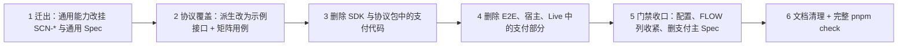

## Context

本仓库是模板演进的中间态：上一步（`2026-09-30-template-example`）已新增中立示例与通用场景门禁，`main` 为 `c0fbc33`，`pnpm check:fast` 全绿。这一步删除支付业务。难点不在"删"，而在支付代码与模板通用能力的纠缠。经逐项核对，纠缠点如下：

| 纠缠点 | 现状 | 直接删除的后果 |
| --- | --- | --- |
| 通用工程能力挂在支付场景下 | 架构与质量门禁（TC-PAYSDK-CORE-017）、包消费（CORE-014）、覆盖对账与证据有效性（CORE-015/016）、Live 配置与构建工具（CORE-021/022）、公共类型注释进入声明（CONTRACT-021）、错误码来源校验（CONTRACT-024）的规范都写在支付 Spec 中，测试都绑定 `TC-PAYSDK-*` | 这些通用能力的覆盖义务随支付 Spec 一起消失，门禁不会报错 |
| 发布预检测试没有绑定任何场景 | `tests/tooling/TC-PAYSDK-RELEASE-PREFLIGHT.spec.ts` 是普通测试 | 发布能力没有规范出处 |
| IDL 义务派生写死为支付接口 | `scripts/lib/contract-inventory.ts` 的方法集合来自 `discoverPaymentRoutes()`；字段策略 `requestPolicies` 按 `CreateTradePay`、`QueryTrade` 逐字段手写；另有 `xpay_env` 专项校验；读取支付 Fixture `TC-PAYSDK-CONTRACT-023/descriptor.json`、`TC-PAYSDK-CONTRACT-024/idl-errors.json` | 协议覆盖保障失效 |
| 示例间接依赖支付类型 | `packages/payment-sdk/src/runtime/default.ts` 引用支付的 `../contracts`（`Cancellation`）与 `../ports/runtime`（`RuntimePort`） | 删除支付后示例无法编译 |
| 示例的隔离规则与反例以支付为参照 | `.dependency-cruiser.cjs` 有 `example-no-payment`、`payment-no-example`；EX-05 反例测试往支付 `src/core/` 写违规文件 | 规则与反例失去意义或无法运行 |
| Live 工具与支付页面混在一起 | `host/weapp/live/config.ts` 依赖支付表单 `trade-form.ts`；`app.live.json` 同时注册支付页与示例页；证据检查的必需矩阵 `requiredLiveCases` 只有支付记录 | 删除支付页面后 Live 工具无法构建 |
| weapp 宿主混合 | `host/weapp/protocol-runner.ts` 同时导出通用的 `runProtocolCase`、`runProtocolSuite` 与支付的 `runPaymentCase` | 示例的协议矩阵 weapp 用例需要前两者 |
| 工具单测把支付 ID 当样本数据 | `scripts/check-fixtures.test.ts`、`packages/e2e/src/cases/*.test.ts`、`reporters/scenario-reporter.test.ts` 等使用 `TC-PAYSDK-*` 作为样本 | 配置删除支付格式后，这些样本不再合法 |
| OpenSpec 无法删除整个能力 | 已在仓库副本上模拟验证：删掉全部 Requirement 后，归档以"Spec 至少要有一个 Requirement"拒绝，CLI 也没有删除能力的命令 | 无法用 delta 删除两份支付 Spec |

约束：每个任务结束后 `pnpm check:fast` 必须通过；手写代码四项覆盖率保持 100%；不改包名、scope、registry、IDL 与生成配置；示例协议长期借用支付 IDL 的 `CreateTrade`、`QueryTrade`（用户决定）。

## Goals / Non-Goals

**Goals:**
- 仓库中不再有支付业务代码、支付测试、支付 Fixture、支付 Spec 与支付文档。
- 被支付"挂住"的通用能力全部迁到通用能力 Spec 与 `SCN-*` 场景之下，覆盖义务不减少。
- IDL 协议义务派生针对示例的 `CreateTrade`、`QueryTrade` 生效，每条义务都有 integration 与 weapp 证据。
- 完整 `pnpm check` 以退出码 0 通过：场景门禁没有任何问题，weapp 按 `packages/e2e/AGENTS.md` 的约定取证。

**Non-Goals:**
- 包名、scope、registry、目录结构、配置化参数化、可选能力模块化、模板使用指南，都留给第三步。
- 不替换 IDL；不修改 ProtoGen Consumer。
- 不修复微信开发者工具自动化的已知不稳定问题；不做 Live 真实运行；不发布。
- 不修改已归档 Change。

## Decisions

### Decision: 执行顺序是"先迁出，再删除"

迁出（第 1、2 步）时支付代码还在，迁移后的用例可以在原被测对象上先跑通，再在第 3、4 步删除被测对象中属于支付的部分。反过来先删除，会出现"用例没有被测对象"的中间态，`check:fast` 无法保持绿色。支付主 Spec 放在第 5 步删除：在此之前，门禁一直能看到支付场景，删除过程中任何遗漏都会以"缺绑定"的形式暴露。

### Decision: 能力归属与场景 ID 迁移表

测试逻辑不变的迁移只改绑定（`ownerId`、`covers`、测试名），不改断言。被删除的 case 只属于支付语义。

| 原场景 | 保留的 case | 删除的 case（原因） | 新场景 |
| --- | --- | --- | --- |
| TC-PAYSDK-CORE-014 双包构建与消费 | protocol-network-esm/commonjs/types-consumer、sdk-does-not-reexport-network、sdk-only-consumer、package-boundaries | sdk-esm/commonjs/types-consumer（改由示例的 SCN-TEMPLATE-EXAMPLE-001 package-consumer 承担）、concurrent-clients、weapp-production-runtime（支付客户端行为） | SCN-TEMPLATE-ENGINEERING-001 |
| TC-PAYSDK-CORE-017 架构与质量门禁 | 全部 9 个 | — | SCN-TEMPLATE-ENGINEERING-002 |
| TC-PAYSDK-CONTRACT-021 状态说明随源码与声明交付 | source-and-dual-declarations、missing-comment-rejected（检查对象改为示例公共类型） | semantic-review-evidence（支付状态语义评审） | SCN-TEMPLATE-ENGINEERING-003 |
| 发布预检（未绑定） | 三个现有测试分别绑定为 preflight-valid-plan、preflight-rejects-drift、publish-order | — | SCN-TEMPLATE-ENGINEERING-004 |
| TC-PAYSDK-CORE-021 Live 配置与凭据控制 | config-source、token-save-replace-clear、storage-failure、redacted-record | create-pay-recovery（支付创建后支付的衔接） | SCN-TEMPLATE-ENGINEERING-005 |
| TC-PAYSDK-CORE-022 Live 构建隔离与证据门禁 | isolated-live-build、live-evidence-validation | missing-create-contract（支付交易创建契约） | SCN-TEMPLATE-ENGINEERING-006 |
| TC-PAYSDK-CONTRACT-023（IDL 矩阵） | — | 全部（支付 `xpay_env` 语义） | 由 SCN-PROTOCOL-CONTRACT-001/002 重新建立（见"IDL 义务派生"） |
| TC-PAYSDK-CONTRACT-024 错误码同源 | all-errors、wrong-code、wrong-description、missing-error、source-mismatch、metadata-only-sync | — | SCN-PROTOCOL-CONTRACT-003（payment-projection-mismatch 更名为 projection-mismatch） |
| TC-PAYSDK-CORE-015 缺绑定 | 全部 3 个 | — | SCN-SCENARIO-GATE-009 |
| TC-PAYSDK-CORE-016 证据不足 | 全部 10 个 | — | SCN-SCENARIO-GATE-010 |
| SCN-SCENARIO-GATE-005 | pattern-config、removed-pattern-cli；payment-baseline-cli 去掉支付基线断言后更名为 multi-pattern-cli | payment-baseline-unchanged 检查点 | SCN-SCENARIO-GATE-011 |

迁移后的 tooling 用例文件按新 ID 重命名（例如 `tests/tooling/TC-PAYSDK-CORE-017.spec.ts` → `tests/tooling/SCN-TEMPLATE-ENGINEERING-002.spec.ts`），Fixture 目录同步改名，manifest 的 `ownerId` 与 `sources.spec.path` 同步更新。其余支付场景（SDK-01～12、15、16，CONTRACT-01～12 中的支付部分，FLOW-PAYSDK-001～008）连同用例、Fixture 一并删除，不迁移。

### Decision: OpenSpec 的两处例外

1. **整份删除两个支付能力**：本 Change 不为 `payment-sdk`、`payment-sdk-contract` 写 delta。第 5 个任务直接删除 `openspec/specs/payment-sdk/` 与 `openspec/specs/payment-sdk-contract/` 目录。这是对"主 Spec 只由归档更新"的有意例外，原因是 OpenSpec 1.6.0 不支持删除整个能力（见 Context）。归档本 Change 时，这两份 Spec 的删除已经体现在工作区中，模拟归档已验证可以通过。
2. **GATE-04 以"删除 + 新增"替代修改**：OpenSpec 要求被 MODIFIED 的 Requirement 保留全部原场景标题的原文；GATE-04 的原场景标题是"多格式并存且支付对账结果不变"，保留会误导使用方。因此删除 GATE-04 与 SCN-SCENARIO-GATE-005（编号不再复用），多格式配置部分迁入新增的 GATE-09 与 SCN-SCENARIO-GATE-011。EX-01、EX-05、GATE-03 的修改只改正文与检查点说明，场景标题原文保持不变，模拟归档已验证通过。

### Decision: SDK 包的删除与运行辅助端口迁移

- **删除**：`src/core/`、`src/adapters/`（payment-infra、channels、platform）、`src/ports/`、`src/errors/`、`src/contracts.ts`、`src/factory.ts` 及其全部单测。
- **运行辅助端口迁移**：新增 `src/runtime/port.ts`，定义 `RuntimePort`（时钟、请求标识、可取消等待），`Cancellation` 改为引用协议包公开导出的类型。`runtime/default.ts` 改为引用 `./port` 与协议包类型。`nextAttemptId` 只被支付核心使用，一并删除，以删除后无引用为准。
- **根入口**：`src/index.ts` 只导出示例的类型、`createExampleClient` 与 `ExampleConfigurationError`。
- **依赖规则**：删除 `example-no-payment`、`payment-no-example`；新增 `domain-isolation`，规则为 `packages/payment-sdk/src/<domain>/` 下的业务目录互不导入，`runtime/` 与 `index.ts` 除外。`core-no-platform-or-node` 的路径改为 `src/(runtime|example/(core|ports))/`。`example-core-no-generated` 与 `wx` lint 规则不变。
- **EX-05 反例**：`tests/tooling/SCN-TEMPLATE-EXAMPLE-008.spec.ts` 不再往支付目录写文件，改为临时新建 `src/sample-domain/` 并在它与 `src/example/` 之间制造互相导入，验证 `domain-isolation` 阻断；恢复后删除临时目录并确认门禁通过。

### Decision: 协议包的调整

- **Shadow**：删除 `testing/shadow/routes.ts` 中的 `discoverPaymentRoutes` 与 `ShadowRoute['methodName']` 中的支付字面量；`createShadowServer` 的 `routes` 参数改为必填，调用方显式传入 `discoverExampleRoutes()`。`testing/index.ts` 只导出示例路由与通用 Shadow 工具。
- **错误码目录缩减为 7 项**：删除仅属于 `CreateTradePay` 的 10 项，保留网关的 `ErrGatewayProxyInvalidParameter`、`ErrGatewayProxyUnauthorized`、`ErrGatewayProxyNotFound` 与 `QueryTrade` 的 `ErrInfraTradeQueryTradeUnauthorized`、`ErrInfraTradeQueryTradeInvalidParameter`、`ErrInfraTradeQueryTradeNotFound`、`ErrInfraTradeQueryTradeUnavailable`。示例用其中的 Unauthorized 判定鉴权失败，用 `QueryTrade` Unavailable 判定可重查，其余用于错误描述。导出名 `paymentBusinessErrors` 等不改，改名属于第三步。
- **来源校验 Fixture**：`tests/fixtures/TC-PAYSDK-CONTRACT-024/` 改名为 `SCN-PROTOCOL-CONTRACT-003/`；`idl-errors.json` 与各反例 JSON 缩减为 7 项；`extract.go`、`reproduce.sh`、`refresh-manifests.py` 按同一清单调整，来源版本仍为 IDL `5539be8f09323709fa65f6568efe22896ec35d24`；`payment-projection-mismatch.json` 更名为 `projection-mismatch.json`。
- 通信执行器、网络适配、generated 代码不变。

### Decision: IDL 义务派生改为针对示例接口

`scripts/lib/contract-inventory.ts` 的改造：

- 方法集合改为 `discoverExampleRoutes()`，即 `CreateTrade` 与 `QueryTrade`。
- 删除 `xpay_env` 专项校验，以及对 `TC-PAYSDK-CONTRACT-023/descriptor.json` 的读取；错误码清单改读 `SCN-PROTOCOL-CONTRACT-003/idl-errors.json`。
- 共享义务 `header-base-req` 去掉支付专属的 `xpay-env-absent` case，其余 case 不变。
- 删除两条支付附加义务（`CreateTradePay#request-mapping#user_id`、`QueryTrade#request-mapping#xpay_env`）。
- 字段策略 `requestPolicies` 按示例的映射（见 `template-example` 的 Design"中立模型到交易接口的映射"）重写：

| 方法 | 字段 | case |
| --- | --- | --- |
| CreateTrade | biz_type、biz_trade_no、user_id、pay_amount、original_amount | mapped-value |
| CreateTrade | goods_type、discount_amount | fixed-value |
| CreateTrade | items、items.biz_order_no、items.sku_id、items.sku_name、items.quantity、items.unit_price、items.pay_amount | mapped-value |
| CreateTrade | items.discount_amount | fixed-value |
| CreateTrade | items.sku_snapshot | omitted |
| CreateTrade / QueryTrade | base_req、base_req.request_id | generated-value |
| CreateTrade / QueryTrade | base_req.product_id | configured-value、omitted |
| QueryTrade | trade_no | mapped-value |
| QueryTrade | biz_type、biz_trade_no、sync_channel | omitted |

  响应字段的义务仍由现有规则自动派生，不手写。派生时若出现上表未覆盖、也无法自动判定的字段，会被报告为待定（PC-01），实现时据此补齐上表，不静默忽略。
- 义务 ID 前缀 `infra.trade.v1.` 不变，`requiredIn` 仍为 integration 与 weapp。

**示例协议矩阵用例**：
- integration：新建 `tests/protocol/SCN-PROTOCOL-CONTRACT-002.spec.ts`，经公共协议客户端与 Shadow 执行全部义务 case，每个 case 用 `covers` 绑定对应的义务 ID。写法参照将被删除的 `TC-PAYSDK-PROTOCOL-MATRIX.spec.ts`，数据放在新 Fixture `SCN-PROTOCOL-CONTRACT-002/`。
- weapp：新建 `tests/weapp/SCN-PROTOCOL-CONTRACT-002.spec.ts`，沿用"一次宿主调用跑完整份清单"的做法，通过保留下来的 `runProtocolSuite` 执行，因此只增加 1～2 个 weapp case。
- `scripts/check-fixtures.ts` 中针对 `TC-PAYSDK-CONTRACT-023` 的特例校验删除。

### Decision: E2E、宿主与 Live 的删除范围

- **用例与 Fixture**：删除 `tests/sdk/`（含 `public-client-harness.ts`）、`tests/flows/`、`tests/protocol/` 与 `tests/weapp/` 下的支付文件、`tests/tooling/TC-PAYSDK-CORE-023.spec.ts`，以及全部 `TC-PAYSDK-*`、`FLOW-PAYSDK-*` Fixture 目录（迁移目录除外）。删除 `SCN-SCENARIO-GATE-005/` 中的支付基线文件。
- **weapp 宿主**：`protocol-runner.ts` 删除 `runPaymentCase` 及仅被它引用的代码，保留 `runProtocolCase`、`runProtocolSuite`。`runProtocolSuite` 目前写死为 `CreateTradePay`/`QueryTrade` 两个动作，改为 `CreateTrade`/`QueryTrade`（元数据、请求与响应 codec 同步替换）；`app.js` 删除 `runPaymentCase` 的注册；`src/drivers/weapp-host.test.ts` 同步调整，保持 100% 覆盖。
- **渠道替身**：删除 `src/drivers/channel-double.ts` 及其测试（只服务支付渠道）。Live 构建与检查中"不得包含测试设施"的判定保留 `testing/shadow`、`tests/fixtures`、`fixtures/`、`@payment-test/protocol`，去掉 `channel-double` 一项。
- **Live**：
  - 删除支付页面 `pages/live/index/`，以及 `controller.ts`、`page.ts`、`create-trade.ts`、`create-trade-errors.ts`、`trade-form.ts`、`runtime.ts` 与对应测试。
  - `config.ts` 去掉对 `trade-form` 的依赖，白名单只保留示例需要的 `PAYMENT_LIVE_GATEWAY_BASE_URL`、`PAYMENT_LIVE_PRODUCT_ID`、`PAYMENT_LIVE_LANE`、`PAYMENT_LIVE_APP_VERSION`、`PAYMENT_LIVE_USER_ID` 与 `LIVE_EXAMPLE_*`。键名的 `PAYMENT_` 前缀在第三步统一改名。
  - `app.live.json` 只注册 `pages/live/example/index`。
  - 证据检查：`requiredLiveCases` 与 `evidence.schema.json` 删除 `LIVE-PAYSDK-*`，只保留 `LIVE-TEMPLATE-EXAMPLE-001`；拒绝含 `/api/base/trade/pay` 请求路径的规则保留（EX-07）。
  - 迁移后的 Live 用例绑定到 SCN-TEMPLATE-ENGINEERING-005/006。
- **工具单测的样本 ID**：所有作为样本数据的 `TC-PAYSDK-*`、`FLOW-PAYSDK-*` 改为 `SCN-SAMPLE-*`、`FLOW-SAMPLE-*` 等通用格式样本，断言语义不变。

### Decision: 门禁与配置收口

- `scenario-gate.config.json` 删除 `^TC-PAYSDK-…`、`^FLOW-PAYSDK-…` 两个格式。
- `scripts/flow.schema.json` 的 `relatedScenarios` 改为 ID 数组；`spec-inventory` 校验每个 ID 都已在有效 Spec 中登记（GATE-03）。现有唯一的 FLOW 表（示例 EX-08）已使用完整 ID，无需改写。
- 覆盖对账与证据有效性（GATE-07、GATE-08）的实现已经存在于 `check-scenarios.ts`，本次只迁移规范与绑定，不改逻辑。

### Decision: 文档

- 根目录与三个包的 AGENTS.md 删除"当前业务：支付"整节；"模板通用规则"中指向支付 Spec 或支付场景的地方改指新的能力 Spec，并补一句"IDL 协议义务派生针对示例的 `CreateTrade`、`QueryTrade`"。
- README 删除支付内容：包职责表中的支付描述、支付 Change 链接、支付 Live 说明等；不改写为模板使用指南。
- 删除 `docs/engineering/live-acceptance.md`、`docs/engineering/live-create-trade-contract.md`；`docs/engineering/bootstrap.md` 是工具安装记录，保留。
- `.env.live.example` 只保留 Live 白名单中剩余的键。

### Decision: 验证方式

- 每个任务：`pnpm check:fast` 必须通过（含 100% 覆盖率与 `check:fixtures`）。
- 第 5 个任务之前，场景门禁里仍有支付问题；从第 5 个任务起，门禁中不应再有任何问题。
- 第 6 个任务：完整 `pnpm check` 退出码为 0。weapp 按 `packages/e2e/AGENTS.md` 的约定执行（每个文件运行前退出主进程并预热，失败时整文件重跑）；验收记录写明重跑情况。
- 场景门禁以完整报告集合运行：unit、integration，以及每个 weapp 文件各一份报告。

## Risks / Trade-offs

- **迁移遗漏导致覆盖义务悄悄减少**：缓解措施有两条。一是迁移表逐项对照；二是支付主 Spec 在最后删除，删除前门禁能看到全部支付场景，迁移不完整会以缺绑定暴露。
- **`CreateTrade` 字段策略可能不全**：嵌套字段较多，手写策略可能遗漏。缓解：派生器会把未判定字段报告为待定（PC-01），实现时以"待定为 0"作为完成条件。
- **示例协议矩阵的 weapp 用例受 DevTools 不稳定影响**：沿用"一次宿主调用跑完整清单"，把 weapp case 控制在 1～2 个，并按 AGENTS 约定重跑。
- **绕过 OpenSpec 删除主 Spec**：属于有意例外，已在 Proposal 与本 Design 中记录原因与模拟验证结果。
- **示例协议仍借用支付 IDL**：`CreateTradePay` 等扣款接口仍在 generated 代码中，由 EX-07 的"不调用支付接口"与 Live 证据检查守护；这是用户接受的长期状态。

## Open Items

| ID | 状态 | 责任方 | 内容 | 关闭依据 | 影响 |
| --- | --- | --- | --- | --- | --- |
| GAP-01 | 已知缺口，不在本次处理 | 用户 | 删除支付后，"端侧渠道适配器"与"平台设备信息适配器"两类分层没有样例 | 需要时扩展示例 | 模板 B 组能力中的这两类分层没有参照 |
| GAP-02 | 留给第三步 | 用户 | 模板使用指南（能力地图、流程、可替换点）、包与项目参数化、可选能力模块化 | 第三步 Change 完成 | README 暂时只描述现状 |
