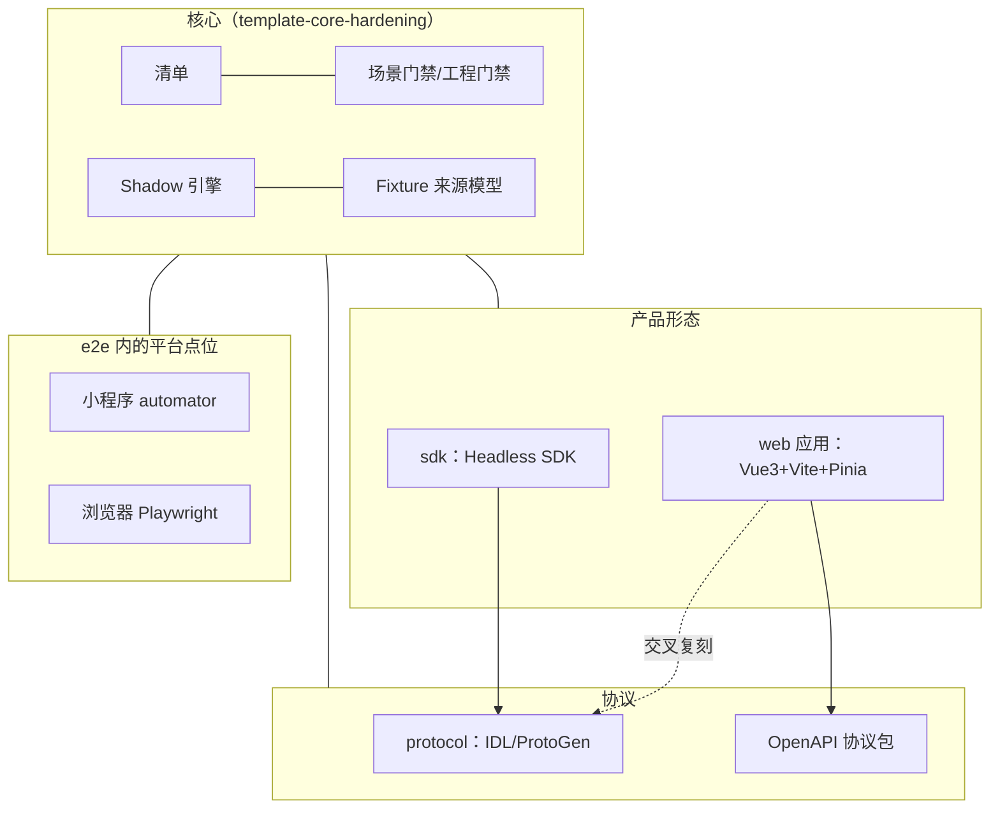

## Context

模板目前只有一套具体实现：Headless SDK + IDL（ProtoGen）+ 小程序。第一个真实使用方 xueshan_fe 的形态是 Web 应用 + OpenAPI + 浏览器，它在模板之外自行补齐了应用骨架、OpenAPI 协议链路、Playwright 浏览器平台、产物边界检查与本地 Mock 预览。本 Change 把这些能力作为**第二套具体实现**并列放进模板。



**前提**：本 Change 以 `template-core-hardening`（下称"核心 Change"）完成并归档为前提，复用其中的清单扩展、手写源码清单、覆盖率完整性、Fixture 来源模型、Shadow 请求记录与有界轮询、X-Request-Id 规范、`pnpm verify`、按需测试、项目地图与复刻验收方法。本 design 中"核心 Change 的某某"都指它已批准的 design 与 Spec。

**规划阶段已完成的前置验证**：

| 编号 | 验证内容 | 结论 |
|---|---|---|
| V1 | 清单改为多包 | 现有代码 6 处假定"每种角色一个包"（`check-architecture`、`check-package`、`check-release`、`contract-inventory`、清单加载校验、ENG-005 用例），schema 说明同样如此。改造可行，方式见"清单多包与组合绑定" |
| V2 | IDL 协议包的浏览器 `fetch` 适配器 | 在模板副本中实现并通过：12 个单测（覆盖率 100%）、经 Shadow 的 Node 集成 16 项、真实 Chromium 经同源代理 5 类结果；把现有协议矩阵的驱动换成该适配器后整体通过。发现 Chromium 会在复用连接被零字节断开时**静默重发 POST** |
| V3 | 版本共存 | 在模板现有基线（TS 5.9.3、Vitest 5.0.0、Vite 8.2.2、Node 22.21.1）上全部依赖可共存，无 peer 警告；`.vue` 计入覆盖率、`vue-tsc`、openapi-typescript 生成、Playwright、ESLint 均通过；`<style scoped src="./X.css">` 经单测与构建验证生效 |
| 调研 | xueshan Web 应用、OpenAPI、浏览器、本地预览的吸收清单 | 见各模块的"来源"说明 |

**用户已确认的决定**（规划讨论中逐条确认）：

- 不做模块化框架，Web 作为第二套具体实现；
- 核心 Change 中只适配 IDL 的义务派生，在本 Change 改为按协议插拔；
- 本地预览只做序列状态；
- 不提供"只放过多出字段"的宽松认领；
- OpenAPI 协议包与 IDL 包一致，构建双格式产物；
- 示例契约中立化重写（交易领域）；
- 信封约定（HTTP 200 + 业务码 0 表示成功）作为可配置默认值；
- 组件树规范：独立 CSS 文件经 `<style scoped src>` 引入、hook 命名 `useX.ts`、模块内保留 `ui/` 层、跨模块共享放 `src/shared/{components,composables,utils}`、模块内子组件放 `components/`；
- 浏览器测试用 Playwright 库，由 Vitest 驱动。

## Goals / Non-Goals

**Goals:**

- 模板同时提供两套可运行、可验收的具体实现：SDK + IDL + 小程序、Web 应用 + OpenAPI + 浏览器；交叉组合 Web 应用 + IDL + 浏览器可用。
- 门禁、清单与 Shadow 对产品形态、协议种类、运行平台无写死；新增一种组合只需改清单与对应包。
- Web 应用的前端架构规范（树形与就近、状态分层、依赖方向、行数上限）尽量机械化。
- 本地预览让开发者与用户可以用 Fixture 数据看到页面与指定状态下的 UI。
- 以三个复刻演练加 xueshan 62 条反馈核对完成本轮迭代的最终验收。

**Non-Goals:**

- 模块化框架（清单模块声明、能力矩阵）；
- UI 还原与一次性视觉验收；
- 业务状态模拟（预览不模拟写操作后的服务端状态推进）；
- Firefox、WebKit 平台证据（只覆盖 Chromium）；
- 多页入口；
- 服务端状态管理库；
- 存量项目升级工具；
- 真实服务端联调验收（仍由真实消费方承担）。

## Decisions

本节按职责模块组织。"清单多包与组合绑定"与"协议适配器"是跨模块的共享契约，其余模块引用它们。

### Decision: 共享契约：清单多包与组合绑定

**问题**：清单 schema 规定 product、protocol、test 三种角色各恰好一个；门禁以 `packageByRole` 取唯一包。模板仓库本身将同时包含两个产品包与两个协议包；协议义务的运行环境取"全部 integration 与 platform 项目"，两套协议并存后会出现 IDL 义务要求浏览器证据、OpenAPI 义务要求小程序证据的交叉误报。

**清单扩展**（字段唯一权威仍是 `project.manifest.schema.json`，每个新属性带中文说明）：

| 字段 | 含义 |
|---|---|
| `packages[]` | 每种角色允许多个；test 角色仍恰好一个（测试基础设施固定在 `packages/e2e/`） |
| `packages[].form` | 仅 product 角色：`sdk` 或 `web-app`，决定该包适用的工程检查（见"按产品形态区分的工程检查"） |
| `packages[].protocolKind` | 仅 protocol 角色：`idl` 或 `openapi`，决定加载哪个协议适配器 |
| `packages[].globalStore` | 仅 `web-app`：全局 store 模块路径 |
| `bindings[]` | 新增。每条为 `{ name, product, protocol, platforms }`：产品包目录、它使用的协议包目录、它的平台测试项目名（platform 类） |

`bindings` 的约束：product 与 protocol 各至少一个；`platforms` 可以为空（骨架阶段）；绑定名唯一；每个 product 恰好出现在一条绑定中；protocol 可被多条绑定引用；`platforms` 只能引用 platform 类测试项目；产品包必须以 workspace 依赖声明其绑定的协议包。

同一 owner 被分属不同协议的绑定中的用例绑定时报错；只被不属于任何绑定的用例绑定的 owner 不做 Fixture 协议一致性核对。`check:package` 的范围是 `sdk` 形态的产品包及其绑定的协议包。现有 IDL Fixture 迁移时一次性补 `protocol` 字段。

**绑定的独占内容与删除**：删除一条绑定时，删除清单由清单事实确定，不靠人工判断：

- 该绑定独占的包（不被其他绑定引用的产品包与协议包）及其测试项目；该绑定的平台测试项目与宿主目录；
- 声明了该绑定（`binding` 字段或位于 `tests/<绑定名>/`）的全部用例及其 Fixture；
- 规则：凡是导入了某绑定独占包（源码、产物或 `testing/`）的测试文件，都 MUST 声明该绑定，由架构检查强制。现有 IDL 相关的 tooling 与协议用例因此都补 `binding: 'sdk-idl-weapp'`；
- 协议包的前置检查命令登记在清单 `packages[].checks`（IDL 为 `proto:validate`、`proto:status`；OpenAPI 为 `api:validate`、`api:status`），`check:fast` 由 `run-by-manifest` 按清单组装这些命令，删除包后随之消失，不需要手改根 `package.json` 的 `check:fast`；
- Spec 的清理（删除只适用于该绑定的 Requirement）属于使用方自己的 Change，作为指南"移除一条绑定"一节的最后一步：在一个 Change 中以 REMOVED 删除这些 Requirement（整份能力退役按核心 Change 的归档已知限制处理），之后场景门禁对账。"移除一条绑定"演练同样执行这一步，再运行完整 `pnpm verify`。
- 指南新增"移除一条绑定"一节，按以下顺序给出操作：删除独占包、平台测试项目与宿主、声明该绑定的用例与 Fixture；同步清单；同步文档（指南、架构文档、根与包级 AGENTS、README 中指向已删除包与命令的内容）；核验模板自身事实的用例按清单派生结论（例如"清单中的每条绑定都满足约束"，而不是"恰好两条"），不需改动；按路径引用独占包的单测与 helper 改为受控临时根输入，或声明所属绑定。

**用例归属绑定**：`defineCase` 的 `binding` 字段优先；未声明时取用例所在目录 `tests/<绑定名>/`；两者都没有的用例（如 `tests/tooling/`）不属于任何绑定，只能声明 integration 环境。现有 IDL 用例不搬目录，补 `binding: 'sdk-idl-weapp'`；新增的 Web 用例放在 `tests/web-openapi-browser/`。

**Fixture 与数据集的协议归属**：Fixture manifest 与预览数据集 manifest 新增 `protocol` 字段（协议包目录）。包含协议响应的 Fixture 必须声明；门禁据此只调用对应协议适配器的 `checkFixture`。门禁同时核对：某个 owner 的 Fixture 声明的协议，必须与绑定该 owner 的用例所属绑定的协议一致，防止漏声明而绕过信封认领。

**发布范围**：发布计划只包含 `sdk` 形态的产品包及其绑定的协议包；`web-app` 形态的产品包与只被它绑定的协议包（模板中为 OpenAPI 协议包）不发布，但仍构建双格式产物供用例与宿主消费。

**已知限制**：两个产品通过不同绑定消费同一协议包的同一接口时，义务 ID 会重复；模板本身不出现这种情况，遇到时在义务 ID 前加绑定名区分，留待真实需求出现再实现。

**按绑定取值的读取方**：

- 协议义务：每个产品的义务只要求 integration 类项目加该产品绑定的 `platforms`。
- `defineCase` 的环境校验：用例声明的环境必须属于其所在绑定（由用例目录 `tests/<绑定名>/` 或 `binding` 字段确定）。
- `run-by-manifest`：`build` 按协议先于产品的依赖序处理全部包；`test:e2e:<name>` 按 platform 项目。
- `check-architecture`、`check-package`/`check:bundle`、`check-release`、`contract-inventory`：全部改为遍历包或绑定，不再取唯一包。

新增包的目录与包名：Web 应用产品包为 `packages/web`（`@daqian/template-web`，`form: web-app`，私有，不发布）；OpenAPI 协议包为 `packages/openapi`（`@daqian/template-openapi`，`protocolKind: openapi`），契约与 lock 放在该包的 `contracts/` 下（`allowedDirectories` 含 `contracts`）。

模板仓库登记两条绑定：`sdk-idl-weapp`（sdk + protocol + weapp）与 `web-openapi-browser`（web 应用 + OpenAPI 包 + browser）。使用方删除不需要的一条即可回到单组合。

替代方案是每种组合一个独立清单，被否决：门禁要同时读多份清单，且共享的 test 包无法归属。

### Decision: 共享契约：协议适配器

**问题**：核心 Change 中协议义务派生、Shadow 响应校验与 Fixture 检查只适配 IDL：声明元素必须是 IDL `createMethod` 常量，字段结构用 IDL 专用的 `deriveFields` 解析；`validateResponse` 只接收 body；`check:fixtures` 没有按协议区分的检查入口。

**接口**：每个协议包在 `testing/adapter.ts` 导出一个协议适配器，门禁按 `packages[].protocolKind` 经清单定位协议包后加载：

| 方法 | 作用 | IDL 实现 | OpenAPI 实现 |
|---|---|---|---|
| `resolveDeclaration(element)` | 把消费接口声明中的一个元素解析为 `{ key, prefix, meta }`；非法元素报错 | 核心 Change 现有逻辑：`createMethod` 常量、generated 声明位置推导包名 | 生成的接口描述常量，前缀取契约名（如 `trade.v1`） |
| `deriveObligations(op, requestFields)` | 派生该接口的义务 | 核心 Change 现有的字段级派生 | 接口粒度派生（见"OpenAPI 协议包"） |
| `responseValidator(op)` | 返回 `(body, status) => issues`，注入 Shadow 路由 | `deriveFields` 结构校验 | 规范化后的 Ajv 校验 + 按接口核对业务码 |
| `checkFixture(manifest, files)` | 协议相关的 Fixture 检查（信封认领、业务码） | 无额外检查 | 多信封认领（见下） |
| `scanCalls(sourceFiles)` | 静态扫描产品源码中的实际调用，用于双向检查 | `request(<X>.meta, …)` | `request(<描述常量>, …)` |

- 核心 Change 的 IDL 专用逻辑整体迁入 IDL 适配器，行为不变，由核心 Change 的 PC-01 等 Scenario 作回归。
- `validateResponse` 签名从 `(body)` 扩为 `(body, status)`：OpenAPI 的响应 schema 按状态码区分；IDL 适配器忽略 status。
- Shadow 引擎仍不导入任何协议生成物（`shadow-engine-no-generated` 不变），校验函数由协议侧路由构造器注入。
- 适配器放在协议包 `testing/`：既能被 Shadow 路由构造器使用，又能被 `scripts/` 门禁导入；不进入协议包生产产物（`production-no-test` 规则覆盖）。

替代方案是门禁内按协议种类写分支，被否决：新增协议需要改门禁。

### Decision: Shadow 引擎归属测试基础设施

**问题**：Shadow 引擎（`server.ts`、`faults.ts`、`routes.ts`、`requests.ts`，以及本 Change 新增的预览构造入口）目前放在 IDL 协议包 `packages/protocol/testing/shadow/`。OpenAPI 路由构造器、e2e harness、宿主与预览启动器都要使用它。只保留 Web + OpenAPI 组合时删除 `packages/protocol`，Shadow 就随之消失；不删则 OpenAPI 包要依赖 IDL 包，形成规划外的协议包间依赖，违背"删除一条绑定即回到单组合"。

**做法**：

- 引擎整体迁到测试包 `packages/e2e/src/shadow/`，属于测试基础设施，不属于任何协议选项；测试包本来就是固定路径、不随组合删除。
- 各协议包 `testing/` 只保留协议相关部分：路由构造器（`idl-routes.ts`、OpenAPI 的 `shadow-routes.ts`）产出**中立路由描述**（含注入的 `validateResponse`），协议适配器（`adapter.ts`）与浏览器执行器（`browser-runner.ts`）。它们不导入引擎，满足 PC-03"引擎只接收中立描述"与 ENG-05"协议包不得依赖测试包"。
- `@template-test/protocol` 别名拆为两部分：引擎从 `packages/e2e/src/shadow/` 导入；各协议包的 testing 入口只导出路由构造器、适配器与执行器。
- 中立路由描述的类型由引擎定义；协议包不能导入引擎，因此各协议包的路由构造器按结构输出同形的对象，由测试包中的类型测试核对两者兼容。
- 预览构造函数 `createPreviewShadowServer` 放在引擎目录下的独立模块 `packages/e2e/src/shadow/preview-server.ts`，不被引擎入口转导出；依赖规则限定只有 `packages/e2e/src/preview/` 可以导入该模块（dependency-cruiser 按模块判定，独立模块保证规则无法经入口绕过）。
- `shadow-engine-no-generated` 规则的路径改为新引擎目录：引擎不得导入任何协议包的生成物与 testing 模块。
- 替换点地图写明"Shadow 引擎属于测试基础设施，不随协议选项删除"。
- 证据：
  - 自动化：受控临时根中删除一条绑定后门禁无需修改即可工作（SCN-TEMPLATE-ENGINEERING-014）；
  - 演练：单组合承诺的真实仓库证据放在复刻验收中，由无上下文 Agent 在隔离副本里照指南"移除一条绑定"一节删除 `sdk-idl-weapp`，允许按指南同步文档、事实核验用例与按路径引用 IDL 包的测试，最后运行完整 `pnpm verify`（ENG-11 的单组合承诺）。在真实仓库里删除一整条绑定是使用方会做的操作，用演练验证还能同时检验指南是否写全。

这项迁移由协议适配器任务一并完成（核心 Change 交付的引擎原样迁移，行为不变，由 PC-06 的既有 Scenario 回归）。

**引擎相关证据的运行项目**：凡是验证引擎自身行为的 case（构造时校验失败的位置信息、`validateResponse` 的入参、`malformed` 认领跳过校验、`headerPatterns` 与 `verify()` 等），改到 test-tools-unit，用中立路由加注入的校验函数验证，不导入任何协议包；验证 IDL 校验器本身（字段结构、编码、oneof、动态类型待定）的 case 留在 protocol-unit，只调用 IDL 路由构造器与校验器，不构造引擎。协议包的测试文件同样不得导入引擎。

### Decision: 按产品形态区分的工程检查

| 检查 | `sdk` | `web-app` |
|---|---|---|
| 类型检查 | `tsc -p tsconfig.build.json --noEmit` | `vue-tsc --build`（含 `tsconfig.app.json`、`tsconfig.core.json`、`tsconfig.vitest.json`）；纯 `tsc` 无法解析 `.vue` |
| 中文注释发现 | 从根入口导出发现（核心 Change ENG-03） | 源码模式：`ports/**`、`core/**` 的导出类型、全局 store 模块、模块上下文（InjectionKey 与其类型）、消费接口声明 |
| 产物边界 | `check:package`（npm 包产物） | `check:bundle`（见"Web 产物边界"） |
| 发布 | 可登记 `release` | 不发布 |

`run-by-manifest` 按 `form` 组装 `typecheck`；注释门禁与产物检查按 `form` 选择实现。`check:package` 只处理 `sdk` 形态的包，`check:bundle` 与 `check:component-tree` 只处理 `web-app` 形态的包，清单中没有对应形态时直接通过；三者都加入 `check:fast` 与 `requiredCommands`。源码清单的 `code` 类扩展名加入 `.vue`；`max-lines` 对 `.vue` 计入 template 与 style 行数。

### Decision: Web 应用产品包

**初始化**：用官方脚手架 `pnpm create vue@3.24.0 packages/<dir> --ts --pinia --vitest --eslint --prettier --bare` 生成后对齐模板（xueshan `docs/engineering/bootstrap.md` 的做法）：

- 删除脚手架自带的 oxlint、包内 ESLint/Prettier 配置与 `.vscode`，统一使用根配置；
- 依赖版本改为本 design"依赖版本"一节；
- 删除脚手架残留（英文 README、Cypress 段等）；
- 包对协议包的依赖用 workspace 依赖声明，不只靠路径别名（xueshan 只靠 4 处别名，容易漂移）。

**目录结构**：

```
src/
  main.ts                    装配入口：唯一允许读取 import.meta.env 的位置
  app/                       装配层：组装 store、端口实现、模块根组件
    platform/                跨模块共用的平台适配器（时钟、可见性、取消），在装配点注入
    consumed-operations.ts   消费接口声明（核心 Change 的机制）
  runtime/                   纯逻辑运行辅助（轮询器、代际），不依赖 Vue/DOM
    ports/                   运行辅助所需的端口（时钟、可见性、取消）
  shared/                    跨模块共享（目录，不是 package）
    components/              共享组件，内部同样用组件树
    composables/             共享 hook
    utils/                   共享工具
  <module>/                  业务模块，按界面块划分
    ui/<Root>/               模块根组件，组件树从这里开始
    core/                    纯逻辑，不依赖 Vue/DOM
    ports/                   外部能力抽象
    adapters/                外部能力实现（调用协议包）
  store/                     全局 store（清单 packages[].globalStore 指向其入口）
```

运行辅助的端口放 `runtime/ports/`，修正 xueshan 中 `runtime/poller.ts` 反向依赖 `game/ports/` 的问题。

**组件树（树形 + 就近）**：

```
<module>/ui/<Root>/
  <Root>.vue                 入口，<style scoped src="./<Root>.css"></style>
  use<Root>.ts               hook（可选）
  <Root>.css                 样式（可选）
  utils/                     只给本子树用的工具（可选）
  components/<Child>/        子组件，结构同上，可继续嵌套
  __tests__/
```

可机械检查的规则（新增 `check:component-tree`，基于 dependency-cruiser 的 JSON 输出判定）：

1. 每个组件目录恰好一个 `.vue`，文件名等于目录名；
2. 子组件不得引用父级组件；
3. CSS 只能被同目录的 `.vue` 引用（全局样式只允许从 `main.ts` 引入）；
4. 组件目录内的非入口文件（hook、样式、`utils/`、`components/*` 的内部文件）只能被本子树引用，外部只能引用 `components/X/X.vue`；
5. 孤儿组件（未被任何文件引用）报错（depcruise `orphan` 规则）。

子组件在语义上是否属于父组件、何时上提到 `shared/`、hook 与 `core/` 纯函数如何分工，写进包级 AGENTS，由评审判断。

**状态分层**（写入包级 AGENTS.md，来源 xueshan `packages/app/AGENTS.md`）：

| 层 | 判定依据 | 放在哪里 |
|---|---|---|
| 组件状态 | 只有一个组件读写 | 组件自身 |
| 模块状态 | 同模块多个组件读写，其他模块不读 | 模块根组件，props/emit 或 provide/inject 下传 |
| 全局状态 | 两个及以上模块读，或由全局流程处理 | `store/` 中唯一的全局 store |

归类看"谁读、谁写"，不看"谁触发"；一份响应中有任何字段需跨模块使用时，整份快照进全局 store。状态分层与组件树是同一棵树的两种视角：组件状态在节点，模块状态在模块根，全局状态在包根。

**全局 store 的约束**：

- 唯一一个 setup store；规模超过行数上限时，拆成多个切片函数在同一个 `defineStore` 中组合，不拆成多个 store。
- 对外只暴露 `readonly()` 状态与 action：组件写入在类型层面即报错（xueshan 的 lint 选择器可被别名、`Object.assign` 绕过，已实测）。
- lint 兜底：禁止组件中对 `*Store` 赋值、`$patch`、`$state`、给 store 起别名、`Object.assign(<store>…)`；store 变量名以 `Store` 结尾，组合式函数命名 `use<X>Store`。
- 异步结果带代际号，过期结果丢弃；导航时 AbortSignal 取消旧请求。
- 协调逻辑拆到 `core/` 纯函数，store 只负责组合并持有状态。
- 示例必须包含"store 写入审计测试"：每个 action 调用前后对全局状态取快照，断言变化的键恰好等于该 action 的写入清单。

**依赖方向**（dependency-cruiser，按清单与绑定生成路径）：

- `ui-no-adapters-no-protocol`：`ui/` 不得引用 `adapters/` 与协议包；
- `core-no-ui-no-framework`：`core/`、`ports/`、`runtime/` 不得引用 `ui/`、Vue、Pinia 与 `.vue`；
- `domain-isolation`：业务模块之间不得互相引用；`app/` 豁免（装配层），可共同引用 `runtime/`、`shared/`、`store/` 与消费接口声明；
- `shared-no-store-no-adapters`：`shared/` 不得引用 `store/` 与 `adapters/`；
- 测试文件模式统一为 `[.](test|spec)[.]ts$`（修正 xueshan 只排除 `.test.ts` 的不一致）。

**类型与 lint 的其他约束**：

- `tsconfig.core.json`：`lib: ["ES2022"]`、`types: []`，`include` 由清单生成（`runtime/`、`*/core/`、`*/ports/`、全局 store），类型层面禁止 DOM；ESLint 对同一范围禁止 DOM 全局（`no-restricted-globals`）。
- `import.meta.env` 只允许出现在 `src/main.ts`，并且只能以"整体传给纯函数"的形式出现（例如 `apiBaseUrl(import.meta.env)`），用 ESLint 选择器实现，替代 xueshan 用 Scenario 做字符串扫描的 PLATFORM-014。
- 产品 `src/` 下禁止覆盖率忽略注释（`v8 ignore`、`istanbul ignore`、`c8 ignore`）；不可达分支按 xueshan 反馈 #37、#38 的方式改写（可辨识联合收窄、抽纯函数）。唯一合法的排除通道是核心 Change 的 `quality.coverageExclusions`。
- `vue/multi-word-component-names` 的例外登记在清单 `quality.componentNameExemptions[]`（`{ path, reason }`，与 `quality.maxLinesExemptions` 同一机制），不在配置中写死文件名。
- ESLint：沿用模板现有的 `defineConfig` + typescript-eslint，加入 `eslint-plugin-vue` 的 flat 配置；不引入 `@vue/eslint-config-typescript`（它与 `extends: ['js/recommended']` 写法冲突，V3 已复现）。

**测试**：

- 单测环境 jsdom；store 与 `core/` 的单测用 `// @vitest-environment node`。
- Vitest 项目 root 固定在仓库根。V3 在 Vitest 5.0 下未复现 xueshan 反馈 #6（root 在包内导致 `.vue` 从覆盖率中消失），仍保留该约束，并增加反例：一个未被测试导入的 `.vue` 必须拉低覆盖率并被 `check:coverage` 报出。
- 入口文件计入覆盖率：测试中动态 `import('../main.ts')`（来源 xueshan `src/__tests__/main-entry.test.ts`）。

### Decision: Web 产物边界

`check:bundle`（来源 xueshan `scripts/check-bundle.ts`、`scripts/lib/bundle.ts`），泛化后：

- **模块清单**：构建时由 Vite 插件写出模块清单（模块来源路径、产物文件及其 sha256），写到 `dist/` 之外（`artifacts/build/<产品目录>/bundle-manifest.json`）。部署不再需要删除文件，源码路径也不会随产物公开。插件放 `scripts/lib/vite-plugins/`，不放在产品包内反向引用 `scripts/`。
- **测试设施不得进入产物**：判定按模块来源路径，范围从清单生成（test 角色包、协议包 `testing/`、Fixture 根），不再用子串匹配（xueshan 的 `/shadow/i` 会误伤）。
- **协议 bundle 不得进入产物**：协议包的契约文件、bundle 后的契约 JSON 不得出现在模块清单中（xueshan 线上产物中已实测到完整契约，含测试 token 与内部域名）。
- **模块与摘要对账**：产物模块全部来自源码清单或依赖；模块清单为空即失败。
- **入口与资源**：入口模块必须在清单中；资源路径必须是相对路径（`base: './'`）。
- **样式残留**：编译后的 CSS 不得残留 `:deep(`、`:slotted(`、`:global(`（xueshan 反馈 #52，残留会导致整条规则静默失效）。
- **产物新鲜度**：模块清单记录"产品摘要"，范围是产品包源码、其协议包源码与 `buildInputs`，不含测试与门禁脚本，改用例不会让产物被判过期。浏览器宿主启动时用同一口径校验（见"浏览器平台点位"）。
- `buildInputs` 的通配不匹配被 `.gitignore` 忽略的文件（如 `.env.local`），避免本地密钥文件进入摘要。

### Decision: OpenAPI 协议包

**契约与同步**（来源 xueshan `scripts/api-contract.ts`）：

- 契约文件与 lock 登记在协议包的清单条目中：`packages[].contract: { file, lock }`，写入 `fingerprints.protocolInputs`。
- `api:validate`：`redocly lint` 无 error（通用基线，任何契约都适用）；再按该契约的**协议约定模块**做约定自洽检查。模板默认约定为：信封 `code` 的枚举等于码表；`x-common-business-codes` 与各接口的 `x-business-codes` 都是 `x-business-code-table`（名称 → 码值）的子集。码表、通用码、接口码的读取方式与自洽规则属于团队约定，不是 OpenAPI 标准，因此是替换点（见下文"协议约定模块"），不写死在门禁里。
- `api:sync <契约来源>`：来源（本地路径、或仓库/分支/commit 信息）由参数传入并原样写进 lock，不在脚本中写死；模板自带示例的来源记为"本仓库"。
- `api:status`：lock 中的契约版本与 sha256 与当前契约一致；lock 中登记的生成物路径集合与 sha256 与重新生成的结果逐一一致（修正 xueshan lock 漏登 `codes.ts` 且不校验生成物集合的问题）。
- `redocly.yaml` 只保留有理由的规则调整（例如"HTTP 恒 200"约定下关闭 `operation-4xx-response`）；引擎测试契约与模板初始的产品契约 lint 零告警，不继承 xueshan 针对 33 处契约缺陷的降级。`api:validate` 对产品契约同样要求零告警零 error（沿用现有实现）；根 `redocly.yaml` 属于协议约定替换点（只作用于产品契约），使用方需要调整规则时写明理由，不视为修改门禁配置；引擎测试契约使用固定的引擎侧配置 `testing/engine/redocly.yaml`，不受使用方调整影响。

**协议约定模块**（替换点）：码表、通用码与接口码的读取，以及约定自洽检查，收拢到与契约同目录的一个约定模块，`api:validate`、生成器（`codes.ts`、`meta.codes`）与 OpenAPI 适配器（业务码义务、Fixture 业务码核对）都只经它读取，不在 `scripts/` 门禁代码或适配器中直接读取 `x-business-code-table` 等扩展。模块把契约中的约定规范化为固定输出（码表为"码名 → 码值"映射，通用码与接口码列表的元素是码表中的码名，外加自洽问题列表），生成物（`codes.ts`、`meta.codes`、`OperationCodes<Id>`）、`business-code#<码>` 义务 ID 与派生规则只依赖这份规范化输出；契约中没有码名时（如数组码表）由约定模块决定码名（例如 `CODE_40001`）。两个约定模块是手写代码，由 `openapi-unit` 覆盖并计入手写代码覆盖率，并登记在 `fingerprints.protocolInputs`。产品契约的约定模块为 `packages/openapi/contracts/conventions.ts`，引擎测试契约的为 `packages/openapi/testing/engine/conventions.ts`，两者具名导出同一函数 `normalizeContractConventions(document)`（入参为 bundle 后的契约对象，返回 `{ codeTable, commonCodes, operationCodes, issues }`），模板初始内容相同（模板默认约定）。各自的单测与模块同目录；`packages/openapi/contracts` 登记在 `fingerprints.sourceRoots`，`openapi-unit` 收集 `contracts/**/*.test.ts`，使用方改写约定模块时连同同目录单测一起改写，覆盖率仍按 100% 要求。使用方的服务端约定不同（例如码表为 `{code, meaning, message}` 数组）时，只改写产品侧的约定模块；契约没有业务码约定时，约定模块返回空码表，业务码义务随之为空。信封形状仍由 REST 执行器的信封约定配置承担（见下文），两者一起列入替换点地图的"协议约定"。

**生成物**（统一放 `src/generated/`，与核心 Change 的源码清单排除规则对齐）：

| 文件 | 内容 |
|---|---|
| `schema.d.ts` | openapi-typescript 7.13.0 生成的类型，零运行时 |
| `operations.ts` | 每个接口一个精简描述常量：`{ meta: { id, method, path, security, codes, implemented } }`。不含描述文字、示例与 `x-fixture`，完整契约不进入生产导入图 |
| `codes.ts` | `businessCodeTable`、`BusinessCode`、`OperationCodes<Id>` |

bundle 后的完整契约只给门禁、Shadow 与适配器使用，放在协议包 `testing/`。

**REST 执行器**（来源 xueshan `packages/api/src/rest/`）：

- 调用形式 `client.request(<描述常量>, input, ctx)`，与消费接口声明使用同一个常量，供双向检查的静态扫描识别。
- 结果为判别联合：`success`（data）、`business-failure`（code、message、data）、`transport-failure`（`HTTP_STATUS`、`INVALID_ENVELOPE`、`NETWORK_ERROR`、`TIMEOUT`、`CANCELLED`、`CODEC_ERROR`、`EMPTY_ACCESS_TOKEN`、`HOST_CONTEXT_ERROR`）。
- **信封约定**作为协议包配置，默认值"HTTP 200 且 `code === 0` 表示成功，信封为 `{ code, message, data }`"，可按项目修改；xueshan 写死的约定不再写死。默认约定下：非 200 为 `transport-failure`（`reason: HTTP_STATUS`）；响应体不是信封为 `INVALID_ENVELOPE`；`code` 非 0 为 `business-failure`。`meta.codes` 为接口特有码与通用码的并集；`x-implemented` 缺省为 `true`。
- **路径参数**：`{x}` 以 `encodeURIComponent` 编码替换，缺参报 `CODEC_ERROR`；参数类型从生成类型推导。
- **身份头**：按 `components.securitySchemes`（apiKey/header）映射头名，不写死；`security: []` 不发身份头；token 缺失或为空报 `EMPTY_ACCESS_TOKEN`；方案不匹配报 `HOST_CONTEXT_ERROR`。
- **HTTP 方法**：按契约中实际出现的方法支持，不限制为 GET/POST/PUT。
- **X-Request-Id**：使用核心 Change 规定的格式与生成规则，由本包 `transport/` 内的标准生成器生成，不可覆盖。OpenAPI 没有 BaseReq，"头与 BaseReq 相等"这条只适用于 IDL。生成器与 IDL 包各一份实现，由同一组格式 Scenario 约束两者，避免为一个 30 行的函数新建共享包。
- **未知字段**：成功响应中契约之外的字段在运行时忽略，不报错（服务端兼容性加字段不应让客户端失败）；这与"测试数据必须严格同形"不矛盾，见下。
- **浏览器网络适配器**：`src/adapters/network/fetch.ts`，以 xueshan `browser-fetch.ts` 为底稿，行为与 IDL 包的 `fetch` 适配器一致（见"IDL 协议包的浏览器网络适配器"）。

**消费接口声明与义务派生**（OpenAPI 适配器）：

- 声明元素为 `{ method: <描述常量>, requestFields }`。`requestFields` 的键空间：`path.<参数>`、`body.<一级字段>`、`header.<名称>`，取值沿用核心 Change 的策略枚举；键空间之外的键，或指向契约中不存在的参数与字段，派生器报错。
- 义务 ID 格式：`<契约名>.<operationId>#<义务类>#<键>`，例如 `trade.v1.getTrade#route#path.trade_no`。
- 义务按接口粒度派生，不派生叶子字段：
  - `route`：方法、路径与每个路径参数；
  - `identity`：身份头或匿名；
  - `request-headers`：content-type、身份头、X-Request-Id（校验头名与格式）；
  - `request-fields`：`requestFields` 中登记的每一项；
  - `envelope`：code、message、data；
  - `business-code#<码>`：该接口可能返回的每个业务码都有处理；
  - `transport-failure`：network-error、timeout、cancelled；
  - `presence`：data 本身及其一级属性的出现性（present / present-or-null / optional）。
- presence 派生吸收 xueshan 修复后的版本：联合类型中存在一个分支包含其余全部分支时，required 取交集、properties 取并集，否则报"待定"（xueshan 反馈 #26 的 oneOf 判定与 TypeError），连同其正例、反例单测。
- `x-implemented: false` 的接口出现在消费集合中时，派生器输出提示，不阻断；指南写明：开发代理连接真实服务端时，这类接口会返回未实现错误，应改用本地预览查看。
- **业务码完备性**：产品侧用 `satisfies Record<OperationCodes<'x'>, Outcome>` 在编译期穷尽每个接口的业务码，并用单测与契约对账（来源 xueshan `code-outcomes.ts`）；示例包含这一写法。

**响应校验与 Fixture 认领**（OpenAPI 适配器）：

- **规范化钩子**：Ajv 校验前把 OAS 3.0 的 `nullable` 转为 2020 写法，把布尔形式的 `exclusive*` 换算为数值形式（来源 xueshan `contract-schema.ts`）。钩子作为协议包配置可扩展，用于契约存在已知缺陷时的规范化，示例契约本身不需要它。
- **严格同形**：Shadow 响应与 Fixture 中的信封必须与契约严格同形，契约之外的字段一律失败，不提供"只放过多出字段"的宽松认领（用户决定）。服务端新增字段时，先更新契约，再写测试数据；产品需要使用某个新字段时，同样必须先进入契约。
- **信封认领**：Fixture 文件中每个形似信封的对象（`code` 为数字且有 `message` 或 `data`）必须被认领，否则失败：
  - `envelopes`：按路径逐个登记所属接口；
  - `contract`：整个文件属于一个接口；
  - 故意的非法信封：使用核心 Change 的 `malformed: { reason }`，并由门禁反证它确实不符合任何接口，防止被当作放行口子。
- **业务码核对**：每个被认领信封的 `code` 必须属于约定模块给出的该接口码与通用码的并集。

**包形态**：与 IDL 包一致，构建 ESM、CommonJS 双格式产物与类型声明；集成用例与宿主都消费产物。根入口具名导出 `createFetchHttp`（平台网络工厂），符合根 AGENTS 执行规则 7。

### Decision: IDL 协议包的浏览器网络适配器

- 新增 `packages/protocol/src/adapters/network/fetch.ts`（以 V2 实验实现为底稿），根入口具名导出 `createFetchHttp`，写法与 `createWechatMiniappHttp` 一致；SDK 根入口不转导出。
- 行为义务与小程序适配器一致：导入或创建时不读平台全局，发送时才读 `globalThis.fetch`；发送前已停止或预算耗尽时不访问平台；结果只交付一次，先锁定再清理；超时与取消用自有计时器加 `AbortController` 区分；读取响应体也计入预算；不重放请求；`credentials: 'same-origin'`、`cache: 'no-store'`。
- **集成测试改用生产实现**：删除 `packages/e2e/src/drivers/node.ts`，integration 用例使用 `createFetchHttp`（Node 22 全局 fetch）。V2 已证明协议矩阵可直接通过；这样符合根 AGENTS 规则 7"SDK 工厂与测试消费同一生产实现"。
- **浏览器传输层重发**：Chromium 在复用连接被零字节断开时会自动重发 POST，SDK 无法控制。"不自动重放"只约束 SDK 自身；幂等由服务端依 X-Request-Id 保证。这一点写入协议包 AGENTS 与指南。

### Decision: 浏览器平台点位

**依赖与驱动**：

- 根 devDependency `playwright` 精确版本 1.63.0（与本机已缓存的 Chromium build 1243 匹配；1.64.0 需要的浏览器尚未缓存），由 Vitest 驱动，不引入 `@playwright/test`。
- 驱动 `packages/e2e/src/drivers/browser.ts`（来源 xueshan）：默认上下文视口 1440×900、DPR 1、时区 `Asia/Shanghai`、locale `zh-CN`，可配置；每个文件启动一次浏览器（`beforeAll`），每个 case 新建 context；驱动只负责桥接，不注入请求逻辑。
- 首次运行前需 `pnpm exec playwright install chromium`，写入 e2e AGENTS；根 AGENTS 执行规则 11 扩展：浏览器自动化复用本机浏览器与 Playwright，不开发 UI 自动化框架。

**宿主**：

| 宿主 | 用途 | 方式 |
|---|---|---|
| `host/browser/`（协议宿主） | 协议矩阵的浏览器证据 | Vite 托管最小页面，页面内用协议包**产物**（不是源码）的公共客户端与 `fetch` 适配器执行计划步骤。宿主对协议种类通用：每个协议包在 `testing/browser-runner.ts` 提供页面内的步骤执行器，宿主按绑定加载对应协议包的执行器；模板为 OpenAPI 与 IDL 两个协议包都提供执行器（IDL 执行器由 protocol-unit 单测覆盖，在交叉复刻中产生浏览器证据）。执行器接口：`run(plan)`，`plan` 为可序列化的步骤数组 `{ method, input, timeoutMs?, cancel?: 'before-send' \| 'in-flight' }`，`method` 为接口名，或可序列化的描述常量（OpenAPI 引擎用例用它传入引擎测试契约的接口，见 OAS-04）；返回与步骤一一对应的可序列化结果（协议客户端的结果原样序列化），无法解析的接口名返回错误结果而不抛出 |
| `host/app/`（应用宿主） | Web 应用用例 | `vite preview` 托管产品 `dist`，`--host 127.0.0.1 --port 0`，以打印出的 URL 访问（修正 xueshan #57 的多余 `--` 与未指定 host） |

两个宿主**共用同一个代理中间件**，把同源 `/api`（或协议宿主的 `/__shadow/...`）转发到当次 Shadow。中间件采用 xueshan 的防透明重发写法：先发响应头再转发；上游在响应前断开时，返回 `502` 加 `content-length: 2` 后立即销毁连接，使浏览器判为"响应不完整"而不是"空响应可重试"。

**Shadow 新增故障**：`partial-then-disconnect`（先发部分响应再断开）。两道防线：

- 主防线：浏览器平台的网络错误用例使用 `partial-then-disconnect`；
- 兜底：共用代理中间件在上游零字节断开时返回不完整响应，即使用例误用零字节 `disconnect`，也不会被浏览器重发；
- 对照证据：同一请求经过不带防护的普通代理时，Chromium 会重发 POST，Shadow 记到两次请求。这条对照用来证明中间件的必要性，防止以后被"简化"掉。

**代码位置**：代理中间件、宿主启动器、预览数据集装载、`dev:remote` 配置解析等逻辑放在 `packages/e2e/src/`（如 `src/hosts/`、`src/preview/`），由 test-tools-unit 覆盖；`packages/e2e/host/` 只放宿主入口页面与配置文件。宿主入口页面中只在 Chromium 页面里执行的脚本（如 `host/browser/runner.ts`）与小程序宿主文件同理，可以登记到 `quality.coverageExclusions`，理由为"只在浏览器宿主页面中执行，行为证据由 browser 用例承担"；核心 Change 的允许排除清单相应扩展这一类。

**宿主配置**：占位资源域名的本地兑现规则、`dev:remote` 的代理前缀列表、默认预览数据集，登记在 `packages/e2e/host/web.config.json`，格式由 `web.config.schema.json` 定义（每个属性带中文说明）；`dev:remote` 的目标地址只从环境变量 `DEV_REMOTE_TARGET` 读取，缺失即退出。

**dist 新鲜度**：应用宿主启动时比对模块清单中的产品摘要与当前产品摘要，不一致即退出并提示先构建（xueshan 反馈 #47、#55）；协议宿主同样校验协议包产物与协议包源码摘要。

**用例组织**：`tests/<绑定名>/`；Fixture 中的占位资源域名由驱动层按配置拦截并以本地资源兑现（来源 xueshan 反馈 #50）。该能力的平台证据不依赖示例：协议宿主的最小页面提供一个按 Fixture 数据渲染 `` 的入口，Fixture 归 SCN-BROWSER-PLATFORM-008 所有，图片地址使用登记的占位域名；`waitForCalls` 上移到 harness。浏览器已知行为（aria-disabled、点击自动滚动、`fill` 产生真实按键、scroll anchoring）写入 e2e AGENTS 的浏览器一节，不做机械化。

**清单**：新增 `testProjects` 项 `{ name: 'browser', class: 'platform', config: 'packages/e2e/vitest.config.browser.ts' }`，不需要 `perFile`；`requiredCommands` 加入 `test:e2e:browser`。

### Decision: 本地预览

**Shadow 预览模式**（核心部分，与协议和平台无关）：

- 服务器级 `mode: 'test' | 'preview'`。preview 模式使用单独的构造函数（`createPreviewShadowServer`），test 模式的 `createShadowServer` 拒绝 `mode: 'preview'`；依赖规则限定只有预览启动器（`packages/e2e/src/preview/`）可以导入预览构造函数。test 模式仍要求 `environmentClass`；用例可以经启动器 API 取得预览证据（如 SCN-BROWSER-PLATFORM-012），但不得以预览模式产生请求次数证据，次数证据只来自 test 模式。
- 只做序列状态：每条路由按"接口 + 路径参数"匹配响应序列，按顺序返回，最后一条无限重复；没有次数上限；不模拟写操作后的业务状态推进。
- 未编排与未注册的请求照常记录并在控制台打印，但不判为问题。

**预览数据集**：

- 位置 `packages/e2e/tests/fixtures/_datasets/<name>/`，结构为显式的 `[{ operationId, pathParams?, responses: [{ status?, body }] }]`：`status` 缺省为 200；`pathParams` 缺省时匹配该接口的任意路径参数，声明时精确匹配；不使用 xueshan 自造的 `op:后缀` 键。数据集 manifest 声明 `protocol`，不参与 owner 解析与来源摘要。
- 文件布局：`_datasets/<name>/manifest.json`（`formatVersion`、`protocol`、说明）与 `_datasets/<name>/entries.json`（条目数组）。
- 匹配优先级：同一接口同时存在声明了 `pathParams` 的条目与未声明的条目时，精确匹配的条目优先；每个条目按"条目 + 实际路径参数"分别维护序列游标。
- 浏览器平台自身的预览证据不依赖 Web 示例：使用协议宿主的最小页面、预览模式 Shadow 与平台自带的数据集（基于 OpenAPI 引擎测试契约），验证"预览模式经共用代理把数据集交付给浏览器"；示例删除与产品契约替换后该证据仍然成立，平台数据集不随产品契约更新。
- 与 Fixture 一样做契约严格同形与业务码校验（`check:fixtures` 对 `_datasets` 走同一协议适配器）。
- 禁止在宿主代码中修补数据（xueshan 临时预览脚本在代码里补玩家状态、重算链接，导致数据不经校验）。唯一允许的变换是资源占位域名替换为本地资源地址，在校验之后进行，替换规则登记在配置中。

**浏览器接线**：

- `pnpm preview:local [--dataset <name>]`：启动预览模式的 Shadow、Vite dev server（可热更新，避开 dist 过期）与共用代理中间件（`/api` → Shadow）。启动时先对数据集做契约校验，失败即退出；不传 `--dataset` 时使用配置中的默认数据集；数据集名不存在时退出并列出可用数据集；占位域名找不到对应本地资源时报错。
- `preview:local` 与 `dev:remote` 登记到清单 `requiredCommands`。
- 要看"某个状态下的 UI"，就为该状态准备一个数据集，用 `--dataset` 选择。

**三种模式**：

| 模式 | 命令 | 服务端 |
|---|---|---|
| 测试 | `pnpm verify` 等 | test 模式 Shadow，严格计数 |
| 本地预览 | `pnpm preview:local` | preview 模式 Shadow，序列状态 |
| 开发代理 | `pnpm dev:remote` | 真实服务端，目标地址只从环境变量读取、无默认值，代理前缀列表在配置中 |

- 三种模式只在宿主或代理层切换，产品代码统一请求同源 `/api` 或 `VITE_API_BASE`，不感知模式。
- 不提供"部分接口走 Shadow、部分走真实服务端"的混合模式。
- AGENTS 中"Shadow 只服务测试"改为"Shadow 服务测试与本地预览，均不进入生产产物"；`check:bundle` 的测试设施检查兜底。

### Decision: Web 示例与示例契约

**通用基础与可替换契约**：模板的通用基础是技术架构、质量基线，以及以 Scenario ID 串联用例、FLOW、Fixture、Shadow 与门禁的链路；契约与协议约定是替换点，使用方换成自己的契约后，通用基础及其证据不受影响。OpenAPI 侧据此把"证明协议引擎可用的证据"与"产品实际消费的契约"分开（xueshan 纵切片演练第 2 轮发现：两者共用 `contracts/trade-v1.yaml` 时，使用方一换契约，约 45 个引擎用例与本能力的 Spec 证据随之失效）：

| 层 | 位置 | 内容 | 使用方是否替换 |
|---|---|---|---|
| 引擎测试契约 | `packages/openapi/testing/engine/`（契约 `trade-v1.yaml`、约定模块 `conventions.ts`、由同一生成器产出的 `generated/` 与 bundle） | 下表四个接口与顶层结构，专供 `openapi-contract` 引擎证据使用 | 否。只有整条 OpenAPI 绑定被删除时随协议包删除 |
| 产品契约 | `packages/openapi/contracts/`（清单 `packages[].contract` 登记的契约与 lock、约定模块 `conventions.ts`；生成物在 `src/generated/`，bundle 在 `testing/`） | 模板初始内容与引擎测试契约相同，供 Web 示例消费 | 是。第一个 Web 业务原地替换契约与约定模块，并必须在同一次提交中删除 Web 示例（示例依赖初始契约的生成常量；指南"移除模板示例"的例外） |
| 协议约定 | 两处 `conventions.ts` 与 REST 执行器的信封约定配置 | 码表、通用码、接口码的读取与自洽规则；信封形状 | 产品侧按服务端约定改写 |

- **证据载体规则**：`openapi-contract` 中验证引擎行为的 Scenario（命令的反例、生成器、执行器线上行为、presence 派生、未实现提示、业务码类型工具、响应校验、Fixture 认领、示例契约结构）一律以引擎测试契约为载体；只有"把通用基线作用在产品契约上"的证据以产品契约为载体：`api:validate`/`api:sync`/`api:status` 对清单契约的运行、门禁按清单加载适配器、对产品声明的义务派生与 OpenAPI 协议矩阵（SCN-OPENAPI-CONTRACT-021）。以产品契约为载体的用例 MUST NOT 写死产品契约中的接口名、契约名与码值，一律从清单、契约与声明派生。
- **线上证据如何用引擎契约**：集成用例与浏览器宿主仍只消费协议包产物中的公共客户端与 `createFetchHttp`（产物中的生成常量来自产品契约）；引擎用例把引擎测试契约生成的描述常量与身份方案作为数据传给公共客户端（客户端本就以参数接收描述常量与 `securitySchemes`），Shadow 路由由引擎测试契约的 bundle 构造。`testing/` 下的契约加载、路由构造器、响应校验与浏览器步骤执行器 MUST 以参数接收契约来源与描述常量，不以模块位置绑死某一份契约（顺带消除"测试适配器只能服务自己那份 bundle"的限制）；浏览器步骤执行器的计划步骤可直接携带描述常量。
- **引擎测试契约的防漂移**：其生成物与 bundle 由同一生成器产出并提交；`openapi-unit` 在临时目录重新生成并逐文件比对，不一致即失败。引擎测试契约不登记清单 `packages[].contract`、不参与 `api:sync`；其目录以通配形式（`packages/openapi/testing/engine/**`）纳入 `fingerprints.protocolInputs`，变化时验收报告的协议摘要过期并触发全量（Fixture 来源摘要只由 Requirement 与 case 决定，不受影响）。目录按项目地图规则配齐 AGENTS.md 与 CLAUDE.md，其 `generated/` 与 `src/generated/` 一样排除在 lint 与格式化之外。
- **Fixture 与数据集的契约载体**：门禁按 GATE-16 只按 `protocol` 找到唯一适配器，而 OpenAPI 适配器默认按清单加载产品契约。以引擎测试契约为载体的 Fixture 与平台预览数据集在 manifest 中声明 `contractCarrier: "engine"`（缺省 `"product"`），由 OpenAPI 适配器在 `checkFixture(manifest, files)` 与 `responseValidator(op, { manifest })` 中解释（PC-07 的 `responseValidator` 增加可选的 `options.manifest`，IDL 适配器忽略）；`check:fixtures` 的 Fixture 检查与数据集逐条校验、预览启动器的启动前校验都原样传入 manifest，不按协议种类分支。`fixture.schema.json` 与数据集 schema 都声明该字段（枚举 `product`、`engine`），适配器拒绝其他取值。Web 应用本地预览的默认数据集（`web.config.json` 的 `defaultDataset`）属于产品侧替换点：模板初始值仍为引擎载体的 `platform-openapi-primary`（两份契约内容相同时可用），替换产品契约时应改指使用方自己的产品侧数据集；不改指时 `preview:local` 启动失败并报出数据集中产品契约不存在的 operationId（预览路由取自产品契约；门禁不检查），指南写明这一步。
- **删除逻辑的归属**：按白名单删除的通用逻辑（标记剥离、整目录与整文件删除、JSON 键删除）从 `template-example` 白名单内的 `example-removal-support.ts` 移到不属于任何白名单的测试辅助模块；两份删除清单分属各自示例（`template-example` 的留在 SCN-TEMPLATE-ENGINEERING-008 的 Fixture，Web 示例的移到 Web 示例自己的 Fixture）。008 在 Web 示例清单不存在时只删 `template-example`，SCN-WEB-EXAMPLE-015 不依赖 `template-example` 白名单内的任何文件，两份白名单可以按任意顺序分别删除。
- **可替换性的回归证据**：新增 WEX-09 / SCN-WEB-EXAMPLE-015（放在 web-example 能力、列入 Web 示例白名单，随示例删除，与 SCN-TEMPLATE-ENGINEERING-008 随 `template-example` 删除同理；若放在永久保留的能力中，使用方换掉契约后它会把使用方契约再替换一次而必然失败）。在受控副本中把产品契约换成一份结构与约定都不同的中立契约（不同接口、数组形式码表、单一身份方案），改写产品侧约定模块，同时删除 Web 示例并声明新契约中的一个接口（含调用的单测）、补齐其矩阵 Fixture 键，`api:validate`、`api:status`、副本内 `check:fast` 通过，场景门禁清单模式的问题集合恰为 008 同口径推导的集合，改动只落在 WEX-09 列出的范围内，引擎测试契约目录、engine 载体的 Fixture 与数据集、`openapi-contract` 引擎用例与 `scripts/` 均未被修改。该中立契约作为 Fixture 提交，不使用 xueshan 契约。
- **IDL 侧**：IDL 引擎证据目前以公司共用 IDL 的具体接口为载体（约 20 个文件），使用方共用该 IDL 时不受影响，换成其他 IDL 来源时会遇到同类问题。本 Change 只在指南替换点地图"协议来源（IDL）"一行列出这些用例并说明随 IDL 来源改写；IDL 侧的同类拆分登记为后续 Change（OI-WA-04），不在本 Change 实施。

**示例契约**（即引擎测试契约的结构，模板初始的产品契约与它相同）：中立化重写，与 IDL 示例同为"交易"领域，约 200–300 行。xueshan 契约只在 xueshan 纵切片复刻演练中使用，不提交进模板。

| 接口 | 用途 | 覆盖的特性 |
|---|---|---|
| `POST /api/v1/trades`（createTrade） | 创建交易 | 请求体与示例；特有业务码；冲突码的 data 走 oneOf 另一分支（覆盖 #26 形状判定） |
| `GET /api/v1/trades/{trade_no}`（getTrade） | 轮询直到终态 | 路径参数（#15）；带同级 type 的 nullable 字段；状态枚举 |
| `GET /api/v1/merchants/{merchant_id}/trades`（listTrades） | 列表 | 多路径参数、整数参数；匿名接口（`security: []`） |
| `POST /api/v1/trades/{trade_no}/cancel`（cancelTrade） | 取消交易，`x-implemented: false` | 未实现接口的标注；示例页面不消费它，只用于验证契约命令与提示规则 |

顶层包含：信封（allOf 加 nullable data）、`x-common-business-codes`、`x-business-code-table`、至少一个 `x-implemented: false` 接口、两个 apiKey 头的 securitySchemes（证明身份头名不写死）、X-Request-Id 请求参数与响应头。

**证据归属**：OpenAPI 协议矩阵（产品声明的每条接口义务在 integration 与 browser 中的运行证据）属于 `openapi-contract`；生成的 `OperationCodes` 类型工具的类型测试属于 `openapi-contract`（openapi-unit）；示例页面行为与示例产品中的业务码完备性对账属于 `web-example`。

**示例页面**（能力 `web-example`）：

- 页面：创建交易表单、交易状态（轮询到终态）、交易列表。
- 页面所需的身份 token 与 `merchant_id` 由装配层的平台适配器从页面 URL 查询参数读取（`?token=…&merchant=…`），经端口注入；用例与预览数据集通过 URL 传入，产品代码不读取环境变量以外的部署配置。
- 状态分层各示范一处：全局（当前交易及其状态，两个模块共读）、模块（表单草稿）、组件（输入焦点）。
- 组件树示范两级 `components/`。
- 共享区：`shared/components/` 中的加载中、加载失败组件。
- 运行辅助：`runtime/` 的轮询器与代际（来源 xueshan `runtime/poller.ts`、`generation.ts`），端口在 `runtime/ports/`。
- 必备测试：入口覆盖、store 写入审计、假时钟驱动的轮询、业务码完备性、一个"不可达分支改写"的正例。
- 本地预览：至少两个数据集（进行中、已完成），演示"看某个状态下的 UI"；示例只要求数据集通过 `check:fixtures` 的契约校验，预览页面能打开的证据由 `browser-platform` 承担，不在示例中重复启动 dev server。

**删除白名单**：按核心 Change 的机制（整目录、`template-example` 风格的片段标记）新增 `web-example` 标记与白名单，包括 Web 应用包中的示例模块、store、预览数据集、示例用例与 Fixture。产品契约（`contracts/` 下的契约、lock 与约定模块）不在白名单内：它是替换点，由使用方原地替换而不是删除；引擎测试契约属于 OpenAPI 协议包的引擎证据，也不在白名单内。两个示例同时删除后门禁仍全绿的证据由示例删除 Scenario（SCN-TEMPLATE-ENGINEERING-008）统一承担，`web-example` 只校验标记成对。核心 Change 归档后，该 Scenario 登记在 template-example 的 EX-10，随 `template-example` 一起删除（核心 A3）；本 Change 以 template-example delta 修改 EX-10，使它同时删除两个示例。另外，核心 Change 归档时的修订 A1（请求 ID 随机源改为 `Math.random`）、A3、A6、A7（删除白名单）已经合入主 Spec，本 Change 的 PC-05 与 ENG-06 MODIFIED 块以归档后的主 Spec 为底，只叠加本 Change 自己的改动。

### Decision: 依赖版本

以 V3 实验为准，全部精确版本：

| 包 | 版本 | 约束 |
|---|---|---|
| vue | 3.5.43 | — |
| pinia | 4.0.3 | 显式声明其 peer `@vue/devtools-api`，不依赖 pnpm 自动安装 peer |
| @vitejs/plugin-vue | 6.0.9 | engines `>=22.12` |
| @vue/test-utils | 2.5.1 | — |
| jsdom | 29.1.1 | 30.x 要求 Node ≥22.22.2；`engines` 提高到该版本后再升级 |
| @types/jsdom | 28.0.3 | jsdom 29 无自带类型 |
| vue-tsc | 3.3.12 | — |
| @vue/tsconfig | 0.9.1 | — |
| eslint-plugin-vue | 10.11.1 | — |
| vue-eslint-parser | 10.4.1 | — |
| openapi-typescript | 7.13.0 | peer `typescript ^5.x`，TS 保持 5.9 |
| playwright | 1.63.0 | 与本机 Chromium 缓存匹配 |
| @redocly/cli | 以 xueshan 锁定版本为基准，实施时核对最新正式版本 | — |

create-vue 3.24.0 的 engines（`^22.18.0 || >=24.12.0`）比模板更严，只用于初始化，不进入依赖。

### Decision: 文档与地图

- 能力地图新增：组合绑定、协议适配器、Web 应用包（含前端架构规范）、产物边界、OpenAPI 协议包、浏览器平台点位、本地预览、Web 示例；每项写承载文件与验证方式。
- 替换点地图：产品（sdk / web 应用）、协议（IDL / OpenAPI）、平台（小程序 / 浏览器）三个点位各两种选项，加"本地预览"与"协议约定"点位；每项列出涉及文件、清单项、示例 Scenario 与门禁。OpenAPI 一行写明"替换产品契约 = 替换 `contracts/` 下的契约、lock 与约定模块，运行 `api:sync`，更新消费声明与矩阵 Fixture 键；引擎测试契约与引擎用例不动"，并写明 OpenAPI 契约须满足的通用基线（lint 无 error、`nullable` 旁带 `type` 等由 redocly 推荐规则报出的问题）。IDL 一行列出以公司共用 IDL 具体接口为载体的引擎用例，说明换 IDL 来源时随之改写（后续 Change OI-WA-04 拆分）。注明"Web 应用 + IDL + 浏览器"已经交叉复刻验证，其余未验证的组合标明未验证。
- 技术架构文档按核心 Change 的结构补齐上述能力章节。
- 新包与模块按核心 Change 的项目地图规则配齐 AGENTS.md 与 CLAUDE.md；包级 AGENTS 写入状态分层、组件树、协议包生成物边界与信封约定。
- 指南"移除模板示例"一节加入 `web-example` 白名单；"跨源部署"说明网关需放行的预检请求头与 `Access-Control-Expose-Headers`，以及带下划线请求头（如 `app_version`）在常见代理上被丢弃的风险。
- 更正 xueshan 反馈 #6 的描述（Vitest 5.0 下未复现）。

### Decision: 验收（本轮迭代的最终验收）

1. 最终提交上 `pnpm verify` 全部步骤退出码 0，场景门禁问题数 0（含小程序逐文件与浏览器项目）。
2. 三个复刻演练（另有第 4、5 条的示例删除与"移除一条绑定"两个演练），按核心 Change 沉淀的指南"复刻验收"执行，每个都由无上下文 Agent 在隔离副本中完成：
   - **支付 SDK 复刻重跑**（SDK + IDL + 小程序），子集同核心 Change，证明 SDK 形态未退化；
   - **xueshan 纵切片复刻**（Web 应用 + OpenAPI + 浏览器）：输入为 xueshan 契约与 Spec 的子集：ENTRY-01（链接识别唯一对局）、ENTRY-02（URL token 身份优先级）、ENTRY-05（按服务端 phase 进入对应体验）、PLATFORM-02（统一处理身份与业务信封）、PLATFORM-05（刷新请求遵守服务端阶段策略，即轮询）、NOTIF-01（通知 badge 反映未读数）、NOTIF-02（打开通知面板不改变已读）。涉及对局信息与通知两组接口，覆盖轮询、全局与模块两层状态、身份头与本地预览。复刻在隔离副本中进行，xueshan 契约与 Spec 只作为演练输入，不提交进模板；`.env.local` 等本地文件不得复制；
   - **交叉复刻**（Web 应用 + IDL + 浏览器）：一个页面、1–2 个 IDL 接口（CreateTrade、QueryTrade），使用 IDL 包的 `fetch` 适配器。起始状态：在隔离副本中先按白名单删除 `template-example`（sdk 包的消费接口声明随之为空，不会与 Web 应用消费同一接口而触发义务 ID 重复的已知限制），再新增绑定 Web 应用 + IDL 协议包 + browser；IDL 的浏览器证据经协议宿主加载 IDL 包的 `testing/browser-runner.ts` 取得。
3. 逐条核对 xueshan 反馈（`docs/template-feedback.md`，62 条）中纳入两个 Change 范围的问题，在演练中均未复现；核对结果写入 verify 记录。范围划分：

| 归属 | 反馈编号 |
|---|---|
| 核心 Change（其 design 已列） | #1 #3 #4 #13 #14 #15 #18 #19 #20 #22 #23 #25 #42 #53 #58 #62、FCR2-I1；文档类 #2 #8 #9 #10 #11 #12 #16 #54 #59 #60 |
| 本 Change | #6（`.vue` 计入覆盖率）、#21（产物测试设施按模块判定）、#24（状态分层规范）、#26（presence 联合判定）、#27 #48（Fixture 契约同形与信封认领）、#28（注释检查锚点，与核心共同承担）、#29 #36 #61（共享、装配、平台适配器放置模型）、#31（`SuccessData` 推导为 never）、#34（Vue 的 ESLint 配置）、#37 #38（不可达分支写法）、#39 #43 #45 #56（浏览器已知行为写入 AGENTS）、#46（非场景数据集目录）、#47 #55（dist 新鲜度）、#50（占位资源域名）、#52（CSS 伪选择器残留）、#57（宿主 host 与端口参数） |
| 排除（理由） | #5（IDL 网关头，替换点地图问题，已由核心 Change 去写死覆盖）、#7（视觉验收，用户决定单独立项）、#17（项目自身把覆盖率 glob 挪进 scripts 引发，属项目代码）、#30 #32（项目自身代码）、#33 #35 #44 #51（门禁能当场暴露、摩擦可见，按筛选标准不吸收）、#40 #41（项目业务代码）、#49（使用方已撤回） |

核对方式：对"本 Change"与"核心 Change"两行中的每一条，在复刻演练记录中找到对应的操作或门禁结果，判定"未复现"或"复现（附证据）"。
4. 示例删除演练：同时删除 `template-example` 与 `web-example` 后，门禁全绿。
5. "移除一条绑定"演练：无上下文 Agent 在隔离副本中照指南删除 `sdk-idl-weapp`，按指南同步文档、事实核验用例与按路径引用 IDL 包的测试，完整 `pnpm verify` 全绿（ENG-11 单组合承诺的真实仓库证据，见"Shadow 引擎归属测试基础设施"）。

### Decision: 实施顺序

1. 清单多包与组合绑定（只登记现有 `sdk-idl-weapp` 绑定），并处理衔接检查中预期的 Fixture 摘要过期；
2. 协议适配器接口与 IDL 适配器迁移（受控临时根中用桩协议包验证两种 `protocolKind`），同时把 Shadow 引擎迁到测试包；
3. 按产品形态区分的工程检查骨架，同时引入 Vue 工具链依赖（`@vitejs/plugin-vue`、`vue-tsc`、`eslint-plugin-vue`、`vue-eslint-parser`），使 `.vue` 的类型检查、行数与覆盖率规则可在受控临时根中验证；
4. IDL 协议包 `fetch` 适配器与 `testing/browser-runner.ts`，integration 改用生产实现；
5. OpenAPI 协议包：契约命令、生成器、示例契约，清单登记该包；
6. OpenAPI 执行器与协议适配器（依赖产品声明的证据推迟到示例任务交付）；
7. Shadow：`(body, status)` 签名、`partial-then-disconnect`、预览模式；
8. Web 应用包骨架与前端架构规则，清单登记 `packages/web` 与绑定 `web-openapi-browser`（此时 `platforms` 为空，允许）；
9. Web 产物边界（模块清单与产品摘要）；
10. 浏览器平台点位：驱动、共用代理、两个宿主、browser 项目，并把 browser 加入绑定的 `platforms`；OpenAPI 线上 Scenario 的 browser case 在此补齐；
11. Web 示例（消费接口声明、页面、预览数据集、OpenAPI 协议矩阵的产品侧证据）；
12. 本地预览命令与开发代理；
13. 文档、地图、AGENTS；
14. OpenAPI 引擎证据与产品契约分离（引擎测试契约、协议约定模块、Fixture 与数据集的契约载体、WEX-09 可替换性回归），由 xueshan 纵切片演练第 2 轮的发现引入；
15. 示例删除演练；
16. 三个复刻演练与最终验收。

**"模板自身事实"类 checkpoint 的交付时机**：依赖后续任务产物的事实核验（例如"模板清单含两条绑定"、"OpenAPI 协议矩阵对 Web 示例的声明有运行证据"），由产物就绪的任务交付；tasks 中逐项标明推迟到的任务，推迟期间该 checkpoint 的门禁问题归属到该任务。

**衔接**：开始 Apply 前，把本 Change 的分支 rebase 到核心 Change 归档后的主线，然后按以下标准判定：

1. `openspec validate template-web-absorption --strict` 通过；
2. 本 Change 每个 MODIFIED 块的基准部分（被修改前的原文）与归档后主 Spec 中对应 Requirement 逐块一致；不一致说明核心 Change 实施中改过 Spec，先同步并重新评审受影响部分；
3. 先单独运行 `SCENARIO_GATE_CHANGES=template-web-absorption pnpm check:fixtures`，再在刷新摘要后运行完整 `check:fast`（串联命令在第一个失败步骤后停止）。**预期失败**只有两类：（a）"Fixture 来源摘要过期，且 owner 属于本 Change MODIFIED 的 Requirement"（本 Change 修改了这些 Requirement 块，按 GATE-10 其 Fixture 摘要必然变化）；（b）下文"中途运行时的示例删除用例"所述 SCN-TEMPLATE-ENGINEERING-008 的 `example-removal-scenarios` 失败。其他任何失败都按衔接失败处理，停止并返回 Plan Review。

**中途运行时的示例删除用例**：核心 Change 交付的 SCN-TEMPLATE-ENGINEERING-008 会在副本中归档作用域内的 Change（即本 Change），而本 Change 的 Scenario 在任务 15 之前大多尚未实现，副本中的场景对账（`example-removal-scenarios`）必然报未绑定。任务 1–14 的 `check:fast` 中，**只允许这一项失败，且失败输出中的问题只能是两种**：（i）本 Change 新增或修改的 Scenario 缺少绑定；（ii）本 Change 的 Scenario 的 `requiredIn` 引用了尚未登记的测试项目（`openapi-unit` 在任务 5 登记、`app-unit` 在任务 8 登记、`browser` 在任务 10 登记，登记之后该项目不再允许出现在这类问题中）；它归属任务 15，任务 15 起必须通过。其他任何失败（包括 SCN-008 的 `example-removal-fast`）都按回归处理。SCN-SCENARIO-GATE-026 中运行副本的 case 不归档作用域内的 Change，不受影响。

预期失败由第一个任务处理：对这些 owner 执行 `pnpm fixtures:refresh <owner...>`，与补写 Fixture 的 `protocol` 字段一并完成。此后任何任务改动了 Requirement 块或 Fixture，都要对受影响的 owner 运行 `fixtures:refresh`，并在验收记录中写明。

## Risks / Trade-offs

- **组件树规则在 xueshan 中没有先例**，示例将是第一个样本，规则可能过严或边界不准 → 机械规则只取五条可确定判定的项，其余写进 AGENTS 由评审判断；xueshan 纵切片复刻会检验它是否可用。
- **核心 Change 实施的派生器要再重构一次** → 用户已接受；迁移保持行为不变，由核心 Change 的 Scenario 回归。
- **严格同形没有宽松口子**：契约滞后时测试无法先行 → 用户有意选择，把"先更新契约"作为强制顺序，暴露契约债务而不是累积。
- **只覆盖 Chromium**：Safari 的重发与禁止头行为可能不同 → 写入已知限制；平台证据只代表 Chromium。
- **两套 X-Request-Id 生成器实现** → 由同一组格式 Scenario 约束；若将来出现第三个协议包，再考虑抽共享包。
- **引擎测试契约与产品契约内容重复**：模板初始时两份契约相同（约 250 行重复） → 有意为之：引擎证据需要不随业务替换的固定载体；两者从第一个 Web 业务起即分化，重复只存在于模板仓库。
- **工作量大**：两个新包加一个平台点位 → 实施顺序先共享契约后具体实现，每步都有门禁回归。

### 未决事项

| ID | 状态 | 责任方 | 待确认内容 | 关闭依据 | 影响范围 |
|---|---|---|---|---|---|
| OI-WA-01 | 已关闭 | 主 Agent | xueshan 纵切片复刻的具体 Scenario 子集 | 已在"验收"中固定 | 最终验收 |
| OI-WA-02 | 开放 | 实施方 | @redocly/cli 的精确版本 | 实施时核对最新正式版本并与 V3 基线共存验证 | OpenAPI 协议包 |
| OI-WA-03 | 开放 | 主 Agent | 核心 Change 实施中若修改了 Spec，本 Change 的 MODIFIED delta 需同步 | 衔接检查通过 | 全部 MODIFIED delta |
| OI-WA-04 | 开放（后续 Change） | 用户 | IDL 侧同类拆分：IDL 引擎证据改用固定的测试 IDL 样本，与产品实际消费的 IDL 来源分开 | 用户 2026-10-14 决定本 Change 只补指南，另立 Change | `protocol-contract`、IDL 协议包 `testing/`、相关引擎用例 |
